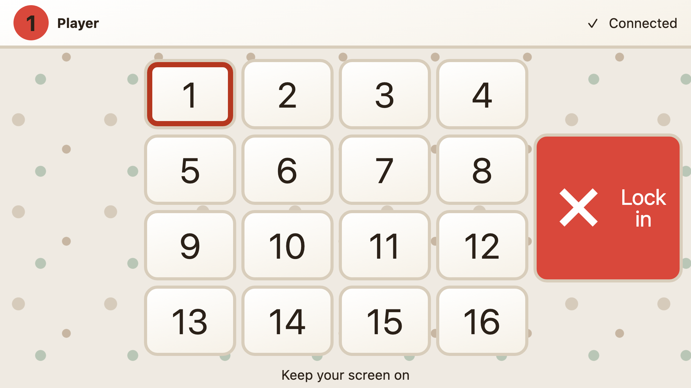

# K-04-layout-engine UAT evidence

Automated execution only. Visual review and acceptance decisions are pending.

Command: `node tools/uat/run.mjs -- K-04-layout-engine --phones 1`
Commit: `ad882cc89046c2e87263ae0782451b663acd562f`
Viewports: 667×375

| Timing | ms | Status |
|---|---:|---|
| stick-faces-667x375 | 496.2 | completed |
| options-667x375 | 256.8 | completed |
| picker-667x375 | 131.0 | failed |

Expected errors (count):
None

## Real server

| Screenshot | What it shows | Looked at by |
|---|---|---|
|  | | |
|  | | |
|  | | |
|  | | |

| Acceptance statement | Pass / fail | Evidence |
|---|---|---|
| | | |

## Integrator's look and probe (2026-11-17)
Still fails "Lock in: one line". The integrator measured the picker at 667 × 375 in Chromium:
the Lock in button is 144 × 144 px, padding 13 + 13, X glyph 55 px, gap 13, so the label gets
44 px; data-label-step is 21 and the span is 44 × 42 (two lines). In round 9 (round9/03) the
same button was about 200 px wide with "Lock in" on one line at 34 px. The measurement is now
right; the button got narrower. The option's width comes from the measured label width, which is
now read at the stepped size, so stepping down narrows the button, which keeps the step down.
Sent back as round 13.
