# K-04-layout-engine UAT evidence

Automated execution only. Visual review and acceptance decisions are pending.

Command: `node tools/uat/run.mjs -- K-04-layout-engine --phones 1`
Commit: `4e9c50e9a7e15a7f74b87506b3e166ffbac8140b`
Viewports: 667×375, 844×390, 932×430

| Timing | ms | Status |
|---|---:|---|
| tabao-667x375 | 618.1 | completed |
| rabakz-667x375 | 176.6 | completed |
| poker-667x375 | 173.2 | completed |
| dpad-only-667x375 | 173.7 | completed |
| text-only-667x375 | 170.8 | completed |
| cards-667x375 | 170.9 | completed |
| every-667x375 | 71.7 | completed |
| tabao-844x390 | 247.2 | completed |
| rabakz-844x390 | 193.1 | completed |
| poker-844x390 | 261.4 | completed |
| dpad-only-844x390 | 190.4 | completed |
| text-only-844x390 | 193.2 | completed |
| cards-844x390 | 193.0 | completed |
| every-844x390 | 122.5 | completed |
| tabao-932x430 | 193.8 | completed |
| rabakz-932x430 | 231.5 | completed |
| poker-932x430 | 194.3 | completed |
| dpad-only-932x430 | 243.6 | completed |
| text-only-932x430 | 245.3 | completed |
| cards-932x430 | 244.2 | completed |
| every-932x430 | 70.4 | completed |
| held face emits press and release with revision | 144.9 | completed |
| stick vector and neutral carry revision | 30.2 | completed |
| removed held control releases at its original revision | 556.7 | completed |
| grid index and Lock in id | 127.7 | completed |
| D-pad direction press and release | 93.1 | completed |
| card id and disabled card | 176.7 | completed |
| answer choice transitions to Watch the TV without a blank frame | 488.2 | completed |
| reduced motion keeps state changes and omits transition animations | 233.3 | completed |

Expected errors (count):
None

## Real server

| Screenshot | What it shows | Looked at by |
|---|---|---|
| 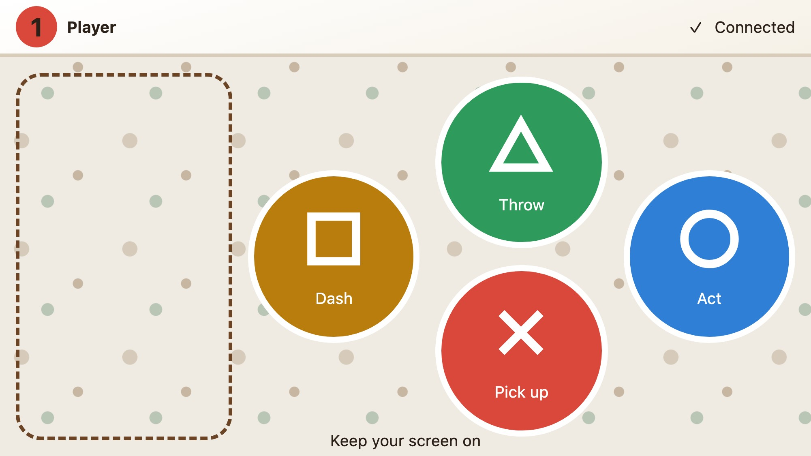 | | |
| 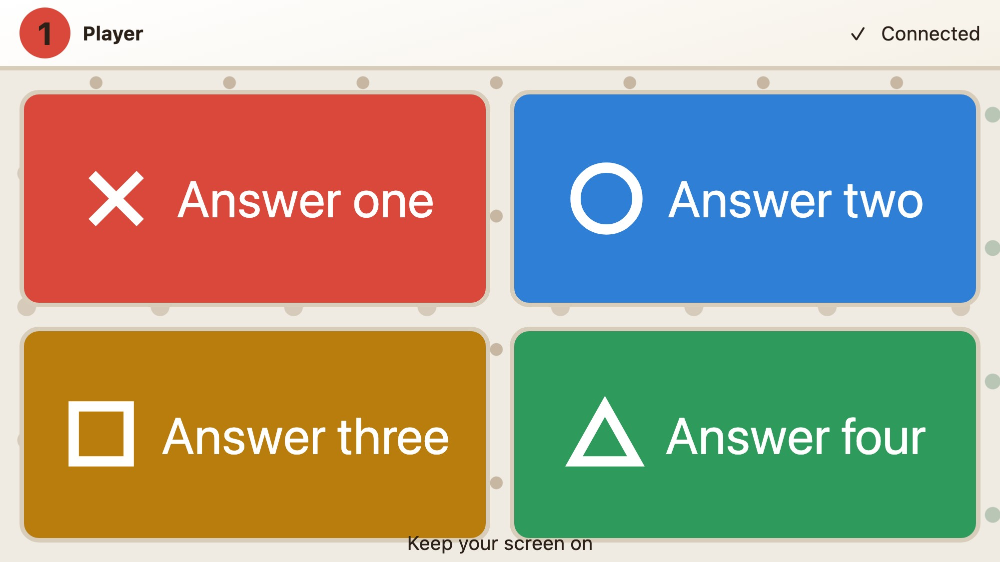 | | |
| 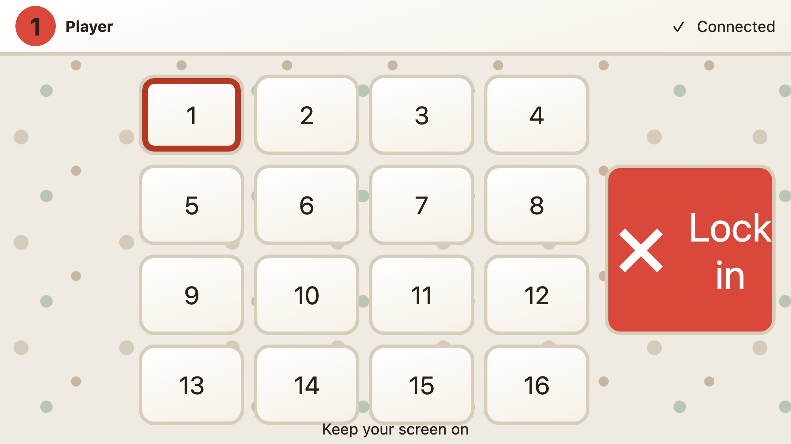 | | |
| 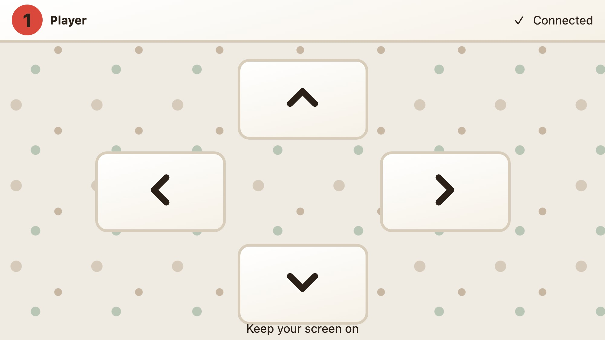 | | |
| 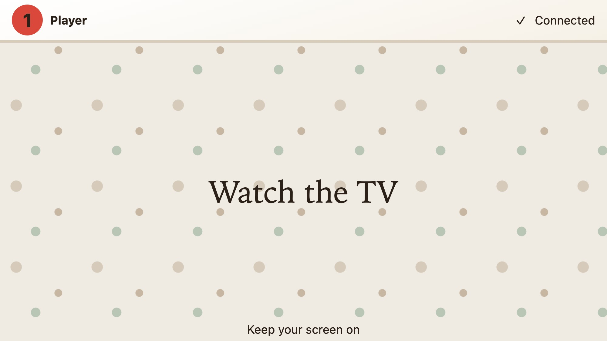 | | |
| 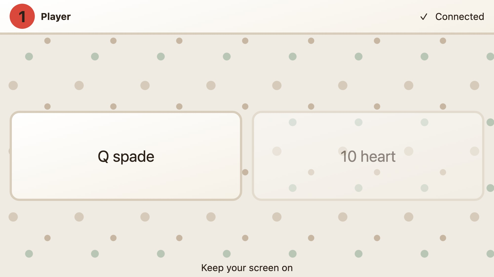 | | |
| 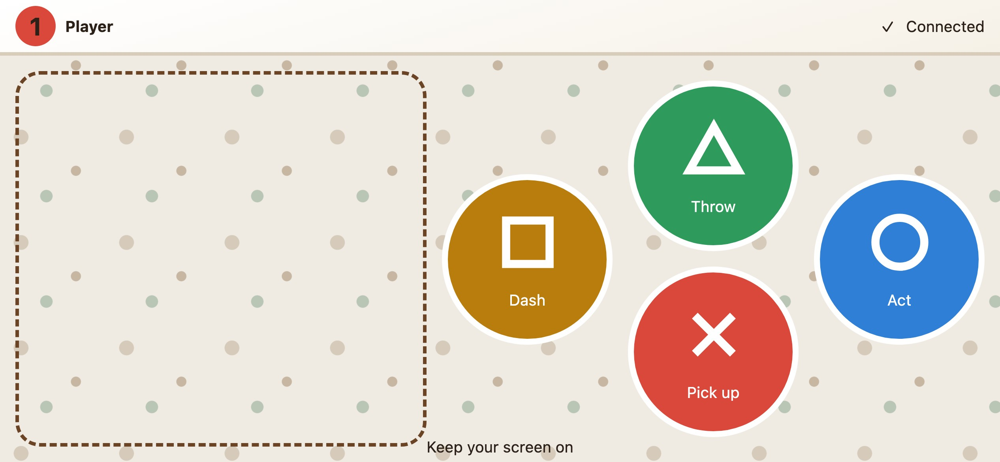 | | |
| 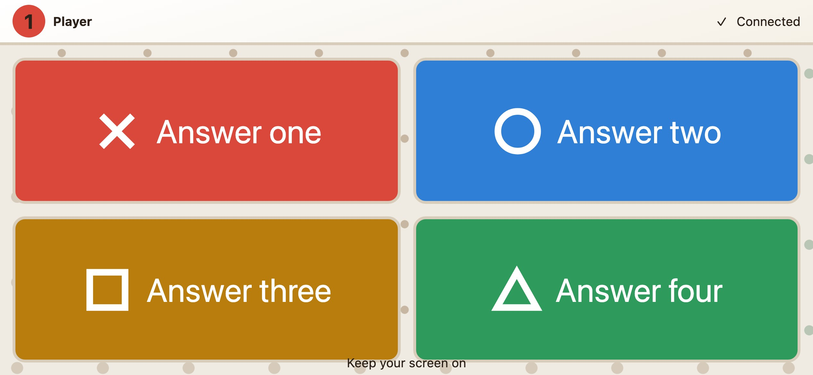 | | |
| 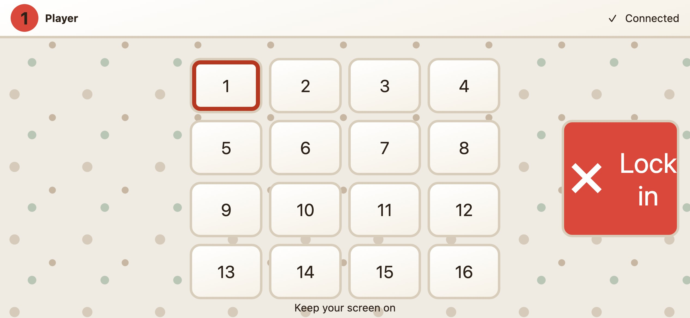 | | |
| 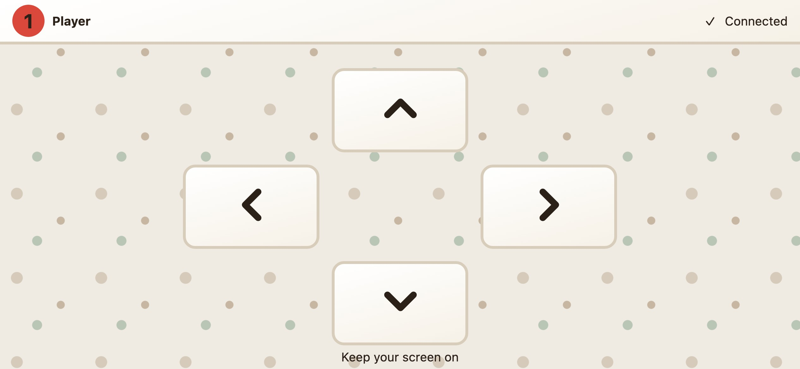 | | |
| 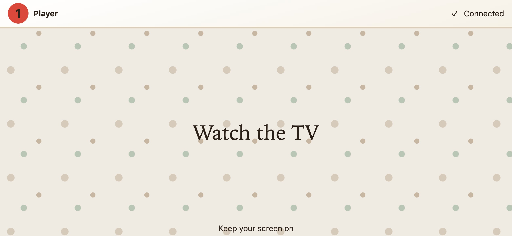 | | |
| 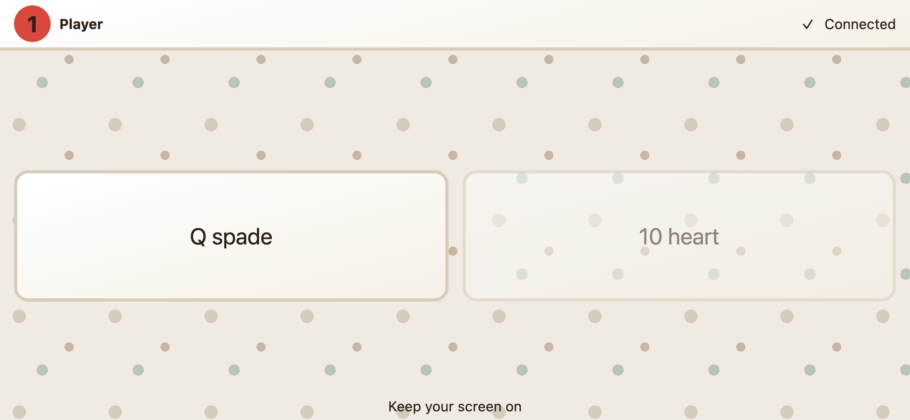 | | |
| 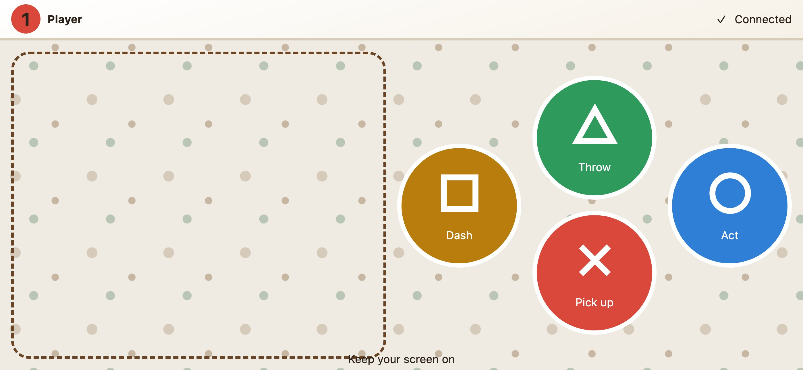 | | |
| 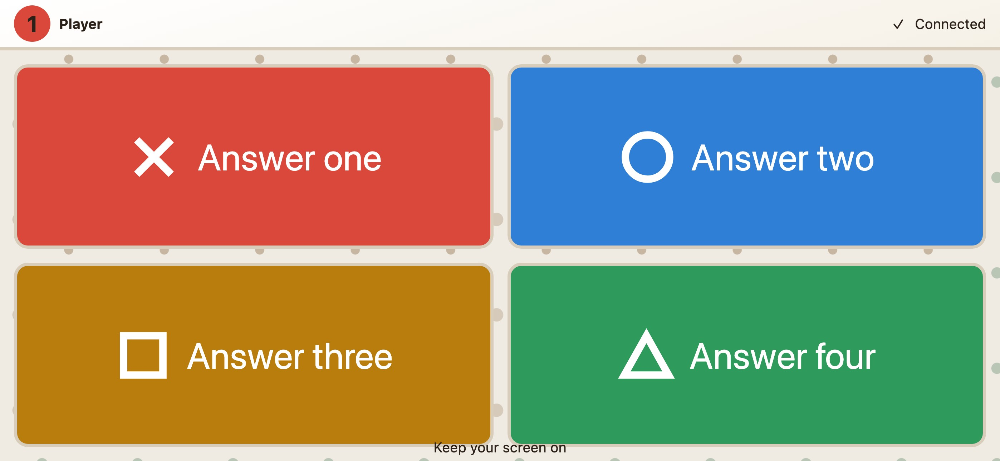 | | |
| 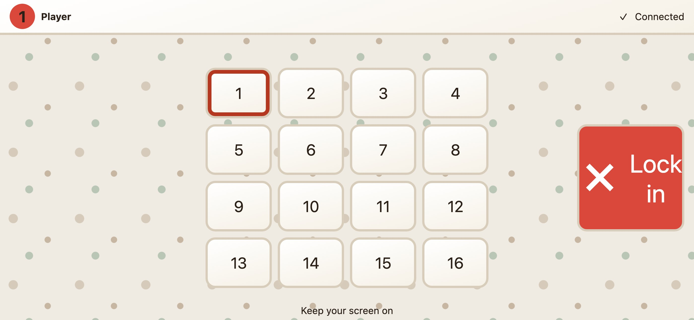 | | |
| 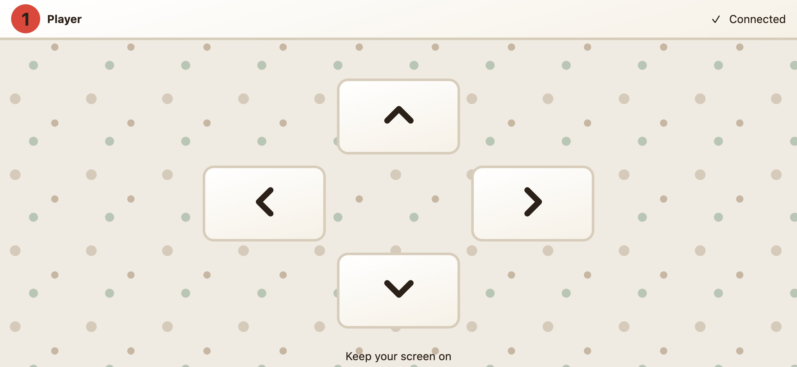 | | |
| 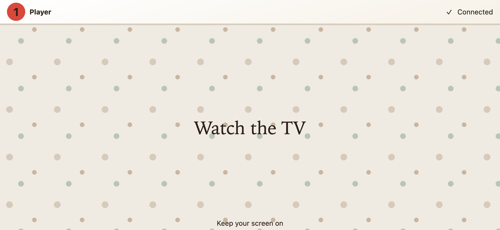 | | |
| 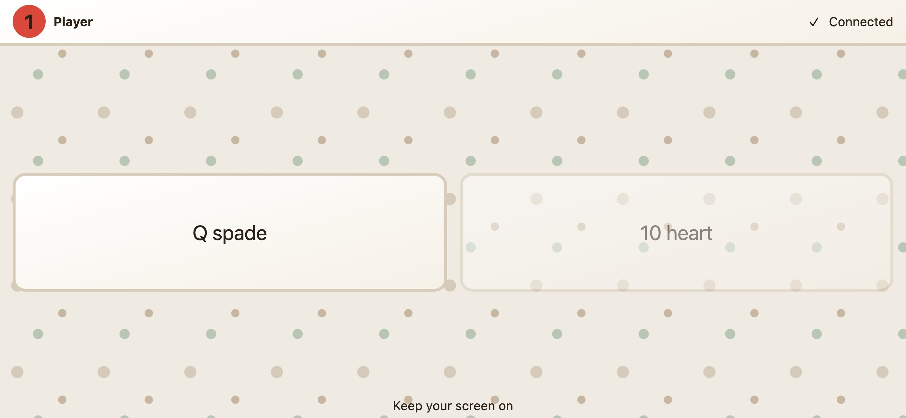 | | |
|  | | |
| 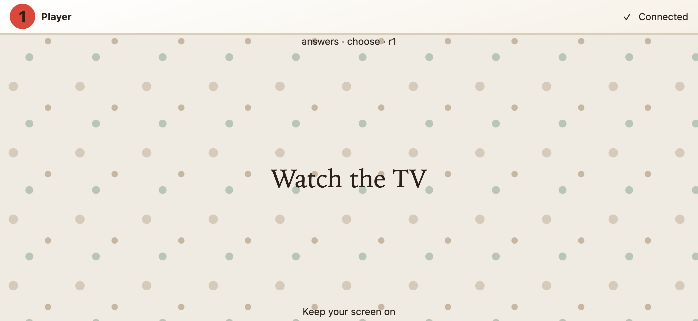 | | |

## Strips

| Screenshot | What it shows | Looked at by |
|---|---|---|
| 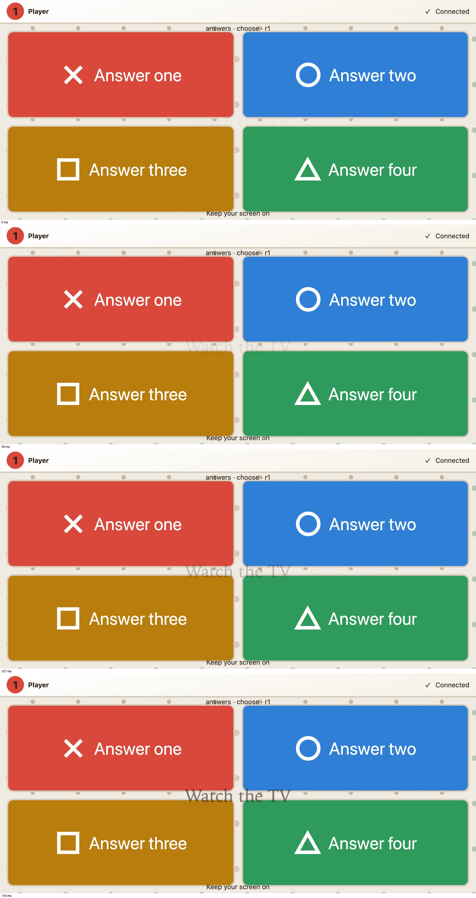 | | |

| Acceptance statement | Pass / fail | Evidence |
|---|---|---|
| | | |

## Integrator's look (2026-11-17)
Run: `pnpm uat -- K-04-layout-engine --phones 1`, exit 0, 29 steps, no process left, after one
integrator change: the `every` stress fixture (every kind at once) is now expected to report
`data-fits="false"` rather than fit; no phone holds it at the floors. Opened k04r2-a.jpg
(tabao, rabakz, poker, dpad-only, text-only, cards at 844; tabao 667; poker 932) and the
answer-transition strip (24) at full size.
Works: placement is applied; Tabao has the stick area on the left and the four faces as a
diamond on the right, all visible; Rabakz options fill the area in the TV's order and shapes
(cross, circle / square, triangle); Poker grid centred with Lock in to its right; D-pad, text
and cards placed and centred.
Faults:
1. "Keep your screen on" overlaps controls: Rabakz 844 (bottom row of answers), Poker 844 and
   932 (bottom grid row). The play area must end above the note.
2. Poker "Lock in" wraps to two lines and the label runs to the button's right edge.
3. Answer → Watch the TV strip: the incoming "Watch the TV" is drawn behind the still-opaque
   answer buttons; the strip (4 frames, 173 ms) stops before the change settles.
4. The demo's debug label "answers · choose · r1" sits over the top edge of the answers.
