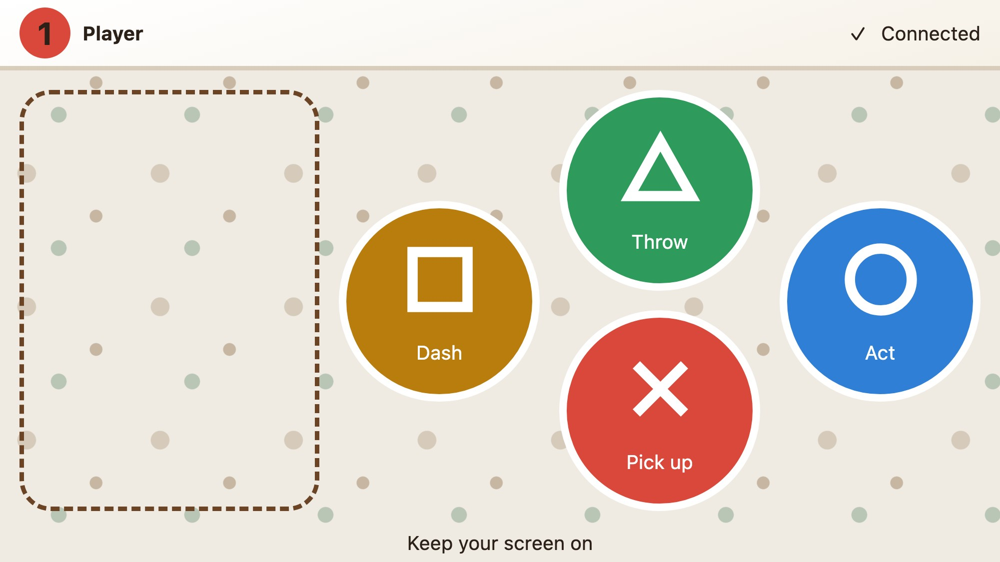
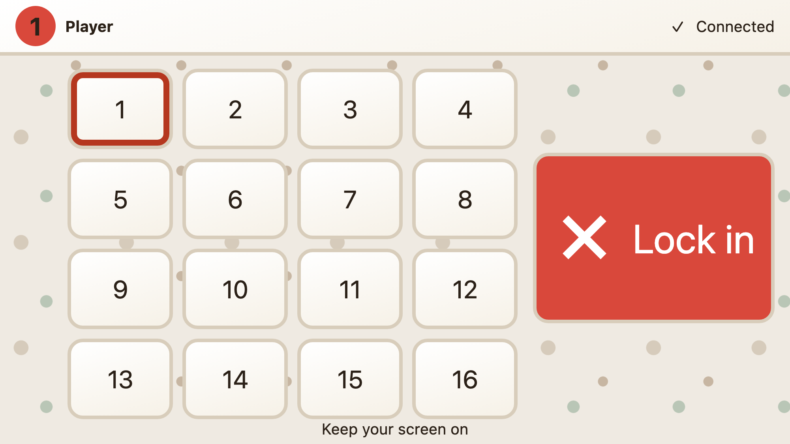

# K-04-layout-engine UAT evidence

Automated execution only. Visual review and acceptance decisions are pending.

Command: `node tools/uat/run.mjs -- K-04-layout-engine --phones 1`
Commit: `037f2189c536a27b18af20dd0187912889a36f4a`
Viewports: 667×375

| Timing | ms | Status |
|---|---:|---|
| tabao-667x375 | 907.4 | completed |
| rabakz-667x375 | 266.6 | completed |
| poker-667x375 | 100.0 | failed |

Expected errors (count):
None

## Real server

| Screenshot | What it shows | Looked at by |
|---|---|---|
|  | | |
|  | | |
|  | | |
|  | | |

| Acceptance statement | Pass / fail | Evidence |
|---|---|---|
| | | |

## Integrator's look (2026-11-17)
Exit 1 at poker-667x375: data-fits false. Opened 04-phone1-failure.png at full size: the grid keeps its 89 x 68 cells and Lock in fits, but only about 8 px above the note, not 13. Ruled D-117 (margin may fall to 8 px where the floors need it).
