# K-04-layout-engine UAT evidence

Automated execution only. Visual review and acceptance decisions are pending.

Command: `node tools/uat/run.mjs -- K-04-layout-engine --phones 1`
Commit: `fa045632a114b76d170f85eb79bcbbd500e8c127`
Viewports: 667×375, 844×390, 932×430

| Timing | ms | Status |
|---|---:|---|
| tabao-667x375 | 356.8 | completed |
| rabakz-667x375 | 174.5 | completed |
| poker-667x375 | 192.3 | completed |
| dpad-only-667x375 | 174.4 | completed |
| text-only-667x375 | 192.3 | completed |
| cards-667x375 | 195.4 | completed |
| every-667x375 | 76.6 | completed |
| tabao-844x390 | 279.3 | completed |
| rabakz-844x390 | 197.1 | completed |
| poker-844x390 | 264.6 | completed |
| dpad-only-844x390 | 207.7 | completed |
| text-only-844x390 | 194.3 | completed |
| cards-844x390 | 193.7 | completed |
| every-844x390 | 81.9 | completed |
| tabao-932x430 | 282.8 | completed |
| rabakz-932x430 | 268.4 | completed |
| poker-932x430 | 269.7 | completed |
| dpad-only-932x430 | 203.4 | completed |
| text-only-932x430 | 267.2 | completed |
| cards-932x430 | 286.1 | completed |
| every-932x430 | 140.6 | completed |
| held face emits press and release with revision | 166.3 | completed |
| stick vector and neutral carry revision | 27.3 | completed |
| removed held control releases at its original revision | 553.3 | completed |
| grid index and Lock in id | 130.1 | completed |
| D-pad direction press and release | 94.7 | completed |
| card id and disabled card | 128.9 | completed |
| answer choice transitions to Watch the TV without a blank frame | 2310.1 | completed |
| reduced motion keeps state changes and omits transition animations | 346.8 | completed |

Expected errors (count):
None

## Real server

| Screenshot | What it shows | Looked at by |
|---|---|---|
| 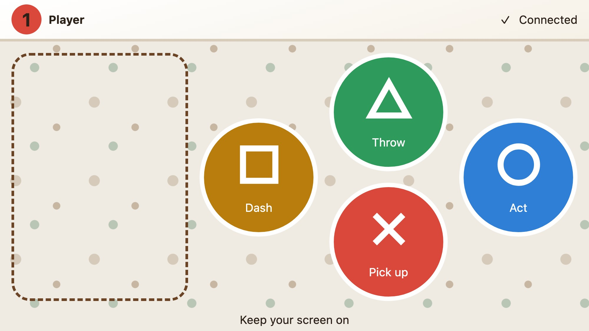 | | |
|  | | |
| 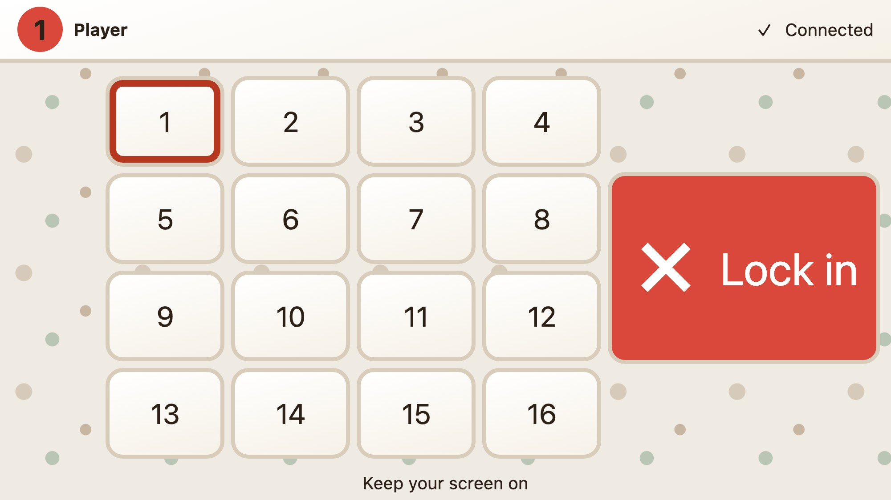 | | |
| 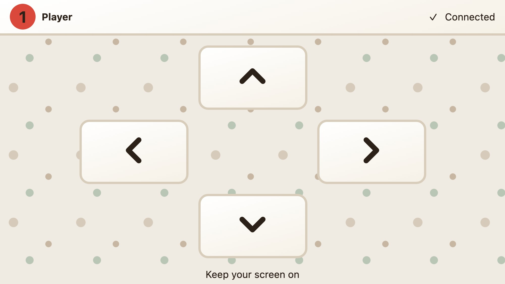 | | |
| 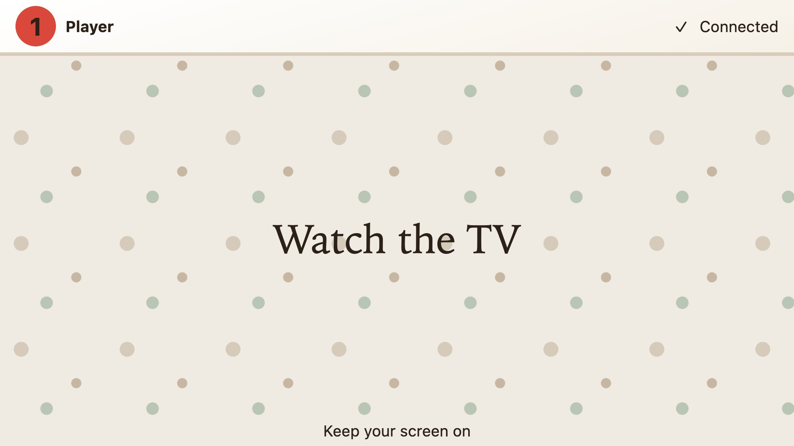 | | |
| 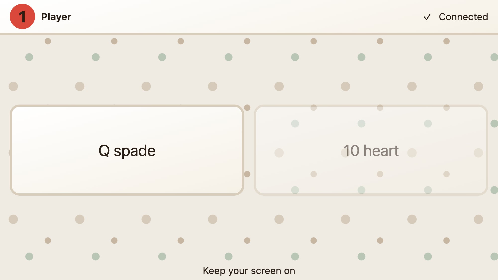 | | |
| 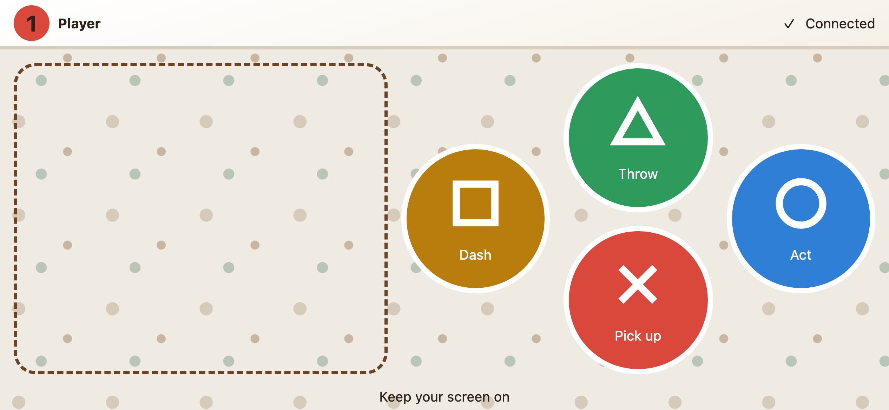 | | |
|  | | |
| 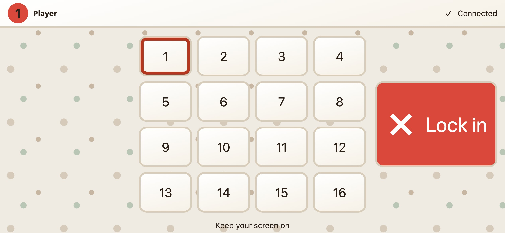 | | |
| 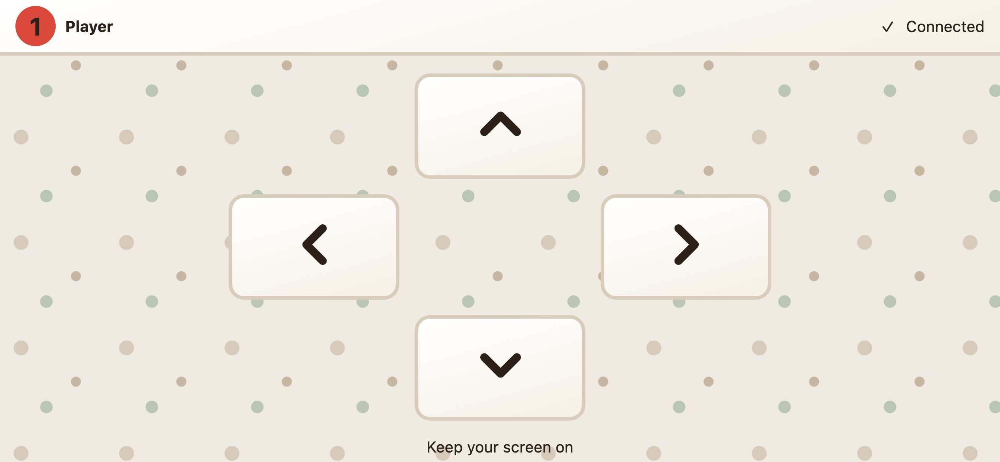 | | |
|  | | |
| 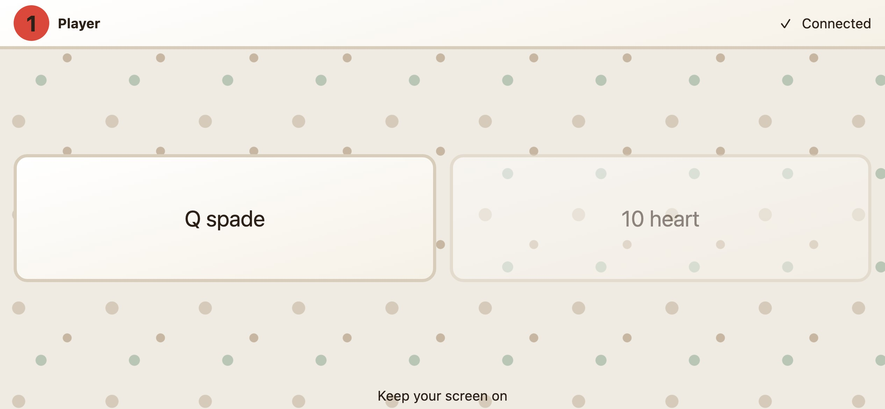 | | |
| 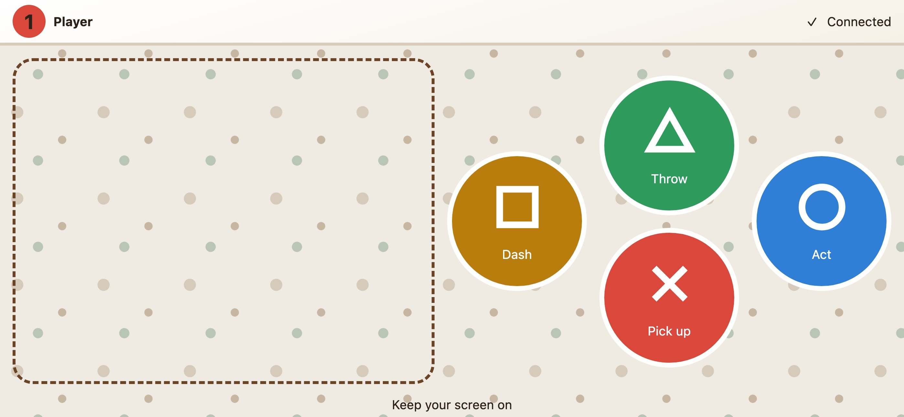 | | |
|  | | |
| 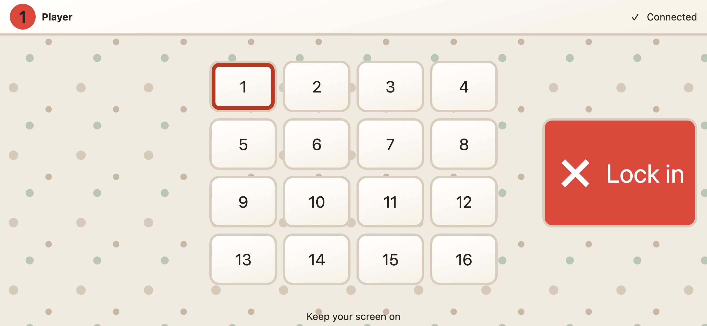 | | |
| 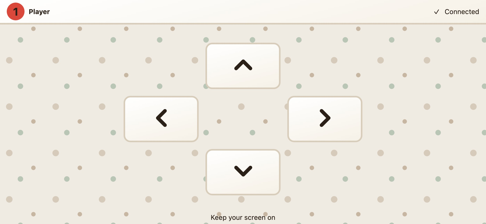 | | |
|  | | |
| 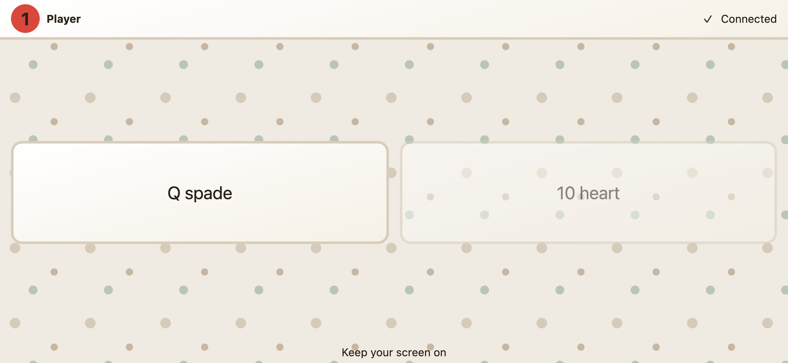 | | |
|  | | |
|  | | |
|  | | |

## Strips

| Screenshot | What it shows | Looked at by |
|---|---|---|
|  | | |
|  | | |

| Acceptance statement | Pass / fail | Evidence |
|---|---|---|
| | | |

## Integrator's look (2026-11-17)
Run: `pnpm uat -- K-04-layout-engine --phones 1`, exit 0, 29 steps, no process left. Opened
k04r5-a.jpg (poker 667 and 844, rabakz 844, tabao 844 and 932, reduced-motion Watch the TV) and
the answer-transition strip (32) in full.
Works: poker fits the 667 × 375 phone with Lock in on one line and clear of the note (D-117,
D-118); larger phones keep full margins; answers in the TV's order fill the area; Tabao's
stick area and face diamond; text centred; reduced motion shows the end state.
Fault: in the strip, "Watch the TV" fades in over the answers, but the answers stay fully
opaque and then vanish in one frame (frames 6 to 7). The 4A token holds the outgoing layer
because the incoming layer is meant to cover it; this incoming layer is transparent, so the
outgoing buttons show through and then cut.
