# K-04-layout-engine UAT evidence

Automated execution only. Visual review and acceptance decisions are pending.

Command: `node tools/uat/run.mjs -- K-04-layout-engine --phones 1`
Commit: `a4a7bbac8bc58ecfaa490b00f1c8337eee73a194`
Viewports: 667×375, 844×390, 932×430

| Timing | ms | Status |
|---|---:|---|
| tabao-667x375 | 1042.9 | completed |
| rabakz-667x375 | 261.3 | completed |
| poker-667x375 | 189.2 | completed |
| dpad-only-667x375 | 189.1 | completed |
| text-only-667x375 | 205.1 | completed |
| cards-667x375 | 188.3 | completed |
| every-667x375 | 121.0 | completed |
| tabao-844x390 | 192.7 | completed |
| rabakz-844x390 | 248.2 | completed |
| poker-844x390 | 260.4 | completed |
| dpad-only-844x390 | 193.7 | completed |
| text-only-844x390 | 241.5 | completed |
| cards-844x390 | 239.7 | completed |
| every-844x390 | 72.8 | completed |
| tabao-932x430 | 211.4 | completed |
| rabakz-932x430 | 245.7 | completed |
| poker-932x430 | 246.5 | completed |
| dpad-only-932x430 | 194.9 | completed |
| text-only-932x430 | 244.7 | completed |
| cards-932x430 | 247.8 | completed |
| every-932x430 | 74.6 | completed |
| held face emits press and release with revision | 163.2 | completed |
| stick vector and neutral carry revision | 28.9 | completed |
| removed held control releases at its original revision | 555.7 | completed |
| grid index and Lock in id | 178.6 | completed |
| D-pad direction press and release | 141.4 | completed |
| card id and disabled card | 127.2 | completed |
| answer choice transitions to Watch the TV without a blank frame | 2710.4 | completed |
| reduced motion keeps state changes and omits transition animations | 352.3 | completed |

Expected errors (count):
None

## Real server

| Screenshot | What it shows | Looked at by |
|---|---|---|
| 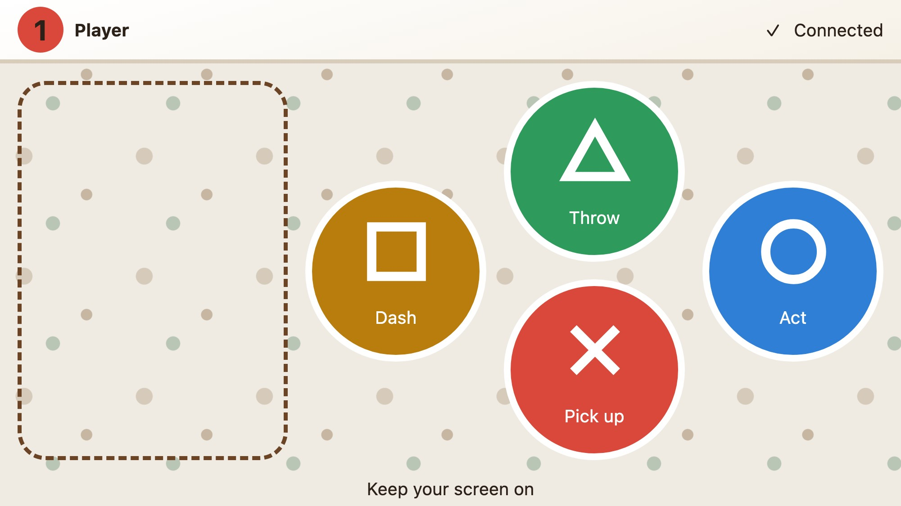 | | |
| 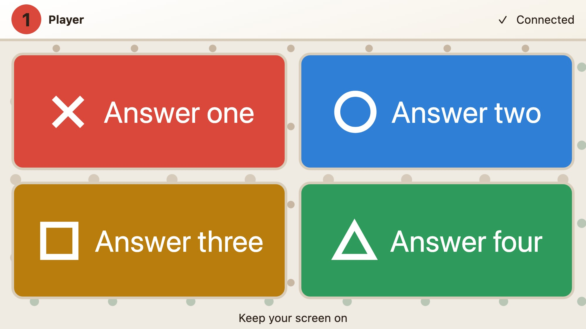 | | |
| 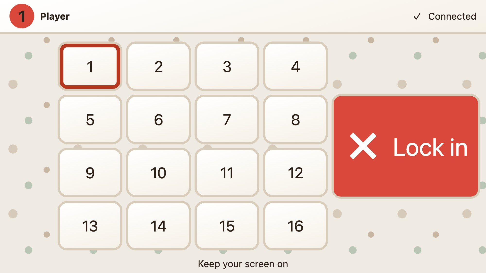 | | |
| 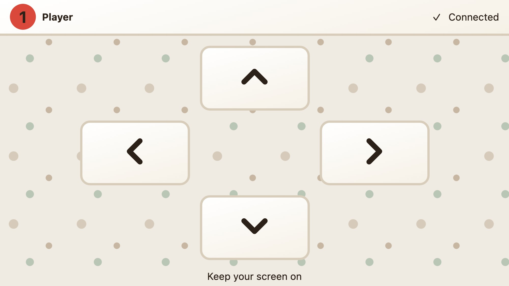 | | |
|  | | |
| 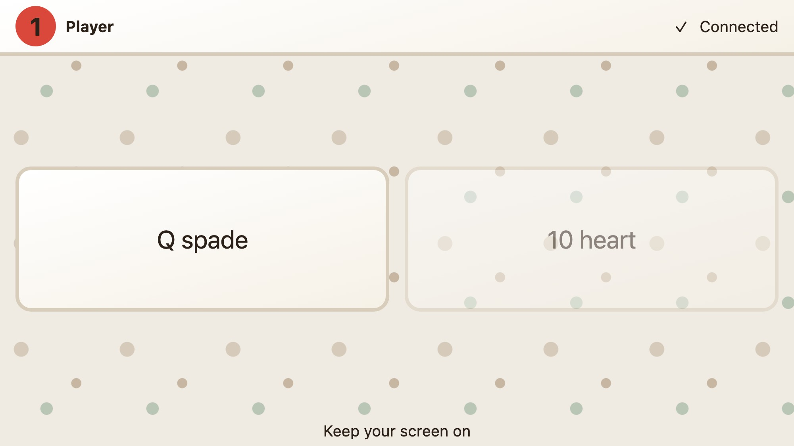 | | |
| 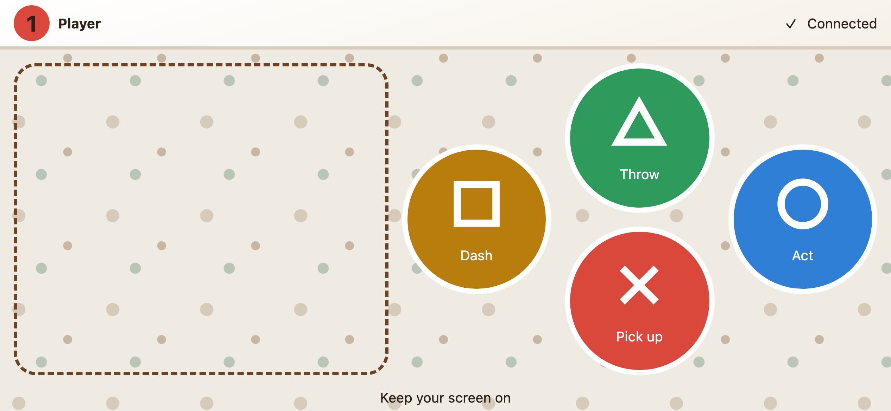 | | |
| 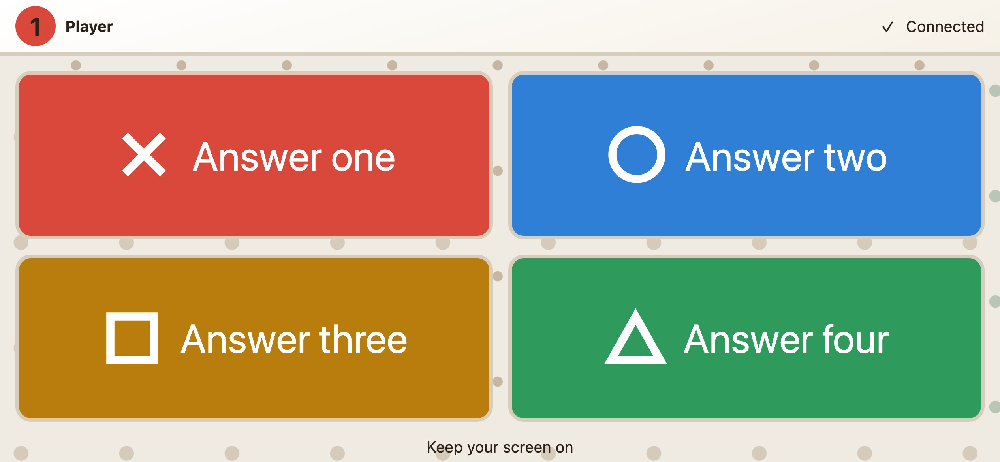 | | |
| 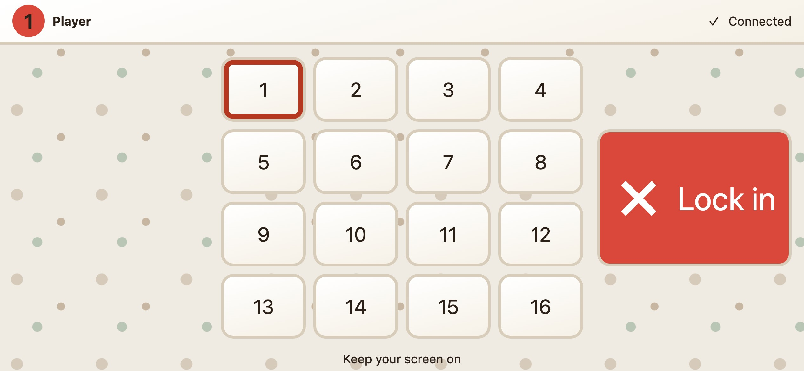 | | |
| 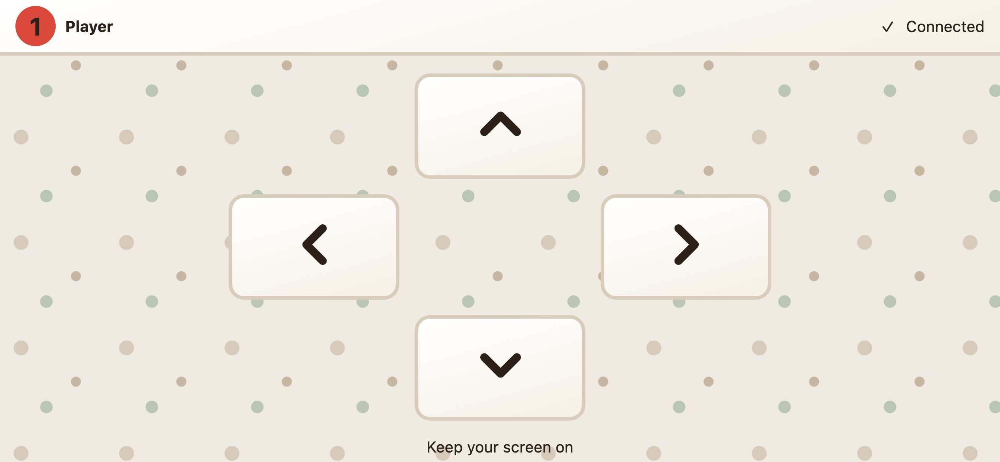 | | |
|  | | |
| 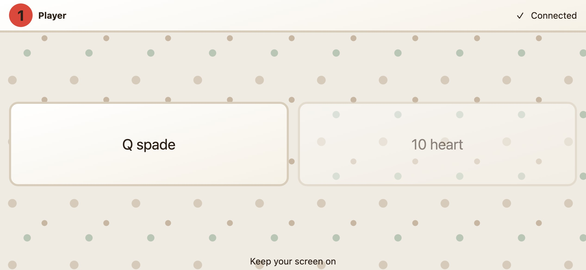 | | |
| 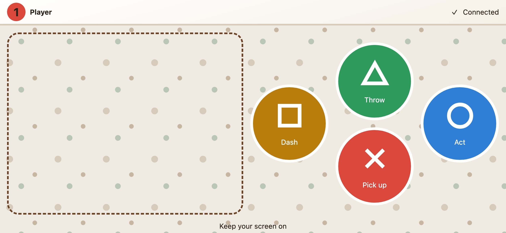 | | |
|  | | |
| 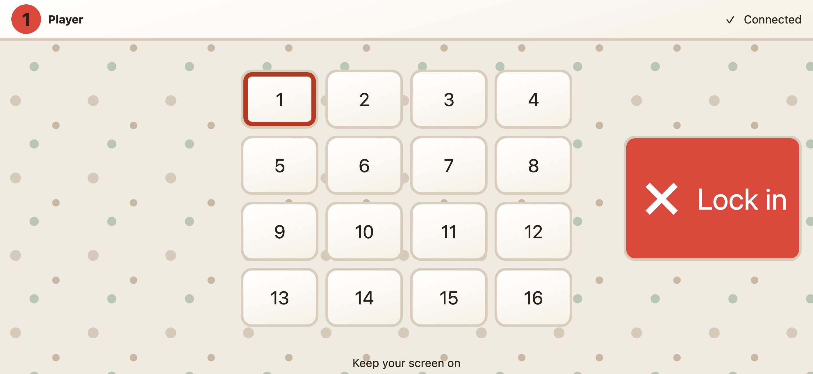 | | |
| 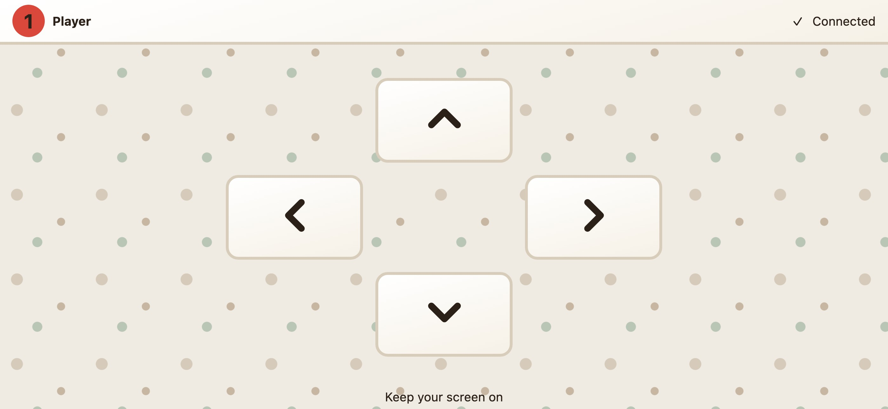 | | |
|  | | |
| 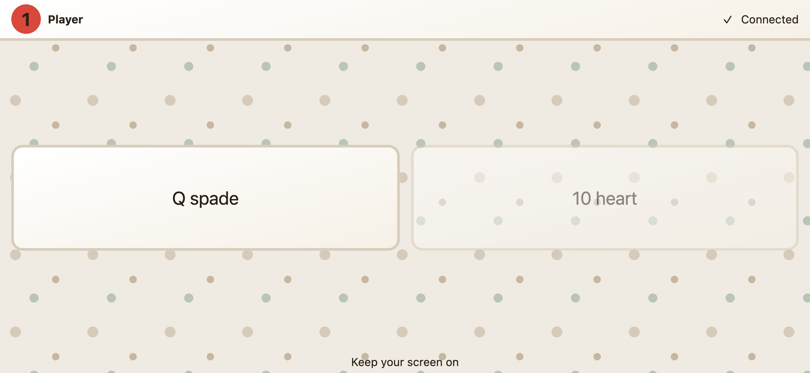 | | |
|  | | |
|  | | |
|  | | |

## Strips

| Screenshot | What it shows | Looked at by |
|---|---|---|
|  | | |
|  | | |

| Acceptance statement | Pass / fail | Evidence |
|---|---|---|
| | | |

## Integrator's look (2026-11-17)
Run: `pnpm uat -- K-04-layout-engine --phones 1`, exit 0, 29 steps, no process left. Opened the
answer-transition strip in full: the answers fade progressively over frames 2 to 5 while
"Watch the TV" comes in above them on the play surface; no cut, no see-through blank frame;
settled from frame 6. Layout stills are unchanged from round 5 (looked at there).
