# K-05-private-panel UAT evidence

Automated execution only. Visual review and acceptance decisions are pending.

Command: `node tools/uat/run.mjs -- K-05-private-panel --phones 1`
Commit: `c09b3054a2bcd3bb76bf4c93f0583798db7dc70c`
Viewports: 667×375, 844×390, 932×430, 1920×1080

| Timing | ms | Status |
|---|---:|---|
| text-667 | 743.9 | completed |
| cards-667 | 231.4 | completed |
| stats-667 | 272.1 | completed |
| grid-667 | 206.9 | completed |
| empty-667 | 206.7 | completed |
| picker-667 | 220.9 | completed |
| text-844 | 277.2 | completed |
| cards-844 | 212.0 | completed |
| stats-844 | 279.6 | completed |
| grid-844 | 262.2 | completed |
| empty-844 | 261.4 | completed |
| picker-844 | 264.5 | completed |
| text-932 | 298.9 | completed |
| cards-932 | 289.1 | completed |
| stats-932 | 301.5 | completed |
| grid-932 | 257.3 | completed |
| empty-932 | 233.5 | completed |
| picker-932 | 252.5 | completed |

Expected errors (count):
None

## Real server

| Screenshot | What it shows | Looked at by |
|---|---|---|
| 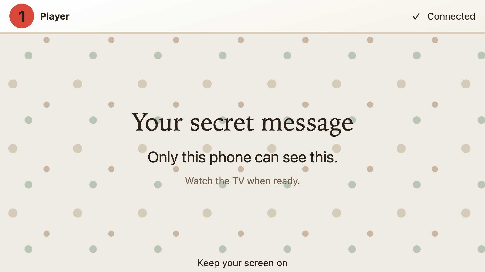 | | |
| 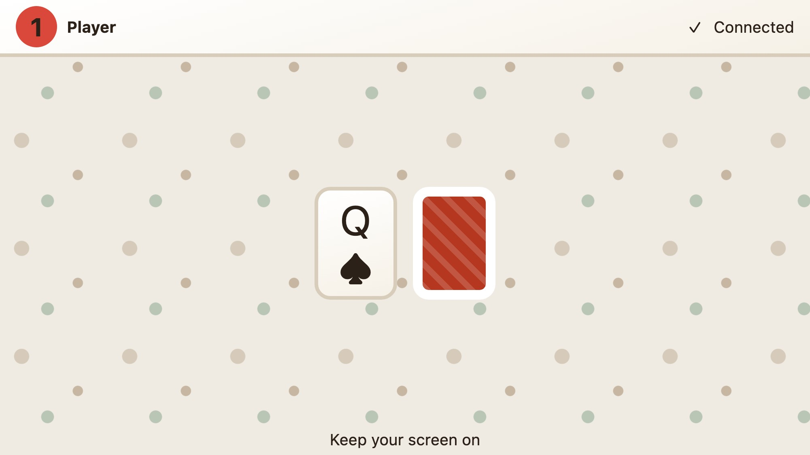 | | |
| 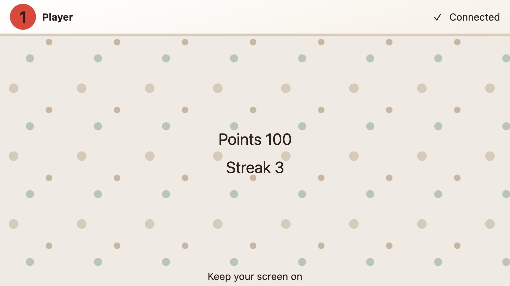 | | |
|  | | |
|  | | |
| 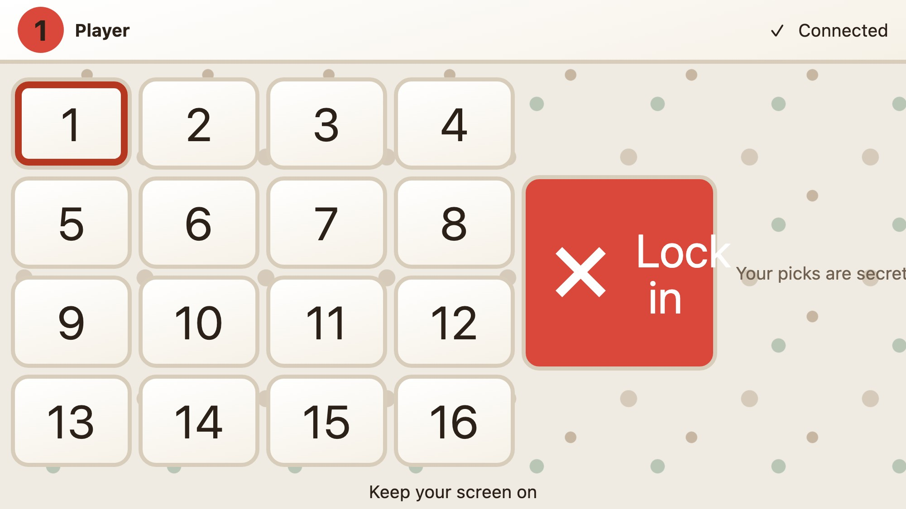 | | |
| 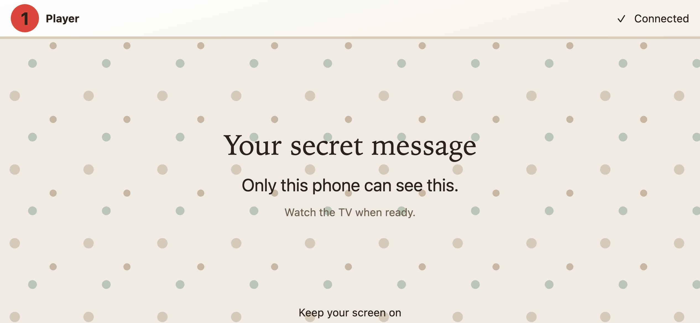 | | |
| 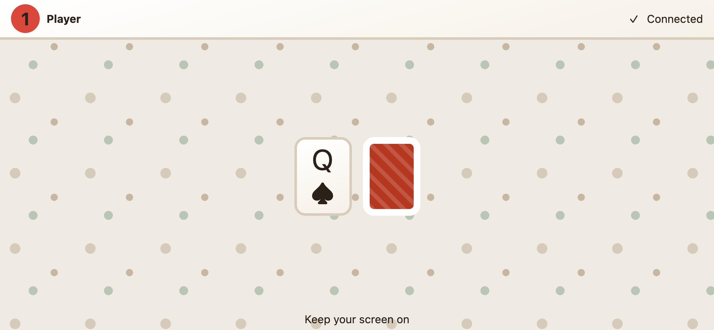 | | |
| 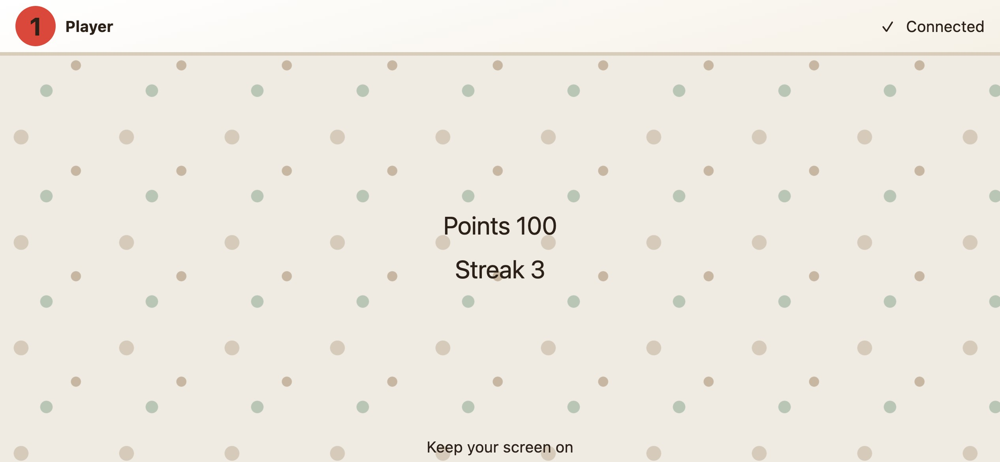 | | |
| 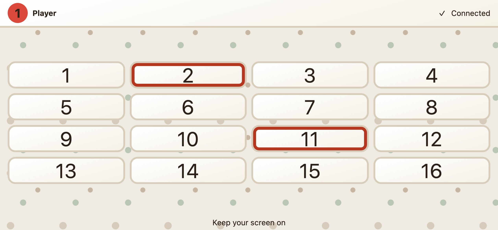 | | |
|  | | |
| 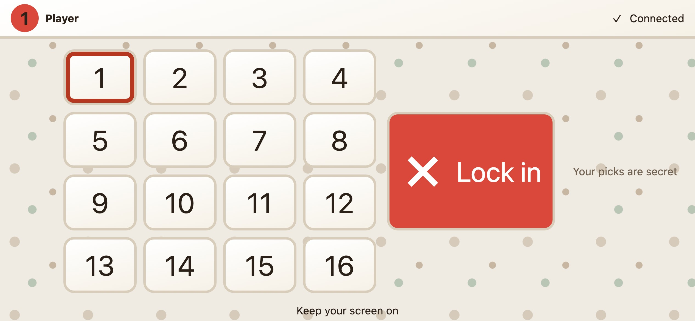 | | |
| 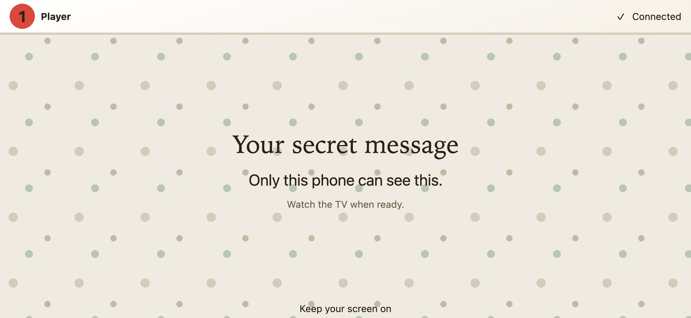 | | |
| 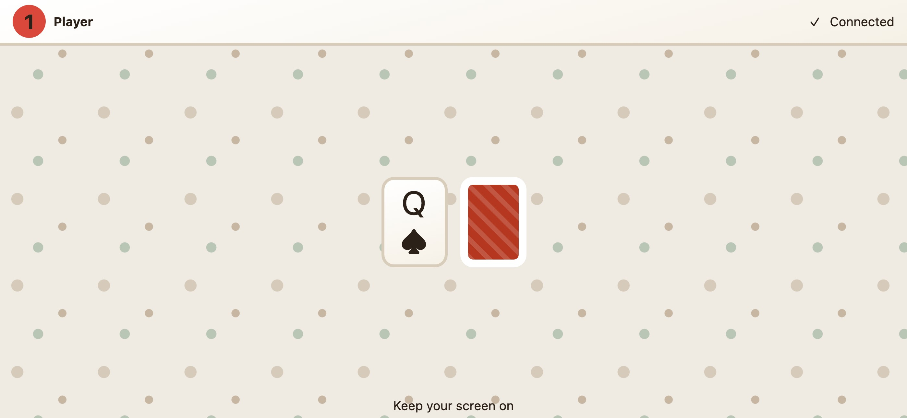 | | |
| 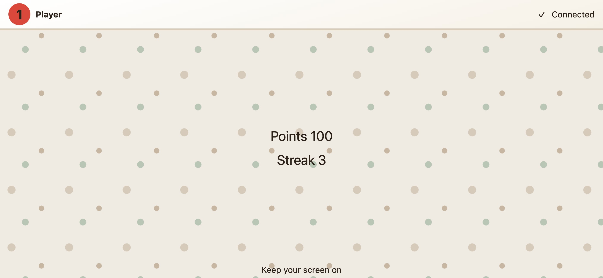 | | |
| 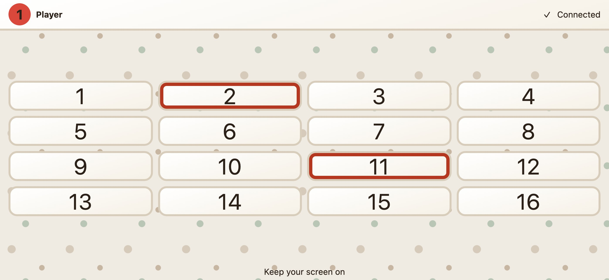 | | |
|  | | |
| 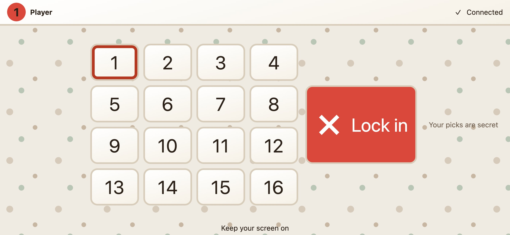 | | |
| 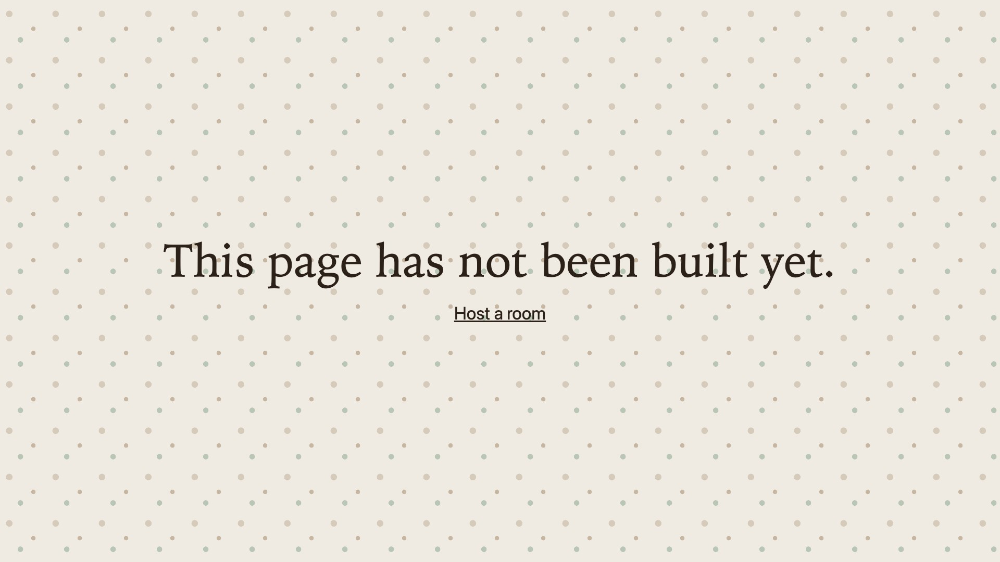 | | |

## Strips

| Screenshot | What it shows | Looked at by |
|---|---|---|
|  | | |

| Acceptance statement | Pass / fail | Evidence |
|---|---|---|
| | | |

## Integrator's look (2026-11-17) — not accepted
Run: `pnpm uat -- K-05-private-panel --phones 1`, exit 0, no process left. Opened k05r1-a.jpg
(shots 01, 02, 03, 04, 06, 08, 12, 32). The script passes, but:
- 06 picker plus panel at 667: "Lock in" wraps to two lines and touches its button edge, and the
  panel note "Your picks are secret" is cut by the screen's right edge. The engine reports
  fits=false and still draws it clipped.
- 02, 08 private cards: about 50 px wide in an almost empty play area; they should grow like
  K-04's cards.
- 03 stats: small plain text in a large empty area.
- 32 the host check shows "This page has not been built yet", not the real host page, so it
  proves nothing about private content.
- 01 text, 04 look-only grid and 12 picker plus panel at 844 look right.
Sent back as round 2 under D-132.
