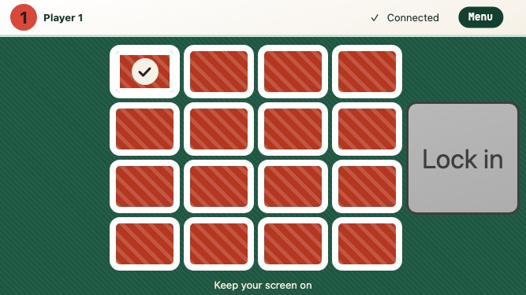
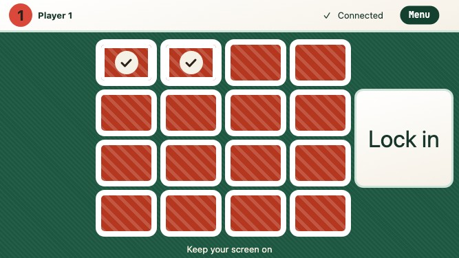
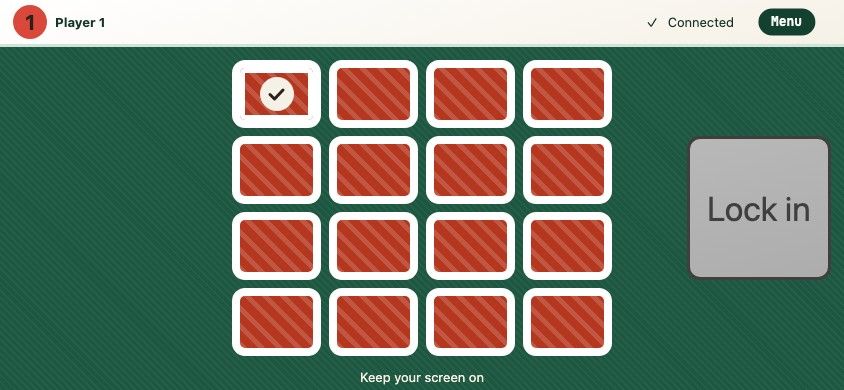
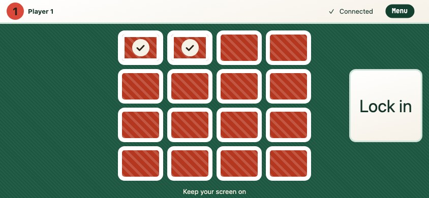

# K-10-selected-card UAT evidence

Host browser: chromium 156.0.8078.4
Phone browser: chromium (legacy iPhone emulation) 156.0.8078.4

Automated execution passed at 48e06d42; the integrator and the reviewer looked at every still on 2026-11-19.

Command: `node tools/uat/run.mjs -- K-10-selected-card --phones 2 --max-mb 12 --timeout-min 10 --out round1`
Commit: `48e06d42aad6b35eda7f713cca70f47de31d76a2`
Viewports: 667×375, 844×390

| Timing | ms | Status |
|---|---:|---|
| Create room through host page | 2351.4 | completed |
| Room created and two phones seated through real pairing | 3299.1 | completed |
| PP-005: start Peek Poker and reach the private pick phase | 4581.6 | completed |
| PP-005: 667 × 375, 1 selected | 406.1 | completed |
| PP-005: 667 × 375, 2 selected | 250.4 | completed |
| PP-005: 844 × 390, 1 selected | 265.3 | completed |
| PP-005: 844 × 390, 2 selected | 234.8 | completed |

Expected errors (count):
None

## Real server

| Screenshot | What it shows | Looked at by |
|---|---|---|
|  | 667 × 375, Card 1 picked: centred cream 34 px disc with dark 21 px tick on the red back, white inset frame kept; 15 plain backs; Lock in disabled | Claude (integrator) and Claude reviewer, 2026-11-19 |
|  | 667 × 375, Cards 1 and 2 picked: both ticked, others plain; Lock in enabled | Claude (integrator) and Claude reviewer, 2026-11-19 |
|  | 844 × 390, as 01 | Claude (integrator) and Claude reviewer, 2026-11-19 |
|  | 844 × 390, as 02 | Claude (integrator) and Claude reviewer, 2026-11-19 |

| Acceptance statement | Pass / fail | Evidence |
|---|---|---|
| Selected backs keep the frame and red and show a centred tick | Pass | 01–04 |
| No rank, suit or position is drawn | Pass | 01–04; empty text asserted |
| Card size unchanged | Pass | DOM bounding box |
| Fades in from 0.95 over fast; exit 115 ms; reduced motion has no transition | Pass | DOM test |
| Disc contrast at least 5.1 : 1 on the base colour (about 4 : 1 over the lighter stripes) | Pass | DOM test; 5.28 : 1 (D-269) |
| Phone 2 shows no pick | Pass (assertion only, no still) | UAT assertion |
