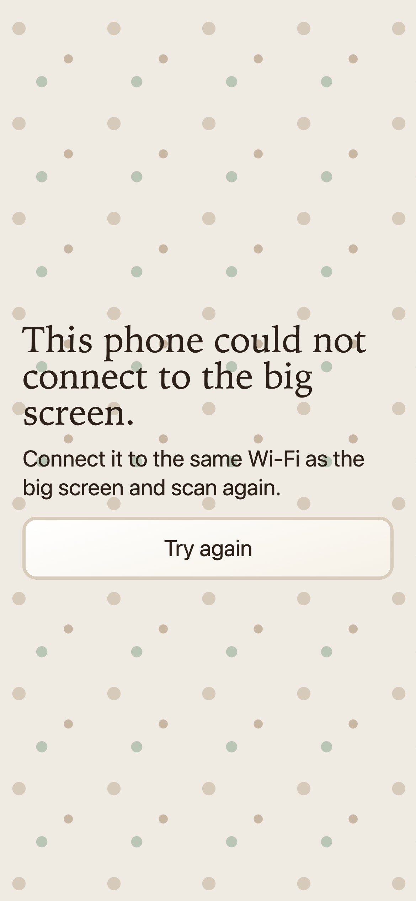
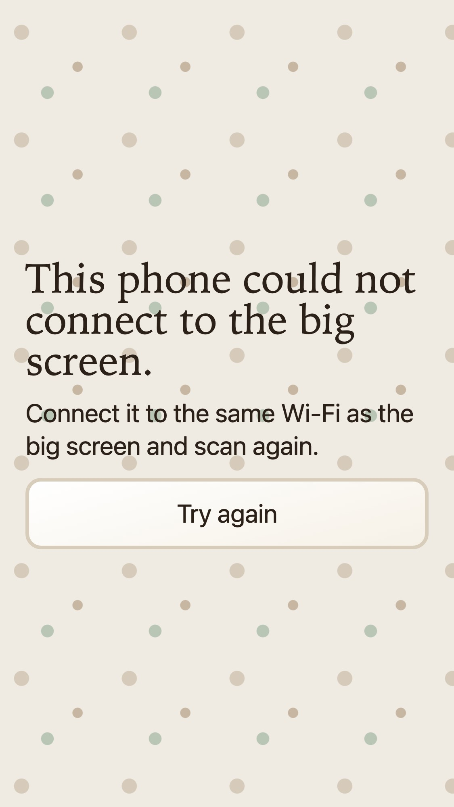
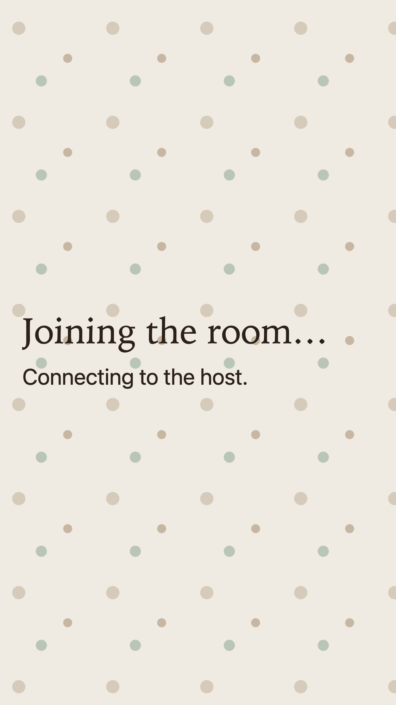

# K-11-could-not-connect UAT evidence

Host browser: chromium 156.0.8078.4
Phone browser: chromium (legacy iPhone emulation) 156.0.8078.4

Automated execution passed; the integrator and the reviewer looked at every still on 2026-11-19.

Command: `node tools/uat/run.mjs -- K-11-could-not-connect --phones 1 --out round1`
Commit: `1269e2e01eabcc47f432a1f8e3224caa21d37ced`
Viewports: 390×844, 375×667

| Timing | ms | Status |
|---|---:|---|
| Create room through host page | 1092.1 | completed |
| Join a room whose host has closed | 15610.7 | completed |
| Settled timeout at 390 | 153.9 | completed |
| Settled timeout at 375 | 109.5 | completed |
| Try again returns to connecting for the same room | 564.7 | completed |

Expected errors (count):
None

## Real server

| Screenshot | What it shows | Looked at by |
|---|---|---|
|  | 390 × 844: the advice heading and detail word for word, Try again about 58 px tall, no scroll | Claude (integrator) and Claude reviewer, 2026-11-19 |
|  | 375 × 667: the same; the button ends at about y 453, no scroll | Claude (integrator) and Claude reviewer, 2026-11-19 |
|  | After Try again: "Joining the room… / Connecting to the host." on the same link | Claude (integrator) and Claude reviewer, 2026-11-19 |

| Acceptance statement | Pass / fail | Evidence |
|---|---|---|
| Advice at 15 s with the exact D-250 copy | Pass | 01, 02; `phone.test.ts` |
| Try again returns to connecting for the same room | Pass | 03 |
| Button at least 55 px, no scroll at both sizes | Pass | UAT asserts; 01, 02 |
| Late seat continues; old attempt closed; timer cancelled on exit; advice kept past the 120 s hold window | Pass (unit tests only, no picture) | `phone.test.ts` REL-006 block |
