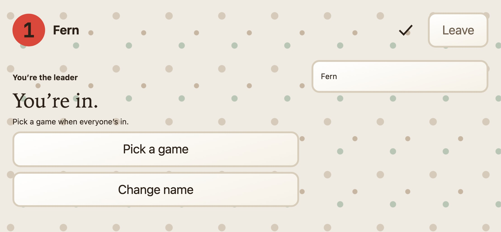
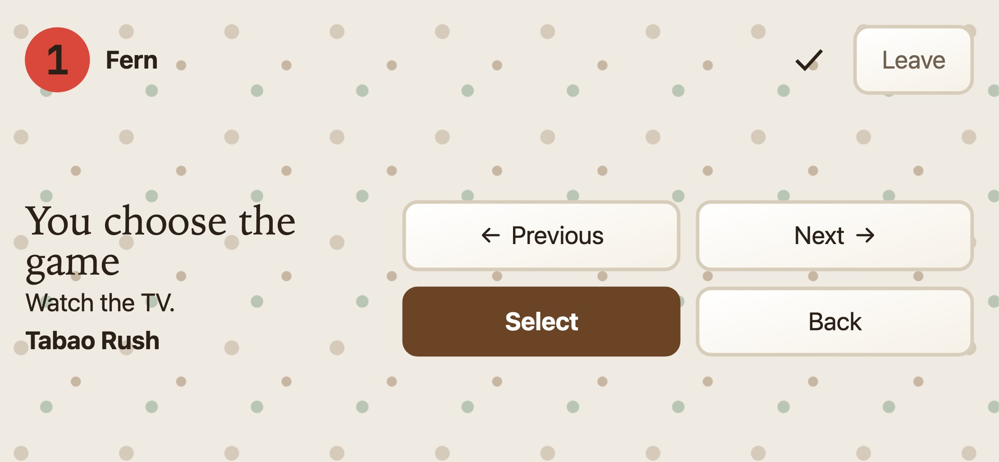
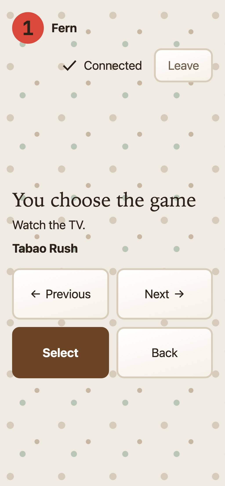

# K-12-fullscreen UAT evidence

Host browser: chromium 156.0.8078.4
Phone browser: chromium 156.0.8078.4

Automated execution only. Visual review and acceptance decisions are pending.

Command: `node tools/uat/run.mjs -- K-12-fullscreen --phones 1 --phone-browser chromium --out round4`
Commit: `2c5a3096f563a35bf2d1c0c5af71fa164ce3dad2`
Viewports: 844×390, 390×844

| Timing | ms | Status |
|---|---:|---|
| Create room through host page | 912.5 | completed |
| First landscape touch reaches the host once and enters fullscreen | 6734.1 | completed |
| Portrait leaves fullscreen | 180.2 | completed |

Expected errors (count):
None

## Real server

| Screenshot | What it shows | Looked at by |
|---|---|---|
|  | | |
|  | | |
|  | | |

| Acceptance statement | Pass / fail | Evidence |
|---|---|---|
| | | |

## Visual review (round 4, commit 2c5a3096 with the fullscreen latch)

| Screenshot | What it shows | Looked at by |
|---|---|---|
| 01-phone1-before-tap.jpg | Landscape 844 × 390: Fern, seat 1, leader, "You're in." with Pick a game and Change name; dot treatment only. Seated, the precondition for the request. | Claude (integrator) |
| 02-phone1-after-tap.jpg | Landscape after one raw CDP touch on Pick a game: the picker (Previous, Next, Select, Back). The touch reached the host once (`data-fullscreen-open-inputs` = 1); fullscreen rests on the `document.fullscreenElement` assertion, which a still cannot show. | Claude (integrator) |
| 03-phone1-portrait.jpg | Portrait 390 × 844 after leaving fullscreen: the picker in one column, 2 × 2 buttons, "Connected" beside Leave; nothing clipped. | Claude (integrator) |

The landing page has none of the three install tags and `/manifest.webmanifest` is served with `display: fullscreen`, `orientation: landscape`, `start_url: /play` (script assertions). Controller start-up (PERF-020): median 175.5 ms against 2,000 ms, production build, CPU ×4, `uat/evidence/controller/perf-1/startup.json`. Real Android and iPhone checks remain (S-05).
