# P-03-phone-pick UAT evidence

Visual review done 2026-11-18 by the integrator and the Claude reviewer.

Command: `node tools/uat/run.mjs -- P-03-phone-pick --phones 1 --out round1-p1`
Commit: `95bb03d28f6746bbf471c7c7015de1e3bd4b8b7c`
Viewports: 667×375, 844×390, 1920×1080

| Timing | ms | Status |
|---|---:|---|
| Create room through host page | 1198.0 | completed |
| Phone memorise, pick, lock and reveal | 20783.4 | completed |
| Random fill and finish the real match | 117012.5 | completed |

Expected errors (count):
None

## Real server

| Screenshot | What it shows | Looked at by |
|---|---|---|
| 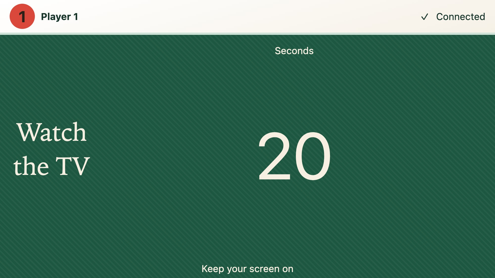 | Phone reads Watch the TV with the seconds left while the grid is memorised; no cards on the phone (667 × 375) | Integrator and Claude reviewer, 2026-11-18 |
| 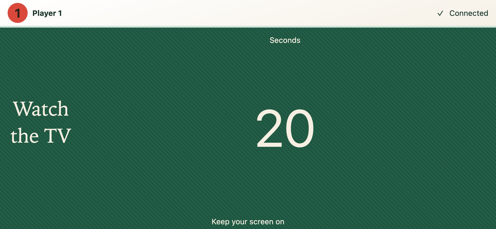 | Phone reads Watch the TV with the seconds left while the grid is memorised; no cards on the phone (844 × 390) | Integrator and Claude reviewer, 2026-11-18 |
| 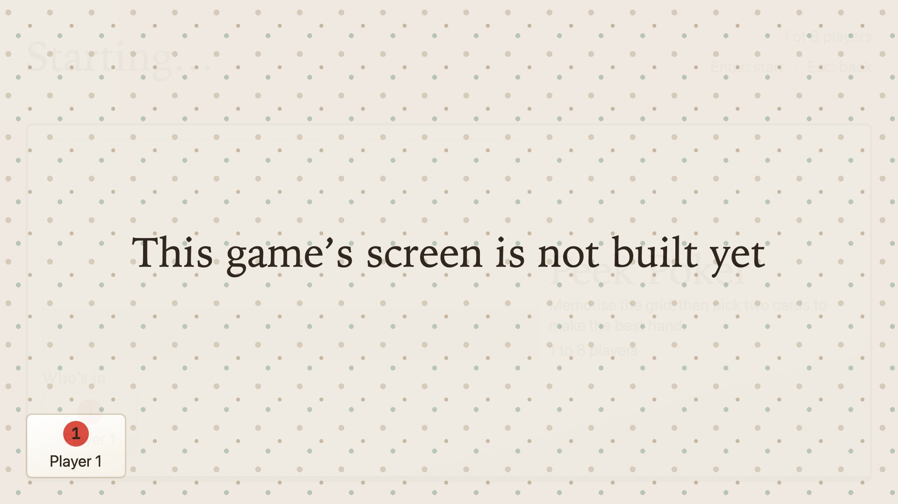 | TV: the "not built yet" placeholder, captured while its fade had not settled (marked UNSETTLED by the harness); not evidence for the TV half, which comes with P-06/P-07 | Integrator and Claude reviewer, 2026-11-18 |
| 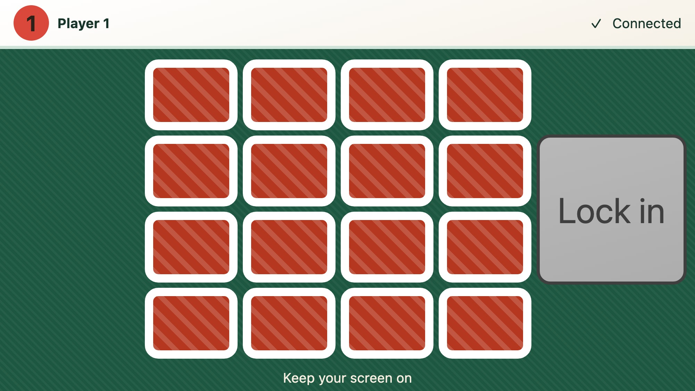 | Private face-down 4 × 4 tap grid, no picks yet; Lock in 144 × 144 without a shape, disabled (667 × 375) | Integrator and Claude reviewer, 2026-11-18 |
| 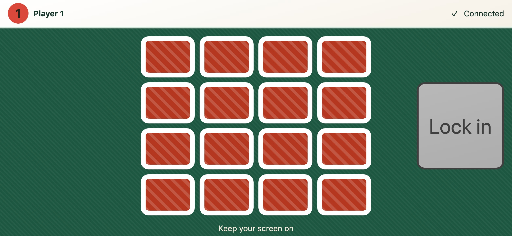 | Private face-down 4 × 4 tap grid, no picks yet; Lock in 144 × 144 without a shape, disabled (844 × 390) | Integrator and Claude reviewer, 2026-11-18 |
|  | TV: the "not built yet" placeholder, captured while its fade had not settled (marked UNSETTLED by the harness); not evidence for the TV half, which comes with P-06/P-07 | Integrator and Claude reviewer, 2026-11-18 |
| 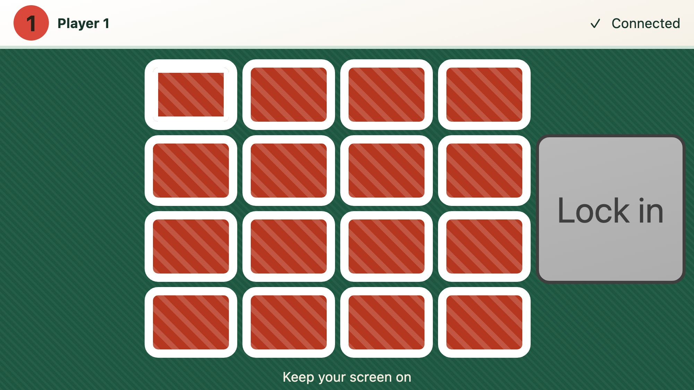 | One card picked (thicker white frame); Lock in still waiting for a second pick (667 × 375) | Integrator and Claude reviewer, 2026-11-18 |
| 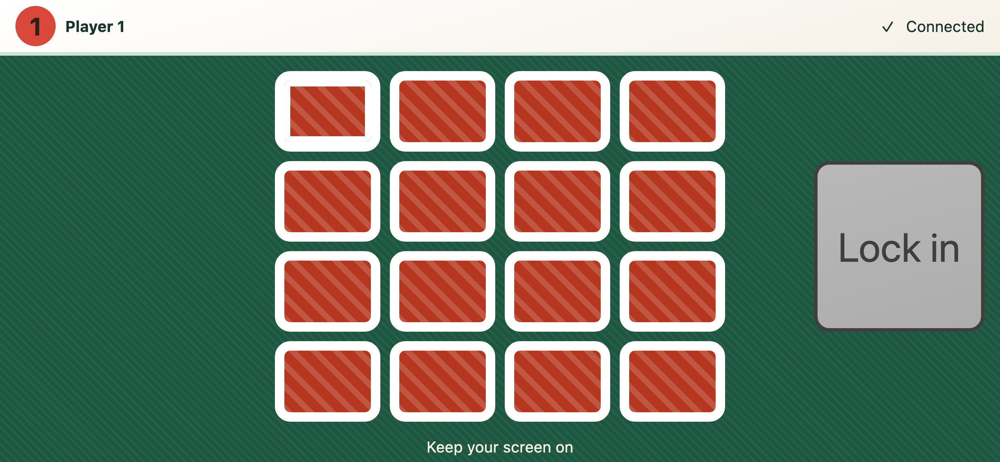 | One card picked (thicker white frame); Lock in still waiting for a second pick (844 × 390) | Integrator and Claude reviewer, 2026-11-18 |
|  | TV: the "not built yet" placeholder, captured while its fade had not settled (marked UNSETTLED by the harness); not evidence for the TV half, which comes with P-06/P-07 | Integrator and Claude reviewer, 2026-11-18 |
| 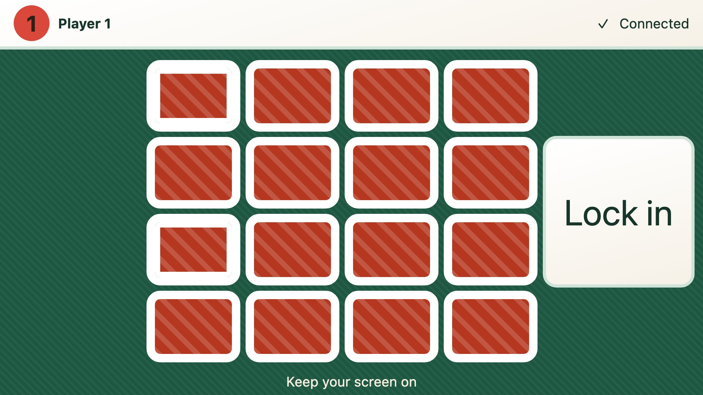 | Two cards picked; Lock in enabled; a third tap is ignored (667 × 375) | Integrator and Claude reviewer, 2026-11-18 |
| 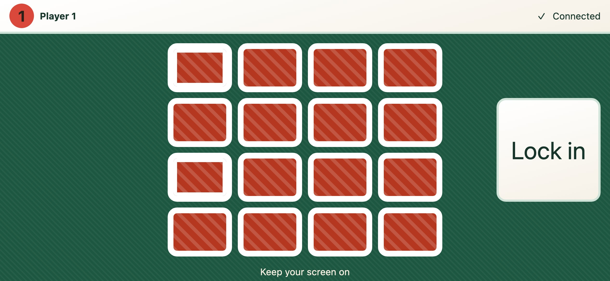 | Two cards picked; Lock in enabled; a third tap is ignored (844 × 390) | Integrator and Claude reviewer, 2026-11-18 |
|  | TV: the "not built yet" placeholder, captured while its fade had not settled (marked UNSETTLED by the harness); not evidence for the TV half, which comes with P-06/P-07 | Integrator and Claude reviewer, 2026-11-18 |
| 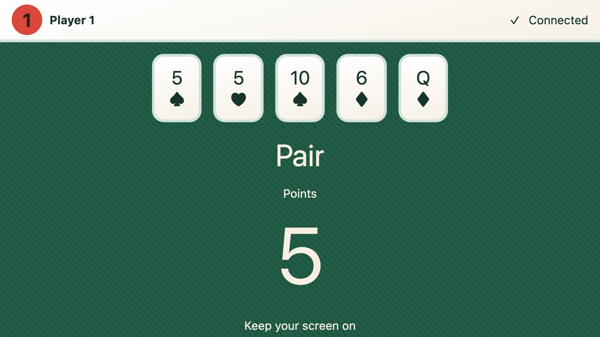 | The phone shows only its own five cards, the hand name and points (667 × 375) | Integrator and Claude reviewer, 2026-11-18 |
| 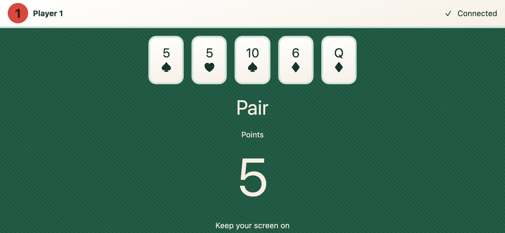 | The phone shows only its own five cards, the hand name and points (844 × 390) | Integrator and Claude reviewer, 2026-11-18 |
|  | TV: the "not built yet" placeholder, captured while its fade had not settled (marked UNSETTLED by the harness); not evidence for the TV half, which comes with P-06/P-07 | Integrator and Claude reviewer, 2026-11-18 |
|  | This seat sees only its own hand at the reveal (different hand per seat) | Integrator and Claude reviewer, 2026-11-18 |
| 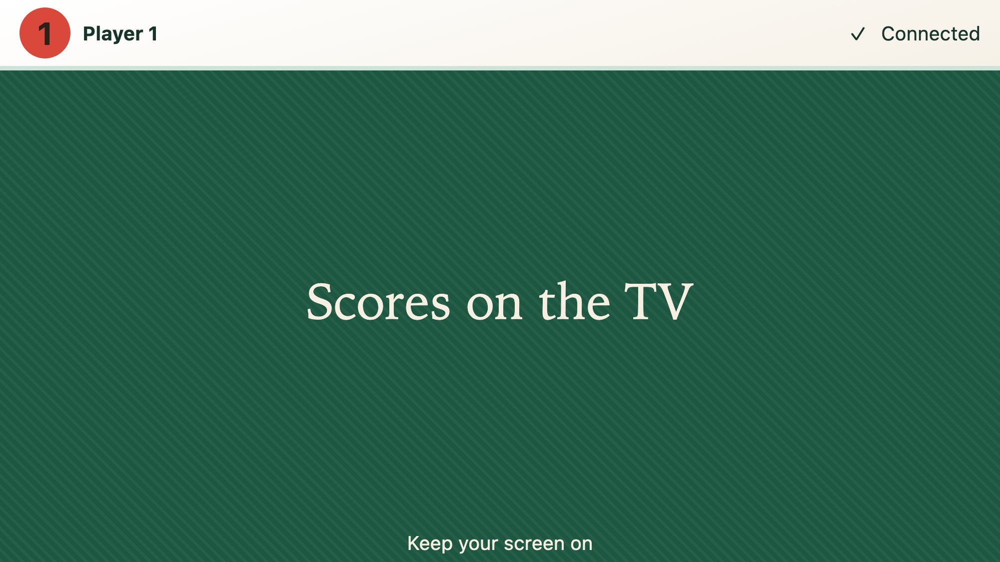 | Scores on the TV (667 × 375) | Integrator and Claude reviewer, 2026-11-18 |
| 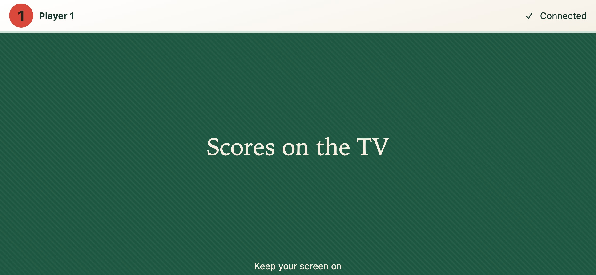 | Scores on the TV (844 × 390) | Integrator and Claude reviewer, 2026-11-18 |
|  | TV: the "not built yet" placeholder, captured while its fade had not settled (marked UNSETTLED by the harness); not evidence for the TV half, which comes with P-06/P-07 | Integrator and Claude reviewer, 2026-11-18 |
| 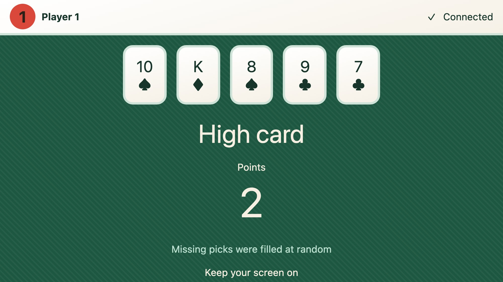 | Own hand with the 13 px note that picks were filled at random (667 × 375) | Integrator and Claude reviewer, 2026-11-18 |
| 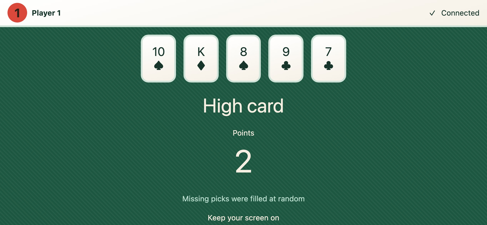 | Own hand with the 13 px note that picks were filled at random (844 × 390) | Integrator and Claude reviewer, 2026-11-18 |
|  | TV: the "not built yet" placeholder, captured while its fade had not settled (marked UNSETTLED by the harness); not evidence for the TV half, which comes with P-06/P-07 | Integrator and Claude reviewer, 2026-11-18 |
| 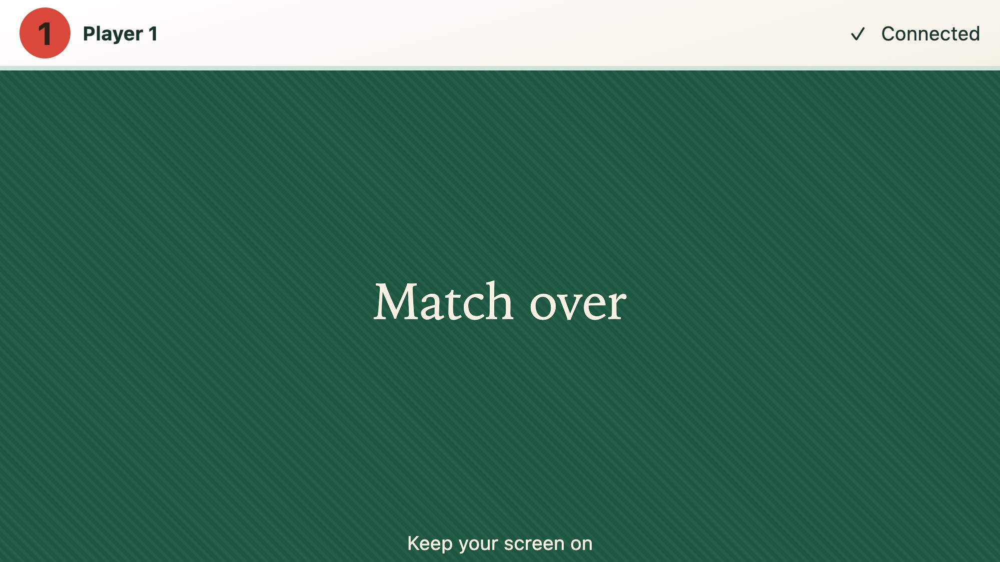 | Match over (667 × 375) | Integrator and Claude reviewer, 2026-11-18 |
| 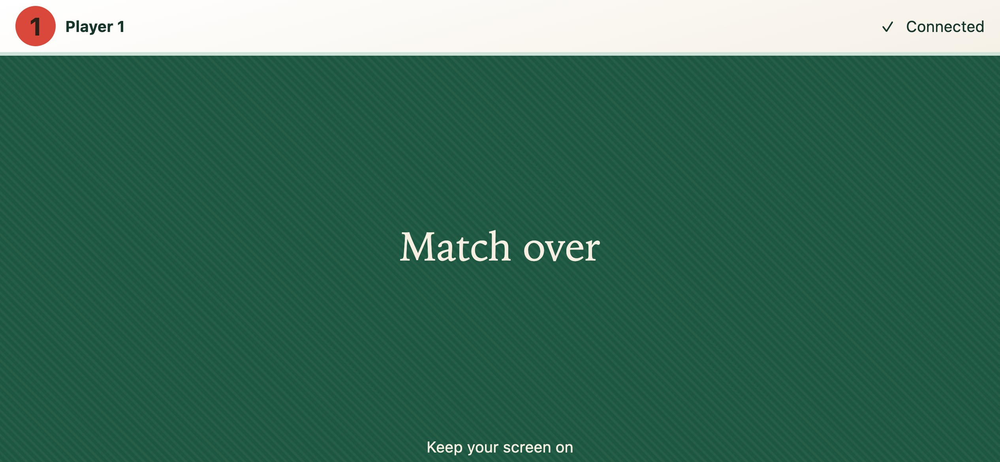 | Match over (844 × 390) | Integrator and Claude reviewer, 2026-11-18 |
| 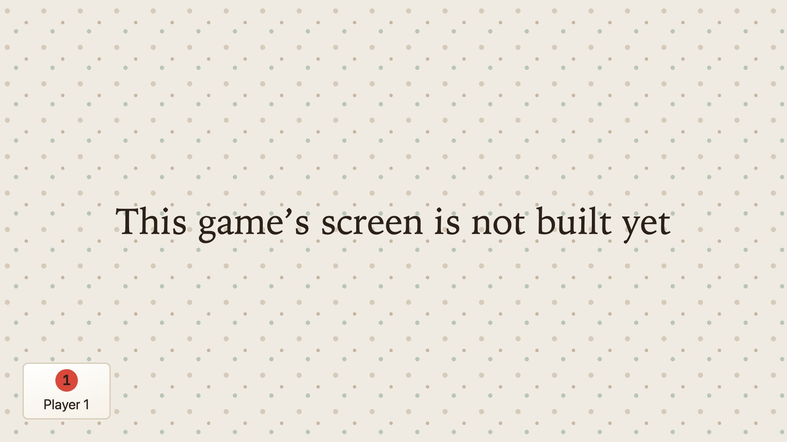 | TV: the "not built yet" placeholder, captured while its fade had not settled (marked UNSETTLED by the harness); not evidence for the TV half, which comes with P-06/P-07 | Integrator and Claude reviewer, 2026-11-18 |

| Acceptance statement | Pass / fail | Evidence |
|---|---|---|
| Memorise: phone says Watch the TV with seconds, shows no cards | pass | 01–02 |
| Private 4 × 4 tap grid, two picks with deselect, Lock in without a shape (D-171) | pass | 04–11, phone.test.ts |
| Lock-in cannot be undone; a third pick is ignored | pass | game.test.ts |
| Reveal shows only the phone's own hand, name and points | pass | reveal stills, phone.test.ts |
| No pick reaches another phone or the TV view before the reveal | pass | payloads.json.gz, session.test.ts |
| Random fill keeps existing picks and adds the 13 px note | pass | random-fill stills, game.test.ts |
| Grid cells 89 × 68 inside the viewport at 667, 844 and 932 | pass | measurements.json |
| TV half (PP-005, PP-020) | not yet: TV is the placeholder | P-06/P-07 |
