# P-04-table UAT evidence

Automated execution only. Visual review and acceptance decisions are pending.

Command: `node tools/uat/run.mjs -- P-04-table --out round3 --max-mb 16`
Commit: `1f1c4895c1a05b546573a33c6a288eba369c4d79`
Viewports: 1920×1080

| Timing | ms | Status |
|---|---:|---|
| 1 seats: memorise | 110.3 | completed |
| 1 seats: picking | 98.7 | completed |
| 1 seats: locked | 497.5 | completed |
| 1 seats: swap | 100.6 | completed |
| 1 seats: reveal | 98.1 | completed |
| 4 seats: memorise | 96.6 | completed |
| 4 seats: picking | 99.8 | completed |
| 4 seats: locked | 499.6 | completed |
| 4 seats: swap | 98.4 | completed |
| 4 seats: reveal | 99.2 | completed |
| 8 seats: memorise | 119.1 | completed |
| 8 seats: picking | 93.4 | completed |
| 8 seats: locked | 499.0 | completed |
| 8 seats: swap | 100.3 | completed |
| 8 seats: reveal | 100.2 | completed |

Expected errors (count):
None

## Real server

| Screenshot | What it shows | Looked at by |
|---|---|---|
| 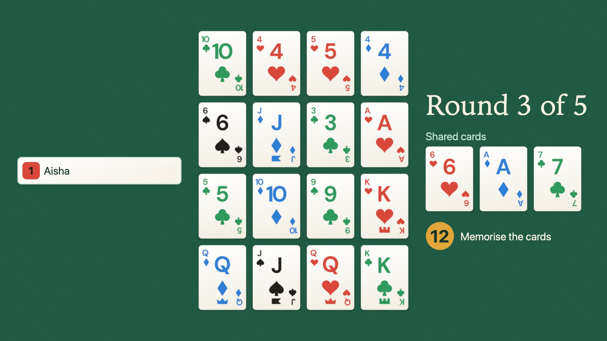 | | |
| 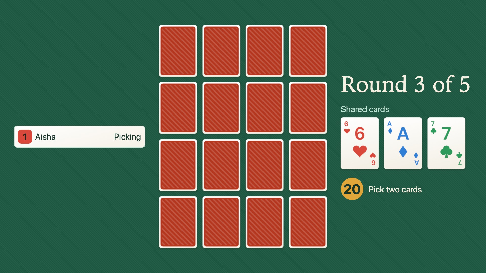 | | |
|  | | |
| 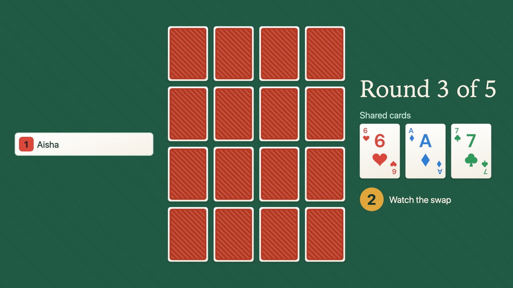 | | |
| 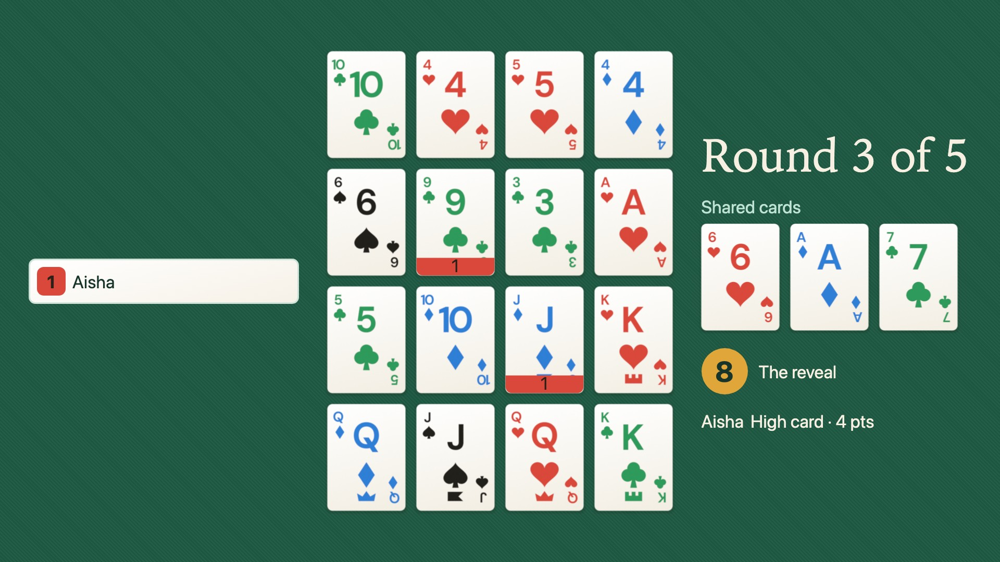 | | |
| 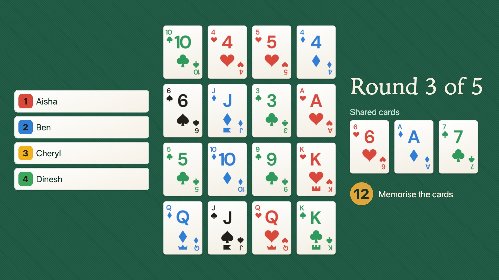 | | |
| 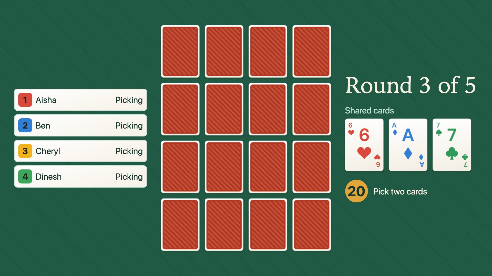 | | |
|  | | |
| 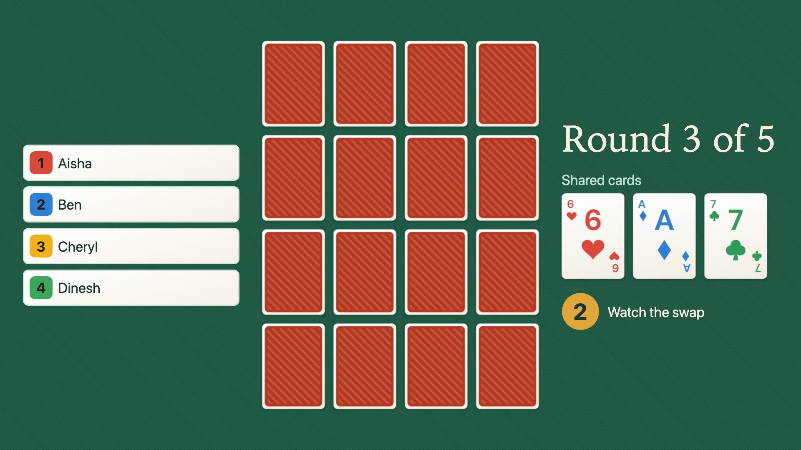 | | |
| 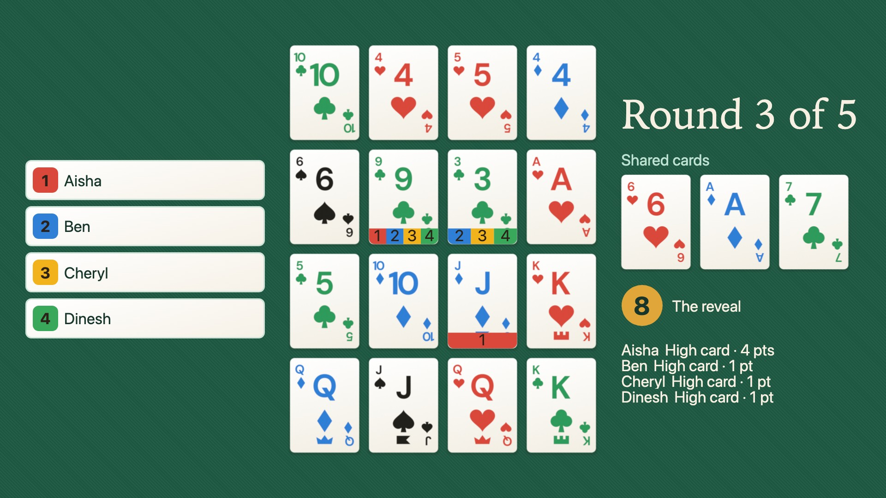 | | |
| 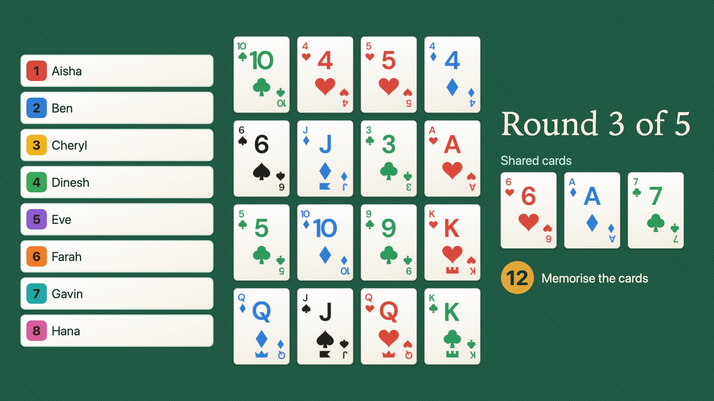 | | |
|  | | |
| 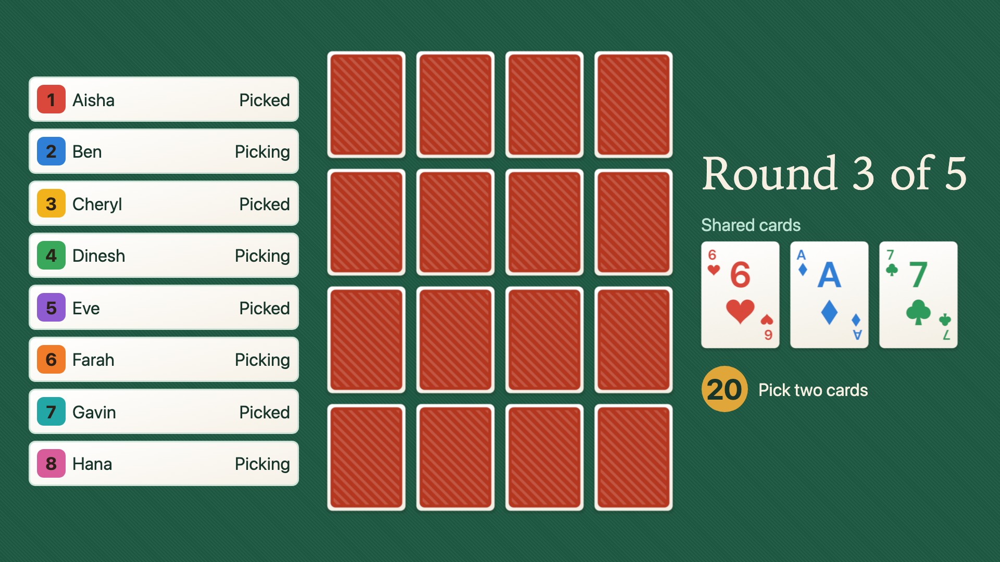 | | |
| 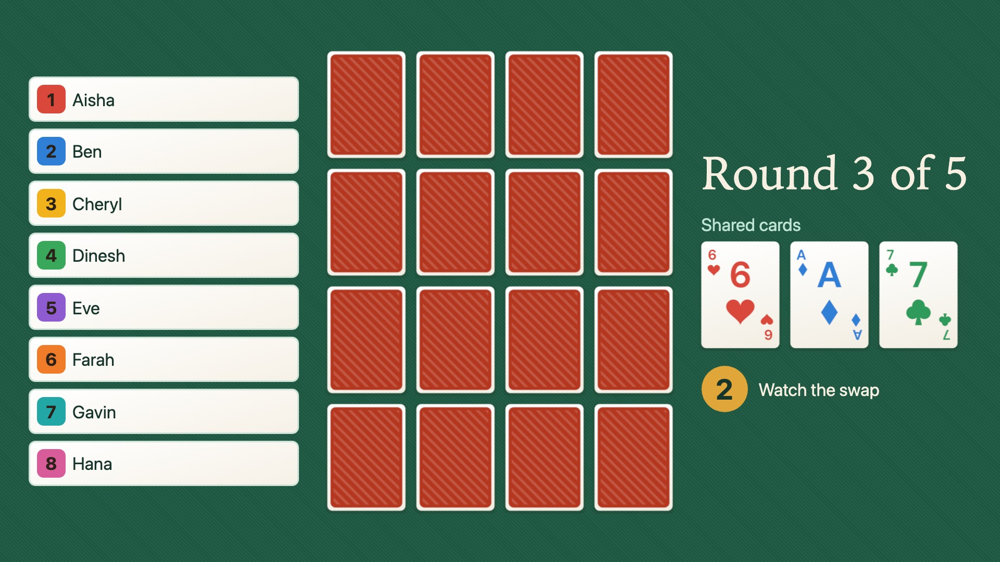 | | |
|  | | |
|  | | |
| 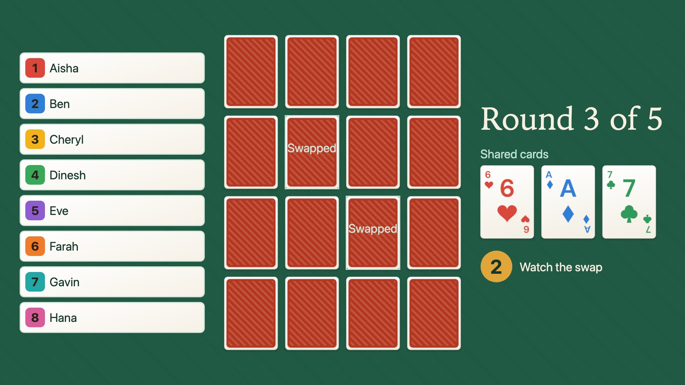 | | |
| 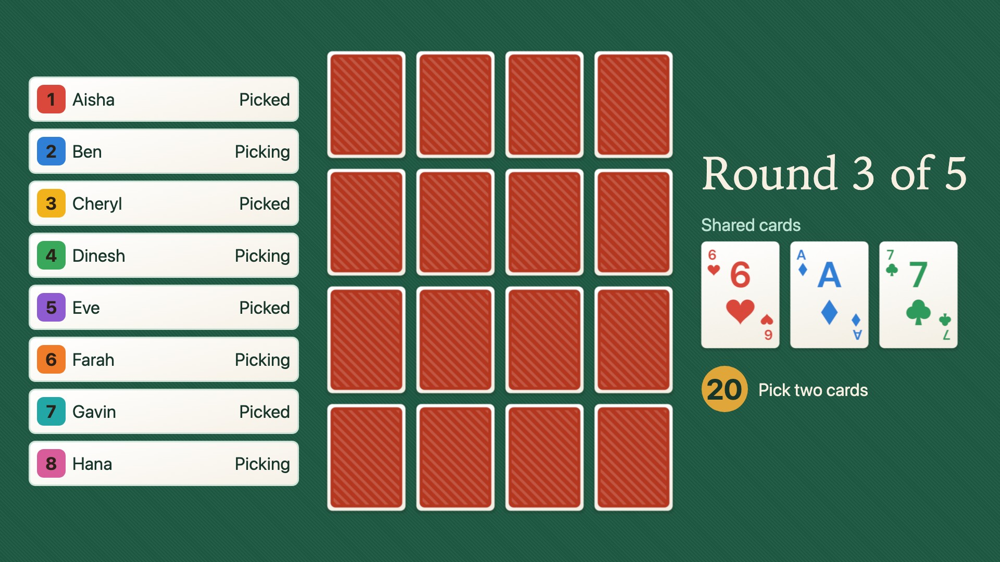 | | |
| 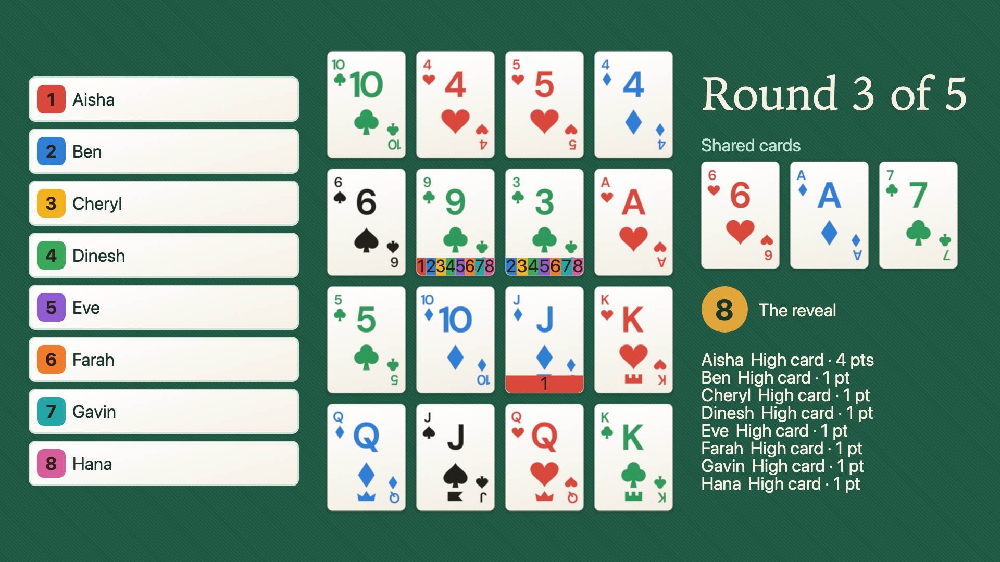 | | |

## Strips

| Screenshot | What it shows | Looked at by |
|---|---|---|
| 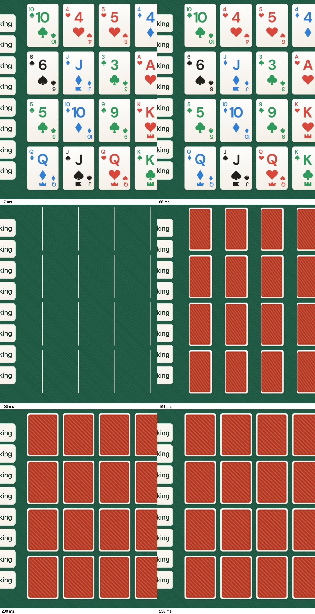 | | |
| 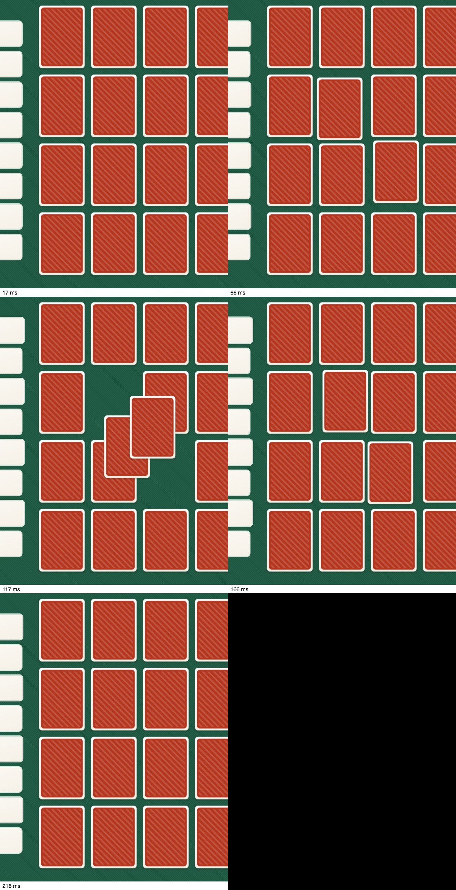 | | |
| 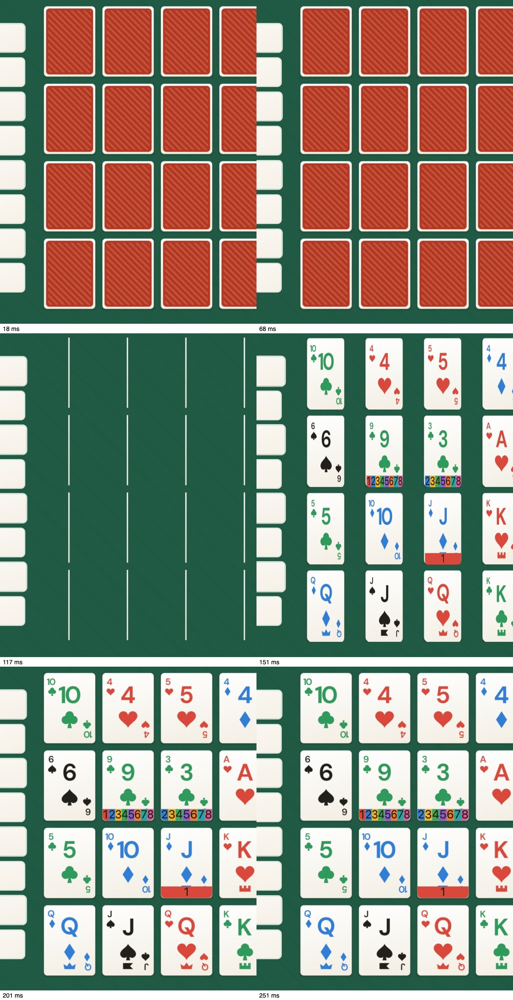 | | |
| 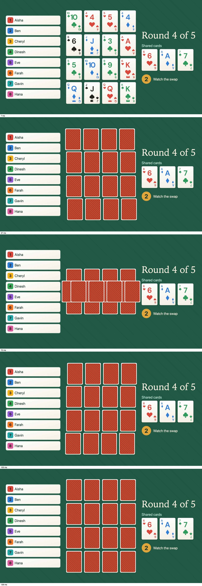 | | |
| 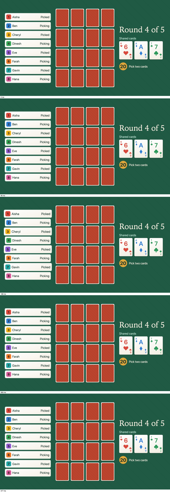 | | |

| Acceptance statement | Pass / fail | Evidence |
|---|---|---|
| | | |
