# P-04-table UAT evidence

Automated execution only. Visual review and acceptance decisions are pending.

Command: `node tools/uat/run.mjs -- P-04-table --out round4 --max-mb 16`
Commit: `83627c34f0dd68d8652951ad39d66fa8be5c987e`
Viewports: 1920×1080

| Timing | ms | Status |
|---|---:|---|
| 1 seats: memorise | 180.9 | completed |
| 1 seats: picking | 119.1 | completed |
| 1 seats: locked | 513.0 | completed |
| 1 seats: swap | 133.6 | completed |
| 1 seats: reveal | 179.4 | completed |
| 4 seats: memorise | 133.3 | completed |
| 4 seats: picking | 137.4 | completed |
| 4 seats: locked | 505.6 | completed |
| 4 seats: swap | 151.6 | completed |
| 4 seats: reveal | 130.6 | completed |
| 8 seats: memorise | 141.3 | completed |
| 8 seats: picking | 226.9 | completed |
| 8 seats: locked | 503.3 | completed |
| 8 seats: swap | 145.5 | completed |
| 8 seats: reveal | 114.1 | completed |

Expected errors (count):
None

## Real server

| Screenshot | What it shows | Looked at by |
|---|---|---|
| 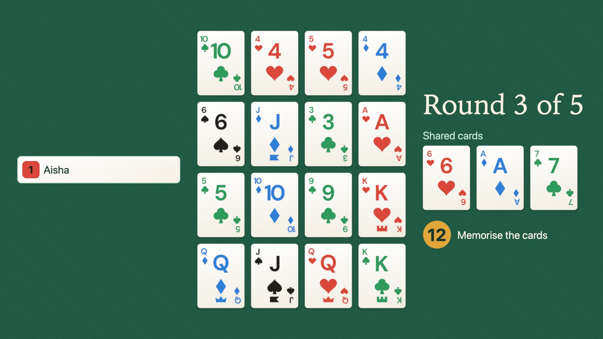 | | |
| 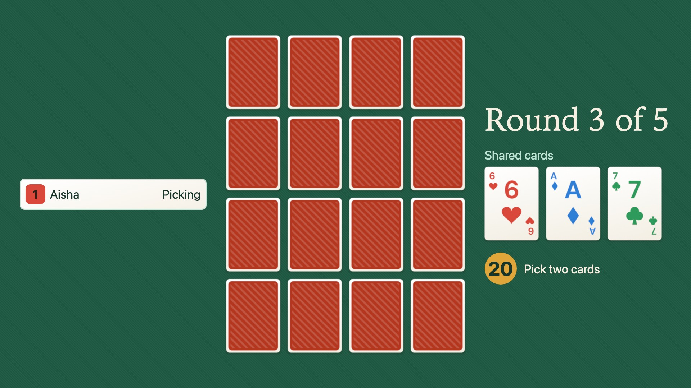 | | |
|  | | |
| 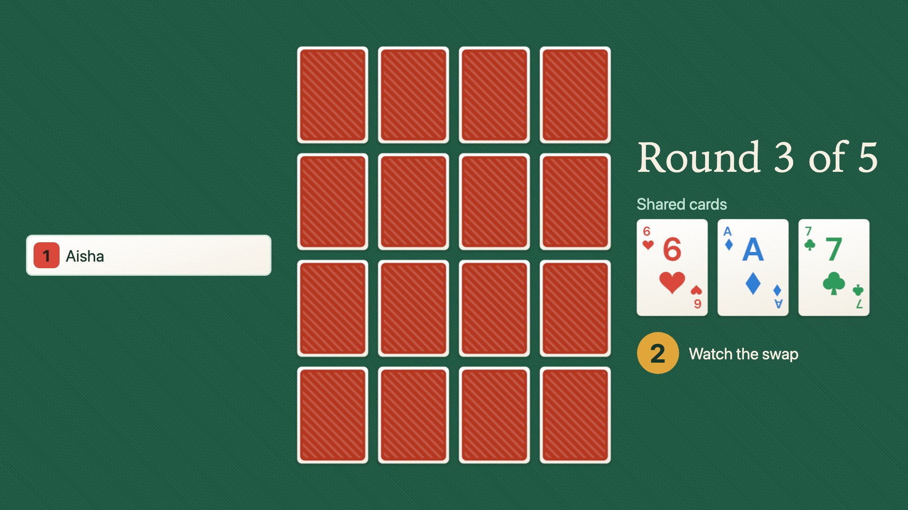 | | |
| 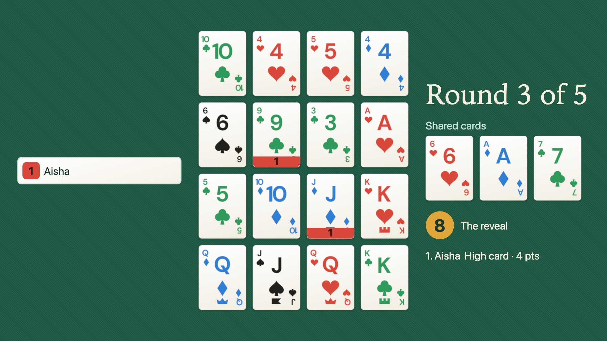 | | |
| 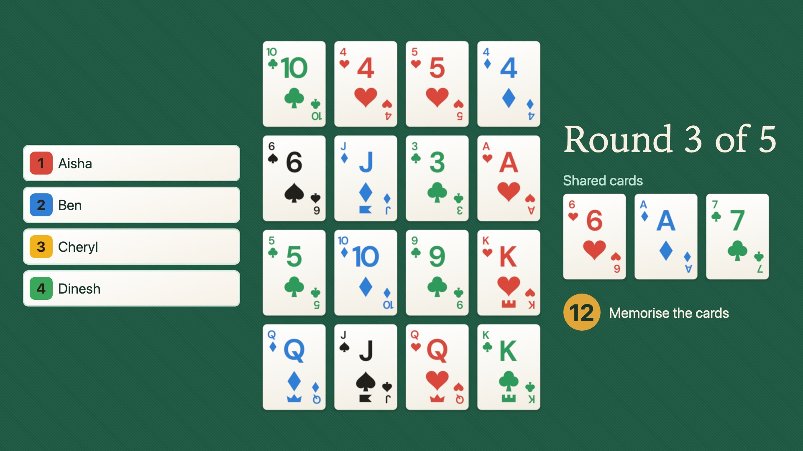 | | |
| 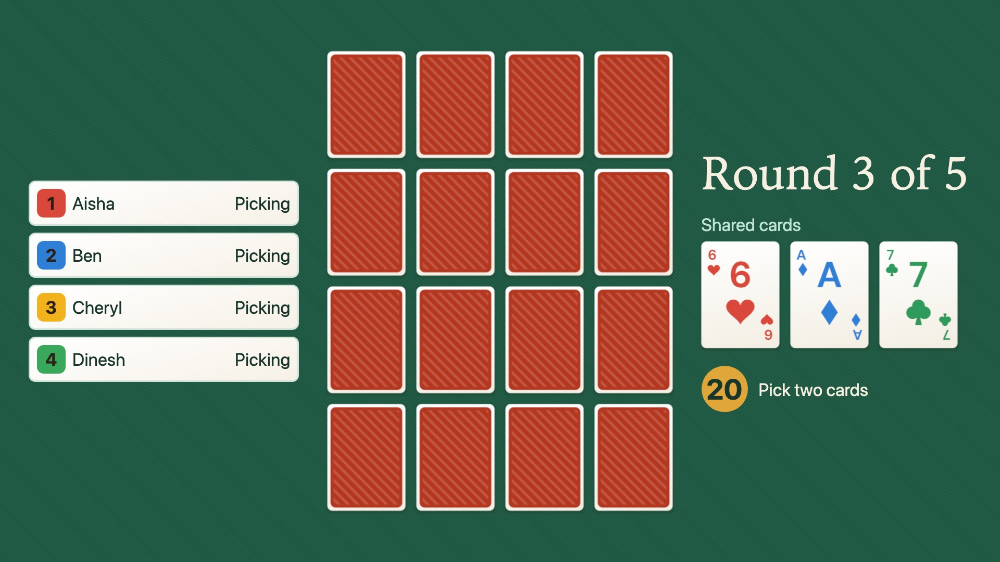 | | |
|  | | |
| 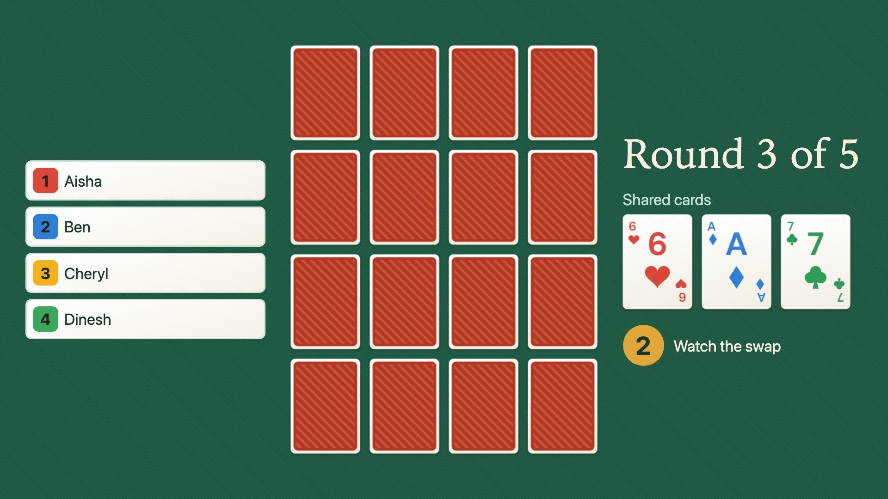 | | |
| 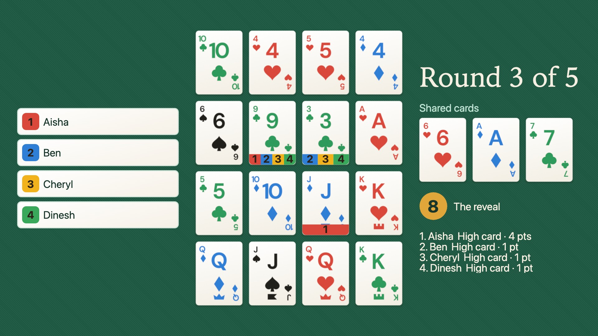 | | |
|  | | |
|  | | |
| 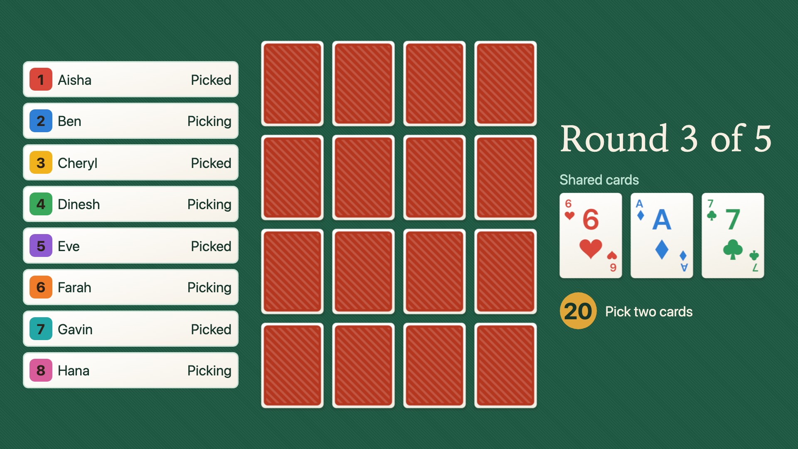 | | |
| 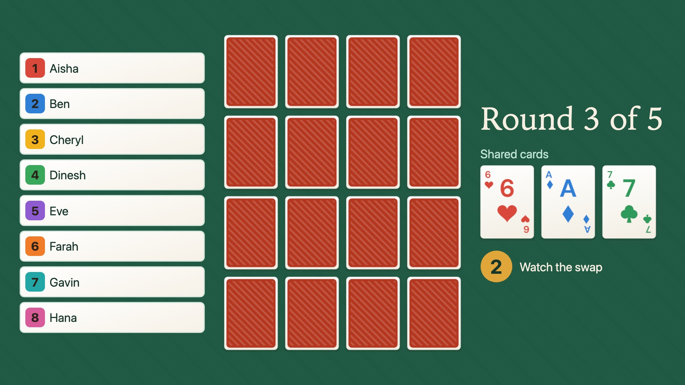 | | |
|  | | |
| 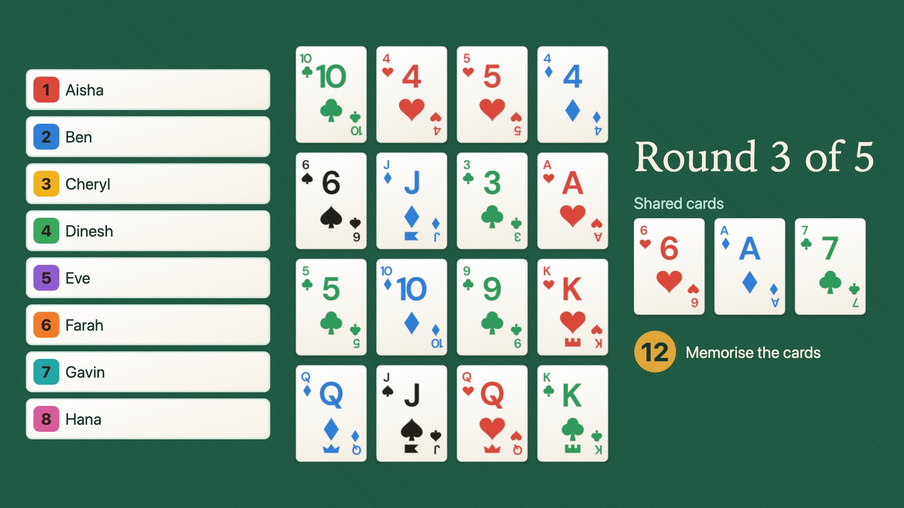 | | |
| 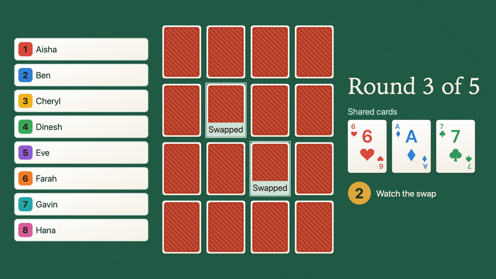 | | |
| 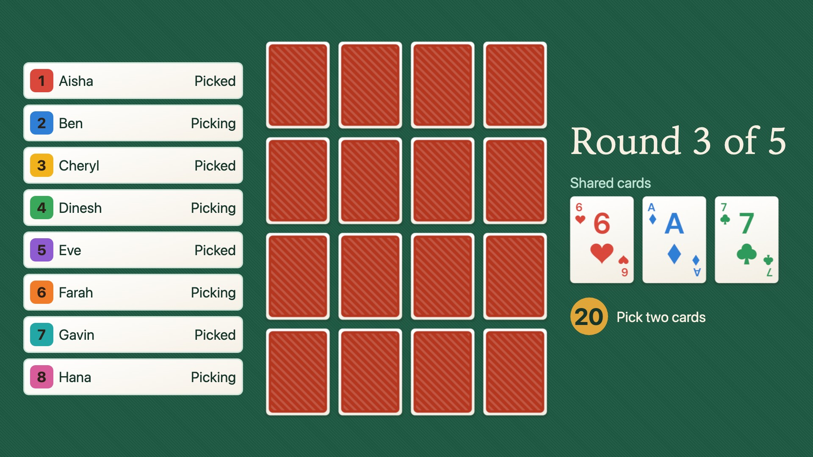 | | |
| 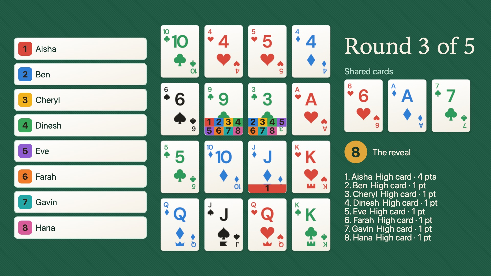 | | |

## Strips

| Screenshot | What it shows | Looked at by |
|---|---|---|
| 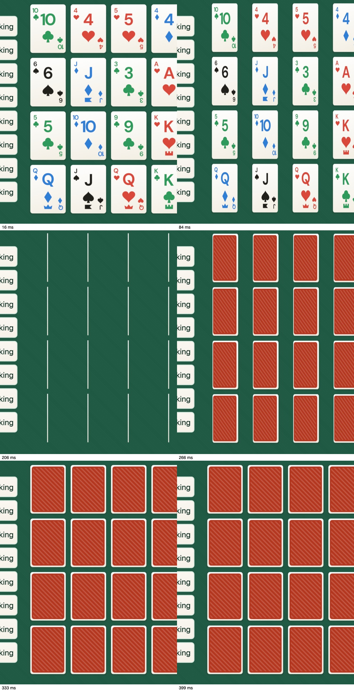 | | |
| 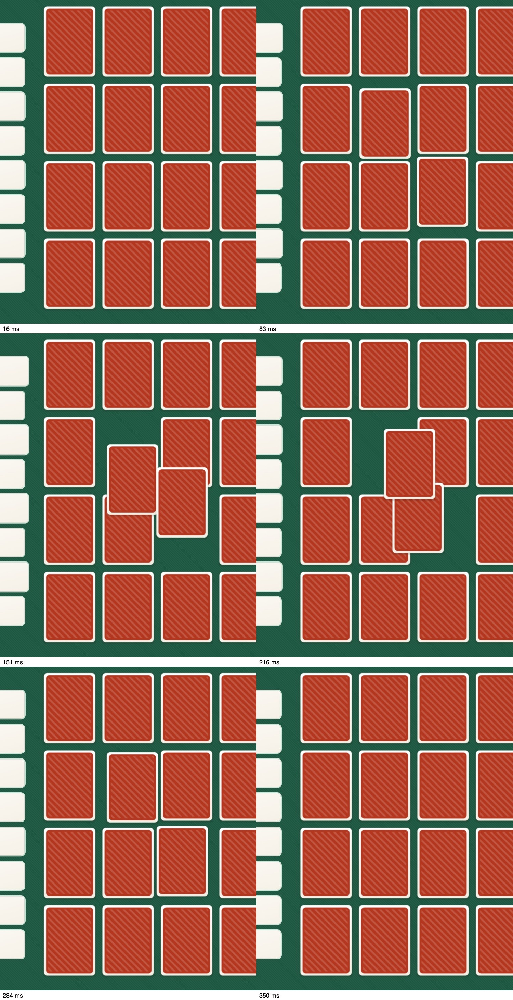 | | |
| 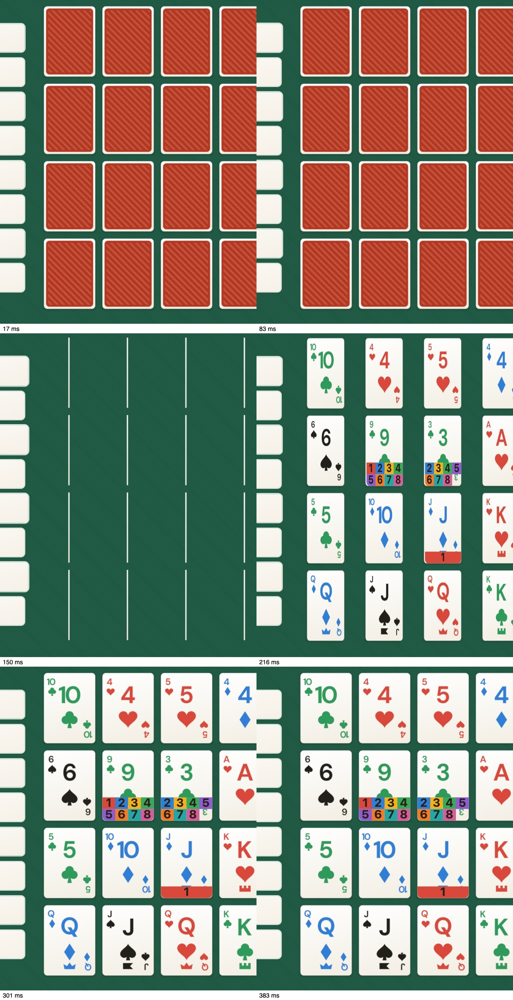 | | |
| 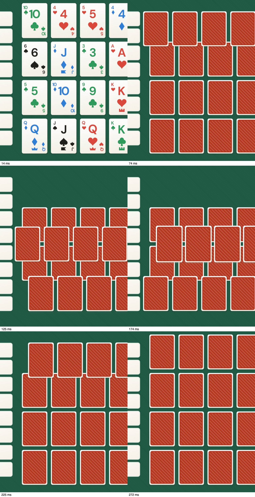 | | |
| 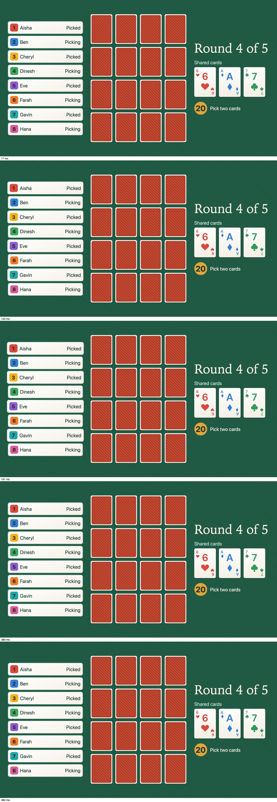 | | |

| Acceptance statement | Pass / fail | Evidence |
|---|---|---|
| | | |
