# P-05-scores-podium UAT evidence

Visual review: Claude (review 2), transcribed from P-05.review2.md.

Command: `node tools/uat/run.mjs -- P-05-scores-podium --phones 1 --out r7-p1`
Commit: `451e6adafcbd18168214e2e4291222efd17dbc01`
Viewports: 1920×1080, 844×390, 1280×720

| Timing | ms | Status |
|---|---:|---|
| Create room through host page | 1618.3 | completed |

Expected errors (count):
None

## Real server

| Screenshot | What it shows | Looked at by |
|---|---|---|
| 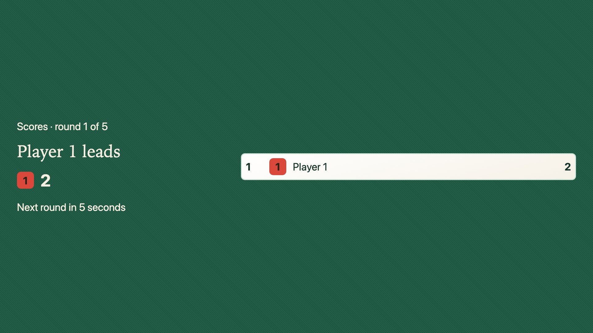 | Match 1 (no stored best), round-1 scoreboard: "Scores · round 1 of 5", "Player 1 leads", seat 1 and score 2, no Best line, "Next round in 5 seconds"; one ranked row on the right, 1 : 1.618 | Claude (review 2) |
| 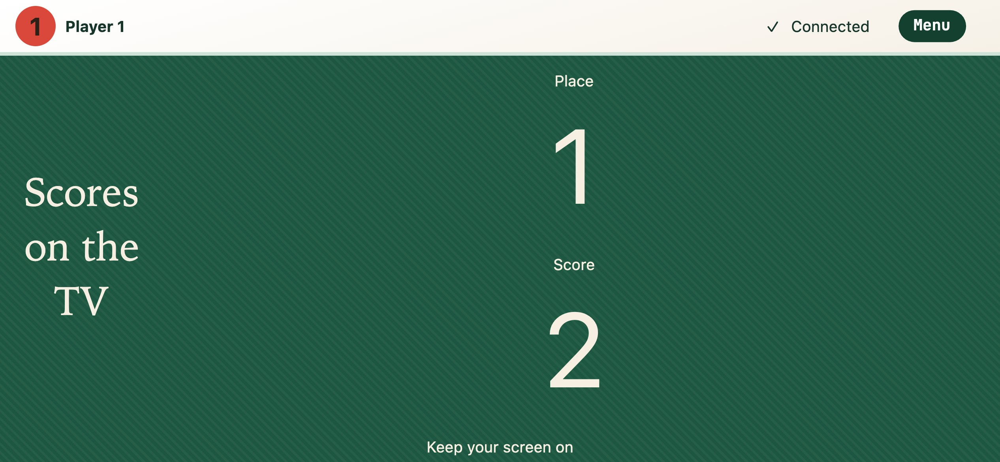 | Phone 1 during scoreboard: "Scores on the TV", Place 1, Score 2, cream on green felt, readable | Claude (review 2) |
| 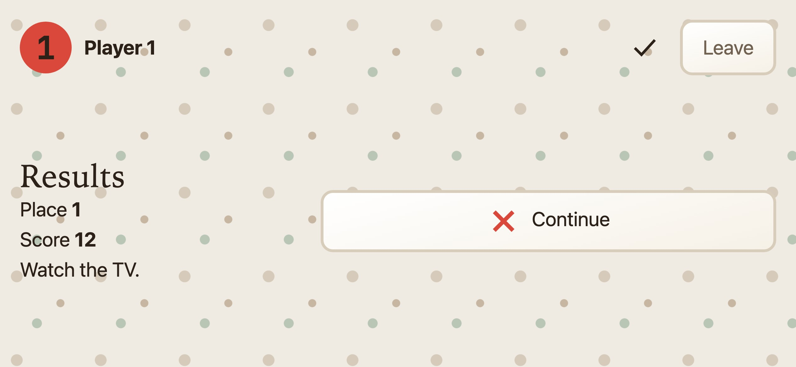 | Phone Results after match 1: Place 1, Score 12, Watch the TV, leader's Continue; no Teams toggle | Claude (review 2) |
| 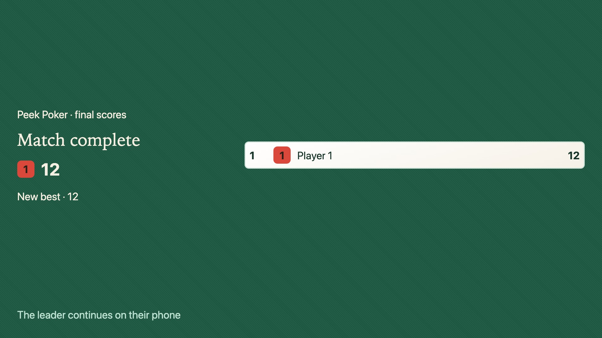 | Solo final at 1920: "Match complete", 12, "New best · 12", no game hand-off line, shell hint at the bottom | Claude (review 2) |
| 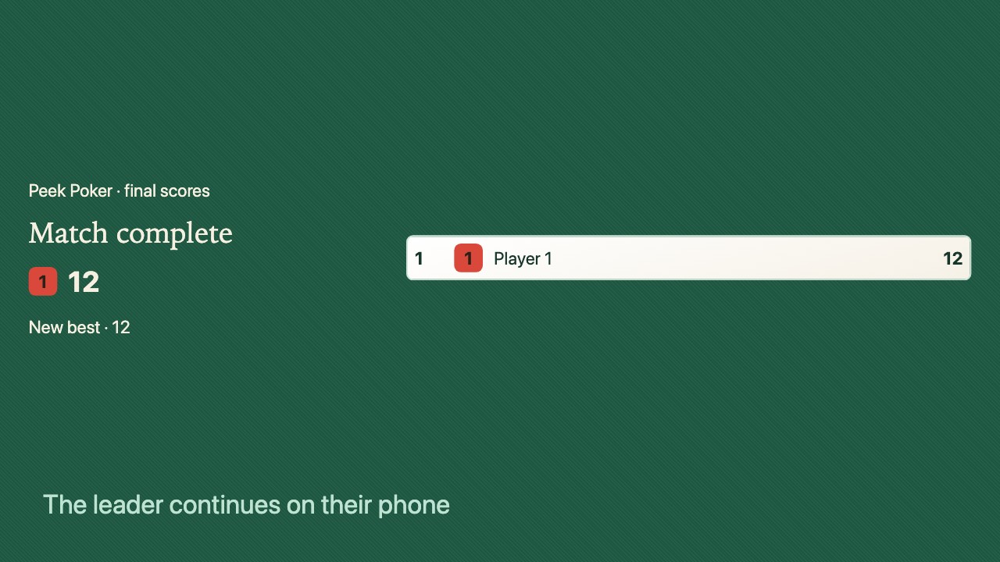 | Same at 1280 × 720: board scaled, shell hint at 1080 size, no overlap | Claude (review 2) |
| 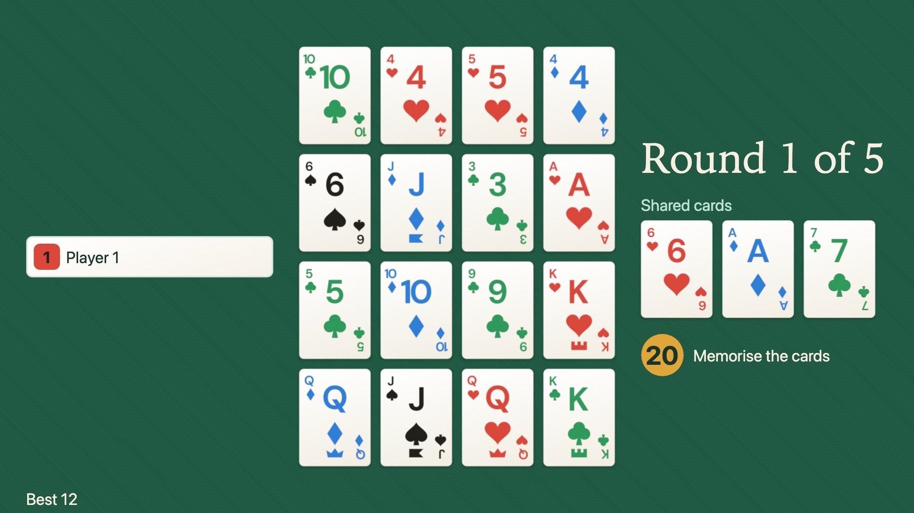 | Match 2 memorise at 1920: "Best 12" bottom-left at 34 px, clear of the player row and the grid | Claude (review 2) |
|  | Same at 1280 × 720, "Best 12" inside the viewport, no collision | Claude (review 2) |
| 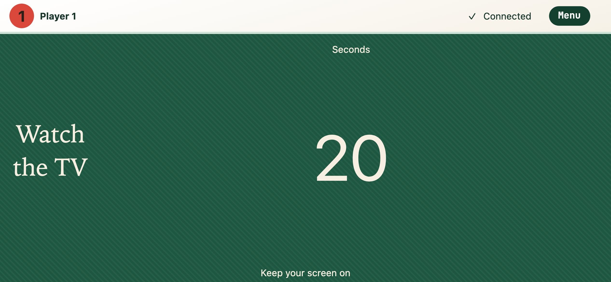 | Phone after Play again (remount): felt, "Watch the TV", Seconds 20, readable | Claude (review 2) |
| 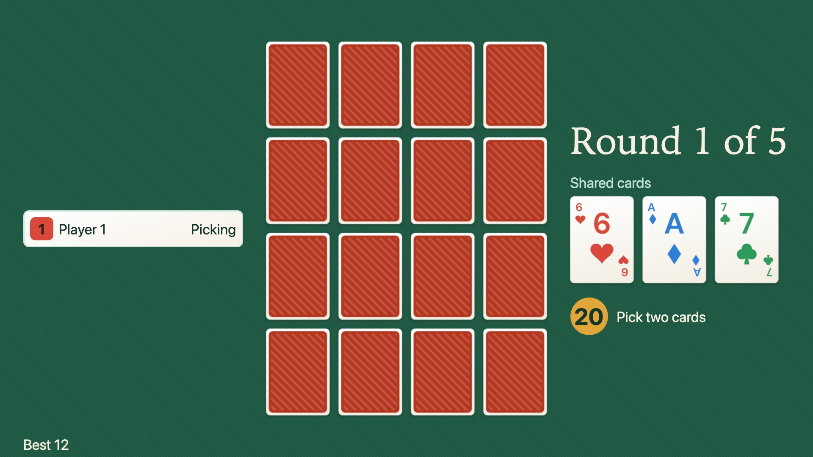 | Match 2 pick at 1920: face-down grid, "Picking", "Best 12", no collision | Claude (review 2) |
| 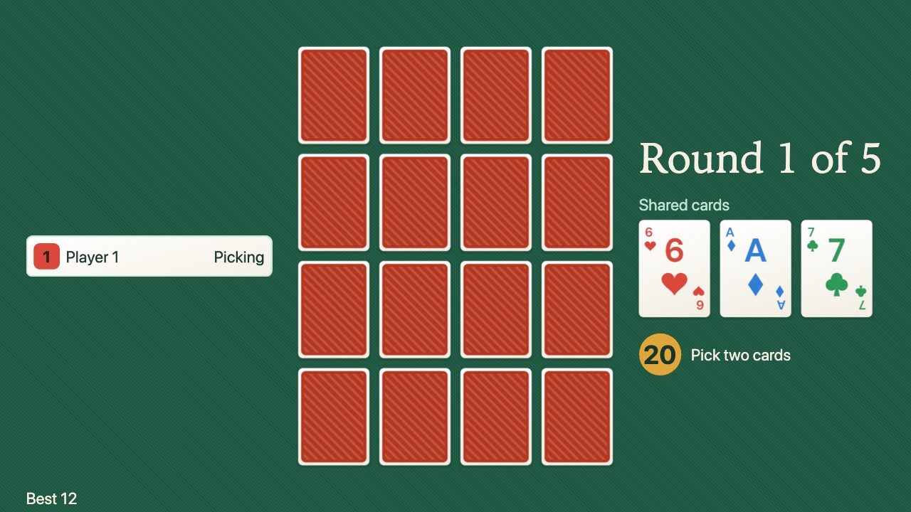 | Same at 1280 × 720 | Claude (review 2) |
| 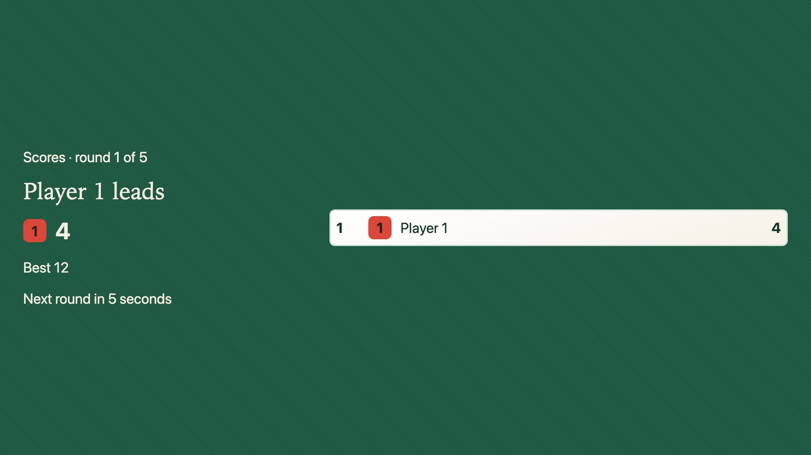 | Match 2 round-1 scoreboard: score 4, "Best 12" summary line, "Next round in 5 seconds" | Claude (review 2) |
|  | Phone during match 2 scoreboard: Place 1, Score 4, felt, readable | Claude (review 2) |
|  | Phone Results after match 2: Place 1, Score 22, Continue | Claude (review 2) |
| 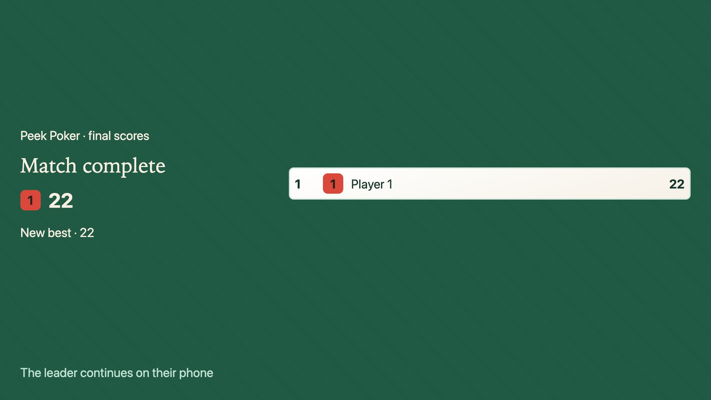 | Solo final at 1920: 22, "New best · 22" (12 beaten) | Claude (review 2) |
| 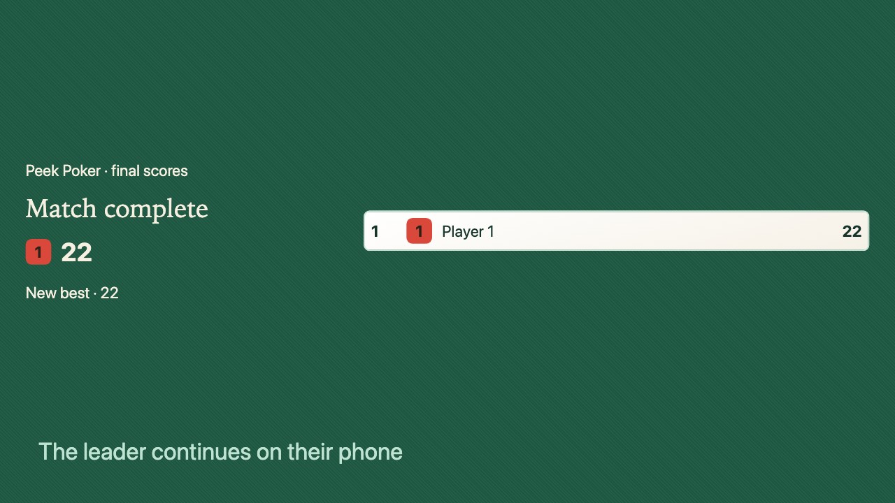 | Same at 1280 × 720, no overlap with the shell hint | Claude (review 2) |

## Strips

| Screenshot | What it shows | Looked at by |
|---|---|---|
| 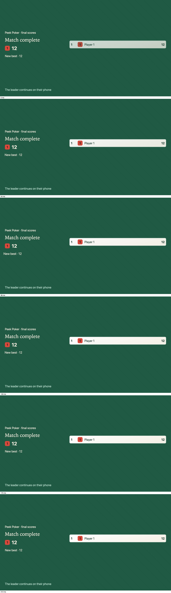 | Six frames seeking the real WAAPI effects at 0/90/180/270/360/450 ms (labels are capture wall-clock): "New best · 12" scales up at 180 ms and returns to rest, no undershoot; row fades in over frames 1–2. The line grows about the column centre, so it slides 16 px left at the peak (should-fix) | Claude (review 2) |
| 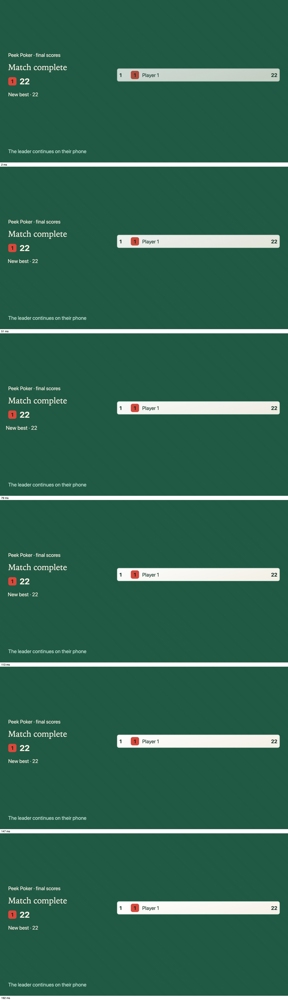 | Same for "New best · 22" | Claude (review 2) |

| Acceptance statement | Pass / fail | Evidence |
|---|---|---|
| Solo first match shows no Best; a stored best shows "Best N" in play and on the scoreboard; a strictly higher final shows "New best · N" and is stored as progress-v1 | pass (but New best is shown before the write is confirmed: review 2 must-fix) | 01, 11, 13–18, 28; UAT asserts the stored record |
| Phones show their own place and score between rounds and on Results, readable | pass | 02, 10, 15, 19, 27 |
| Final podium fits 1920 and 1280 with the shell hint, no game hand-off line | pass | 11, 12, 28, 29 |
| New best pulses once, no overshoot | pass (sideways drift, should-fix) | 09, 26 |

Superseded by r8-p1 (round 8, commit ecfb3b7f). r7-p1 showed "New best" before the write was confirmed and the pulse drifting sideways; both are fixed in r8-p1.
