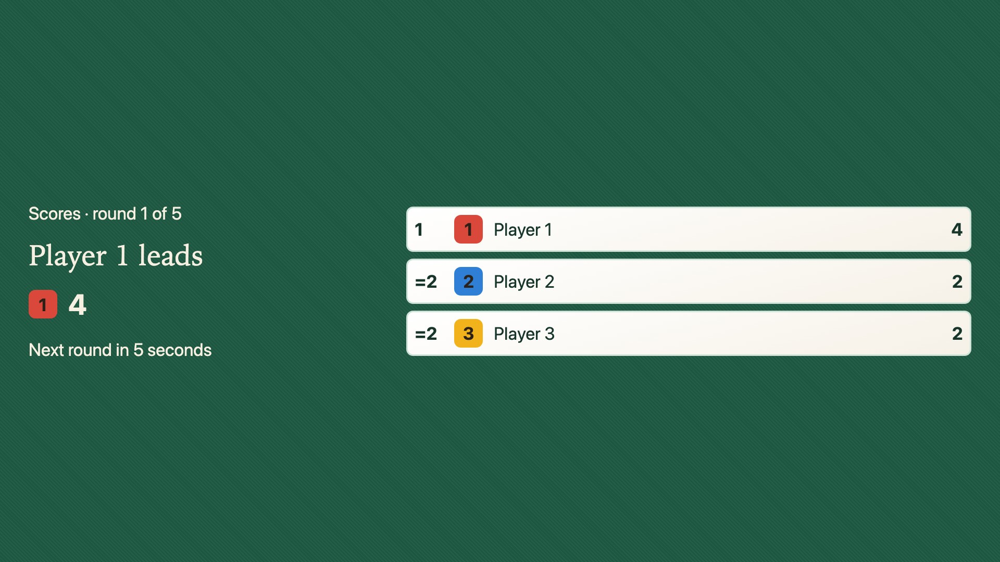
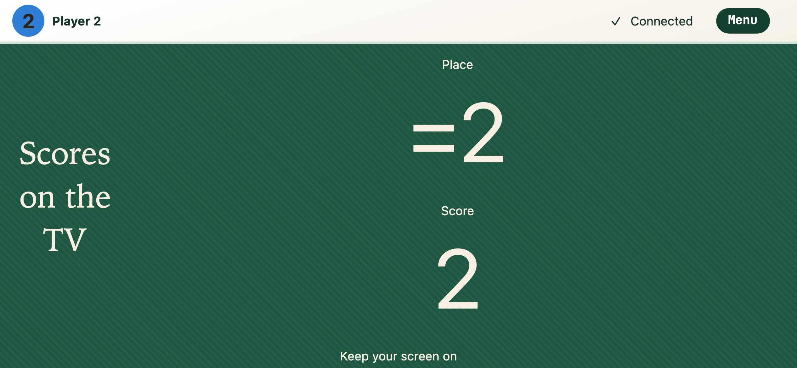
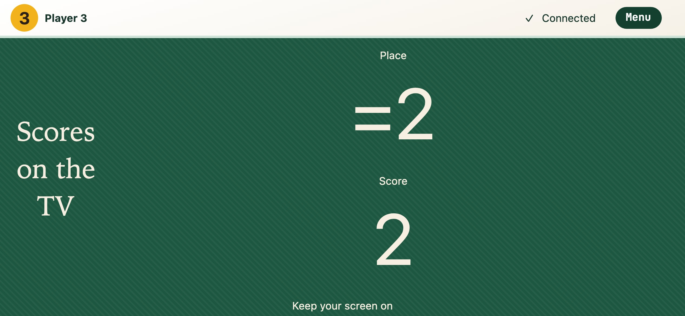
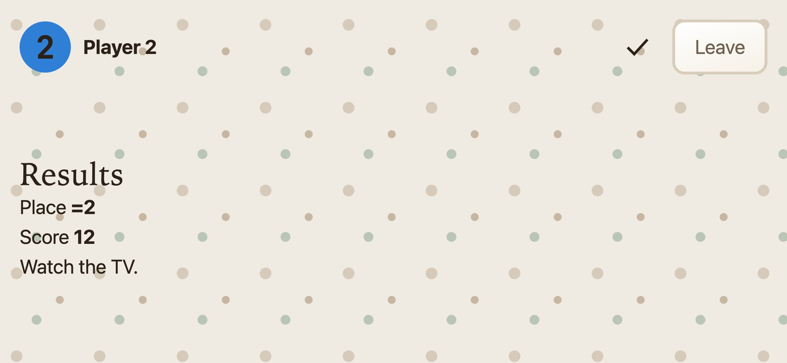
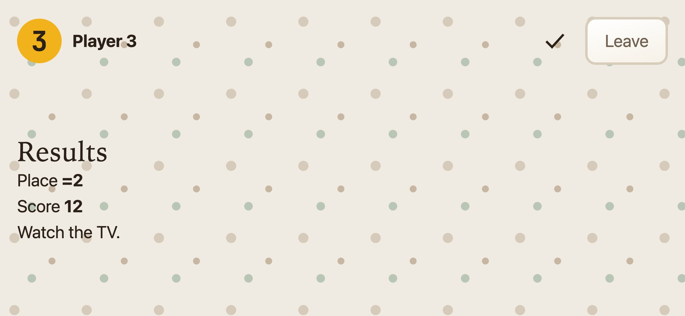
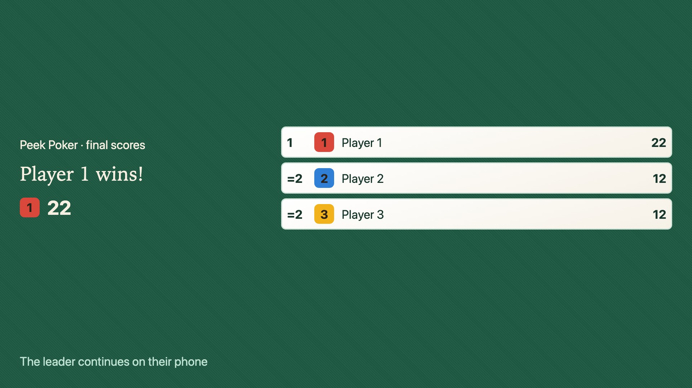
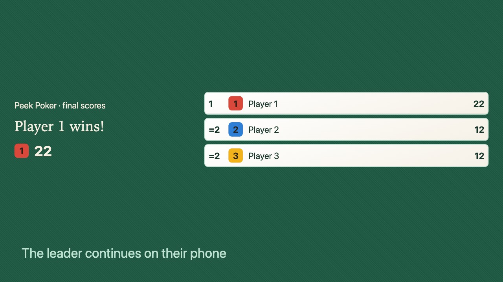
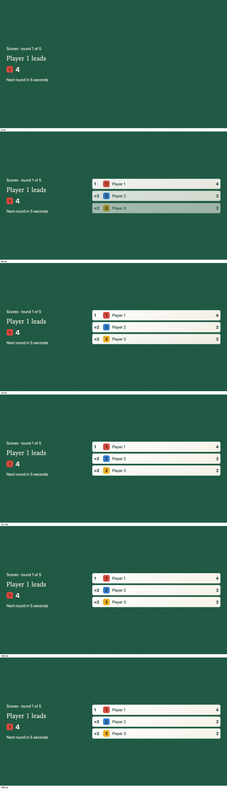

# P-05-scores-podium UAT evidence

Visual review: Claude (review 2), transcribed from P-05.review2.md.

Command: `node tools/uat/run.mjs -- P-05-scores-podium --phones 3 --out r7-p3`
Commit: `451e6adafcbd18168214e2e4291222efd17dbc01`
Viewports: 1920×1080, 844×390, 1280×720

| Timing | ms | Status |
|---|---:|---|
| Create room through host page | 1741.3 | completed |

Expected errors (count):
None

## Real server

| Screenshot | What it shows | Looked at by |
|---|---|---|
|  | Round-1 scoreboard, 3 players: Player 1 leads with 4; "=2" for players 2 and 3 on 2; no Best line | Claude (review 2) |
|  | Phone 1: Place 1, Score 4, felt, readable | Claude (review 2) |
|  | Phone 2: Place =2, Score 2, matches the TV | Claude (review 2) |
|  | Phone 3: Place =2, Score 2 | Claude (review 2) |
|  | Phone 1 Results: Place 1, Score 22, Continue, no Teams toggle | Claude (review 2) |
|  | Phone 2 Results: Place =2, Score 12, no leader buttons | Claude (review 2) |
|  | Phone 3 Results: Place =2, Score 12 | Claude (review 2) |
|  | Final podium at 1920: "Player 1 wins!" 22; rows 1, =2, =2; no Best/New best; shell hint only | Claude (review 2) |
|  | Same at 1280 × 720, no overlap | Claude (review 2) |

## Strips

| Screenshot | What it shows | Looked at by |
|---|---|---|
|  | Row entrance seeking 0/90/…/450 ms (labels are capture wall-clock): no rows at 0, three rows fading in staggered at 90 ms (row 3 faintest), settled by 180 ms; ease-out, no overshoot | Claude (review 2) |

| Acceptance statement | Pass / fail | Evidence |
|---|---|---|
| Ties share places as "=N" on the TV and every phone; no best copy with 2+ players | pass | 01, 10, 11, 13, 14, 15 |

Superseded by r8-p3 (round 8). The multiplayer stills 01 and 09–16 are byte-identical across the two runs.
