# P-05-scores-podium UAT evidence

Visual review: Claude (review 2), transcribed from P-05.review2.md.

Command: `node tools/uat/run.mjs -- P-05-scores-podium --phones 8 --out r7-p8`
Commit: `451e6adafcbd18168214e2e4291222efd17dbc01`
Viewports: 1920×1080, 844×390, 1280×720

| Timing | ms | Status |
|---|---:|---|
| Create room through host page | 2787.2 | completed |

Expected errors (count):
None

## Real server

| Screenshot | What it shows | Looked at by |
|---|---|---|
| 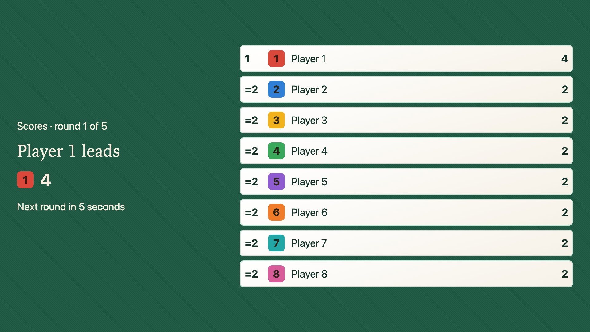 | 8-row scoreboard at 1920: 1 then seven "=2", all inside the board | Claude (review 2) |
|  | Phone 1 during scoreboard: Place 1, Score 4, felt, readable | Claude (review 2) |
|  | Phone 2 during scoreboard: Place =2, Score 2, felt, readable | Claude (review 2) |
| 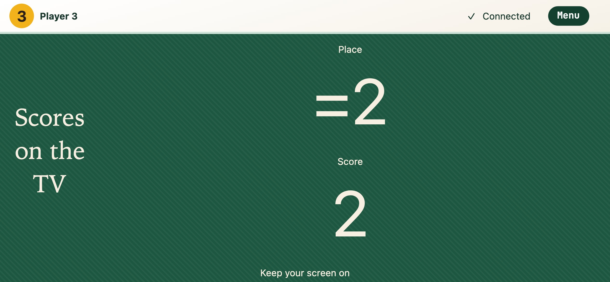 | Phone 3 during scoreboard: Place =2, Score 2, felt, readable | Claude (review 2) |
| 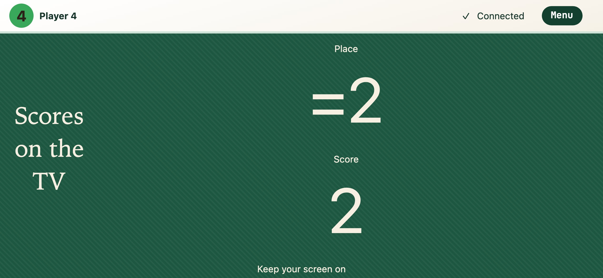 | Phone 4 during scoreboard: Place =2, Score 2, felt, readable | Claude (review 2) |
| 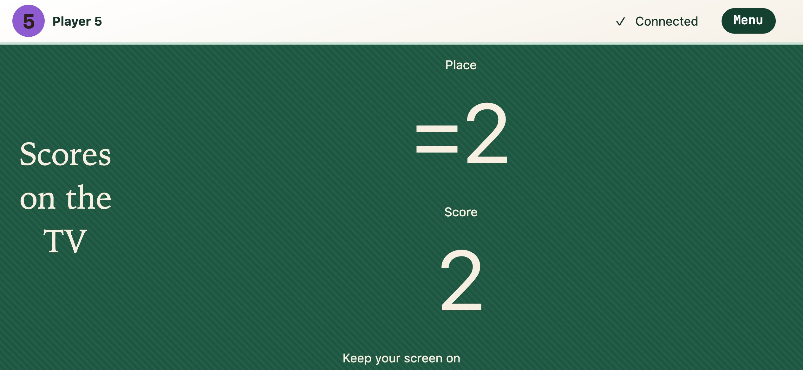 | Phone 5 during scoreboard: Place =2, Score 2, felt, readable | Claude (review 2) |
| 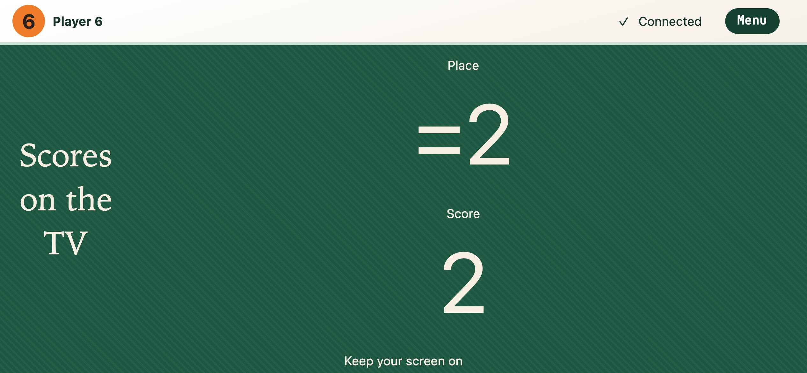 | Phone 6 during scoreboard: Place =2, Score 2, felt, readable | Claude (review 2) |
| 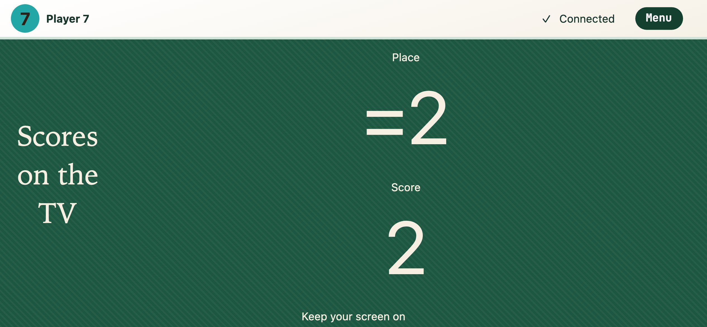 | Phone 7 during scoreboard: Place =2, Score 2, felt, readable | Claude (review 2) |
| 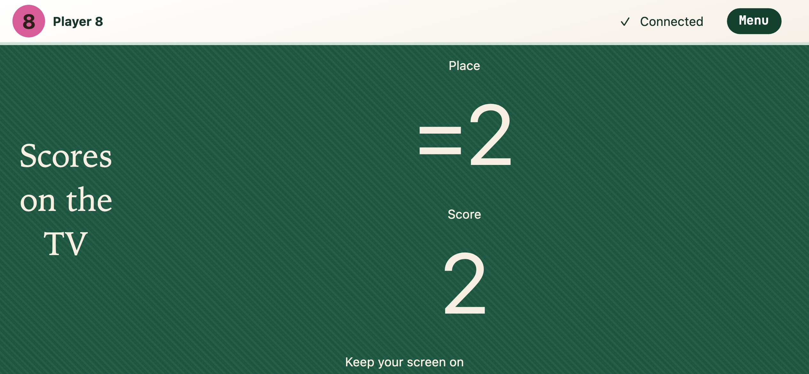 | Phone 8 during scoreboard: Place =2, Score 2, felt, readable | Claude (review 2) |
| 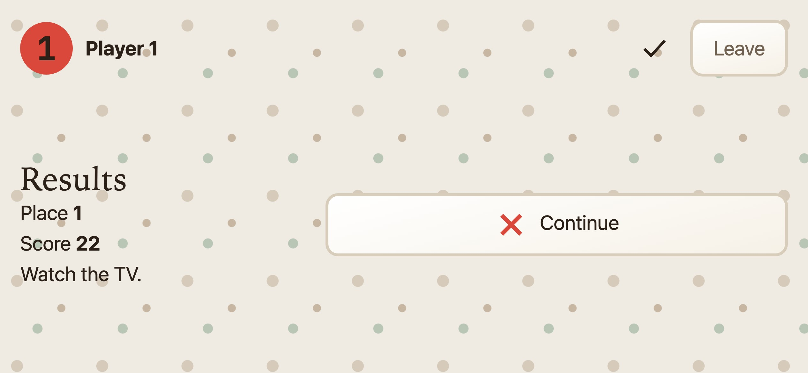 | Phone 1 Results: Place 1, Score 22, Continue, no Teams toggle | Claude (review 2) |
| 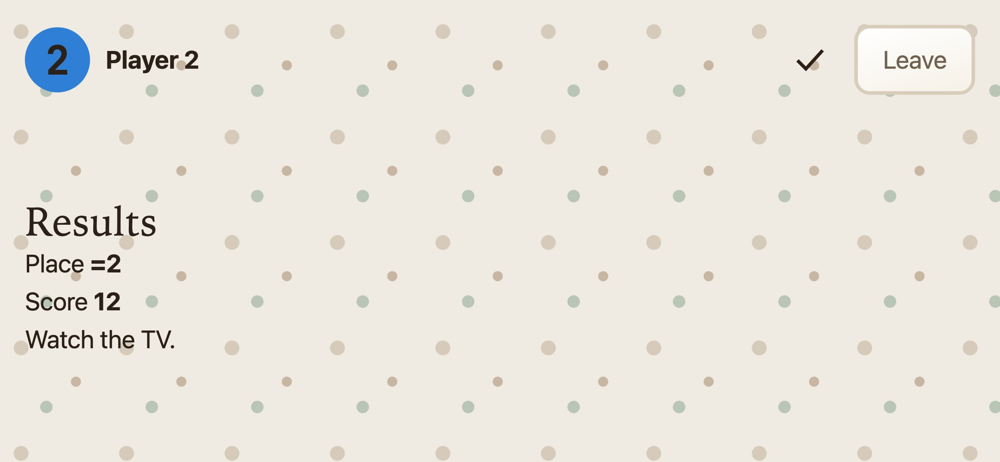 | Phone 2 Results: Place =2, Score 12, no leader buttons or Teams toggle | Claude (review 2) |
| 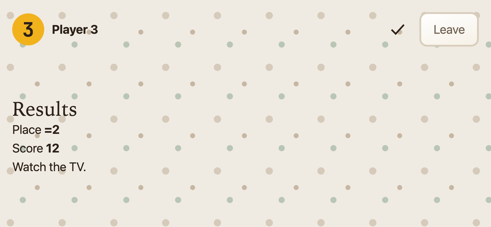 | Phone 3 Results: Place =2, Score 12, no leader buttons or Teams toggle | Claude (review 2) |
| 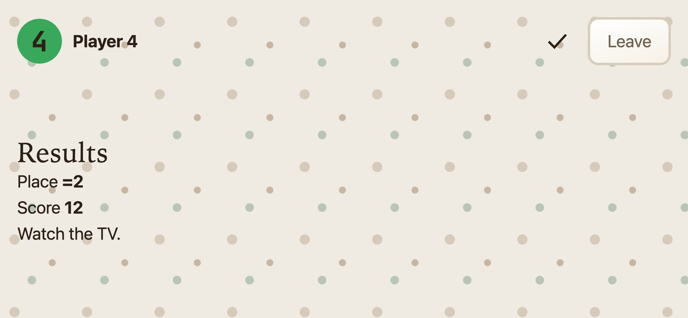 | Phone 4 Results: Place =2, Score 12, no leader buttons or Teams toggle | Claude (review 2) |
| 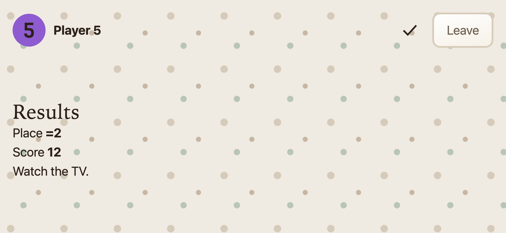 | Phone 5 Results: Place =2, Score 12, no leader buttons or Teams toggle | Claude (review 2) |
| 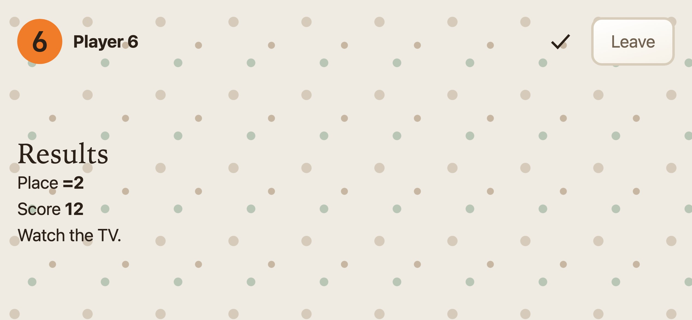 | Phone 6 Results: Place =2, Score 12, no leader buttons or Teams toggle | Claude (review 2) |
| 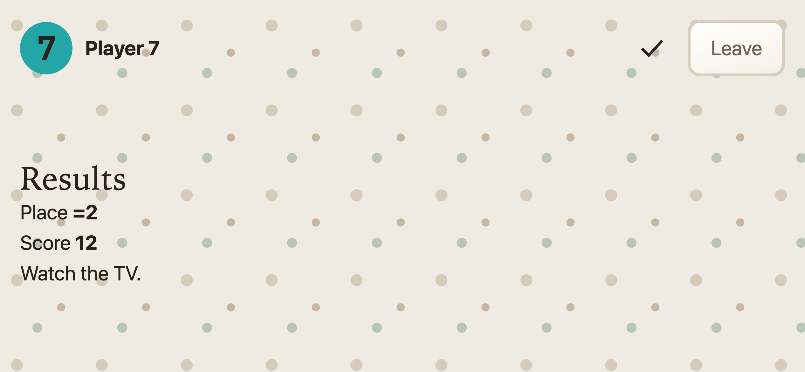 | Phone 7 Results: Place =2, Score 12, no leader buttons or Teams toggle | Claude (review 2) |
| 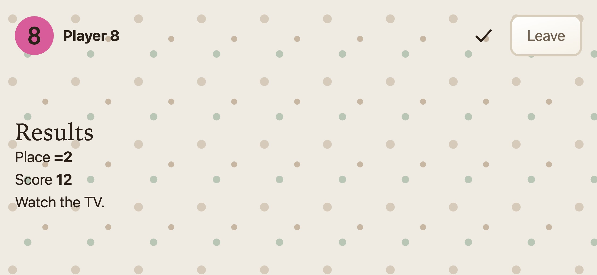 | Phone 8 Results: Place =2, Score 12, no leader buttons or Teams toggle | Claude (review 2) |
| 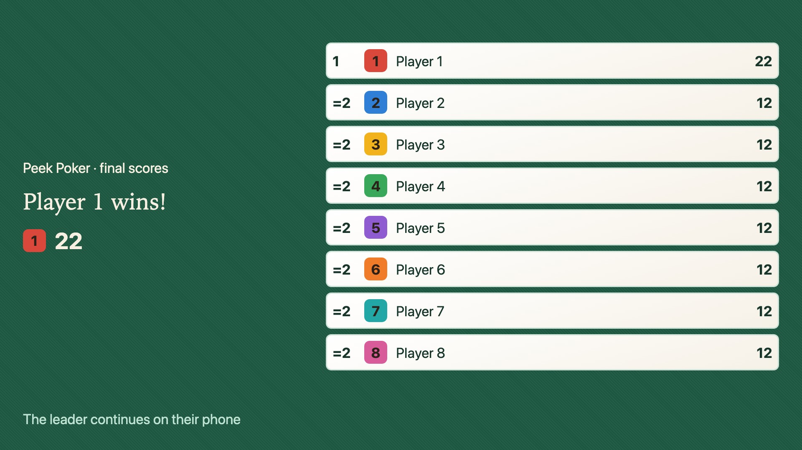 | 8-row final at 1920: "Player 1 wins!" 22, all rows inside, shell hint clear | Claude (review 2) |
| 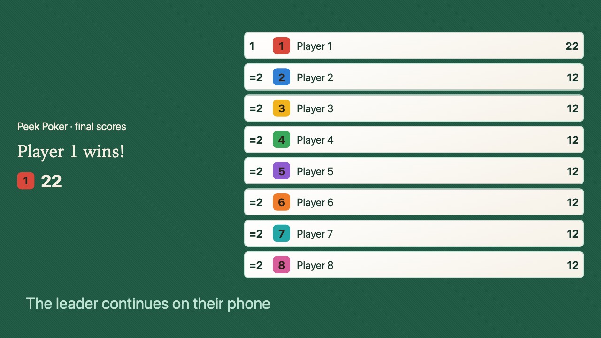 | 8-row final at 1280 × 720 beside the unscaled shell hint: last row ends at y 591, hint text starts at y 634 (43 px clear); no overlap or scroll | Claude (review 2) |

## Strips

| Screenshot | What it shows | Looked at by |
|---|---|---|
| 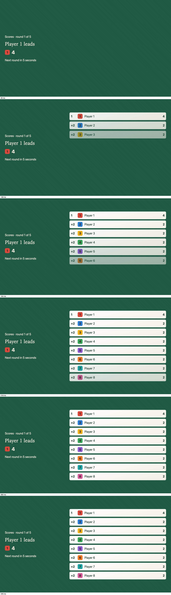 | Row entrance at 0/90/180/270/360/450 ms seek (labels are capture wall-clock): 3, 6, then 8 rows in, 30 ms stagger visible, settled by 360 ms | Claude (review 2) |

| Acceptance statement | Pass / fail | Evidence |
|---|---|---|
| 8-row podium does not touch the shell's final hint at 1280 × 720 | pass | 26 |

Current for eight phones at HEAD. Round 8 changed only the solo best line, the solo title rule and .pp-result-best, none of which draws with eight players; r8-p3 stills are byte-identical to r7-p3, and poker-results.dom.test.ts checks eight rows at both TV sizes at HEAD.
