# P-05-scores-podium UAT evidence

Superseded by r9-p1 (round 9): the scoreboard Best line now sits under the score, and the New best pulse plays on the settled board.

Automated execution only. Visual review and acceptance decisions are pending.

Command: `node tools/uat/run.mjs -- P-05-scores-podium --phones 1 --out r8-p1`
Commit: `ecfb3b7fd2e641e27a834d76b73129505d144d80`
Viewports: 1920×1080, 844×390, 1280×720

| Timing | ms | Status |
|---|---:|---|
| Create room through host page | 1351.6 | completed |

Expected errors (count):
None

## Real server

| Screenshot | What it shows | Looked at by |
|---|---|---|
| 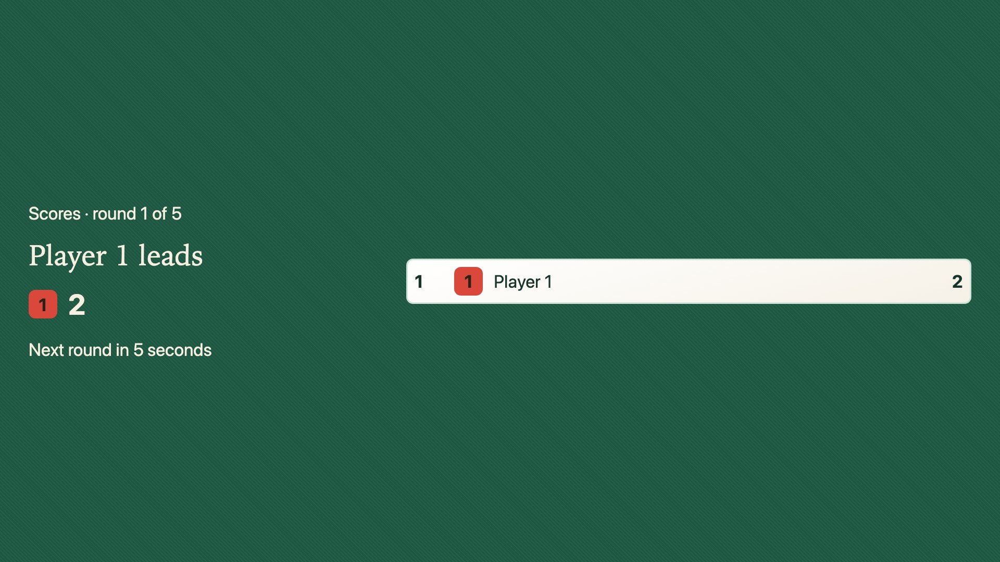 | | |
| 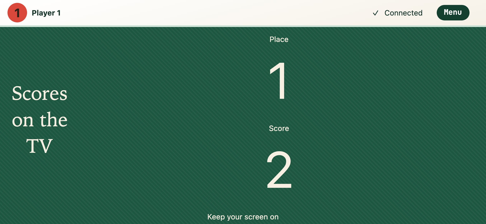 | | |
| 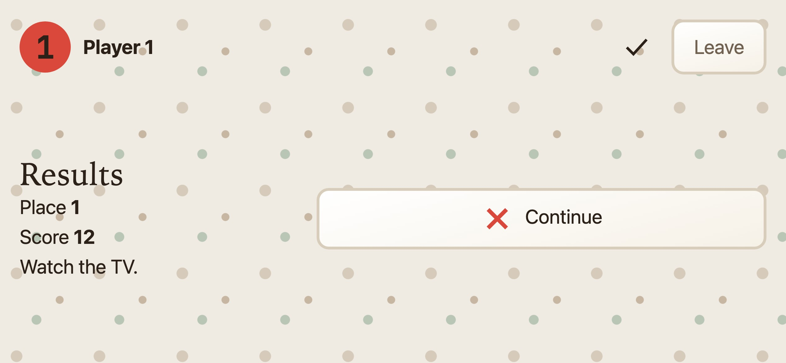 | | |
| 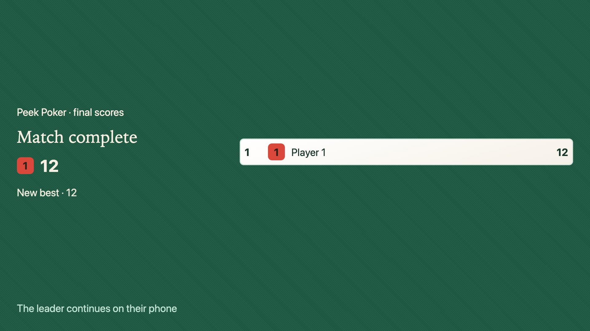 | | |
| 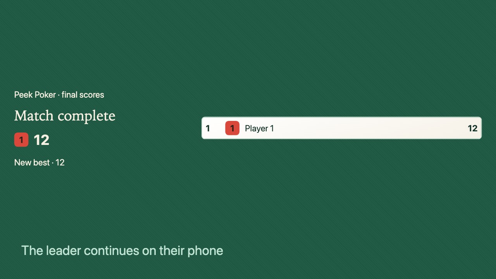 | | |
| 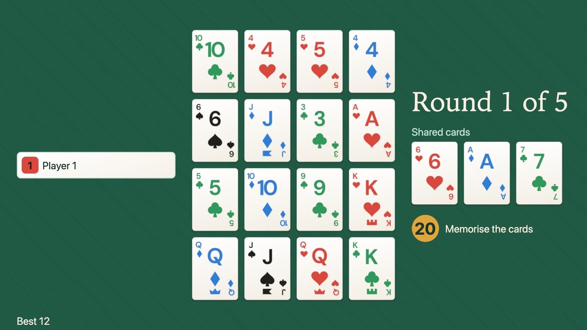 | | |
|  | | |
| 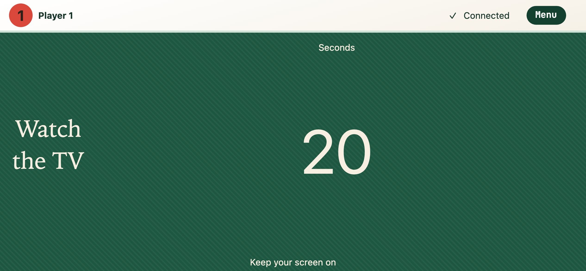 | | |
| 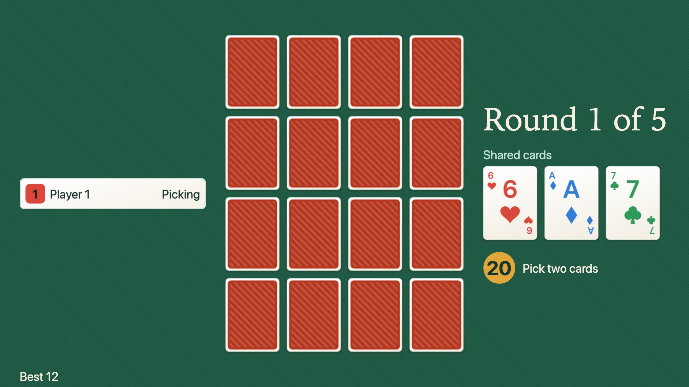 | | |
| 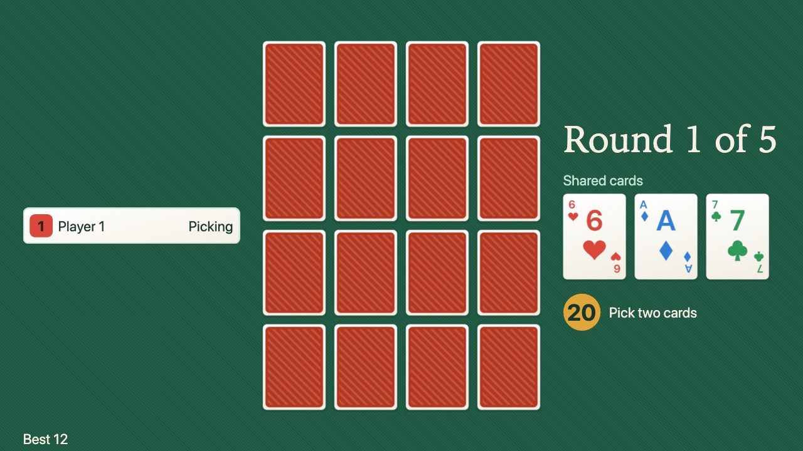 | | |
| 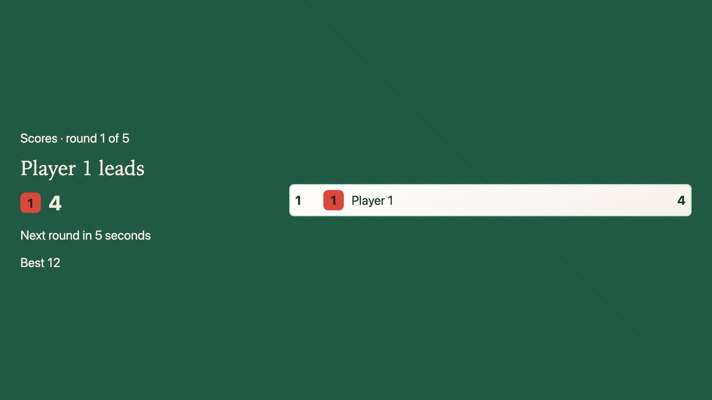 | | |
| 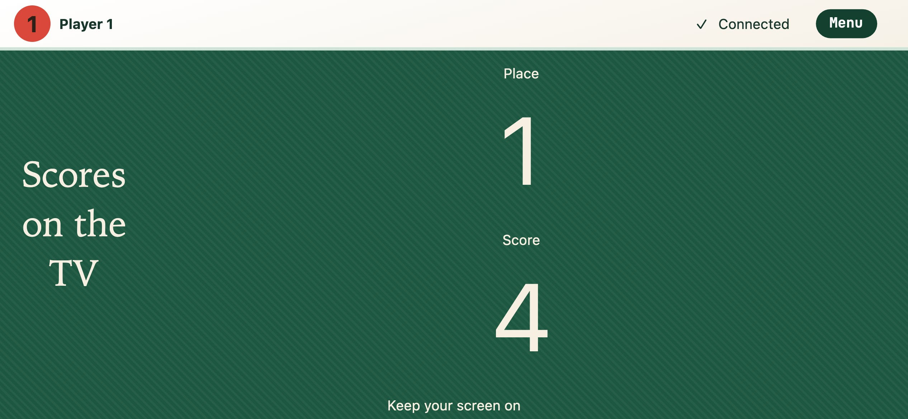 | | |
|  | | |
| 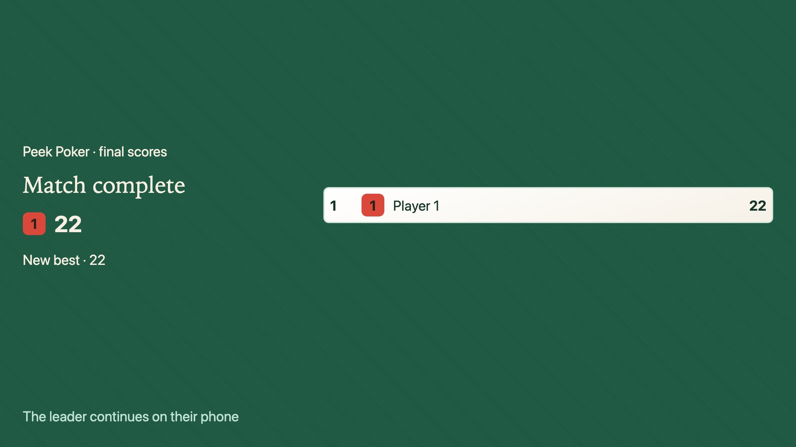 | | |
| 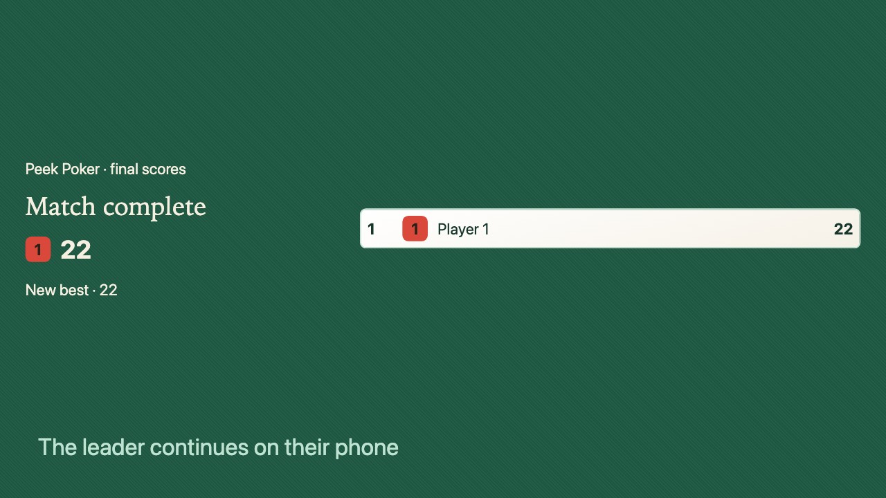 | | |

## Strips

| Screenshot | What it shows | Looked at by |
|---|---|---|
| 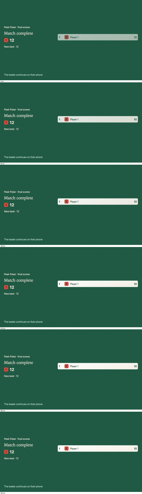 | | |
| 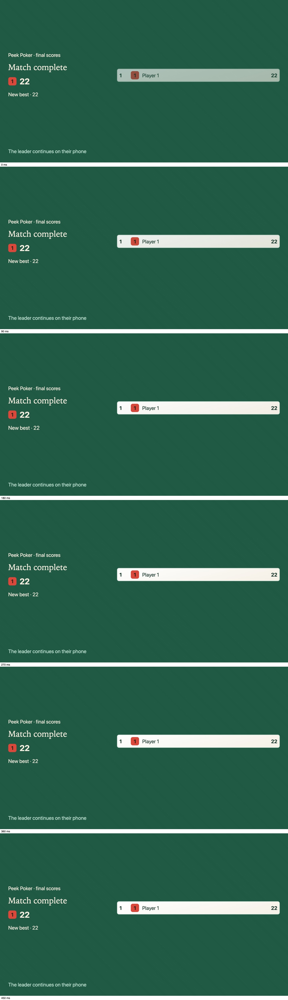 | | |

| Acceptance statement | Pass / fail | Evidence |
|---|---|---|
| | | |
