# P-05-scores-podium UAT evidence

Visual review: Claude (integrator), 2026-11-18, round 9 (29d794d0). Supersedes r8-p1. Stills other than 18 match r8-p1 as described by review 3.

Command: `node tools/uat/run.mjs -- P-05-scores-podium --phones 1 --out r9-p1`
Commit: `29d794d02f05f0e8e711782e4d0a81032acbaeb7`
Viewports: 1920×1080, 844×390, 1280×720

| Timing | ms | Status |
|---|---:|---|
| Create room through host page | 1527.8 | completed |

Expected errors (count):
None

## Real server

| Screenshot | What it shows | Looked at by |
|---|---|---|
| 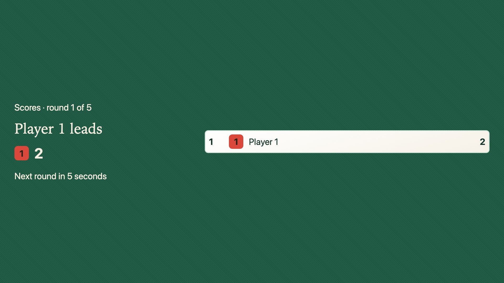 | Match 1 (no stored best), round-1 scoreboard: "Scores · round 1 of 5", "Player 1 leads", seat 1 and 2, "Next round in 5 seconds", no Best line; one ranked row on the right, 1 : 1.618 | Claude (integrator, r9; text from review 3, unchanged stills) |
| 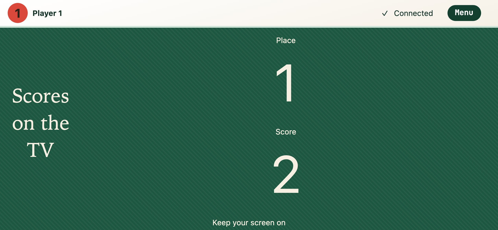 | Phone 1 during the scoreboard: "Scores on the TV", Place 1, Score 2, cream on green felt, readable | Claude (integrator, r9; text from review 3, unchanged stills) |
| 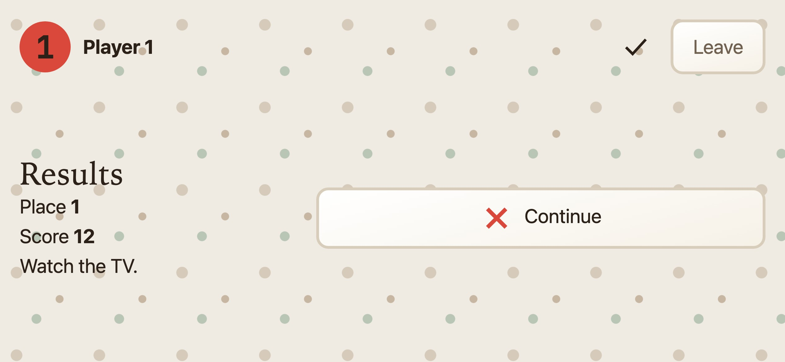 | Phone Results after match 1: Place 1, Score 12, "Watch the TV.", leader's Continue; console dots; no Teams toggle | Claude (integrator, r9; text from review 3, unchanged stills) |
| 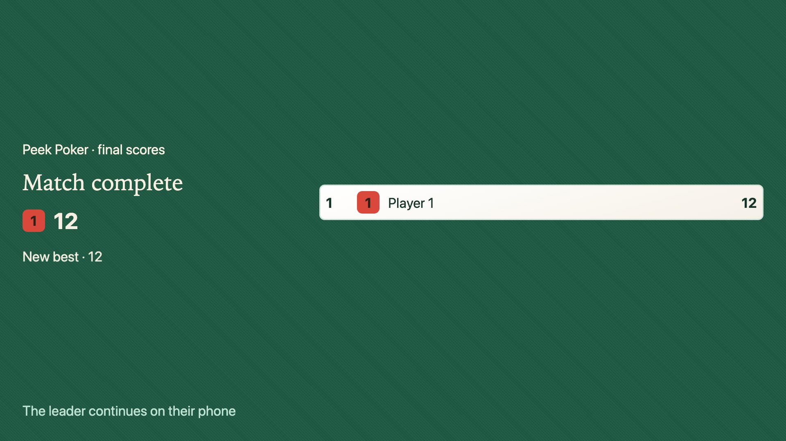 | Solo final at 1920 after the save: "Match complete", 12, "New best · 12" beneath the score; shell hint is the only hand-off line | Claude (integrator, r9; text from review 3, unchanged stills) |
| 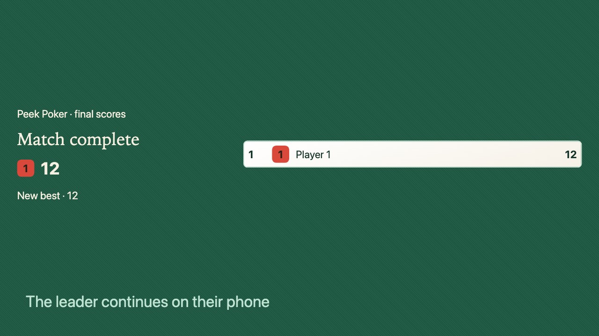 | Same at 1280 × 720: board scaled, shell hint at its 1080 size, no overlap | Claude (integrator, r9; text from review 3, unchanged stills) |
| 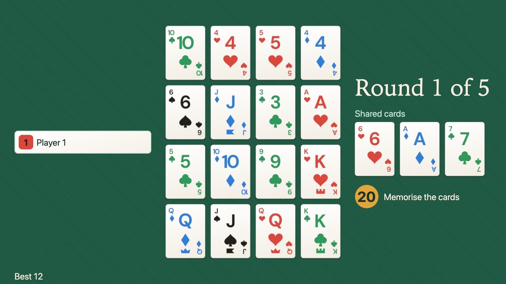 | Match 2 memorise at 1920: "Best 12" bottom-left, clear of the player row and grid | Claude (integrator, r9; text from review 3, unchanged stills) |
|  | Same at 1280 × 720, "Best 12" inside the viewport, no collision | Claude (integrator, r9; text from review 3, unchanged stills) |
| 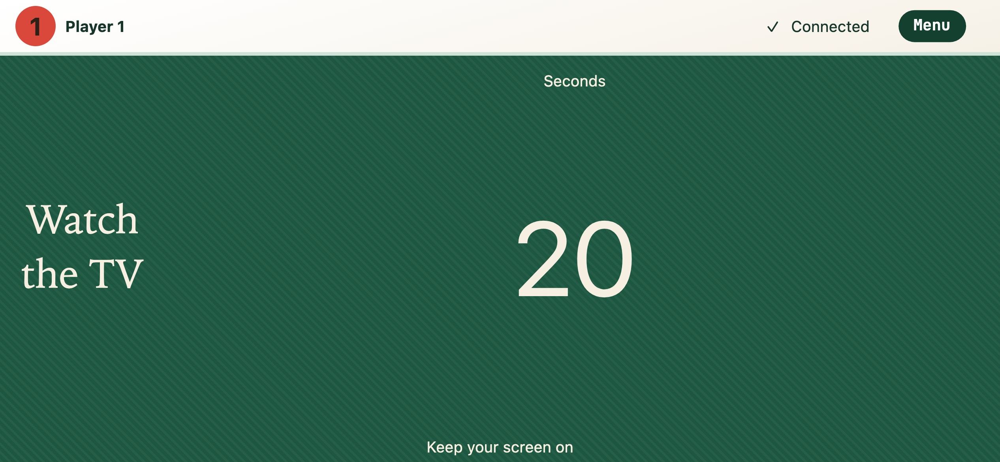 | Phone after Play again: felt, "Watch the TV", Seconds 20, readable | Claude (integrator, r9; text from review 3, unchanged stills) |
| 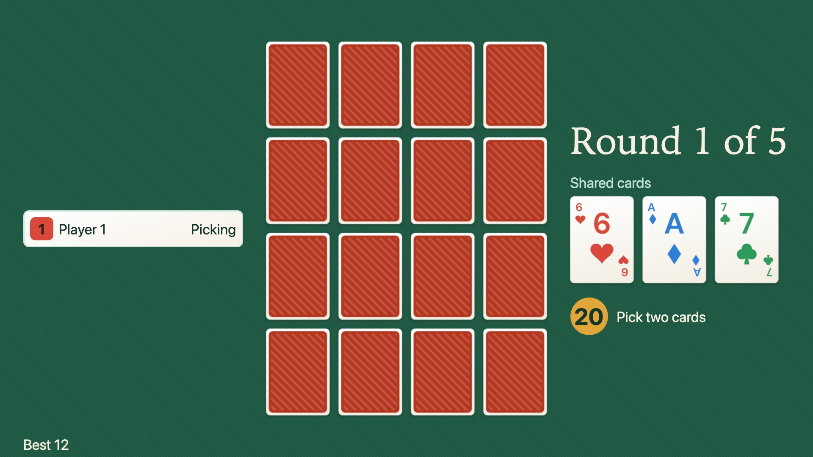 | Match 2 pick at 1920: face-down grid, "Picking", "Best 12", no collision | Claude (integrator, r9; text from review 3, unchanged stills) |
| 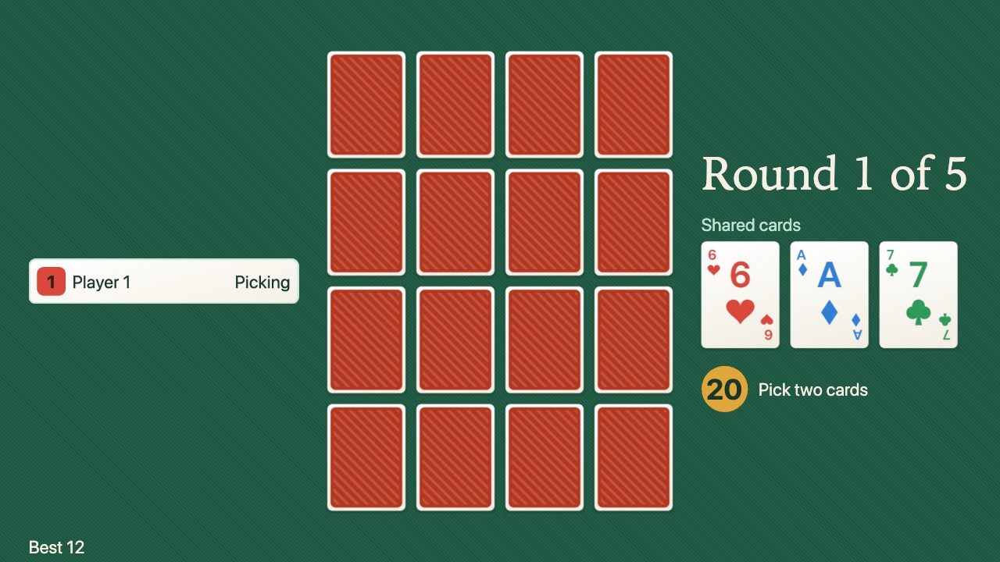 | Same at 1280 × 720 | Claude (integrator, r9; text from review 3, unchanged stills) |
|  | Phone during the match-2 scoreboard: Place 1, Score 4, felt, readable | Claude (integrator, r9; text from review 3, unchanged stills) |
|  | Phone Results after match 2: Place 1, Score 22, Continue | Claude (integrator, r9; text from review 3, unchanged stills) |
| 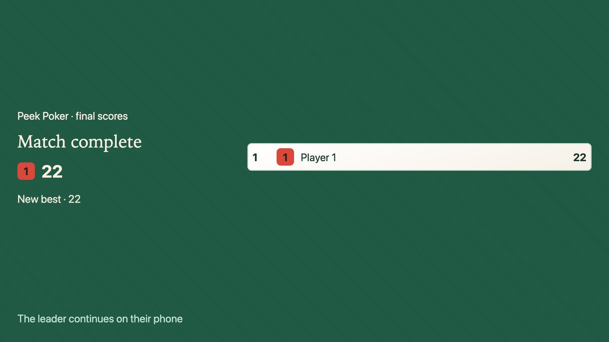 | Solo final at 1920 after the save: 22, "New best · 22" (12 beaten) | Claude (integrator, r9; text from review 3, unchanged stills) |
| 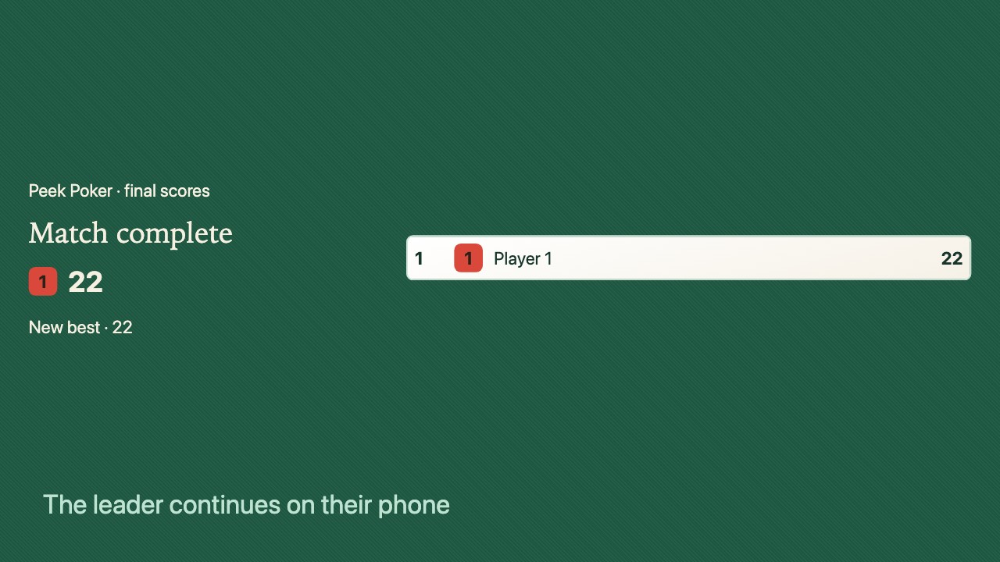 | Same at 1280 × 720, no overlap with the shell hint | Claude (integrator, r9; text from review 3, unchanged stills) |
| 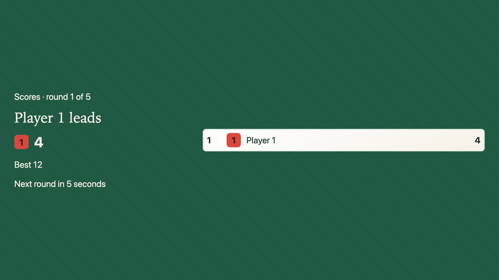 | Match 2 round-1 scoreboard: "Player 1 leads", 4, then "Best 12" directly under the score, then "Next round in 5 seconds" (round-9 fix of review 3 should-fix 1) | Claude (integrator) |

## Strips

| Screenshot | What it shows | Looked at by |
|---|---|---|
| 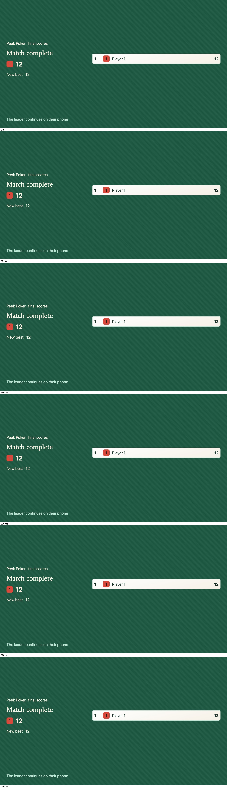 | Strip starts once "New best" shows, on a settled board (row fully drawn at 0 ms). Seek 0/90/180/270/360/450 ms: "New best · 12" left edge fixed at x 57; right edge 248, 249, 257, 249, 248, 248 (peak +9 px at 180 ms, at rest by 360 ms); no overshoot or sideways drift (measured) | Claude (integrator) |
| 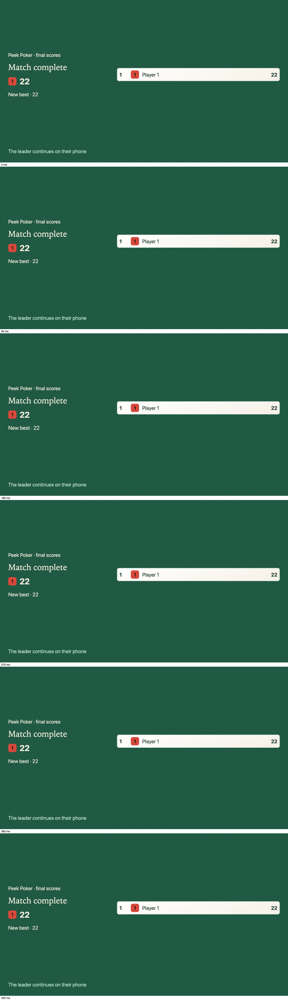 | Same for "New best · 22": right edge 252, 254, 261, 254, 252, 252; left edge 57 throughout; row settled throughout | Claude (integrator) |

## Acceptance

| Acceptance statement | Pass / fail | Evidence |
|---|---|---|
| Solo first match shows no Best; a stored best shows "Best N" in play and on the scoreboard | pass | 01, 13, 14, 16, 17, 18 |
| "New best · N" only after a successful save, for a completed match that stayed one player; a failed write, tie, lower score, multiplayer, join-then-leave or unreadable store never claims it | pass | 11, 28 (visual); `games/peek-poker/src/rules/saved-view.test.ts`, `apps/web/src/session-storage.test.ts`, UAT asserts stored `{schemaVersion:1,data:{best}}` |
| Phones show their own place and score between rounds and on Results, readable | pass | 02, 10, 15, 19, 27 |
| Final podium fits 1920 and 1280 with the shell hint, no game hand-off line | pass | 11, 12, 28, 29 |
| New best pulses once about its left edge on the settled board, no overshoot | pass | 09, 26 |
