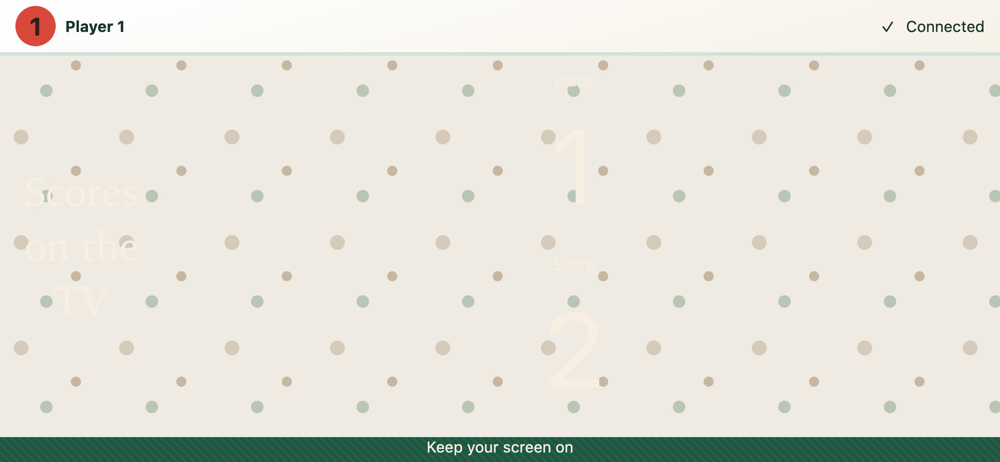
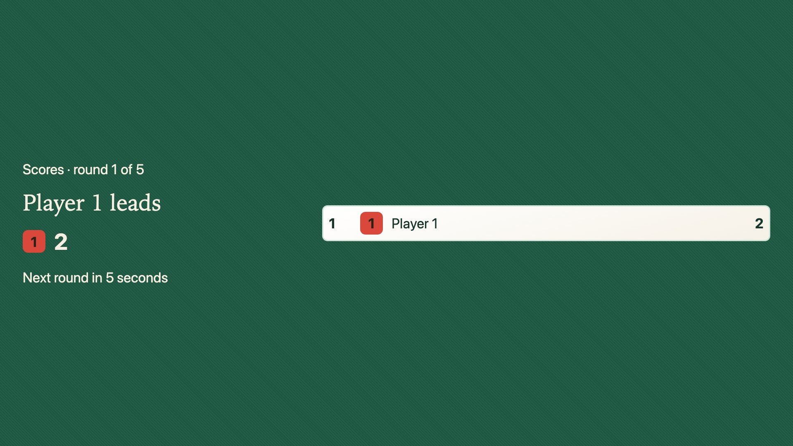
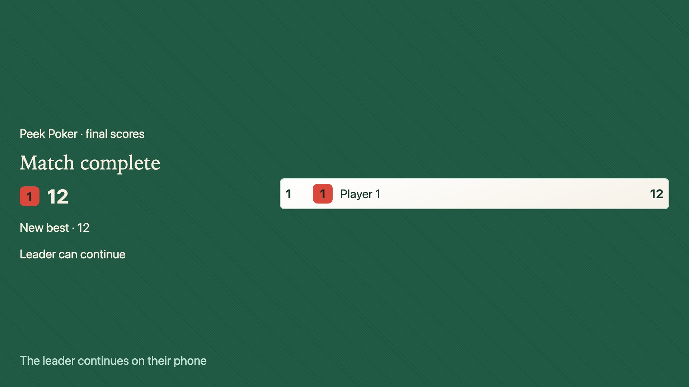
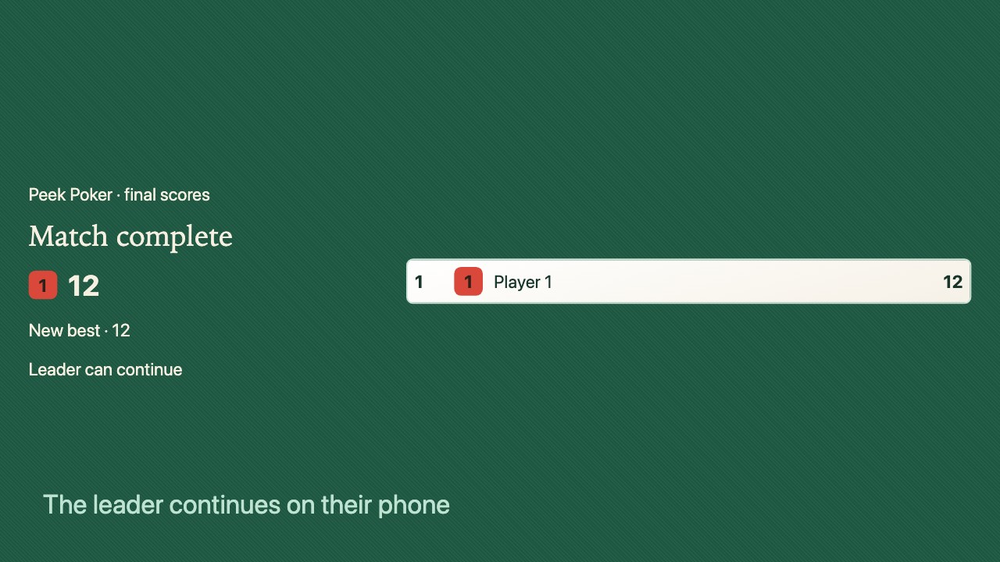
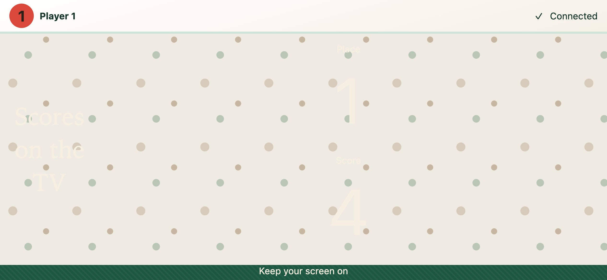
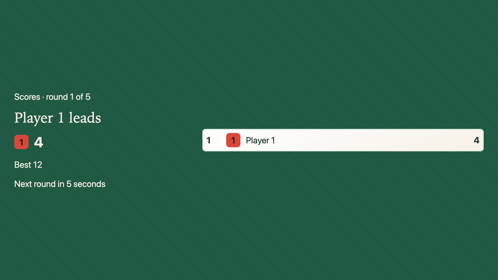
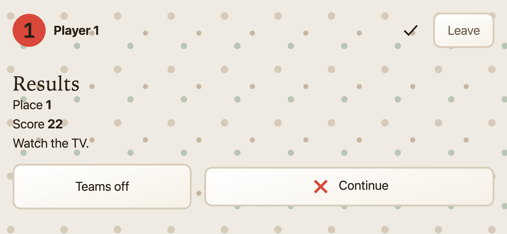
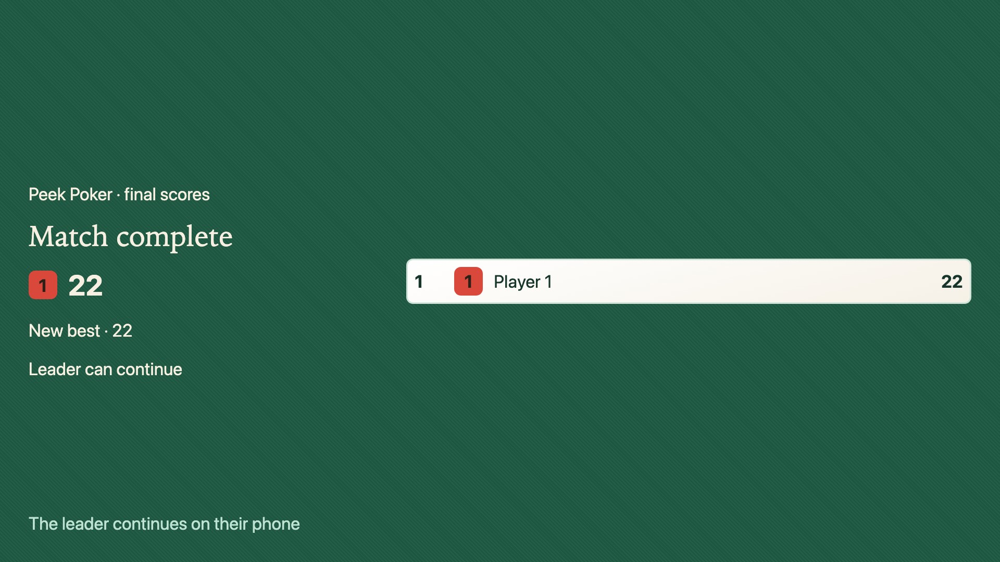
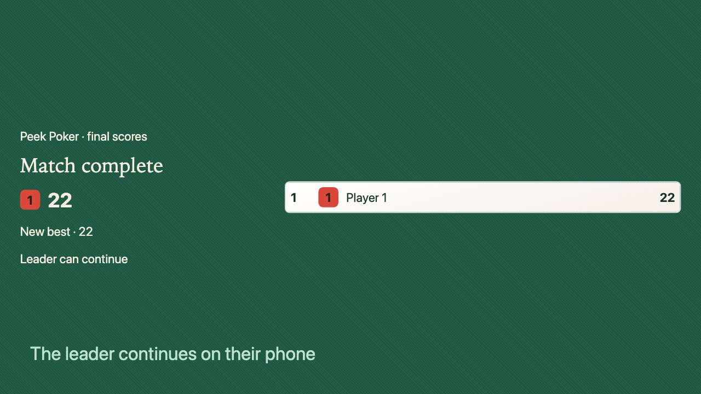

# P-05-scores-podium UAT evidence

Superseded by r8-p1 / r8-p3 (and r7-p8 for eight phones); not reviewed.

Command: `node tools/uat/run.mjs -- P-05-scores-podium --phones 1 --out round5-p1`
Commit: `c6575d96a9d8931a3c4e7990c35ed9a96674bbf1`
Viewports: 844×390, 1920×1080, 1280×720

| Timing | ms | Status |
|---|---:|---|
| Create room through host page | 1341.6 | completed |

Expected errors (count):
None

## Real server

| Screenshot | What it shows | Looked at by |
|---|---|---|
|  | | |
|  | | |
|  | | |
|  | | |
|  | | |
|  | | |
|  | | |
|  | | |
|  | | |
|  | | |

| Acceptance statement | Pass / fail | Evidence |
|---|---|---|
| | | |
