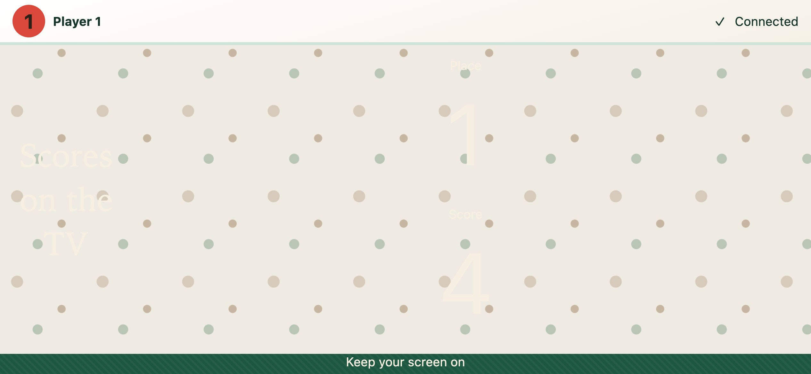
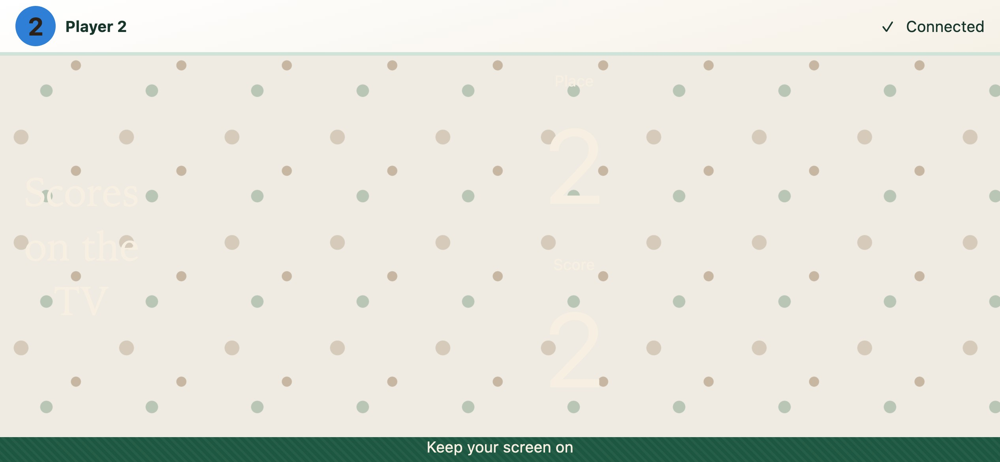
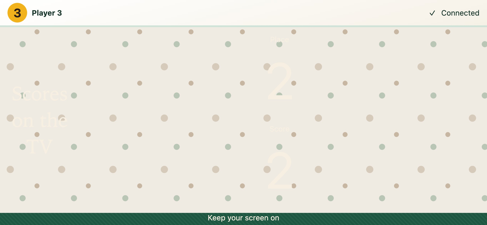
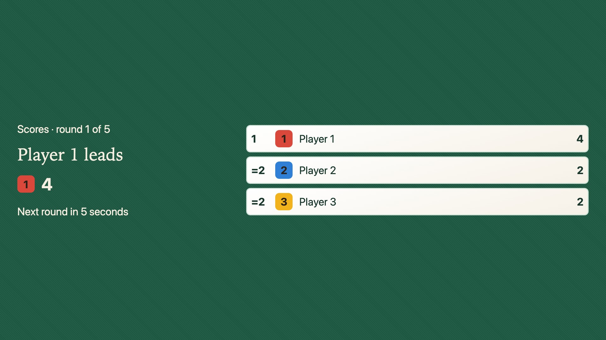
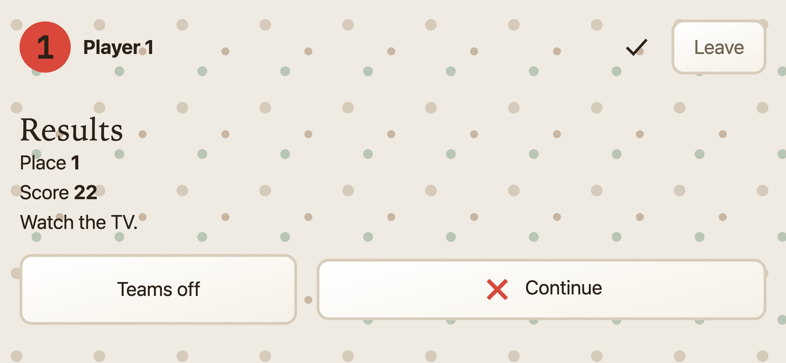
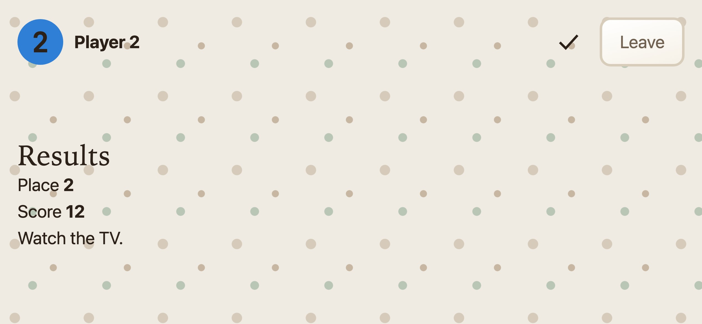
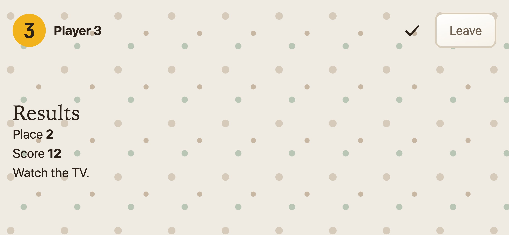
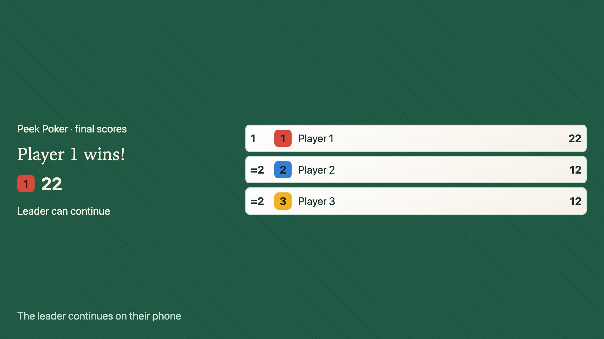
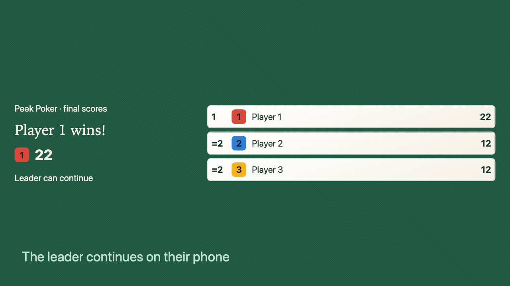

# P-05-scores-podium UAT evidence

Superseded by r8-p1 / r8-p3 (and r7-p8 for eight phones); not reviewed.

Command: `node tools/uat/run.mjs -- P-05-scores-podium --phones 3 --out round5-p3`
Commit: `4423c72a4d659e8381e5e7b855dcc580d6c6e04e`
Viewports: 844×390, 1920×1080, 1280×720

| Timing | ms | Status |
|---|---:|---|
| Create room through host page | 1561.8 | completed |

Expected errors (count):
None

## Real server

| Screenshot | What it shows | Looked at by |
|---|---|---|
|  | | |
|  | | |
|  | | |
|  | | |
|  | | |
|  | | |
|  | | |
|  | | |
|  | | |

| Acceptance statement | Pass / fail | Evidence |
|---|---|---|
| | | |
