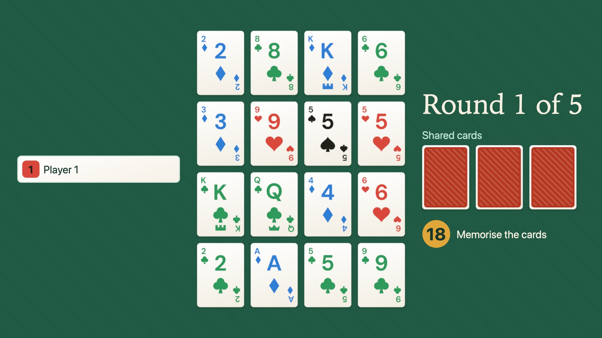
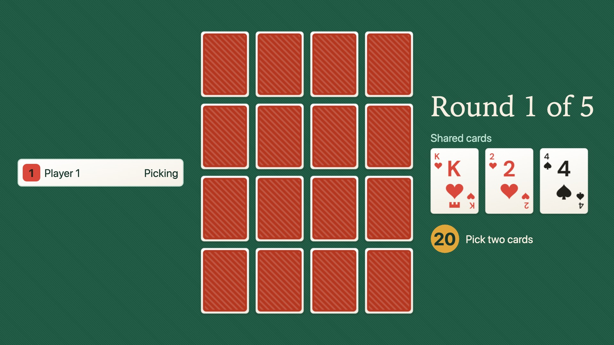
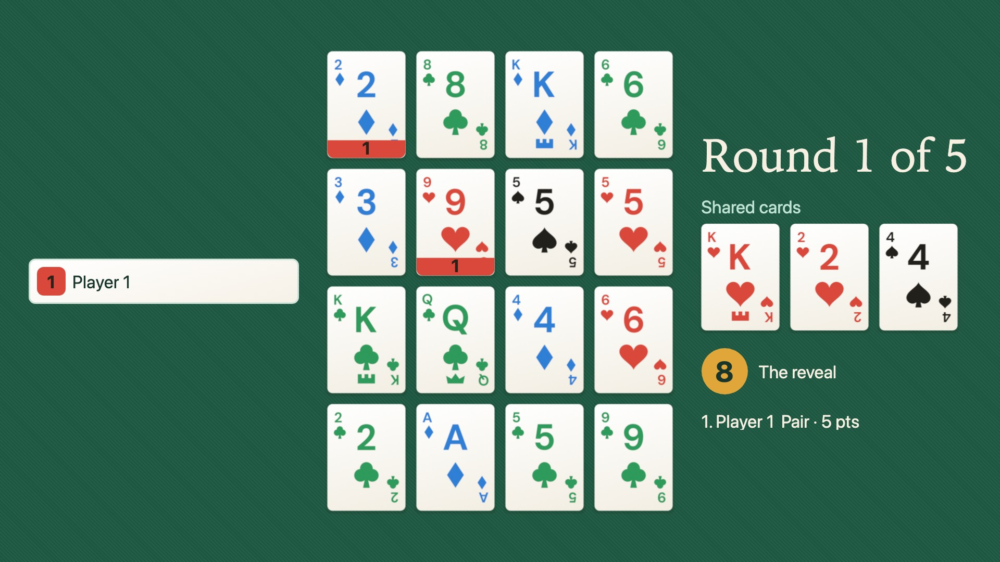
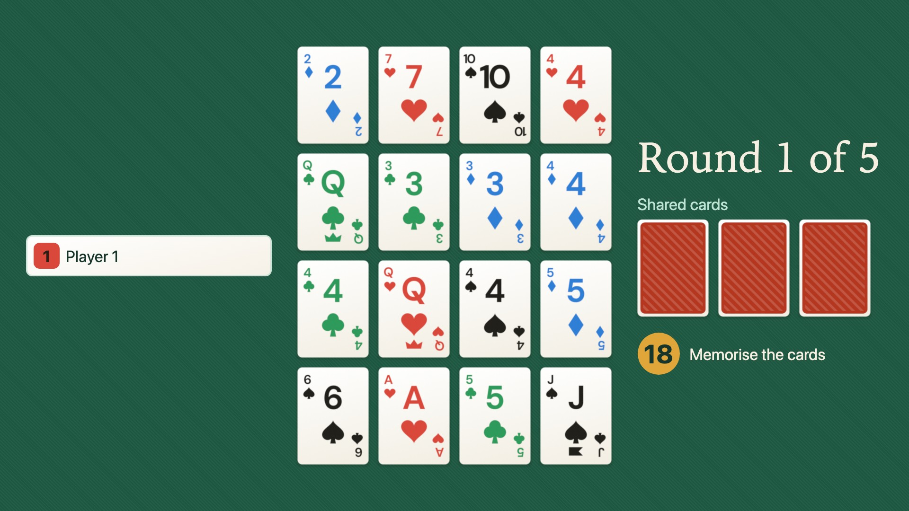

# P-06-table-in-console UAT evidence

Host browser: chromium 156.0.8078.4
Phone browser: chromium (legacy iPhone emulation) 156.0.8078.4

Automated execution only. Visual review and acceptance decisions are pending.

Command: `node tools/uat/run.mjs -- P-06-table-in-console --phones 1 --out p12-p1`
Commit: `cea706ab7058975b277de4fc69c2195b52181448`
Viewports: 1920×1080, 1280×720

| Timing | ms | Status |
|---|---:|---|
| Create room through host page | 1516.2 | completed |
| Create room through host page | 341.0 | completed |

Expected errors (count):
None

## Strips

| Screenshot | What it shows | Looked at by |
|---|---|---|
|  | | |
|  | | |

## Real server

| Screenshot | What it shows | Looked at by |
|---|---|---|
|  | | |
|  | | |
|  | | |
|  | | |
|  | | |

| Acceptance statement | Pass / fail | Evidence |
|---|---|---|
| | | |
