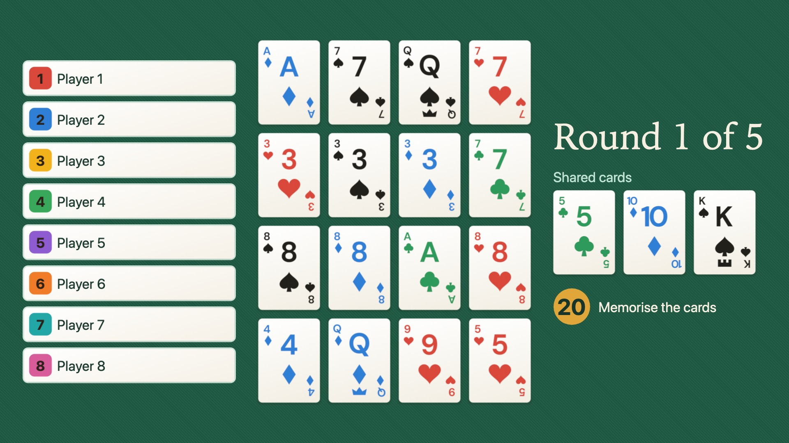
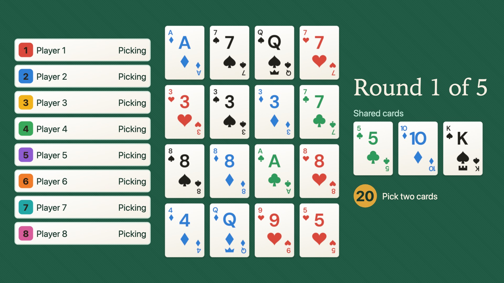
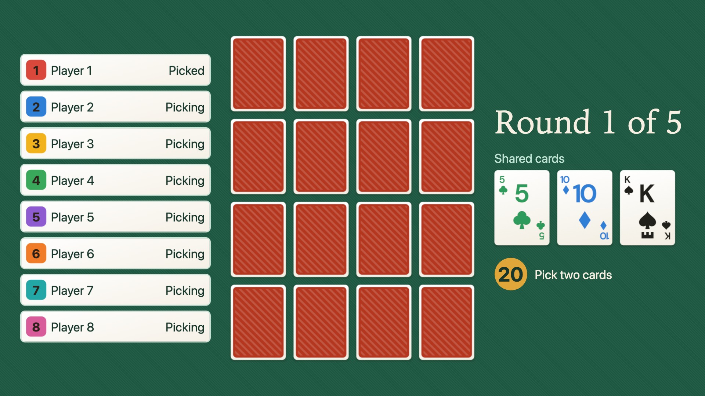
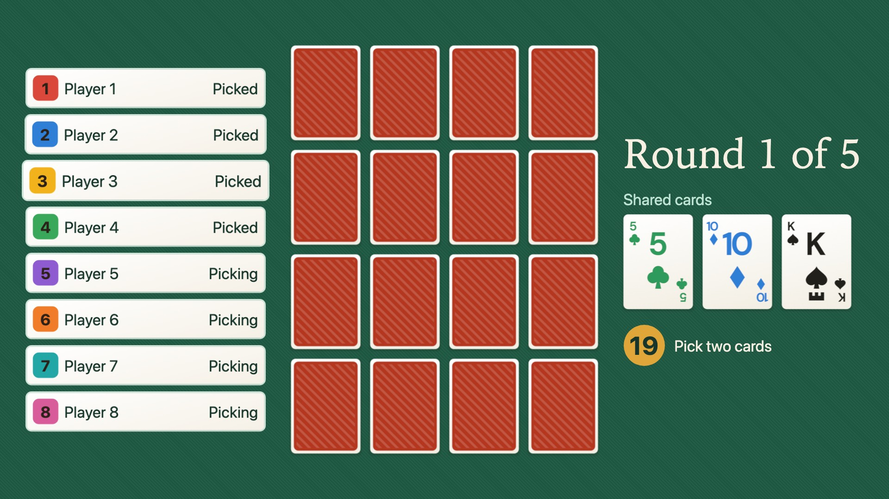
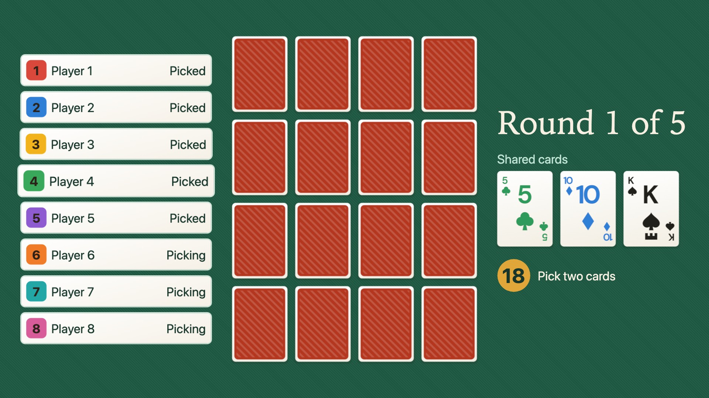
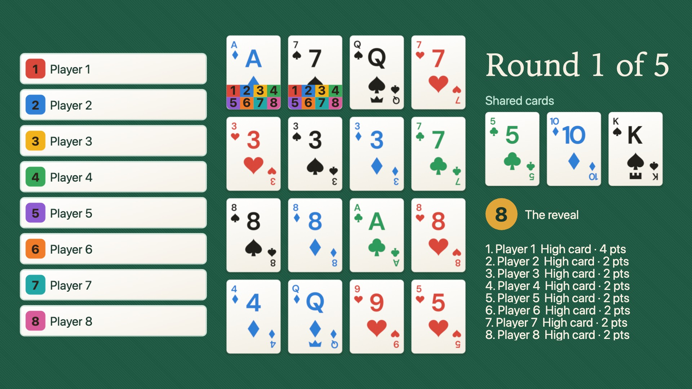

# P-06-table-in-console UAT evidence

Automated execution only. Visual review and acceptance decisions are pending.

Command: `node tools/uat/run.mjs -- P-06-table-in-console --phones 8 --out round1-p8`
Commit: `d21cf197da43ad043fe26c5d80bc62e6b2350c9f`
Viewports: 1920×1080

| Timing | ms | Status |
|---|---:|---|
| Create room through host page | 1157.3 | completed |

Expected errors (count):
None

## Real server

| Screenshot | What it shows | Looked at by |
|---|---|---|
|  | | |
|  | | |
|  | | |
|  | | |
|  | | |
|  | | |
|  | | |
|  | | |
|  | | |
|  | | |

| Acceptance statement | Pass / fail | Evidence |
|---|---|---|
| | | |
