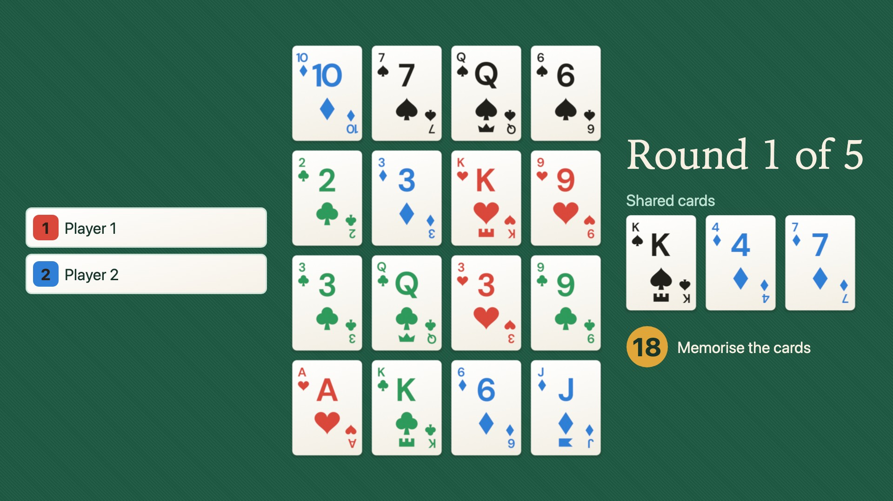
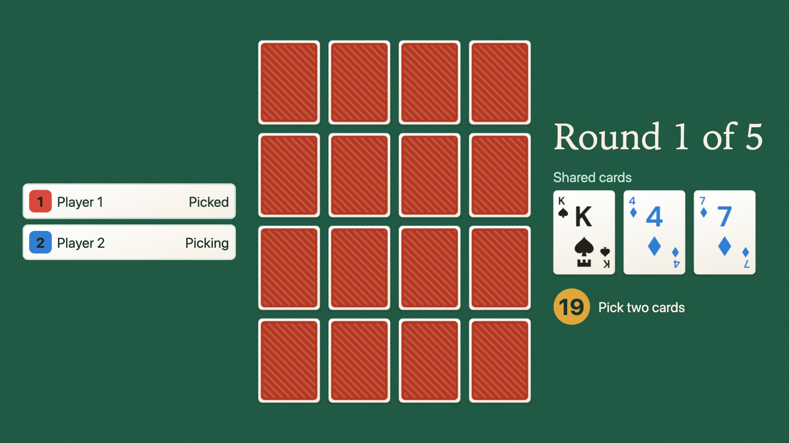
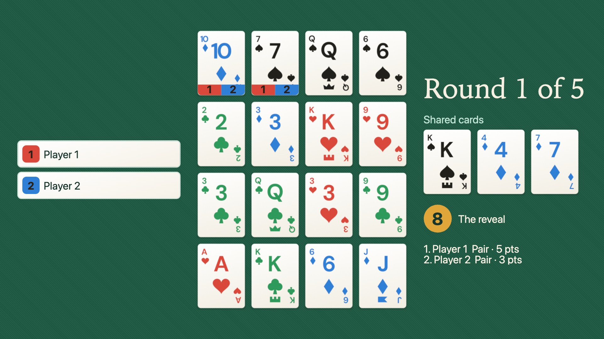

# P-06-table-in-console UAT evidence

Automated execution only. Visual review and acceptance decisions are pending.

Command: `node tools/uat/run.mjs -- P-06-table-in-console --phones 2 --out round3-p2`
Commit: `b3c937f81820ae952827b2911f21fe1033433c90`
Viewports: 1920×1080

| Timing | ms | Status |
|---|---:|---|
| Create room through host page | 1181.0 | completed |

Expected errors (count):
None

## Strips

| Screenshot | What it shows | Looked at by |
|---|---|---|
|  | | |

## Real server

| Screenshot | What it shows | Looked at by |
|---|---|---|
|  | | |
|  | | |
|  | | |
|  | | |

| Acceptance statement | Pass / fail | Evidence |
|---|---|---|
| | | |
