# P-06-table-in-console UAT evidence

Reviewed 2026-11-18 (P-06 review 6 opened every still; the integrator opened p8 11, 21, 22). Evidence still holds at merge commit d6c7ad40 (review 6).

Command: `node tools/uat/run.mjs -- P-06-table-in-console --phones 8 --frames --max-mb 24 --out round5-p8`
Commit: `05107482ee540a2374c45c51783825744189e688`
Viewports: 1920×1080, 1280×720

| Timing | ms | Status |
|---|---:|---|
| Create room through host page | 1898.4 | completed |
| Create room through host page | 204.6 | completed |

Expected errors (count):
None

## Strips

| Screenshot | What it shows | Looked at by |
|---|---|---|
| 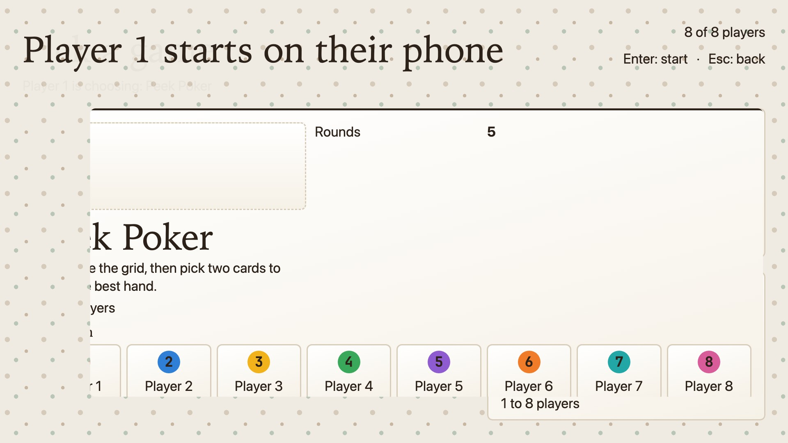 | The picker start screen ("Player 1 starts on their phone", Rounds 5) part-way through the tile expansion, the frame before Start. | Claude reviewer |
| 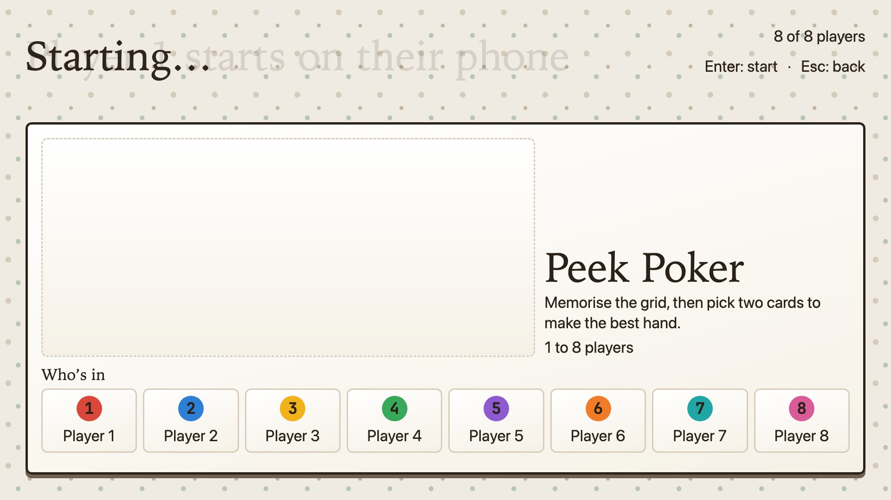 | "Starting…" fades in over the outgoing heading; expanded tile and eight seat chips, no bare surface. | Claude reviewer |
|  | "Starting…" held with the expanded tile and eight chips (settings mirror cleared by main at Start). | Claude reviewer |
|  | "Starting…" held. | Claude reviewer |
| 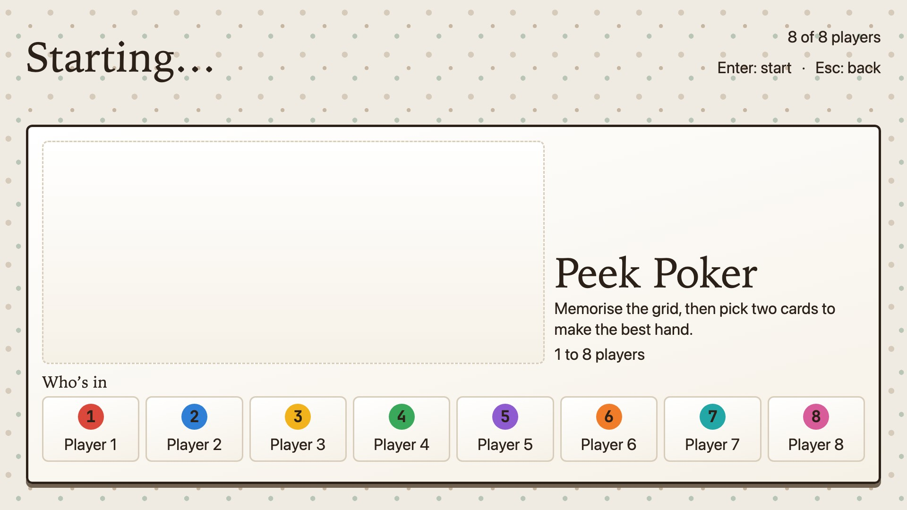 | "Starting…" held. | Claude reviewer |
| 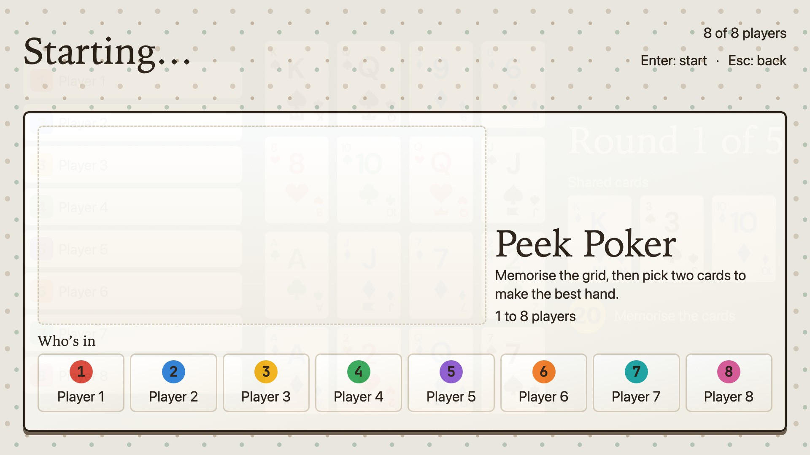 | Overlap crossfade: picker fading out as the table fades in, no blank frame. | Claude reviewer |
| 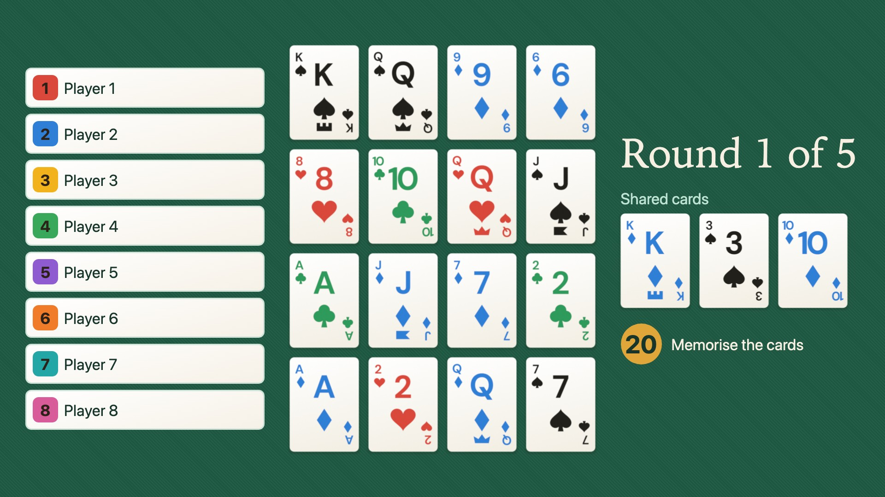 | Settled memorise table: 16 faces, shared K♦ 3♠ 10♦, eight rows. | Claude reviewer |
|  | Memorise, timer counting down. | Claude reviewer |
|  | Memorise, timer counting down. | Claude reviewer |
|  | Memorise, timer counting down. | Claude reviewer |
|  | Strip: Start → "Starting…" for 4 frames → one overlap frame → settled table; no bare or ghosted frame. | Claude reviewer and integrator |
| 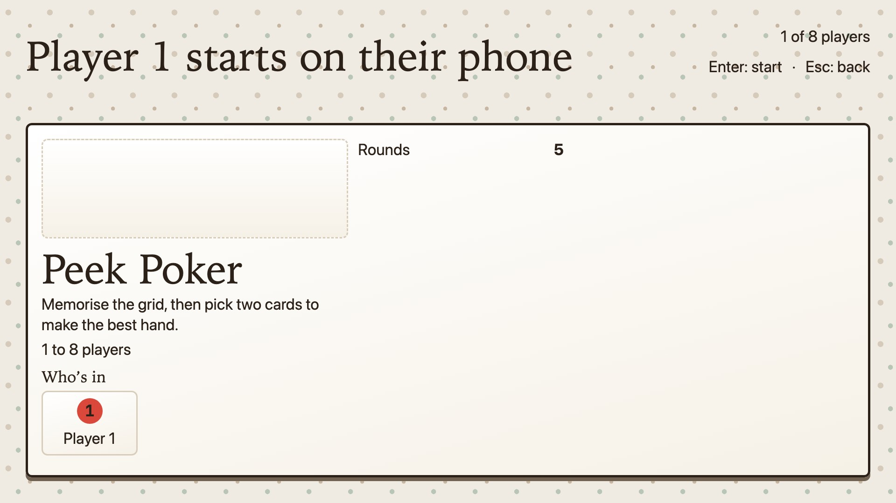 | Opened; consistent with the neighbouring frames. | Claude reviewer |
| 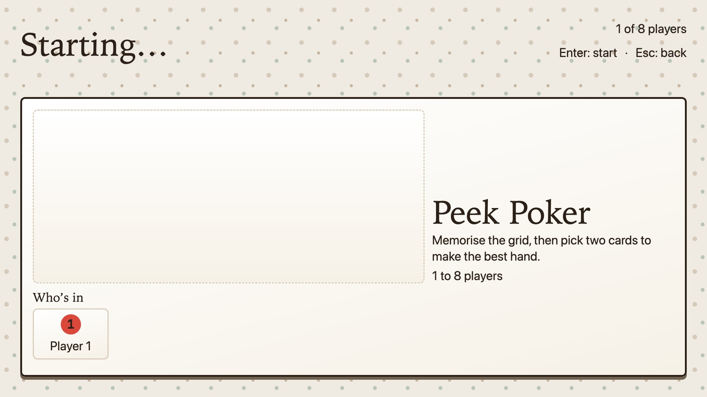 | Opened; consistent with the neighbouring frames. | Claude reviewer |
|  | Opened; consistent with the neighbouring frames. | Claude reviewer |
|  | Opened; consistent with the neighbouring frames. | Claude reviewer |
|  | Opened; consistent with the neighbouring frames. | Claude reviewer |
|  | Opened; consistent with the neighbouring frames. | Claude reviewer |
|  | Opened; consistent with the neighbouring frames. | Claude reviewer |
|  | Opened; consistent with the neighbouring frames. | Claude reviewer |
|  | Opened; consistent with the neighbouring frames. | Claude reviewer |
| 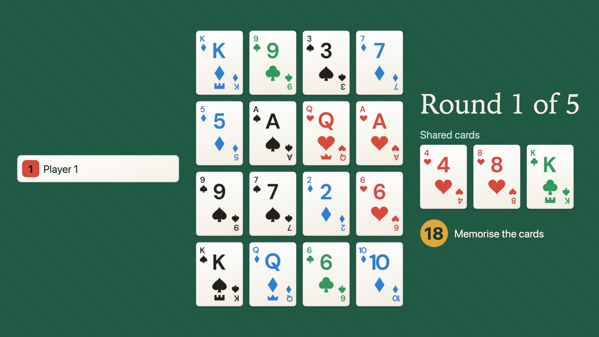 | Opened; consistent with the neighbouring frames. | Claude reviewer |
|  | Reduced-motion strip: "Starting…" then an instant switch to the table, no fade frame. | Claude reviewer |

## Real server

| Screenshot | What it shows | Looked at by |
|---|---|---|
|  | Settled memorise table (last strip frame). | Claude reviewer |
|  | 1280 × 720: the whole table fits, nothing clipped. | Claude reviewer |
| 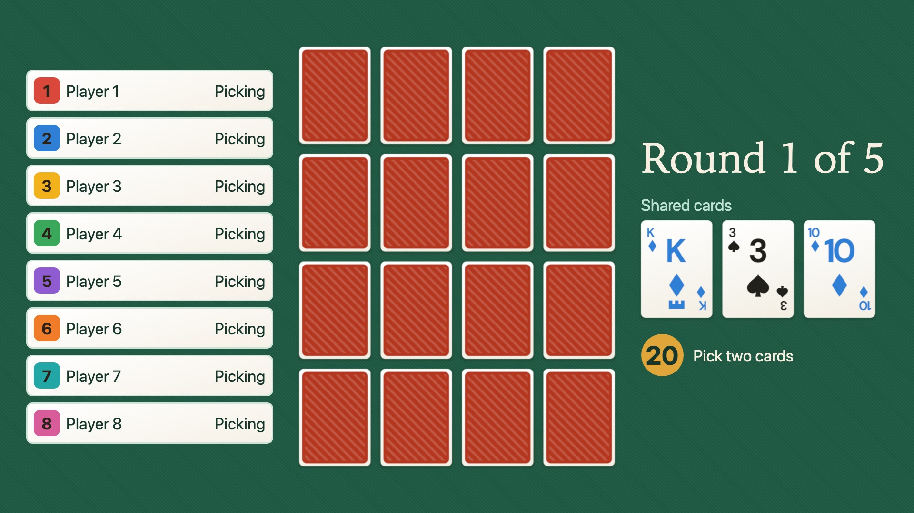 | Pick phase: 16 backs, all eight rows Picking, "Pick two cards", 20. | Claude reviewer |
|  | Lock 1: the locker reads Picked; grid stays backs; no card marked. | Claude reviewer |
| 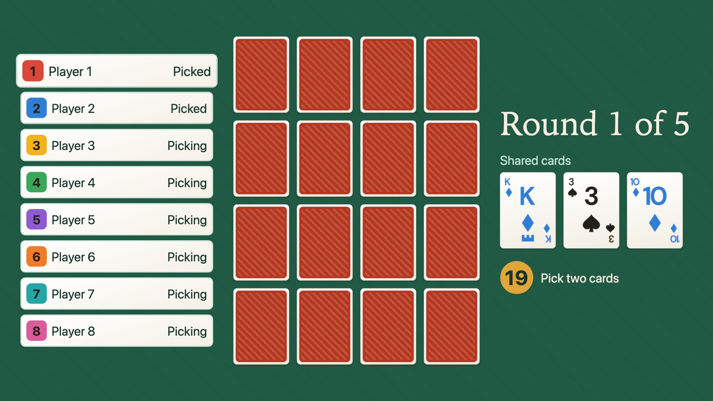 | Lock 2; grid stays backs. | Claude reviewer |
|  | Lock 3; grid stays backs. | Claude reviewer |
| 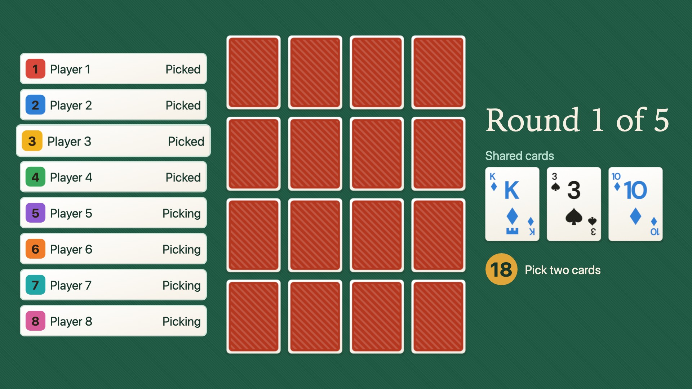 | Lock 4; grid stays backs. | Claude reviewer |
|  | Lock 5; grid stays backs. | Claude reviewer |
| 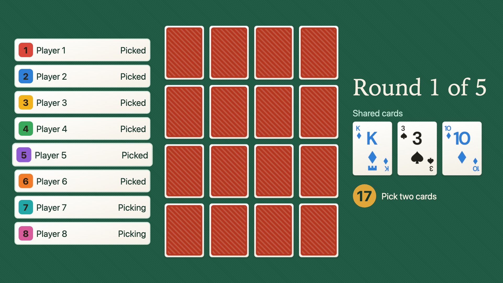 | Lock 6; grid stays backs. | Claude reviewer |
| 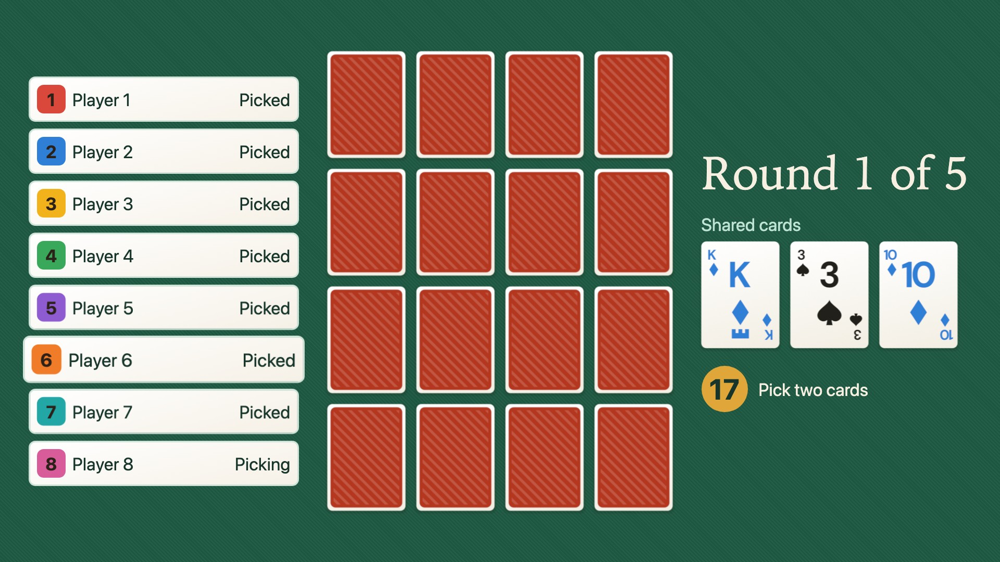 | Lock 7: seven Picked, one Picking; only backs. | Claude reviewer and integrator |
| 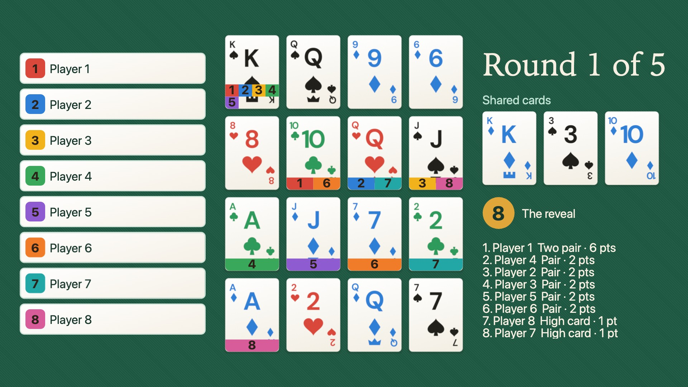 | Reveal: picks marked by seat colour and number (five markers on K♠ cover its lower pip; rank and index readable, OQ-043); ranking correct for K♦ 3♠ 10♦. | Claude reviewer and integrator |
|  | Settled memorise table in the reduced-motion room. | Claude reviewer |

| Acceptance statement | Pass / fail | Evidence |
|---|---|---|
| Start holds "Starting…" with the expanded tile and seat chips until the table is ready, then picker and table overlap in one crossfade with no bare frame | Pass | 11 (strip), 02–06 |
| With reduced motion the switch is instant (no fade frame) | Pass | reduced-motion strip |
| The table fits 1280 × 720 | Pass | 13 |
| No pick or mark is visible on the TV before the reveal (PP-005 big-screen clause) | Pass | pick and lock-in stills |
| The reveal marks each pick by seat colour and number and ranks the hands correctly | Pass (p8: five markers on one card cover the lower pip; OQ-043) | reveal still |
| Nothing is requested after Start | Pass | requests-after-start.json |
| Four table fonts finish before Start | Pass | font-requests-before-start.json |
