# P-07-full-match UAT evidence

Accepted for P-07 full-match and secrecy coverage, with the final-round scoreboard copy defect recorded for P-10. PP-032 visual acceptance remains qualified by that defect. Integrator review: Claude, 2026-11-18. Round 5 report completion: Codex, 2026-11-18 (all listed images opened in contact sheets; detailed reveal images and strips also opened at full size).

Command: `node tools/uat/run.mjs -- P-07-full-match --phones 8 --max-mb 24 --timeout-min 20 --out round3-p8`
Commit: `5d8be7e48d0f6f6ca20ae5d82b03bb434dc80e5f`
Viewports: 1920×1080, 844×390, 1280×720

| Timing | ms | Status |
|---|---:|---|
| Create room through host page | 1272.8 | completed |
| Lobby: all phones join through real pairing | 1967.0 | completed |
| Picker → default five rounds → Start real Peek Poker | 1304.2 | completed |
| R1 PP-002/003/004/011: deal, memorise timer and swap difficulty | 10045.2 | completed |
| R1 PP-005/006/021: early and late private picks; TV lock seats only | 12112.5 | completed |
| R1 PP-020/021 PLAT-033: every pre-reveal public view is secret | 3.5 | completed |
| R1 PP-020: every decoded control-channel message is secret before reveal | 2.0 | completed |
| R1 PP-020/021: every sampled pick DOM frame has no early reveal | 212.5 | completed |
| R1 PP-007/008/009/010: reveal, random fill, poker points and speed tie | 4982.8 | completed |
| R1 PP-032: scoreboard and every phone’s own place and score | 3590.1 | completed |
| R2 PP-002/003/004/011: deal, memorise timer and swap difficulty | 6504.1 | completed |
| R2 PP-005/006/021: early and late private picks; TV lock seats only | 10297.8 | completed |
| R2 PP-020/021 PLAT-033: every pre-reveal public view is secret | 2.1 | completed |
| R2 PP-020: every decoded control-channel message is secret before reveal | 1.4 | completed |
| R2 PP-020/021: every sampled pick DOM frame has no early reveal | 170.9 | completed |
| R2 PP-007/008/009/010: reveal, random fill, poker points and speed tie | 3646.2 | completed |
| R2 PP-032: scoreboard and every phone’s own place and score | 2896.7 | completed |
| R3 PP-002/003/004/011: deal, memorise timer and swap difficulty | 6822.3 | completed |
| R3 PP-005/006/021: early and late private picks; TV lock seats only | 10447.8 | completed |
| R3 PP-020/021 PLAT-033: every pre-reveal public view is secret | 1.3 | completed |
| R3 PP-020: every decoded control-channel message is secret before reveal | 1.8 | completed |
| R3 PP-020/021: every sampled pick DOM frame has no early reveal | 164.2 | completed |
| R3 PP-007/008/009/010: reveal, random fill, poker points and speed tie | 3621.3 | completed |
| R3 PP-032: scoreboard and every phone’s own place and score | 2886.1 | completed |
| R4 PP-002/003/004/011: deal, memorise timer and swap difficulty | 6034.5 | completed |
| R4 PP-005/006/021: early and late private picks; TV lock seats only | 10414.5 | completed |
| R4 PP-020/021 PLAT-033: every pre-reveal public view is secret | 1.6 | completed |
| R4 PP-020: every decoded control-channel message is secret before reveal | 0.7 | completed |
| R4 PP-020/021: every sampled pick DOM frame has no early reveal | 172.3 | completed |
| R4 PP-007/008/009/010: reveal, random fill, poker points and speed tie | 3612.0 | completed |
| R4 PP-032: scoreboard and every phone’s own place and score | 2886.3 | completed |
| R5 PP-002/003/004/011: deal, memorise timer and swap difficulty | 8991.8 | completed |
| R5 PP-005/006/021: early and late private picks; TV lock seats only | 11779.5 | completed |
| R5 PP-020/021 PLAT-033: every pre-reveal public view is secret | 1.8 | completed |
| R5 PP-020: every decoded control-channel message is secret before reveal | 0.9 | completed |
| R5 PP-020/021: every sampled pick DOM frame has no early reveal | 186.1 | completed |
| R5 PP-007/008/009/010: reveal, random fill, poker points and speed tie | 4509.7 | completed |
| R5 PP-032: scoreboard and every phone’s own place and score | 3561.6 | completed |
| PP-001/032: final podium at 1920 and 1280, own final stats, Continue → picker | 2021.3 | completed |

Expected errors (count):
None

## Real server

| Screenshot | What it shows | Looked at by |
|---|---|---|
| 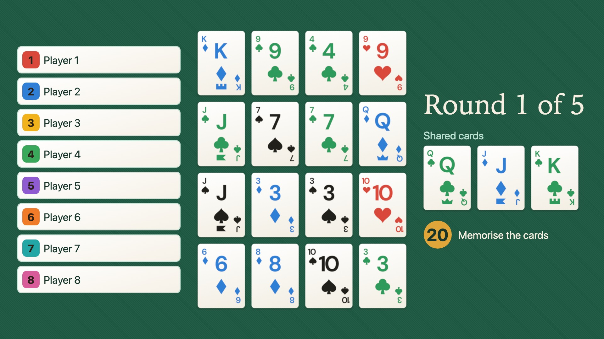 | Face-up 4 × 4 grid, three shared cards and memorise countdown. | Codex, report completion, 2026-11-18 (contact sheet) |
|  | Watch the TV with Seconds countdown. | Codex, report completion, 2026-11-18 (contact sheet) |
|  | Watch the TV with Seconds countdown. | Codex, report completion, 2026-11-18 (contact sheet) |
|  | Watch the TV with Seconds countdown. | Codex, report completion, 2026-11-18 (contact sheet) |
|  | Watch the TV with Seconds countdown. | Codex, report completion, 2026-11-18 (contact sheet) |
|  | Watch the TV with Seconds countdown. | Codex, report completion, 2026-11-18 (contact sheet) |
| 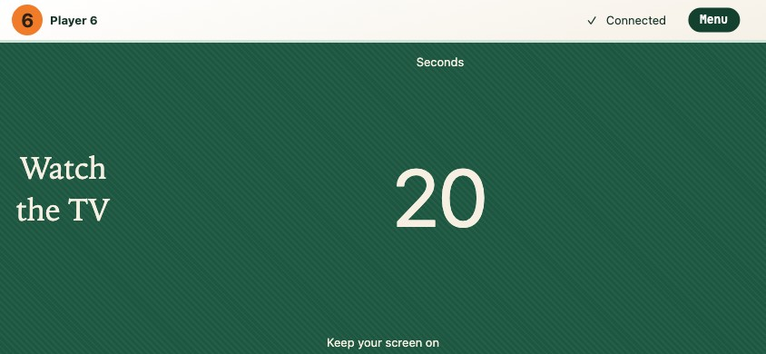 | Watch the TV with Seconds countdown. | Codex, report completion, 2026-11-18 (contact sheet) |
| 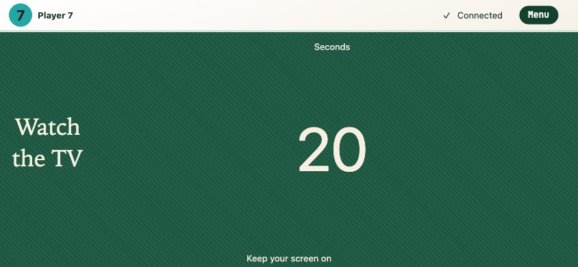 | Watch the TV with Seconds countdown. | Codex, report completion, 2026-11-18 (contact sheet) |
|  | Watch the TV with Seconds countdown. | Codex, report completion, 2026-11-18 (contact sheet) |
| 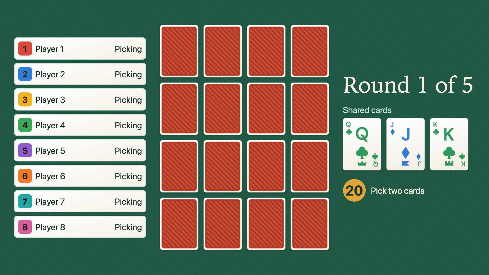 | Face-down 4 × 4 grid, face-up shared cards, Picking labels and countdown. | Codex, report completion, 2026-11-18 (contact sheet) |
|  | Face-down 4 × 4 grid with grey Lock in. | Codex, report completion, 2026-11-18 (contact sheet) |
|  | Face-down 4 × 4 grid with grey Lock in. | Codex, report completion, 2026-11-18 (contact sheet) |
| 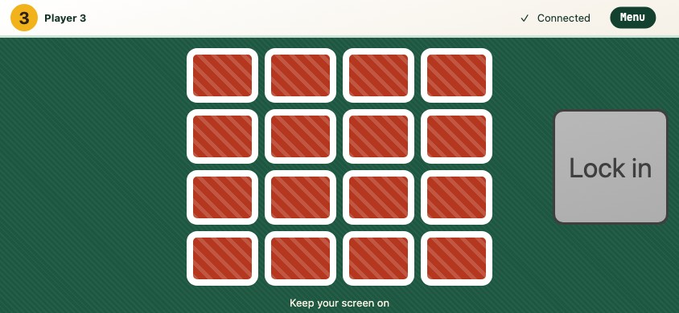 | Face-down 4 × 4 grid with grey Lock in. | Codex, report completion, 2026-11-18 (contact sheet) |
|  | Face-down 4 × 4 grid with grey Lock in. | Codex, report completion, 2026-11-18 (contact sheet) |
|  | Face-down 4 × 4 grid with grey Lock in. | Codex, report completion, 2026-11-18 (contact sheet) |
| 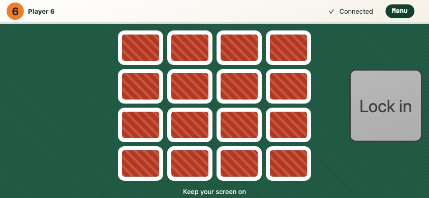 | Face-down 4 × 4 grid with grey Lock in. | Codex, report completion, 2026-11-18 (contact sheet) |
|  | Face-down 4 × 4 grid with grey Lock in. | Codex, report completion, 2026-11-18 (contact sheet) |
|  | Face-down 4 × 4 grid with grey Lock in. | Codex, report completion, 2026-11-18 (contact sheet) |
| 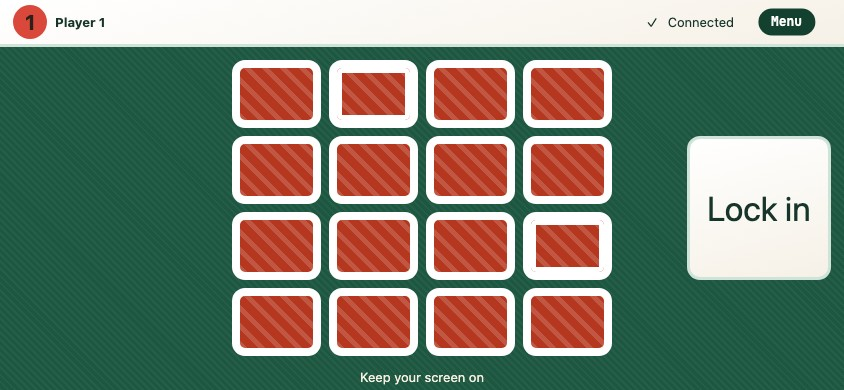 | Two cells have thicker white frames; Lock in is light. | Claude, integrator review, 2026-11-18 |
| 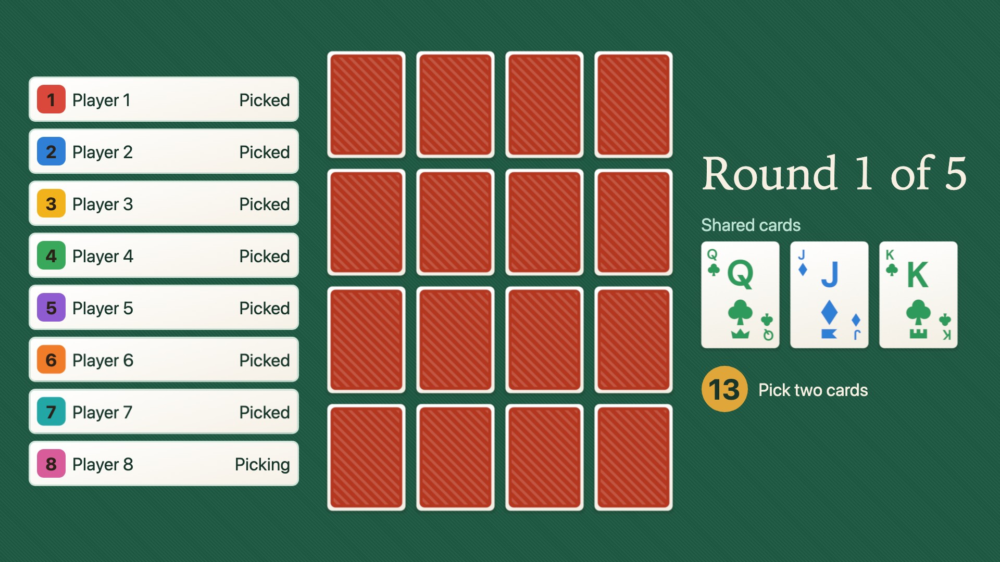 | Face-down grid, shared cards face up, Picked/Picking labels per seat. | Codex, report completion, 2026-11-18 (contact sheet) |
| 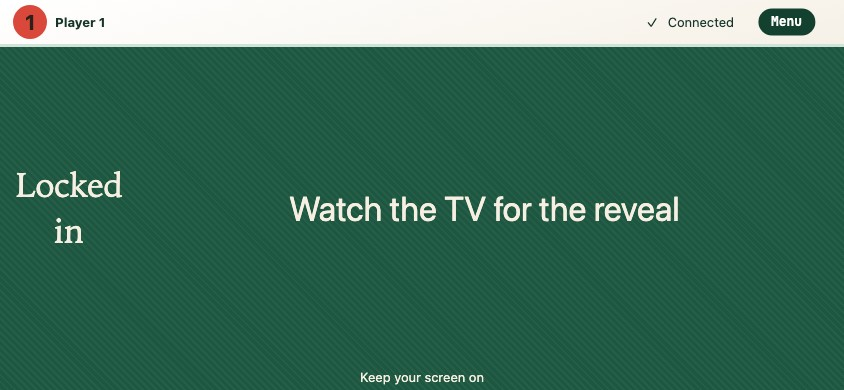 | Locked in and Watch the TV for the reveal; no card faces. | Codex, report completion, 2026-11-18 (contact sheet) |
|  | Locked in and Watch the TV for the reveal; no card faces. | Codex, report completion, 2026-11-18 (contact sheet) |
| 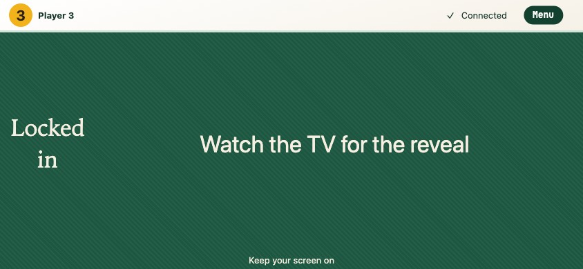 | Locked in and Watch the TV for the reveal; no card faces. | Codex, report completion, 2026-11-18 (contact sheet) |
|  | Locked in and Watch the TV for the reveal; no card faces. | Codex, report completion, 2026-11-18 (contact sheet) |
| 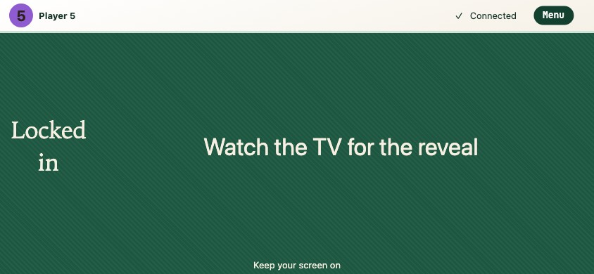 | Locked in and Watch the TV for the reveal; no card faces. | Codex, report completion, 2026-11-18 (contact sheet) |
| 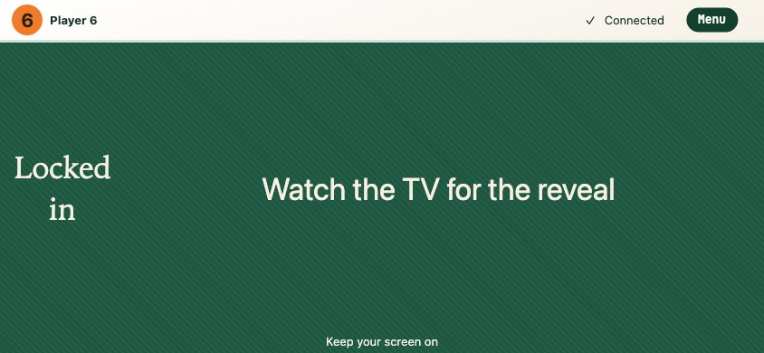 | Locked in and Watch the TV for the reveal; no card faces. | Codex, report completion, 2026-11-18 (contact sheet) |
|  | Locked in and Watch the TV for the reveal; no card faces. | Codex, report completion, 2026-11-18 (contact sheet) |
| 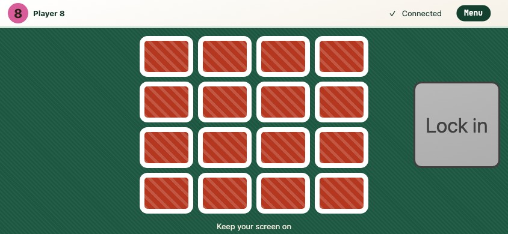 | Face-down 4 × 4 grid and grey Lock in for the idle seat. | Codex, report completion, 2026-11-18 (contact sheet) |
| 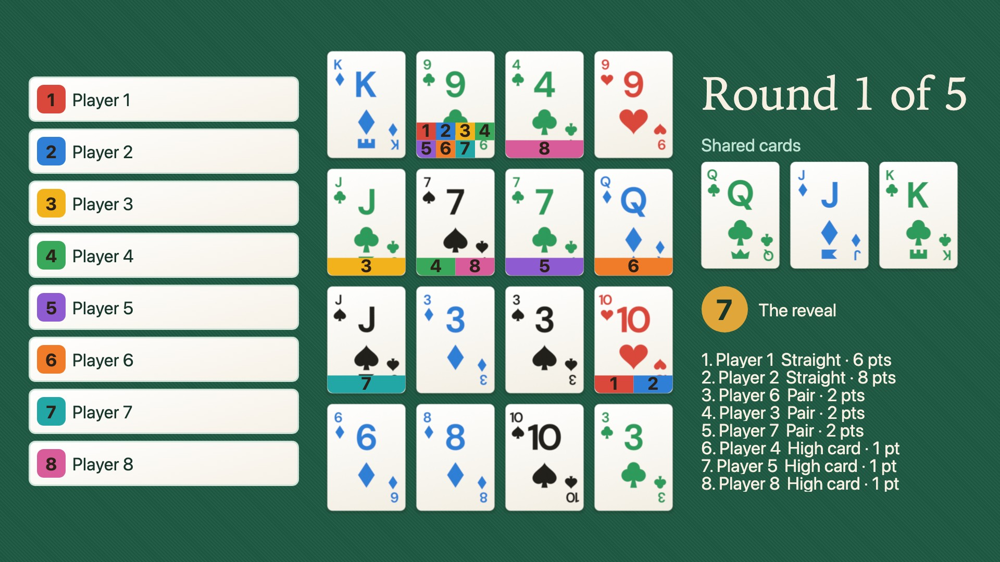 | Flipped grid and markers; Straight · 6/8 then pairs and high cards; countdown 7. | Claude, integrator review, 2026-11-18 |
|  | Five face-up cards, hand name and Points. | Codex, report completion, 2026-11-18 (contact sheet) |
|  | Five face-up cards, hand name and Points. | Codex, report completion, 2026-11-18 (contact sheet) |
| 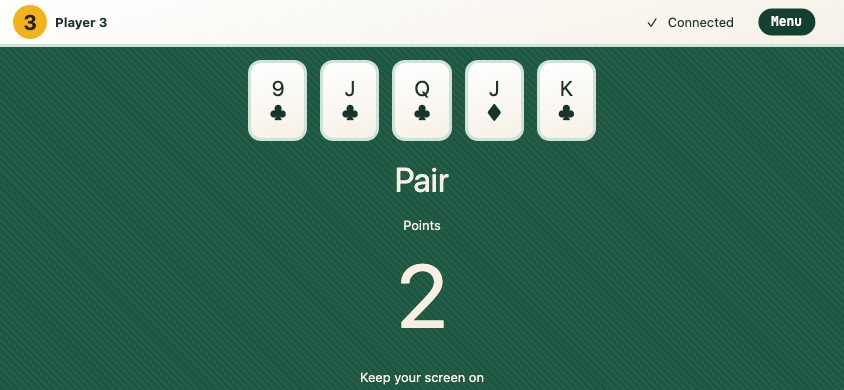 | Five face-up cards, hand name and Points. | Codex, report completion, 2026-11-18 (contact sheet) |
| 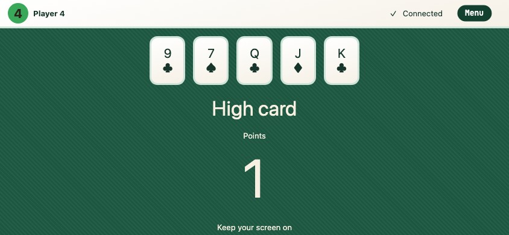 | Five face-up cards, hand name and Points. | Codex, report completion, 2026-11-18 (contact sheet) |
| 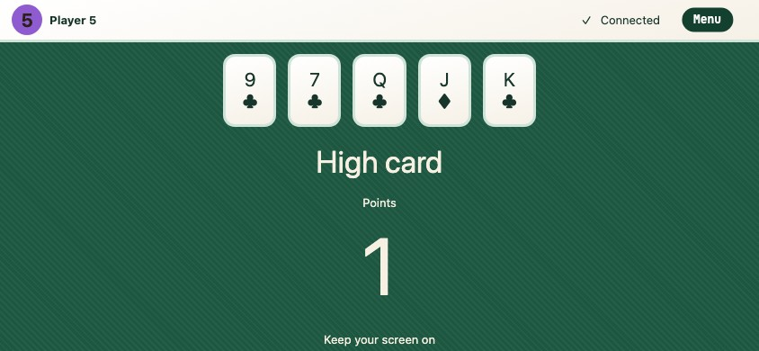 | Five face-up cards, hand name and Points. | Codex, report completion, 2026-11-18 (contact sheet) |
|  | Five face-up cards, hand name and Points. | Codex, report completion, 2026-11-18 (contact sheet) |
| 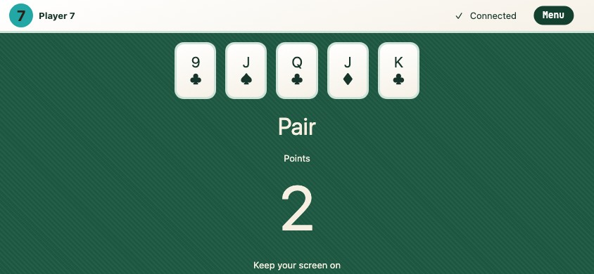 | Five face-up cards, hand name and Points. | Codex, report completion, 2026-11-18 (contact sheet) |
|  | Idle P8: 7♠ 4♣ Q♣ J♦ K♣, High card, 1 point; missing picks filled at random note. | Claude, integrator review, 2026-11-18 |
|  | Seven markers on 9♣ in a 4 + 3 block; rank and corner suit readable. | Claude, integrator review, 2026-11-18 |
| 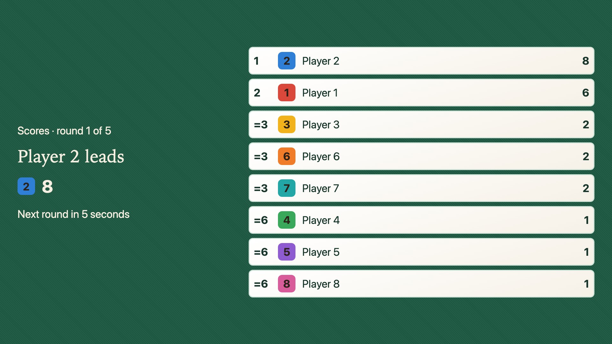 | Scoreboard: P2 8 leads P1 6; tied places =3 and =6. | Claude, integrator review, 2026-11-18 |
| 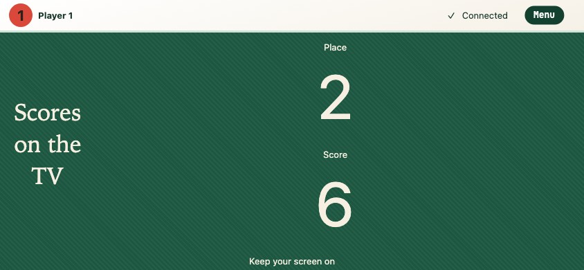 | Scores on the TV with this player’s Place and Score. | Codex, report completion, 2026-11-18 (contact sheet) |
| 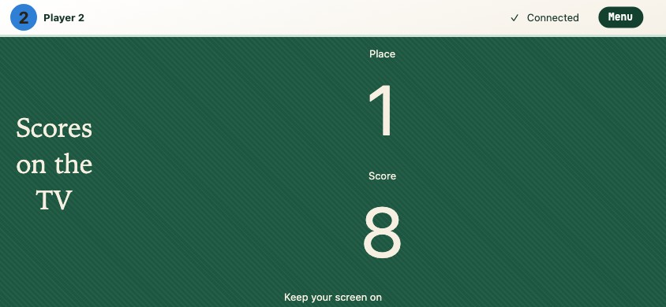 | Scores on the TV with this player’s Place and Score. | Codex, report completion, 2026-11-18 (contact sheet) |
| 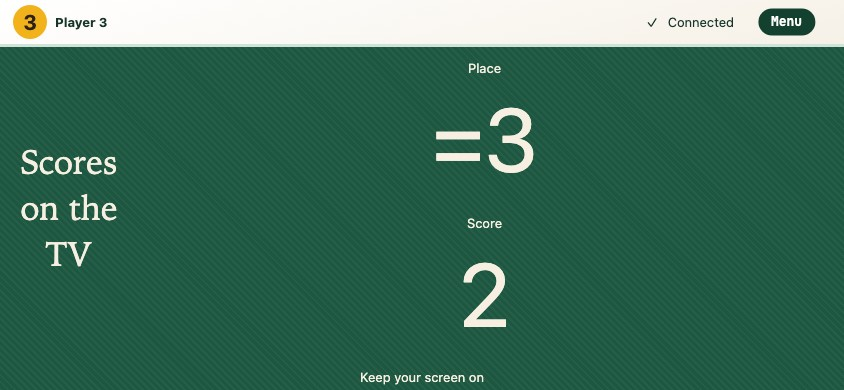 | Scores on the TV with this player’s Place and Score. | Codex, report completion, 2026-11-18 (contact sheet) |
| 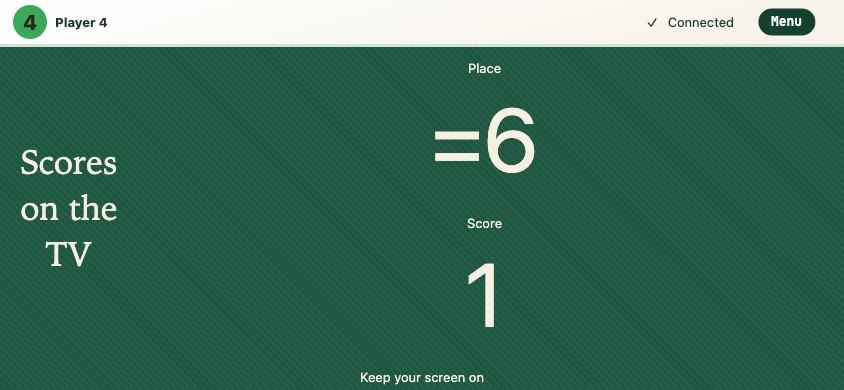 | Scores on the TV with this player’s Place and Score. | Codex, report completion, 2026-11-18 (contact sheet) |
|  | Scores on the TV with this player’s Place and Score. | Codex, report completion, 2026-11-18 (contact sheet) |
| 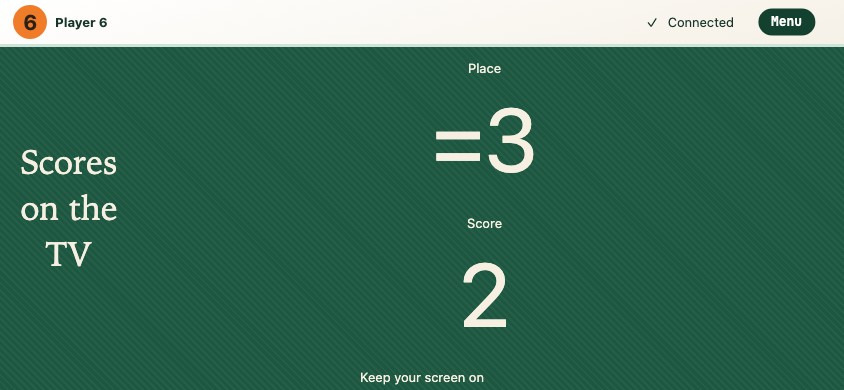 | Scores on the TV with this player’s Place and Score. | Codex, report completion, 2026-11-18 (contact sheet) |
| 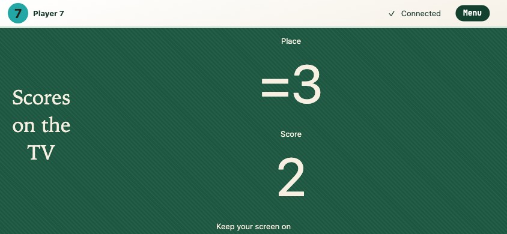 | Scores on the TV with this player’s Place and Score. | Codex, report completion, 2026-11-18 (contact sheet) |
|  | Scores on the TV with this player’s Place and Score. | Codex, report completion, 2026-11-18 (contact sheet) |
| 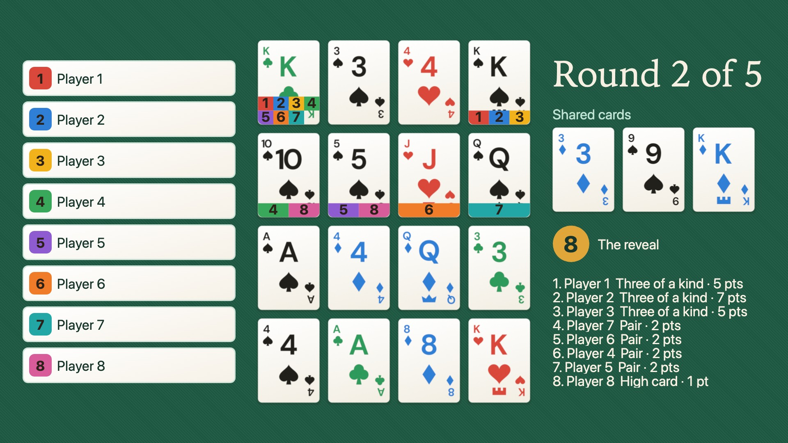 | Seven markers on K♣ in a 4 + 3 block; three best hands show Three of a kind · 5/7/5. | Claude, integrator review, 2026-11-18 |
| 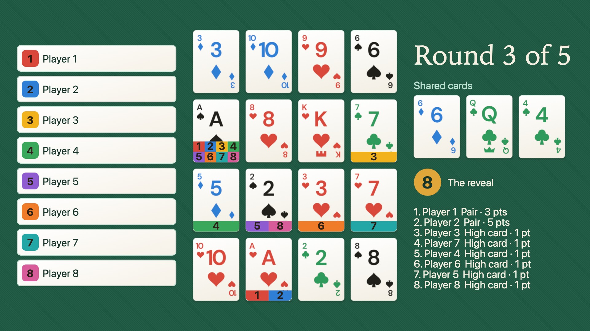 | Eight markers on A♠ in a 4 + 4 block; top-left rank/suit and centre rank readable; centre pip mostly covered. | Claude, integrator review, 2026-11-18 |
| 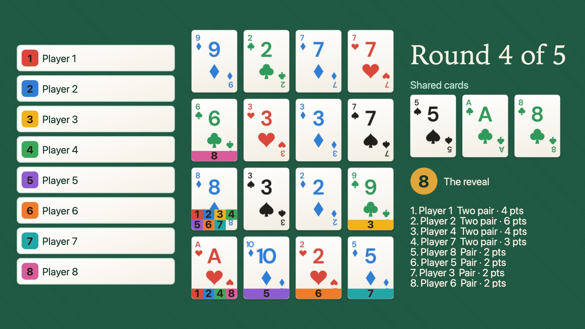 | Seven markers on 8♦ in a 4 + 3 block; rank and corner suit readable. | Claude, integrator review, 2026-11-18 |
| 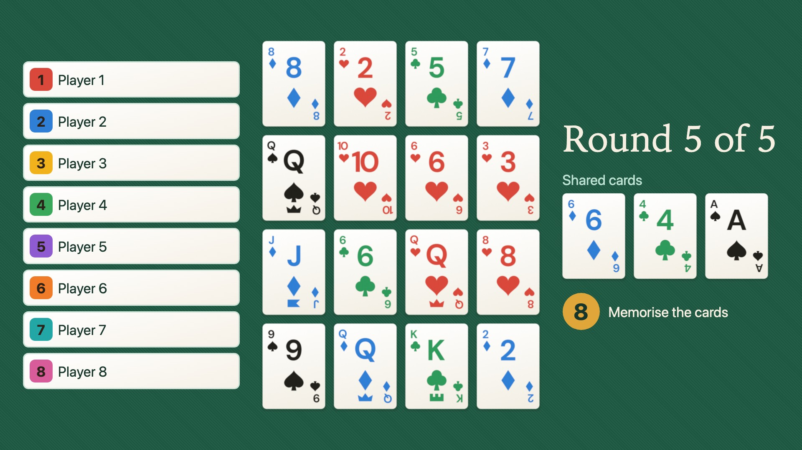 | Face-up 4 × 4 grid, three shared cards and memorise countdown. | Codex, report completion, 2026-11-18 (contact sheet) |
| 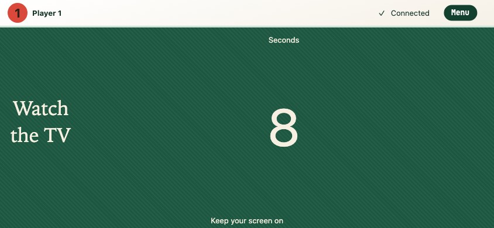 | Watch the TV with Seconds countdown. | Codex, report completion, 2026-11-18 (contact sheet) |
|  | Watch the TV with Seconds countdown. | Codex, report completion, 2026-11-18 (contact sheet) |
| 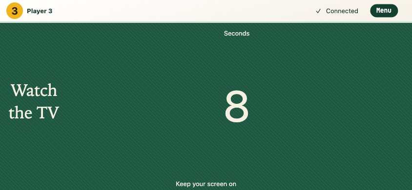 | Watch the TV with Seconds countdown. | Codex, report completion, 2026-11-18 (contact sheet) |
|  | Watch the TV with Seconds countdown. | Codex, report completion, 2026-11-18 (contact sheet) |
| 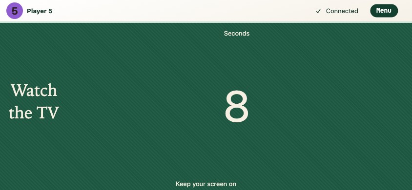 | Watch the TV with Seconds countdown. | Codex, report completion, 2026-11-18 (contact sheet) |
| 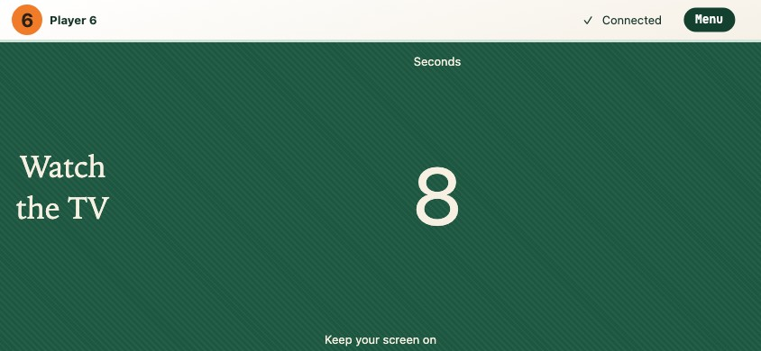 | Watch the TV with Seconds countdown. | Codex, report completion, 2026-11-18 (contact sheet) |
|  | Watch the TV with Seconds countdown. | Codex, report completion, 2026-11-18 (contact sheet) |
|  | Watch the TV with Seconds countdown. | Codex, report completion, 2026-11-18 (contact sheet) |
| 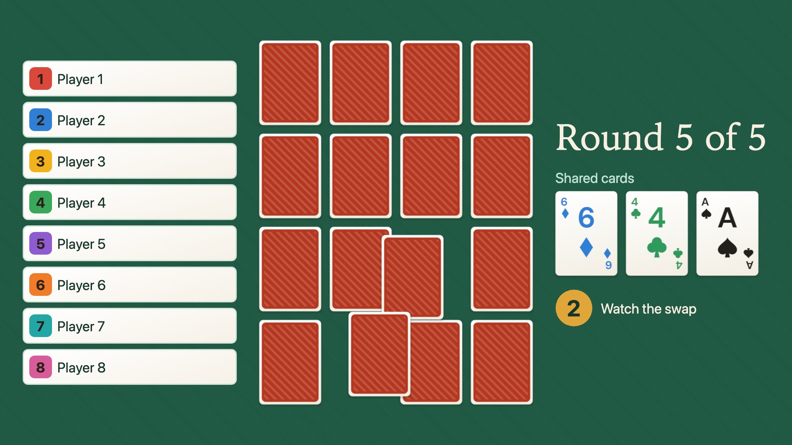 | Face-down cards offset during swap; shared cards remain face up. | Codex, report completion, 2026-11-18 (contact sheet) |
| 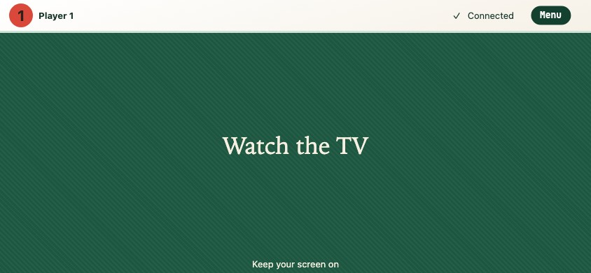 | Watch the TV; no card faces shown. | Codex, report completion, 2026-11-18 (contact sheet) |
| 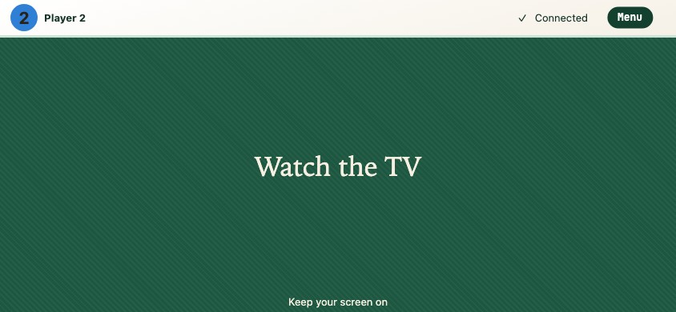 | Watch the TV; no card faces shown. | Codex, report completion, 2026-11-18 (contact sheet) |
|  | Watch the TV; no card faces shown. | Codex, report completion, 2026-11-18 (contact sheet) |
|  | Watch the TV; no card faces shown. | Codex, report completion, 2026-11-18 (contact sheet) |
|  | Watch the TV; no card faces shown. | Codex, report completion, 2026-11-18 (contact sheet) |
|  | Watch the TV; no card faces shown. | Codex, report completion, 2026-11-18 (contact sheet) |
|  | Watch the TV; no card faces shown. | Codex, report completion, 2026-11-18 (contact sheet) |
|  | Watch the TV; no card faces shown. | Codex, report completion, 2026-11-18 (contact sheet) |
| 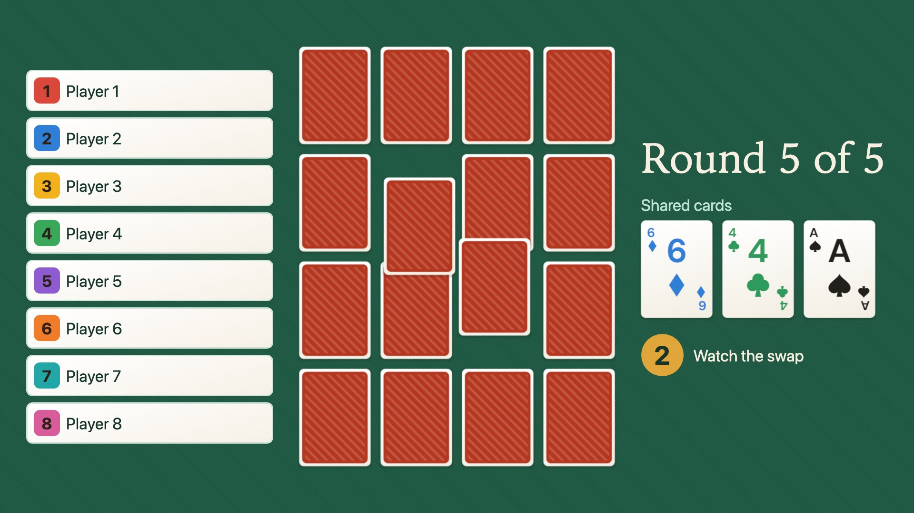 | Face-down cards offset during swap; shared cards remain face up. | Codex, report completion, 2026-11-18 (contact sheet) |
|  | Watch the TV; no card faces shown. | Codex, report completion, 2026-11-18 (contact sheet) |
|  | Watch the TV; no card faces shown. | Codex, report completion, 2026-11-18 (contact sheet) |
|  | Watch the TV; no card faces shown. | Codex, report completion, 2026-11-18 (contact sheet) |
|  | Watch the TV; no card faces shown. | Codex, report completion, 2026-11-18 (contact sheet) |
|  | Watch the TV; no card faces shown. | Codex, report completion, 2026-11-18 (contact sheet) |
|  | Watch the TV; no card faces shown. | Codex, report completion, 2026-11-18 (contact sheet) |
| 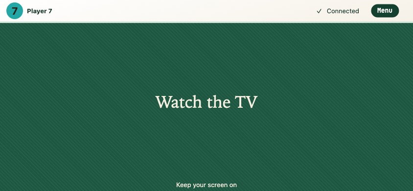 | Watch the TV; no card faces shown. | Codex, report completion, 2026-11-18 (contact sheet) |
|  | Watch the TV; no card faces shown. | Codex, report completion, 2026-11-18 (contact sheet) |
| 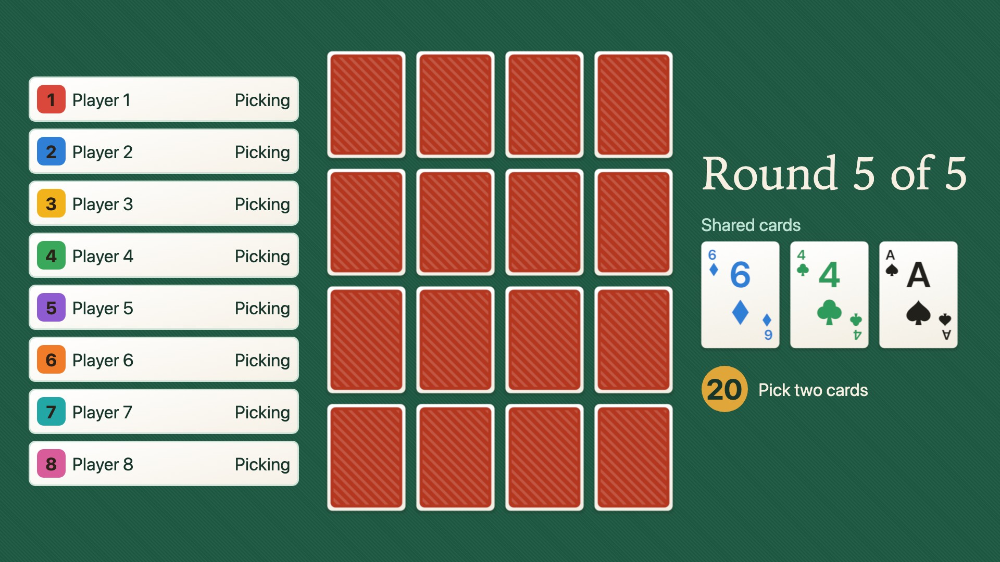 | Face-down 4 × 4 grid, face-up shared cards, Picking labels and countdown. | Codex, report completion, 2026-11-18 (contact sheet) |
|  | Face-down 4 × 4 grid with grey Lock in. | Codex, report completion, 2026-11-18 (contact sheet) |
|  | Face-down 4 × 4 grid with grey Lock in. | Codex, report completion, 2026-11-18 (contact sheet) |
|  | Face-down 4 × 4 grid with grey Lock in. | Codex, report completion, 2026-11-18 (contact sheet) |
|  | Face-down 4 × 4 grid with grey Lock in. | Codex, report completion, 2026-11-18 (contact sheet) |
|  | Face-down 4 × 4 grid with grey Lock in. | Codex, report completion, 2026-11-18 (contact sheet) |
|  | Face-down 4 × 4 grid with grey Lock in. | Codex, report completion, 2026-11-18 (contact sheet) |
|  | Face-down 4 × 4 grid with grey Lock in. | Codex, report completion, 2026-11-18 (contact sheet) |
|  | Face-down 4 × 4 grid with grey Lock in. | Codex, report completion, 2026-11-18 (contact sheet) |
| 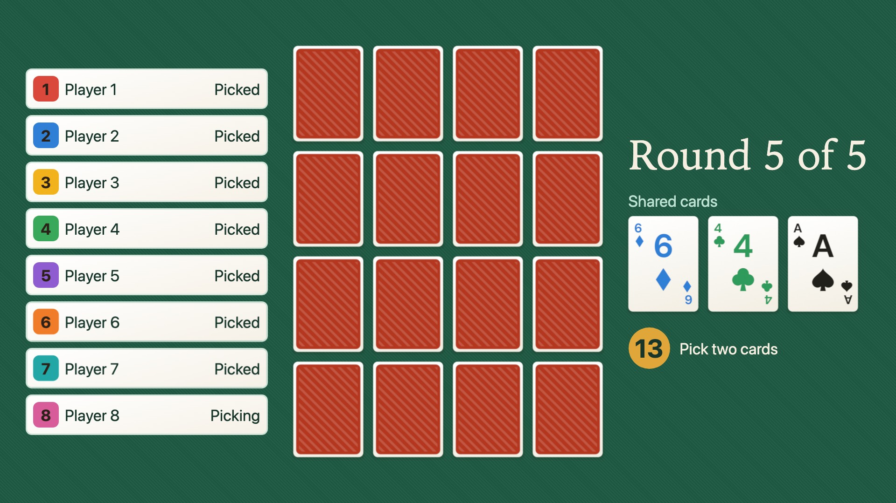 | Face-down grid; P1–P7 Picked, P8 Picking; shared cards face up. | Claude, integrator review, 2026-11-18 |
|  | Locked in and Watch the TV for the reveal; no card faces. | Codex, report completion, 2026-11-18 (contact sheet) |
|  | Locked in and Watch the TV for the reveal; no card faces. | Codex, report completion, 2026-11-18 (contact sheet) |
|  | Locked in and Watch the TV for the reveal; no card faces. | Codex, report completion, 2026-11-18 (contact sheet) |
|  | Locked in and Watch the TV for the reveal; no card faces. | Codex, report completion, 2026-11-18 (contact sheet) |
|  | Locked in and Watch the TV for the reveal; no card faces. | Codex, report completion, 2026-11-18 (contact sheet) |
|  | Locked in and Watch the TV for the reveal; no card faces. | Codex, report completion, 2026-11-18 (contact sheet) |
|  | Locked in and Watch the TV for the reveal; no card faces. | Codex, report completion, 2026-11-18 (contact sheet) |
|  | Face-down 4 × 4 grid and grey Lock in for the idle seat. | Codex, report completion, 2026-11-18 (contact sheet) |
| 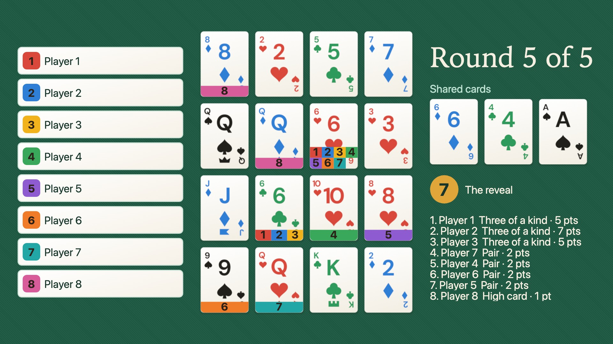 | Flipped grid and markers; P1/P2/P3 Three of a kind · 5/7/5; countdown 7. | Claude, integrator review, 2026-11-18 |
| 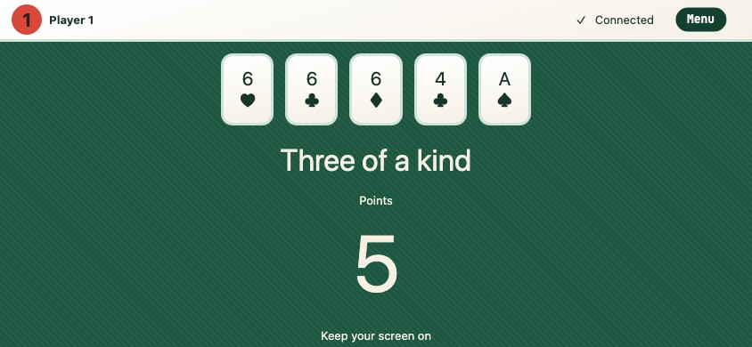 | P1: 6♥ 6♣ 6♦ 4♣ A♠, Three of a kind, 5 points. | Claude, integrator review, 2026-11-18 |
| 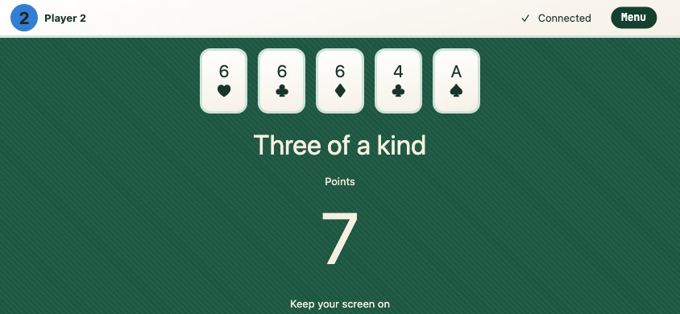 | Five face-up cards, hand name and Points. | Codex, report completion, 2026-11-18 (contact sheet) |
| 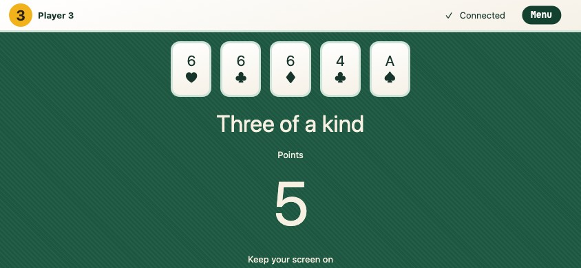 | Five face-up cards, hand name and Points. | Codex, report completion, 2026-11-18 (contact sheet) |
| 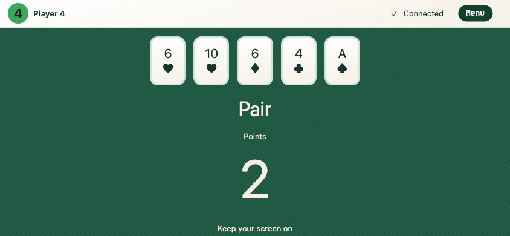 | Five face-up cards, hand name and Points. | Codex, report completion, 2026-11-18 (contact sheet) |
| 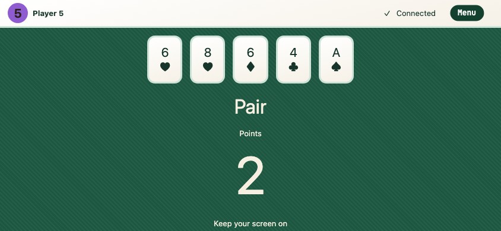 | Five face-up cards, hand name and Points. | Codex, report completion, 2026-11-18 (contact sheet) |
|  | Five face-up cards, hand name and Points. | Codex, report completion, 2026-11-18 (contact sheet) |
| 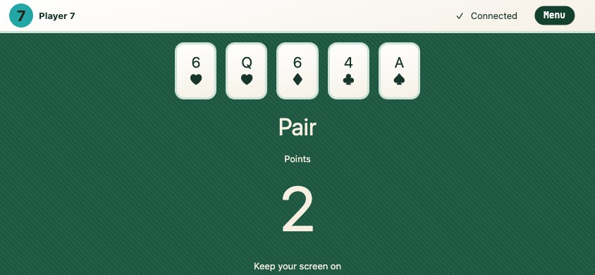 | Five face-up cards, hand name and Points. | Codex, report completion, 2026-11-18 (contact sheet) |
| 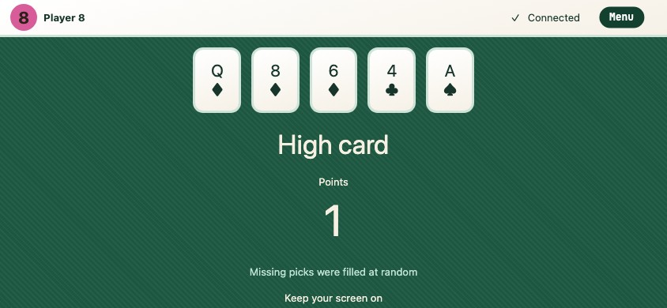 | Five face-up cards, hand name and Points; idle seat also has the random-fill note. | Codex, report completion, 2026-11-18 (contact sheet) |
|  | Seven markers on 6♥ in a 4 + 3 block; rank and corner suit readable. | Claude, integrator review, 2026-11-18 |
| 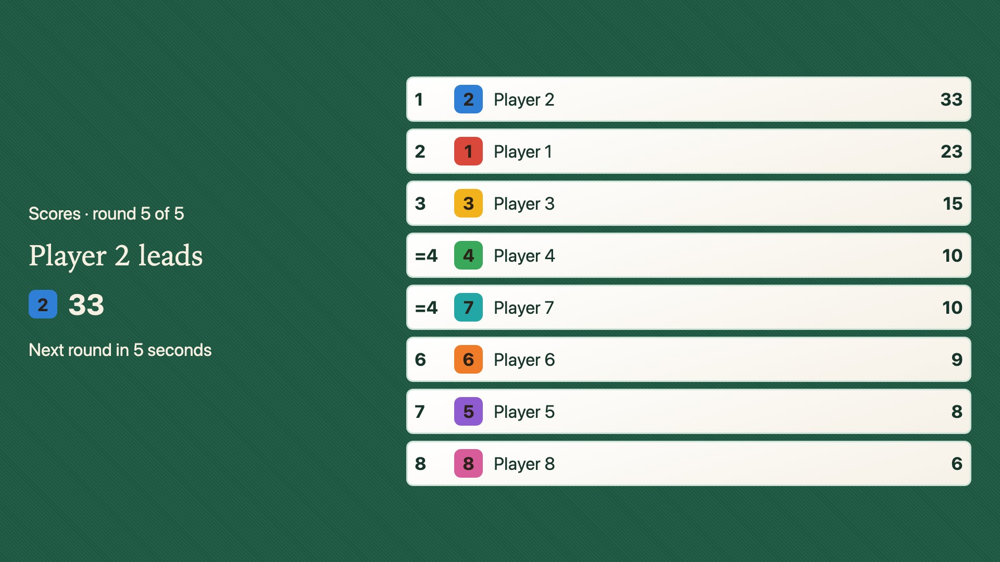 | R5 scoreboard: P2 33 leads, =4 tie at 10; wrongly says Next round in 5 seconds (P-10). | Claude, integrator review, 2026-11-18 |
| 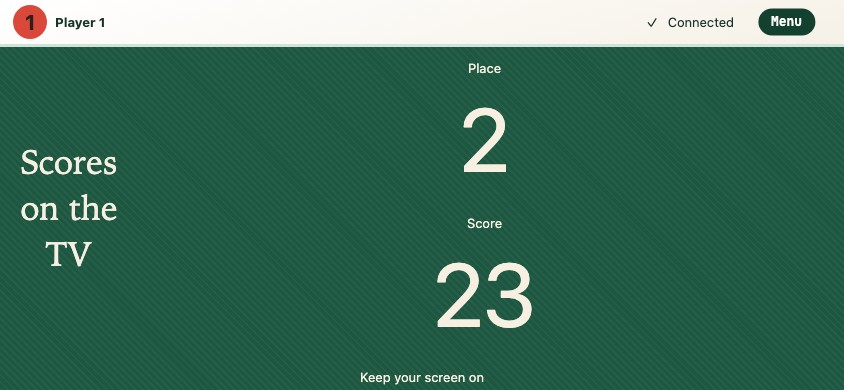 | Scores on the TV with this player’s Place and Score. | Codex, report completion, 2026-11-18 (contact sheet) |
|  | Scores on the TV with this player’s Place and Score. | Codex, report completion, 2026-11-18 (contact sheet) |
|  | Scores on the TV with this player’s Place and Score. | Codex, report completion, 2026-11-18 (contact sheet) |
|  | Scores on the TV with this player’s Place and Score. | Codex, report completion, 2026-11-18 (contact sheet) |
|  | Scores on the TV with this player’s Place and Score. | Codex, report completion, 2026-11-18 (contact sheet) |
|  | Scores on the TV with this player’s Place and Score. | Codex, report completion, 2026-11-18 (contact sheet) |
|  | Scores on the TV with this player’s Place and Score. | Codex, report completion, 2026-11-18 (contact sheet) |
|  | P8 scoreboard: Place 8, Score 6. | Claude, integrator review, 2026-11-18 |
|  | 1920 × 1080 final board: P2 wins with 33; eight rows including =4 tie. | Claude, integrator review, 2026-11-18 |
|  | 1280 × 720 final board: P2 wins with 33; leader-continues hint remains large relative to stage. | Claude, integrator review, 2026-11-18 |
|  | Shell Results with this player’s Place and Score; leader phone has Continue. | Codex, report completion, 2026-11-18 (contact sheet) |
|  | P2 shell Results: Place 1, Score 33. | Claude, integrator review, 2026-11-18 |
|  | Shell Results with this player’s Place and Score; leader phone has Continue. | Codex, report completion, 2026-11-18 (contact sheet) |
|  | Shell Results with this player’s Place and Score; leader phone has Continue. | Codex, report completion, 2026-11-18 (contact sheet) |
|  | Shell Results with this player’s Place and Score; leader phone has Continue. | Codex, report completion, 2026-11-18 (contact sheet) |
|  | Shell Results with this player’s Place and Score; leader phone has Continue. | Codex, report completion, 2026-11-18 (contact sheet) |
|  | Shell Results with this player’s Place and Score; leader phone has Continue. | Codex, report completion, 2026-11-18 (contact sheet) |
|  | Shell Results with this player’s Place and Score; leader phone has Continue. | Codex, report completion, 2026-11-18 (contact sheet) |
|  | Shell Pick a game screen with Peek Poker selected. | Codex, report completion, 2026-11-18 (contact sheet) |

## Strips

| Screenshot | What it shows | Looked at by |
|---|---|---|
|  | Six sampled frames: backs narrow to lines, faces widen, hands list appears under a mask; no blank stage or visible overshoot. | Claude, integrator review, 2026-11-18 |

| Acceptance statement | Pass / fail | Evidence |
|---|---|---|
| PP-001–011, PLAT-033: default five-round console match and scoring | Pass | Completed named steps and round-1/5 stills; review 2 independent oracle/trace checks. Random fill as slowest was not exercised. |
| PP-020, PP-021: no early public or other-seat secrets | Pass | Review 2 scans of secrecy.json.gz and sampled DOM frames; locked-TV stills show only seat status. |
| PP-008, PP-031: reveal and seat-marker presentation | Pass | Reveal strip and reveal stills; seven/eight-marker stills 45, 55, 56, 57, 112. |
| PP-032: totals, own stats and final podium | Pass with known defect | Final boards and phone stats; R5 scoreboard wrongly promises another round (P-10). |
| Physical phones/TV, late join and all-locked early end | Not covered | Emulated console run; idle seat prevents all-locked transition. |
