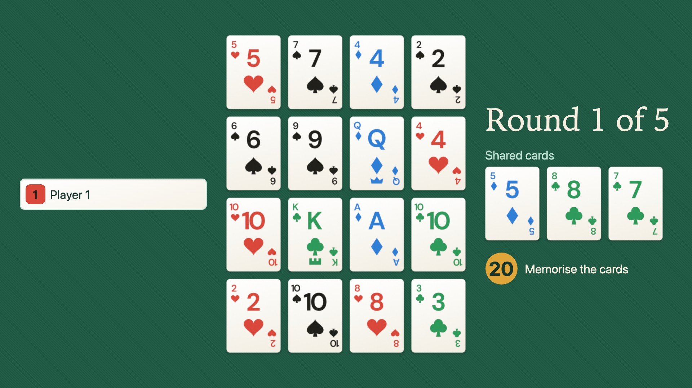
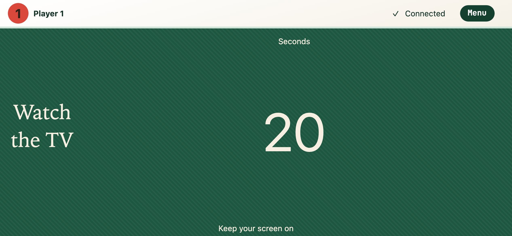

# P-08-production-atlas UAT evidence

Looked at by the integrator, 2026-11-18.

Command: `node uat/slices/P-08-production-atlas.mjs --out prod-r4`
Commit: `c8d44592f23f279308b8ddcfe62aef802c989d00`
Viewports: 1920×1080, 844×390

| Timing | ms | Status |
|---|---:|---|
| Create room through host page | 892.0 | completed |

Expected errors (count):
None

## Real server

| Screenshot | What it shows | Looked at by |
|---|---|---|
|  | Production build TV at memorise: 16 table cards and 3 shared cards from the packed atlas, crisp faces, suits told apart by shape and colour, felt background, timer 20 and "Memorise the cards" | Integrator |
|  | Production build phone at memorise: Peek Poker felt with cream "Watch the TV", "Seconds" and 20, readable; the round-2 cream-on-cream paint is gone (controller-kit repaints on the shell theme change) | Integrator |

| Acceptance statement | Pass / fail | Evidence |
|---|---|---|
| The production build draws the table from the packed card atlas | Pass | 01 |
| The production phone shows the Peek Poker felt theme, not the shell paint | Pass | 02 |
