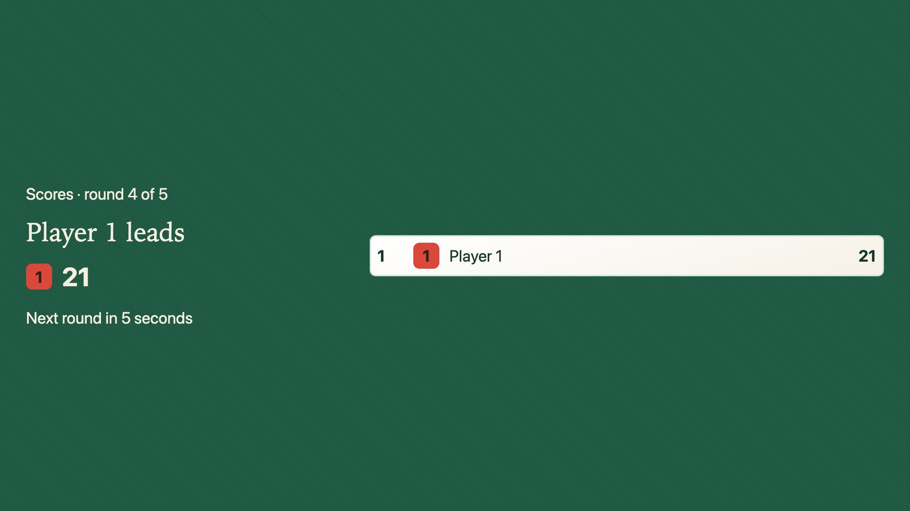
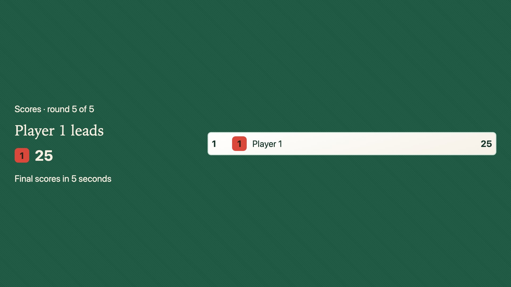

# P-10-final-scoreboard UAT evidence

Automated execution passed. Visual review: Claude reviewer and integrator, 2026-11-18 (P-10 review 1).

Command: `node tools/uat/run.mjs -- P-10-final-scoreboard --phones 1 --out round1-p1`
Commit: `77716e5f336c42a2d1a2672860f5e9cc5b2e4b66`
Viewports: 1920×1080

| Timing | ms | Status |
|---|---:|---|
| Create room through host page | 1328.2 | completed |

Expected errors (count):
None

## Real server

| Screenshot | What it shows | Looked at by |
|---|---|---|
|  | Scoreboard after round 4 of 5: "Scores · round 4 of 5", "Next round in 5 seconds". | Claude reviewer, 2026-11-18 |
|  | Scoreboard after round 5 of 5: "Scores · round 5 of 5", "Final scores in 5 seconds"; layout unchanged, felt texture the only surface treatment. | Claude reviewer and integrator, 2026-11-18 |

| Acceptance statement | Pass / fail | Evidence |
|---|---|---|
| Earlier scoreboards keep "Next round in 5 seconds" | Pass | 01 |
| The last scoreboard says "Final scores in 5 seconds" | Pass | 02 |
| Phones still show "Scores on the TV" | Pass | asserted in the UAT script |
