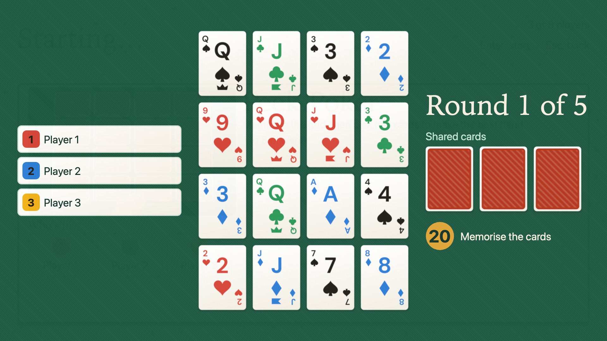
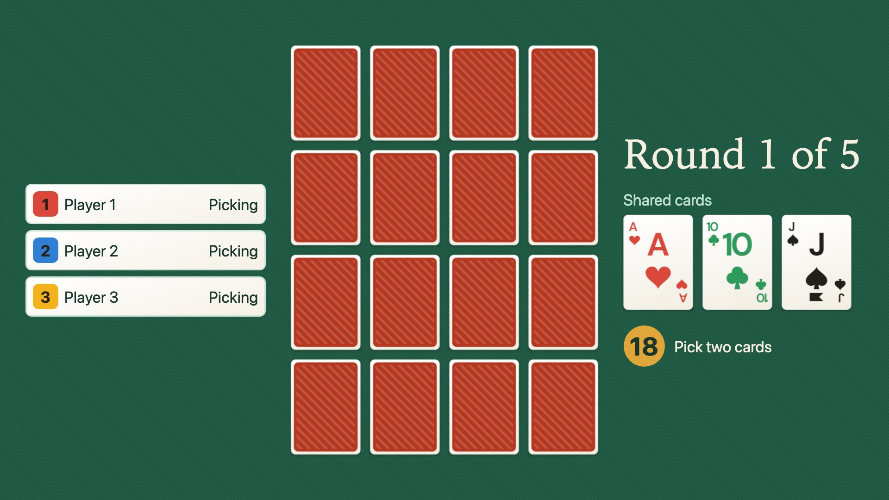
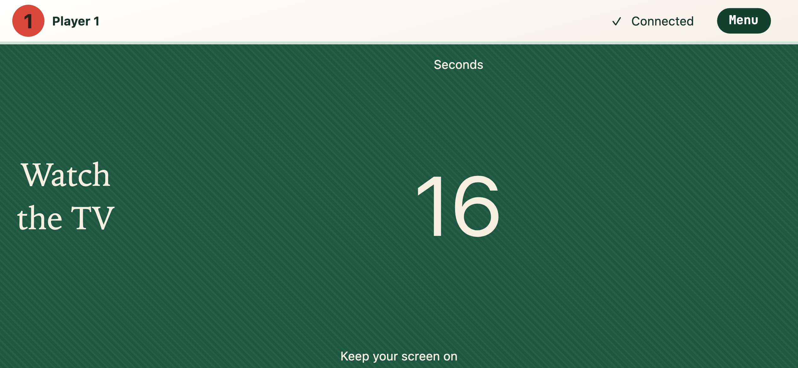
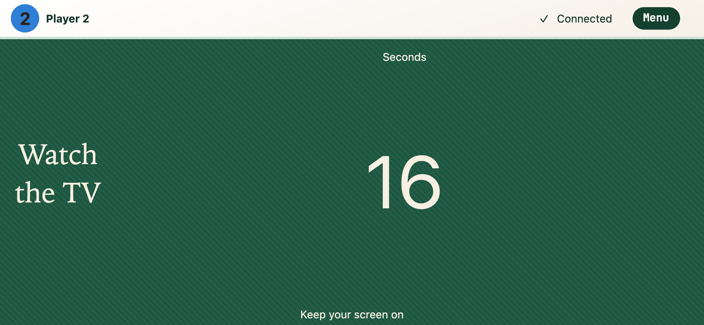
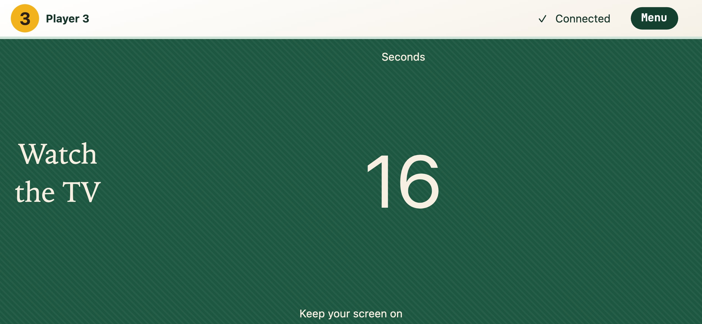
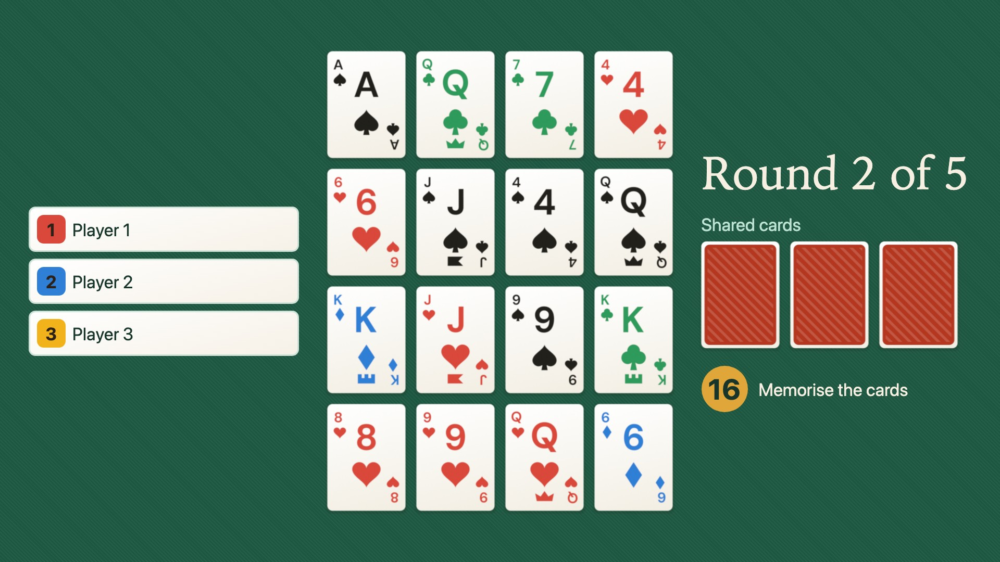
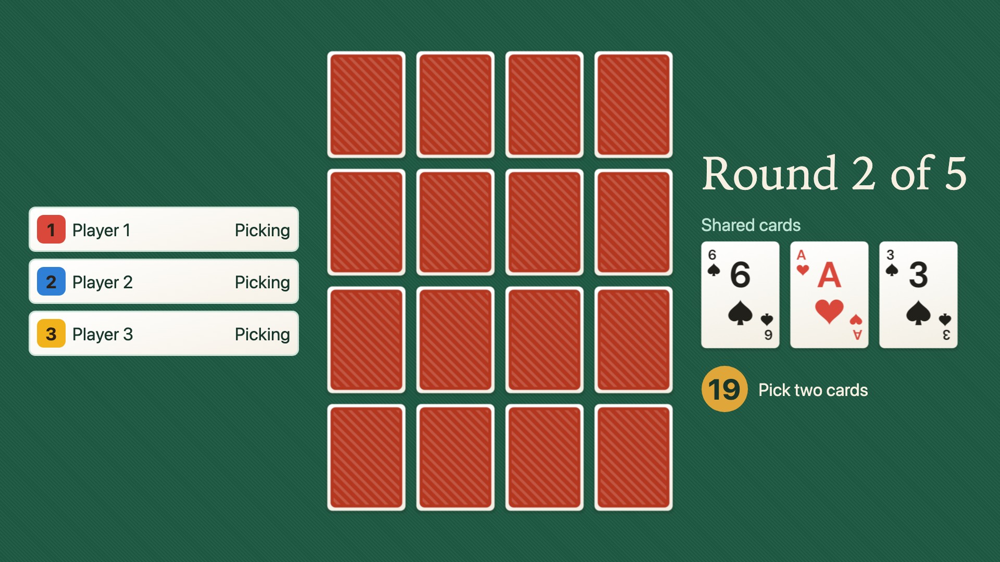
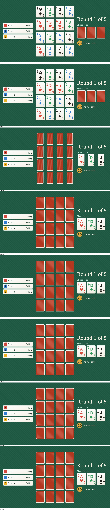
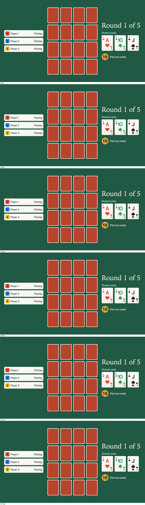

# P-12-shared-cards UAT evidence

Host browser: chromium 156.0.8078.4
Phone browser: chromium (legacy iPhone emulation) 156.0.8078.4

Automated execution only. Visual review and acceptance decisions are pending.

Command: `node tools/uat/run.mjs -- P-12-shared-cards --phones 3 --out round3`
Commit: `cea706ab7058975b277de4fc69c2195b52181448`
Viewports: 1920×1080, 844×390

| Timing | ms | Status |
|---|---:|---|
| Create room through host page | 1743.9 | completed |
| Normal memorise keeps shared faces secret | 269.7 | completed |
| Reduced memorise keeps shared faces secret | 708.8 | completed |

Expected errors (count):
None

## Real server

| Screenshot | What it shows | Looked at by |
|---|---|---|
|  | | |
|  | | |
|  | | |
|  | | |
|  | | |
|  | | |
|  | | |
|  | | |
|  | | |

## Strips

| Screenshot | What it shows | Looked at by |
|---|---|---|
|  | | |
|  | | |

| Acceptance statement | Pass / fail | Evidence |
|---|---|---|
| | | |

## Visual review (2026-11-20)

| Screenshot | What it shows | Looked at by |
|---|---|---|
| 01-host-memorise.jpg | Round 1 memorise at 20 s: grid face up, three shared backs. The console's "Starting…" screen still shows faintly at left (the start crossfade is in progress), as in round 1. The backs are clear. | Claude reviewer |
| 10-strip-grid-hide-shared-reveal.jpg | Frames 1–2: grid faces with shared backs and "Pick two cards". Frame 3: grid backs and shared faces (A♥ 10♣ J♠) both narrow and lifted, turning together. Frames 4–8: grid backs, shared faces, settled. No bounce. Frame times are approximate (new item 1). | Claude reviewer |
| 17-strip-grid-hide-shared-reveal-end.jpg | Six frames after the turn: grid backs and shared A♥ 10♣ J♠ steady, timer 19. Nothing moves or overshoots. | Claude reviewer |
| 18-host-just-after-flip.jpg | Pick at 18 s: 16 backs; shared A♥ 10♣ J♠ face up at full size. Taken about 0.8 s after the change (new item 2). | Claude reviewer |
| 19-host-pick.jpg | Pick at 17 s: same cards, stable; all three "Picking". | Claude reviewer |
| 20-phone1-round2-memorise-phone1.jpg | Phone 1, round 2 memorise: "Watch the TV", Seconds 16. No card faces, no ghost of round 1. | Claude reviewer |
| 21-phone2-round2-memorise-phone2.jpg | Phone 2: as phone 1; no faces, no ghost. | Claude reviewer |
| 22-phone3-round2-memorise-phone3.jpg | Phone 3: as phone 1; no faces, no ghost. | Claude reviewer |
| 23-host-reduced-memorise.jpg | Reduced motion, round 2 memorise at 16 s: new grid face up, three shared backs. | Claude reviewer |
| 24-host-reduced-pick.jpg | Reduced motion, first capture after the change (timer 20): grid backs and shared 6♠ A♥ 3♠ face up at once, with no turn. | Claude reviewer |
| 25-host-reduced-pick-settled.jpg | Timer 19: same, stable. | Claude reviewer |

**Also opened:**
- P-04 p12b: `22-strip-flip.jpg` (full mirrored turn, explicit times) and `11-host-8-memorise.jpg` (8 players, backs).
- P-06 p12-p1: `12-host-tv-memorise.jpg` (backs), `14-host-tv-pick.jpg` (K♥ 2♥ 4♠ up) and `27-host-tv-memorise-reduced.jpg` (backs).
- P-07 p12-8b: `10-host-r1-pick-tv.jpg` (K♠ 3♣ 8♣ up, 8 players "Picking").

**Against DESIGN §6:**
- Felt is the single treatment on each surface, and contrast holds.
- Tokens only; no bounce.
- The turn uses the mask and changes face while edge-on.
- Reduced motion keeps the state change.
- The phone crossfade now overlaps.
