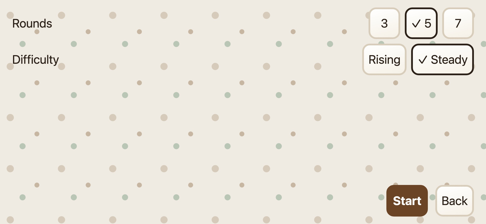
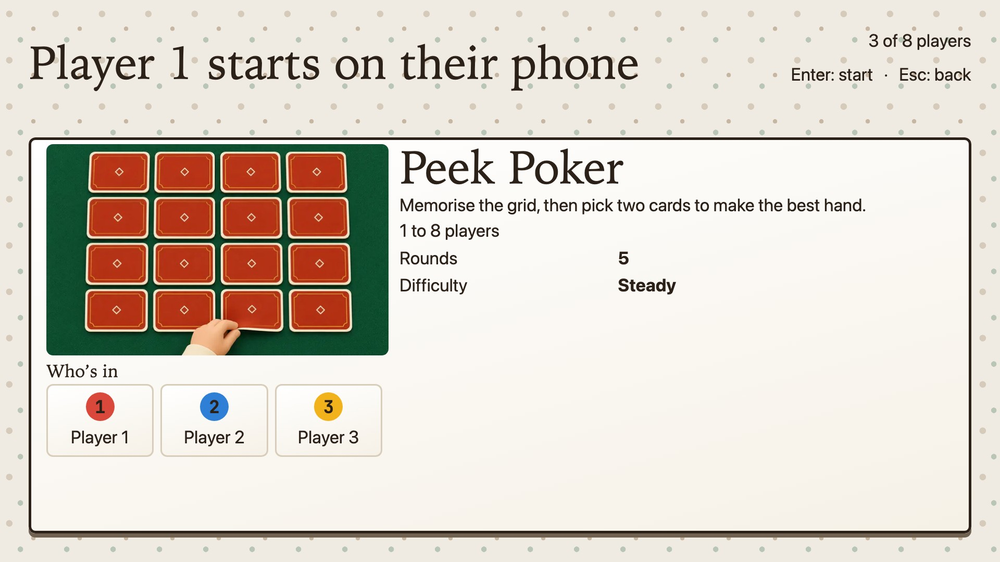
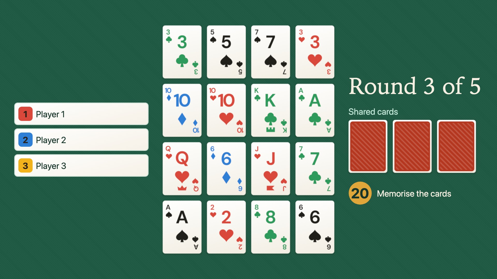
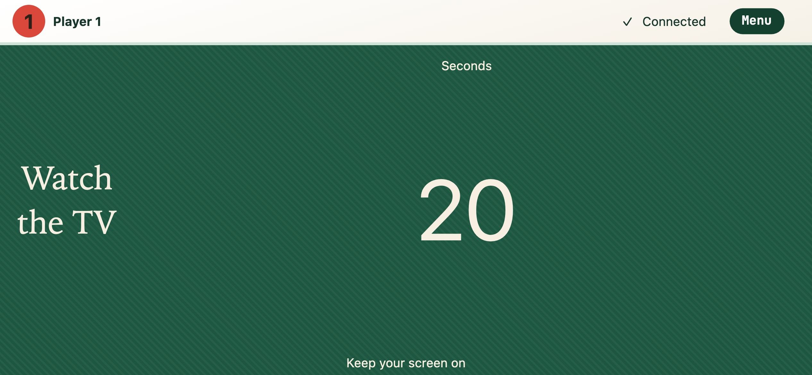
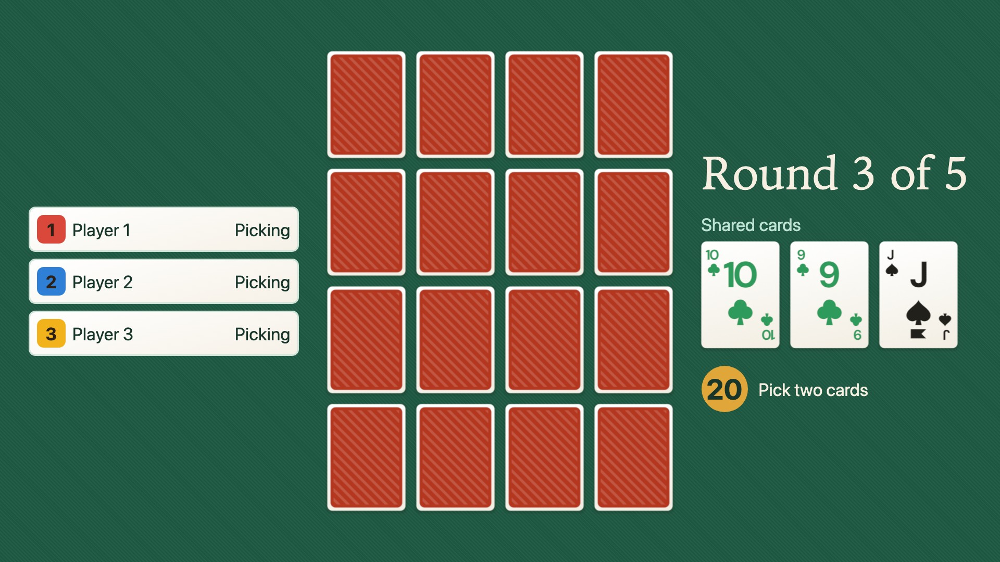
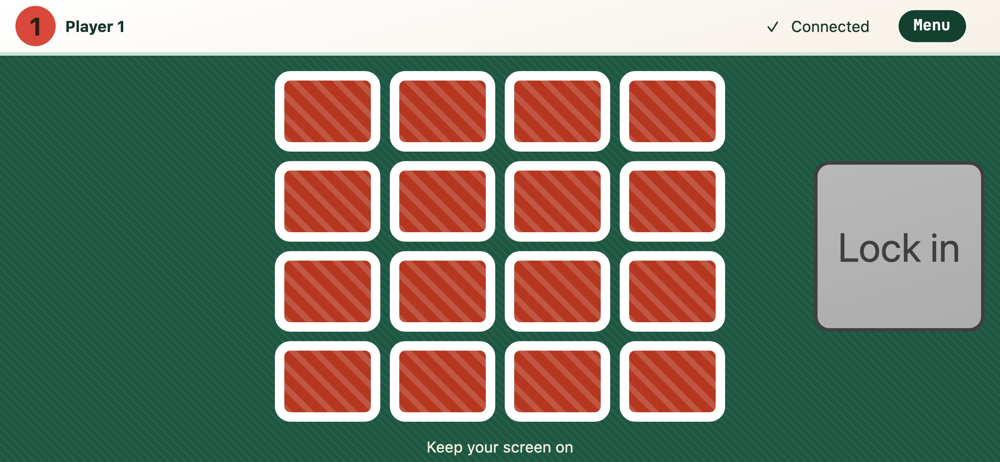

# P-13-steady-mode UAT evidence

Host browser: chromium 156.0.8078.4
Phone browser: chromium (legacy iPhone emulation) 156.0.8078.4

Automated execution only. Visual review and acceptance decisions are pending.

Command: `node tools/uat/run.mjs -- P-13-steady-mode --phones 3 --out round3`
Commit: `c3a40390fbb1256fd8baafd3fefec0f731e9b567`
Viewports: 844×390, 1920×1080

| Timing | ms | Status |
|---|---:|---|
| Create room through host page | 1921.1 | completed |
| Choose Steady on the leader phone and mirror it on TV | 1924.9 | completed |
| Round 1 uses 20 seconds and proceeds directly to pick | 5193.0 | completed |
| Round 2 uses 20 seconds and proceeds directly to pick | 3405.7 | completed |
| Round 3 uses 20 seconds and proceeds directly to pick | 2568.3 | completed |

Expected errors (count):
None

## Real server

| Screenshot | What it shows | Looked at by |
|---|---|---|
|  | | |
|  | | |
|  | | |
|  | | |
|  | | |
|  | | |

| Acceptance statement | Pass / fail | Evidence |
|---|---|---|
| | | |

## Visual review

**round3** (`uat/evidence/P-13-steady-mode/round3/`, commit c3a40390, 3 phones; all stills opened)
| Screenshot | What it shows | Looked at by |
|---|---|---|
| 01-phone1-setup-steady-phone.jpg | Leader phone, landscape, dot-grid background. Rounds 3 / ✓5 / 7. Difficulty: Rising, ✓Steady (pressed, dark edge). Start (accent) and Back. Targets ≥ 55 px, text legible. | Claude reviewer |
| 02-host-setup-steady-tv.jpg | TV 1920 × 1080: "Player 1 starts on their phone"; "3 of 8 players"; "Enter: start · Esc: back". Peek Poker card with mirror rows "Rounds **5**" and "Difficulty **Steady**". Seats 1–3 under "Who's in". One treatment per surface. | Claude reviewer |
| 03-host-round-3-memorise-tv.jpg | TV "Round 3 of 5": grid face up, the **three shared cards face down** (P-12 merged), timer **20**, "Memorise the cards". Rising would give 12 s in round 3. | Claude reviewer |
| 04-phone1-round-3-memorise-phone.jpg | Phone: "Watch the TV", Seconds **20**, "Keep your screen on". No card faces on the phone. | Claude reviewer |
| 05-host-round-3-pick-tv.jpg | TV round 3: grid face down, shared 10♣ 9♣ J♠ now face up, timer 20, "Pick two cards", all three players "Picking". Straight to pick with no swap; the script saw no `swap` phase in any public view. | Claude reviewer |
| 06-phone1-round-3-pick-phone.jpg | Phone pick grid of 16 card backs; "Lock in" dimmed until two cards are picked. | Claude reviewer |
