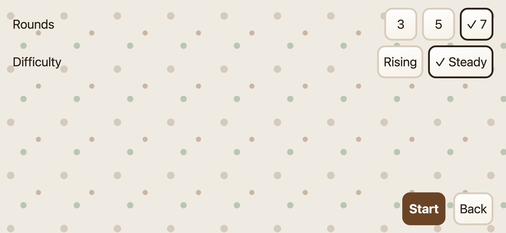
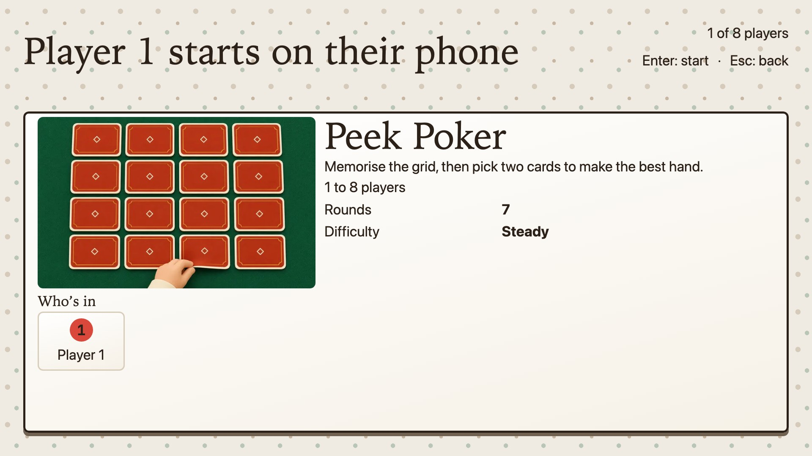
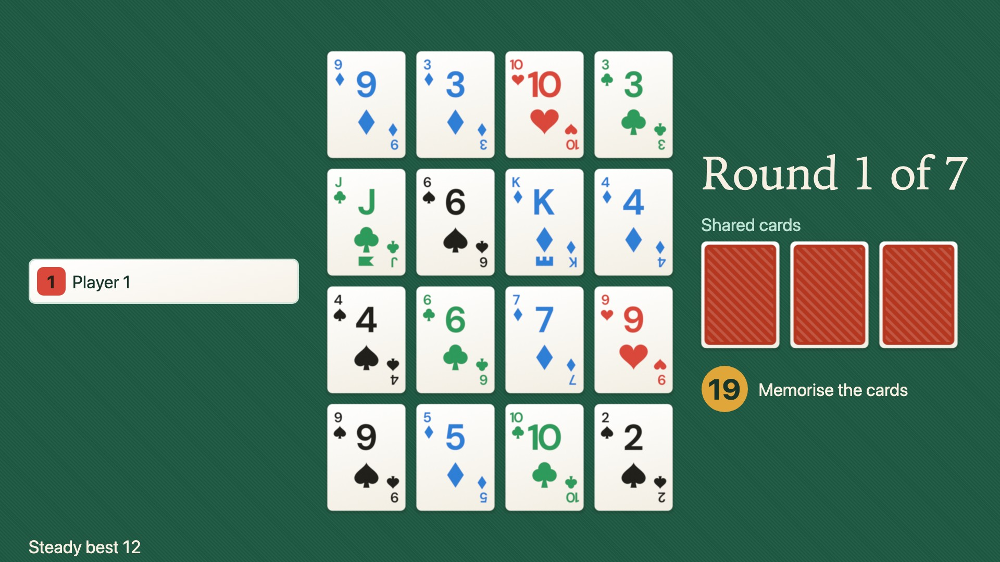
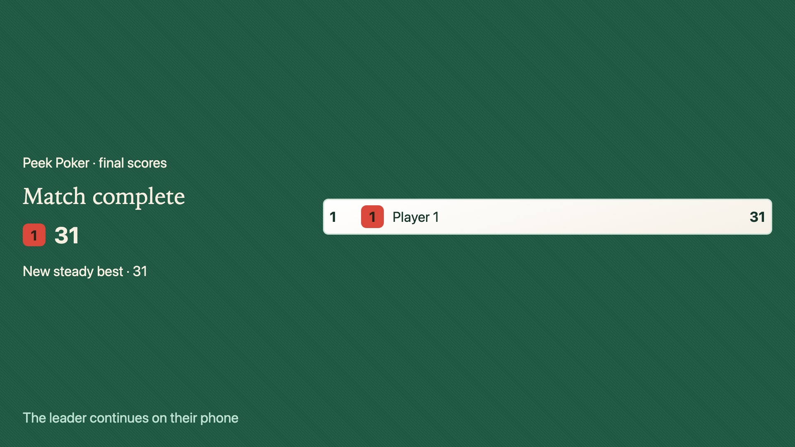

# P-13-steady-mode UAT evidence

Host browser: chromium 156.0.8078.4
Phone browser: chromium (legacy iPhone emulation) 156.0.8078.4

Automated execution only. Visual review and acceptance decisions are pending.

Command: `node tools/uat/run.mjs -- P-13-steady-mode --phones 1 --out solo5`
Commit: `39c7758aaac0da8ef5a7faf72b566c9474b833ef`
Viewports: 844×390, 1920×1080

| Timing | ms | Status |
|---|---:|---|
| Create room through host page | 1716.5 | completed |
| Choose Steady on the leader phone and mirror it on TV | 2021.4 | completed |
| Solo play shows the seeded Steady best | 788.2 | completed |
| Solo round 1 locks two picks | 3618.5 | completed |
| Solo round 2 locks two picks | 2361.0 | completed |
| Solo round 3 locks two picks | 2345.5 | completed |
| Solo round 4 locks two picks | 2245.9 | completed |
| Solo round 5 locks two picks | 2283.4 | completed |
| Solo round 6 locks two picks | 2353.3 | completed |
| Solo round 7 locks two picks | 2457.7 | completed |
| Solo final shows a new Steady best above 12 | 675.9 | completed |

Expected errors (count):
None

## Real server

| Screenshot | What it shows | Looked at by |
|---|---|---|
|  | | |
|  | | |
|  | | |
|  | | |

| Acceptance statement | Pass / fail | Evidence |
|---|---|---|
| | | |

## Visual review

**solo5** (`uat/evidence/P-13-steady-mode/solo5/`, commit 39c7758a, 1 phone, host record seeded `{ bests: { rising: 40, steady: 12 } }`; stills taken after Web Animations finished in real time)

| Screenshot | What it shows | Looked at by |
|---|---|---|
| 01-phone1-setup-steady-phone.jpg | Leader phone: Rounds ✓7, Difficulty ✓Steady, Start and Back. | Claude (integrator) |
| 02-host-setup-steady-tv.jpg | TV setup card: "1 of 8 players", mirror rows Rounds 7 and Difficulty Steady, one seat. | Claude (integrator) |
| 03-host-steady-best-play-tv.jpg | TV "Round 1 of 7", memorise, timer 19, shared cards face down, one seat; bottom left **"Steady best 12"** (the Steady record, not Rising's 40). Set-up fade finished. | Claude (integrator) |
| 04-host-steady-best-final-tv.jpg | Final: "Peek Poker · final scores", "Match complete", seat 1 with 31, **"New steady best · 31"**; the results row fully drawn; hand-off line "The leader continues on their phone" present. | Claude (integrator) |

| Acceptance statement | Pass / fail | Evidence |
|---|---|---|
| The leader chooses Steady on the phone and the TV mirrors it | Pass | round3 01–02, solo5 01–02 |
| Steady rounds have 20 s to memorise and no twist | Pass | round3 03–06; solo5 runs 7 rounds; rules tests for 3, 5 and 7 rounds |
| Steady best shown during play, new Steady best on the final screen | Pass | solo5 03, 04 |
| Perf on the merged tree | Pass (Chromium slice gate) | perf-merged: PERF-010 input p95 32.2 ms ≤ 50, PERF-012 160 of 160, frames p95 18.2 ms, max 33.3 ms, PERF-001 not assessed (development build); perf-sim-merged: PERF-040 Peek Poker p95 0.000208 ms ≤ 1.67. The scenario uses default settings (Rising), the heavier case. |
