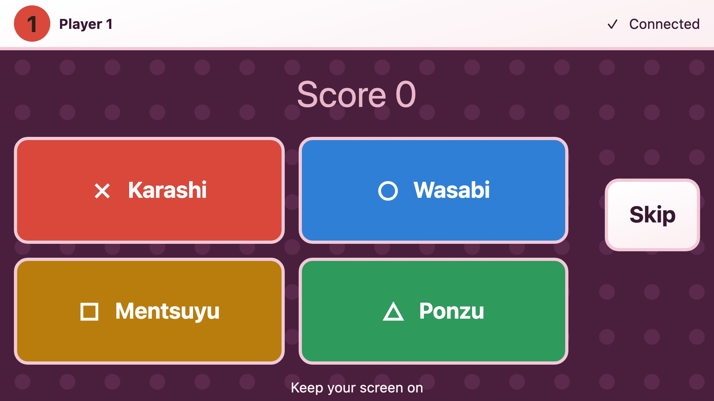
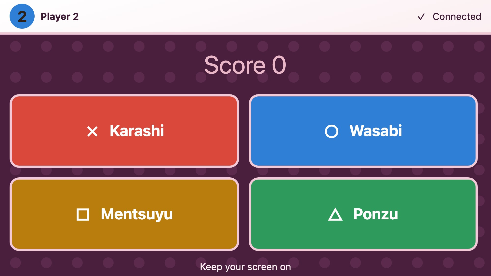
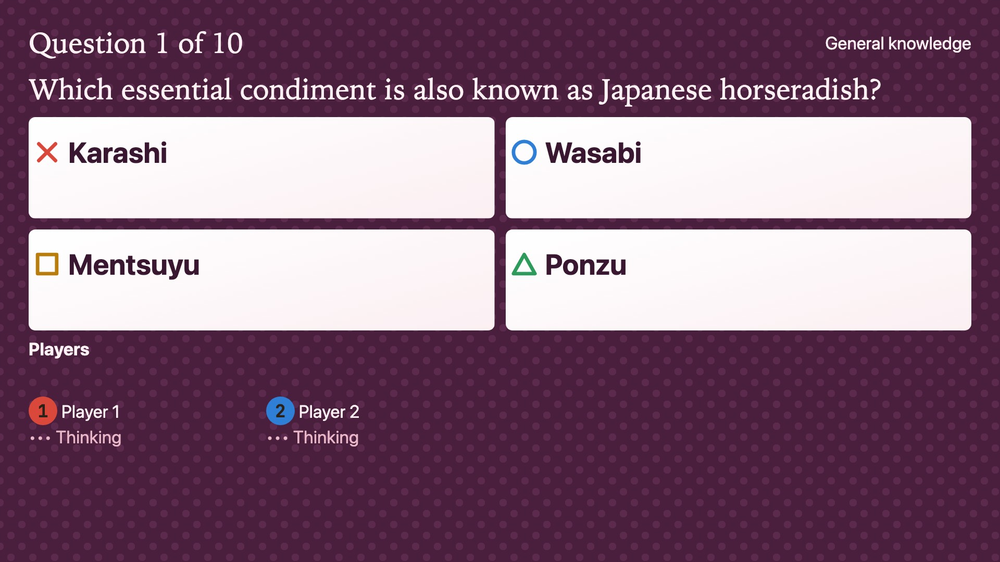
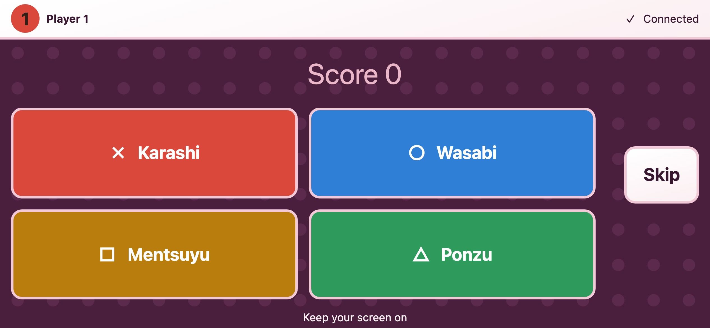
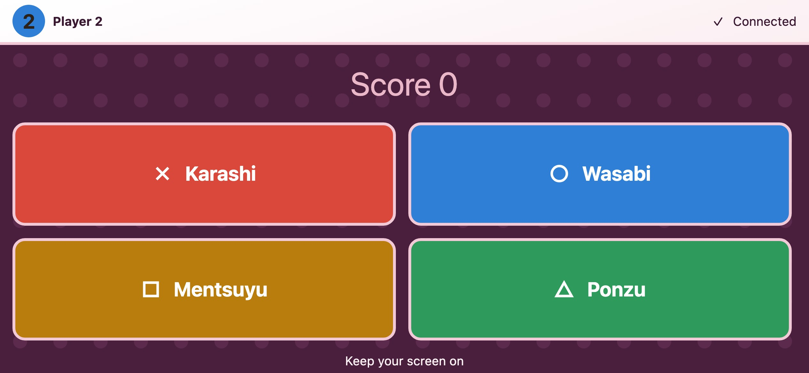
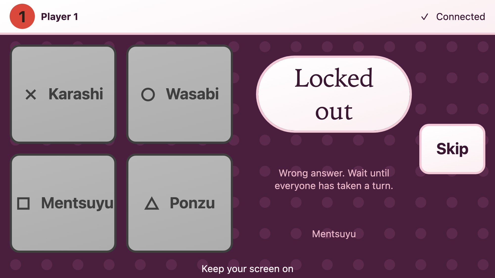

# R-02-phone-layouts UAT evidence

Automated execution only. Visual review and acceptance decisions are pending.

Command: `node tools/uat/run.mjs -- R-02-phone-layouts --phones 2 --out uat-r8-p2`
Commit: `027502496f8c71d9a9bd9cf9baab5ee41b919eff`
Viewports: 667×375, 1920×1080, 844×390

| Timing | ms | Status |
|---|---:|---|
| Create room through host page | 1303.4 | completed |

Expected errors (count):
None

## Real server

| Screenshot | What it shows | Looked at by |
|---|---|---|
|  | | |
|  | | |
|  | | |
|  | | |
|  | | |
|  | | |
|  | | |

| Acceptance statement | Pass / fail | Evidence |
|---|---|---|
| | | |
