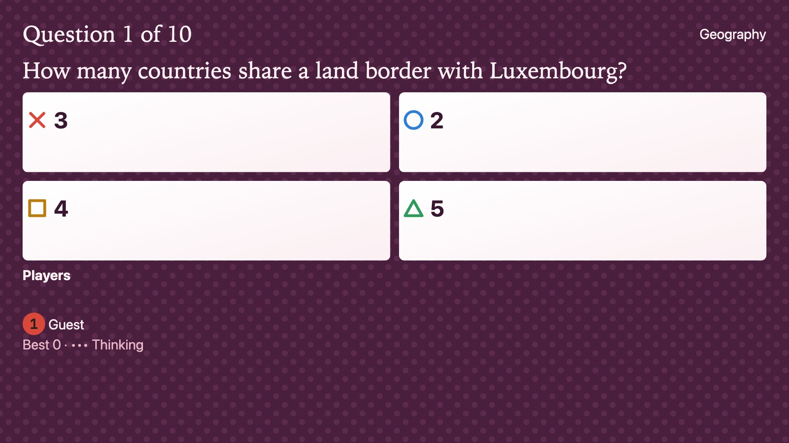
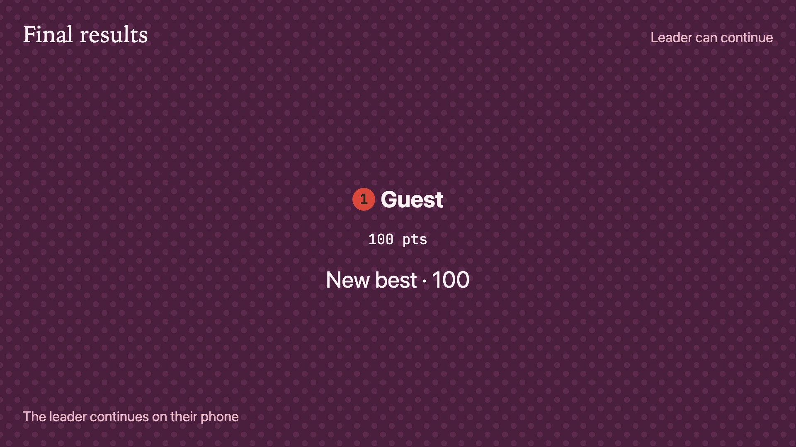
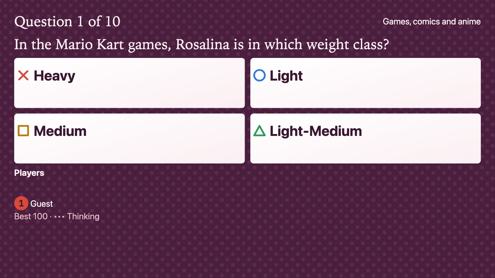
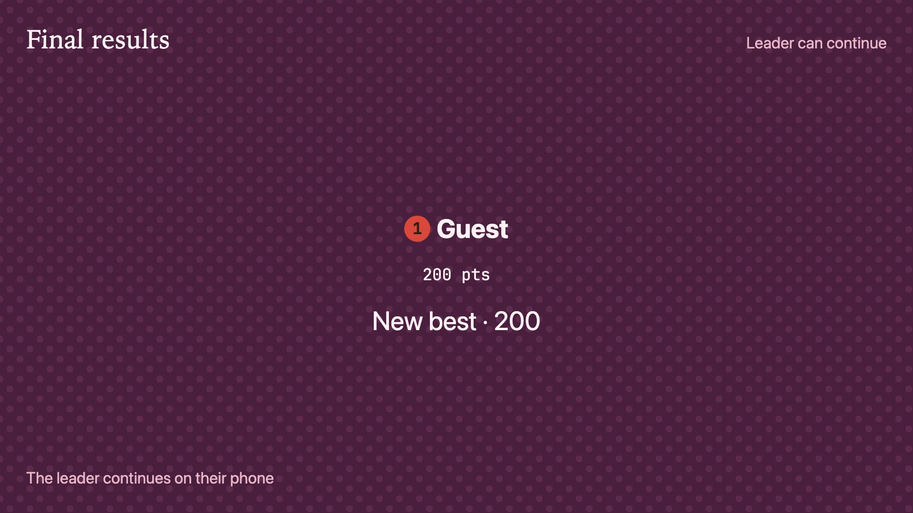

# R-06-solo-best UAT evidence

Automated execution only. Visual review and acceptance decisions are pending.

Command: `node tools/uat/run.mjs -- R-06-solo-best --phones 1 --out round2`
Commit: `a24117ac4b83abfd8b960527f1a6bae10e0171c0`
Viewports: 1920×1080

| Timing | ms | Status |
|---|---:|---|
| Create room through host page | 1395.8 | completed |
| Solo match 1 with seed 42 | 37268.0 | completed |
| Solo match 2 with seed 42 | 36502.3 | completed |

Expected errors (count):
None

## Real server

| Screenshot | What it shows | Looked at by |
|---|---|---|
|  | | |
|  | | |
|  | | |
|  | | |

| Acceptance statement | Pass / fail | Evidence |
|---|---|---|
| | | |
