# R-06-solo-best UAT evidence

Automated execution only. Visual review and acceptance decisions are pending.

Command: `node tools/uat/run.mjs -- R-06-solo-best --phones 2 --out round3`
Commit: `9d9aa7a1f4b562d5a25450ecf99f7c373cc23c26`
Viewports: 1920×1080, 844×390

| Timing | ms | Status |
|---|---:|---|
| Create room through host page | 1264.3 | completed |
| Solo match 1 with seed 42 | 32811.4 | completed |
| Solo match 2 with seed 42 | 32949.0 | completed |
| Solo match 3 with seed 42 | 30531.0 | completed |
| Solo match 4 with seed 42 | 33458.3 | completed |
| Create room through host page | 961.4 | completed |

Expected errors (count):
None

## Real server

| Screenshot | What it shows | Looked at by |
|---|---|---|
| 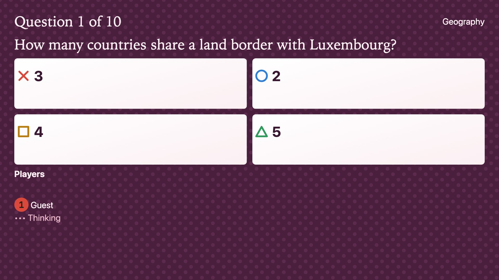 | | |
| 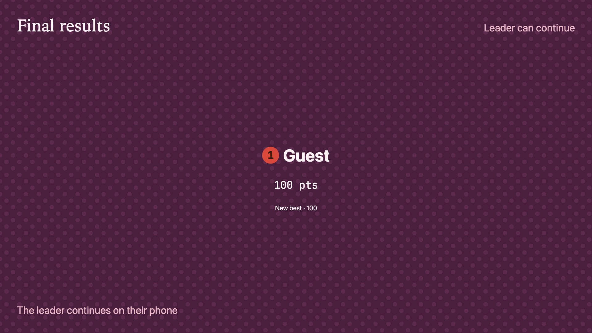 | | |
| 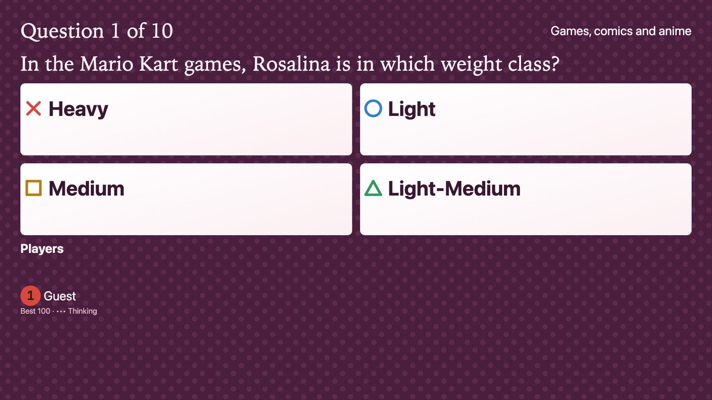 | | |
| 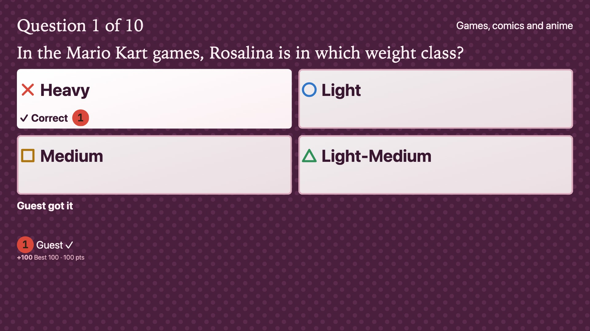 | | |
| 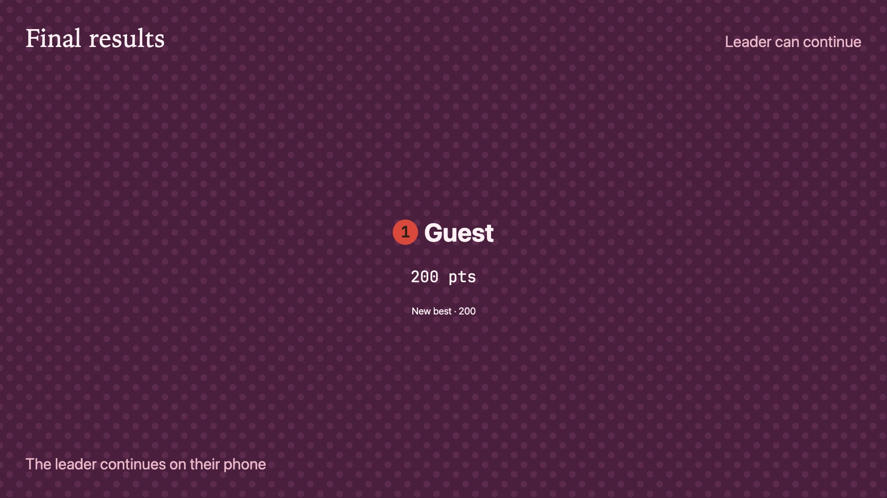 | | |
| 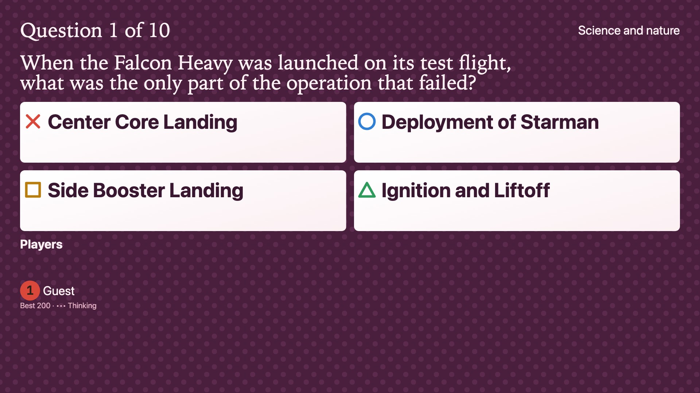 | | |
| 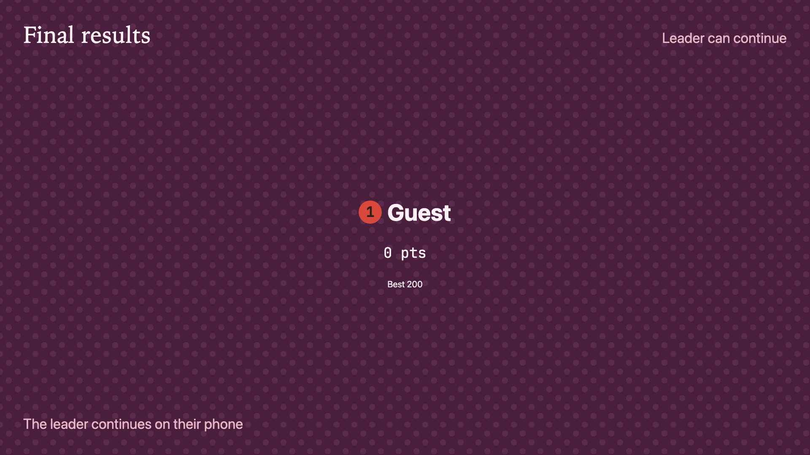 | | |
| 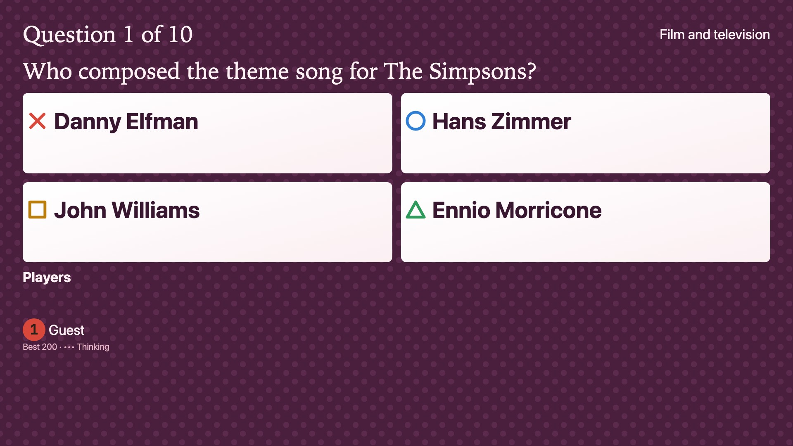 | | |
| 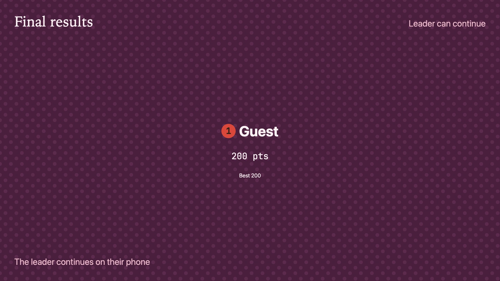 | | |
|  | | |
| 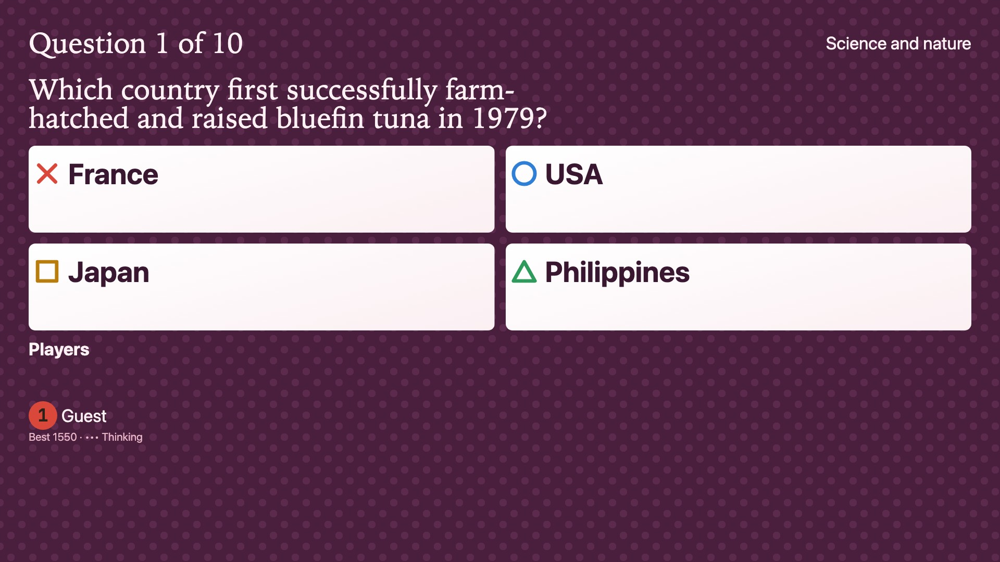 | | |
| 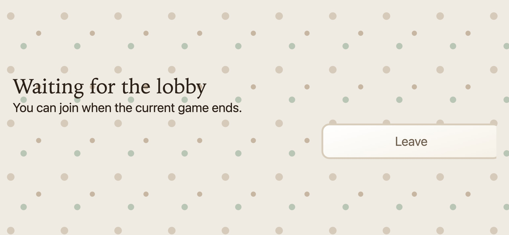 | | |
| 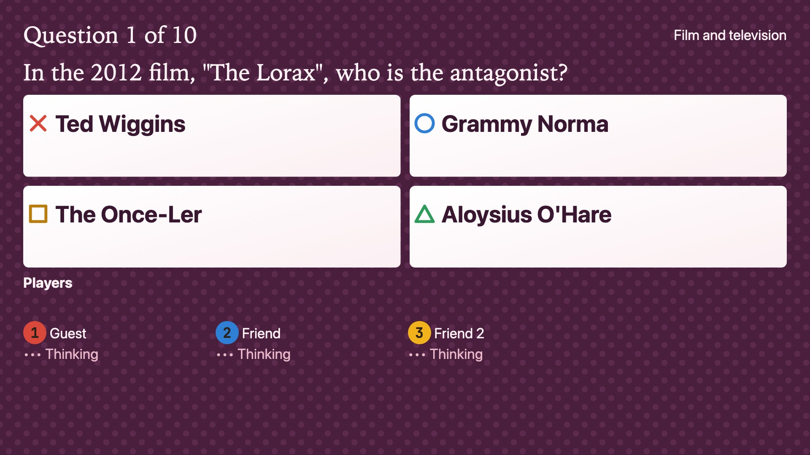 | | |
| 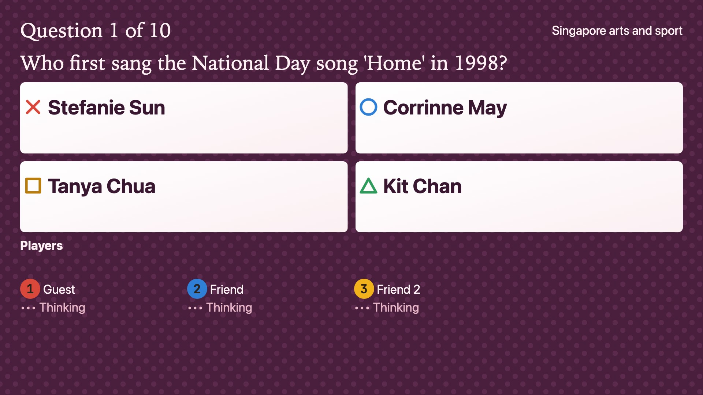 | | |
| 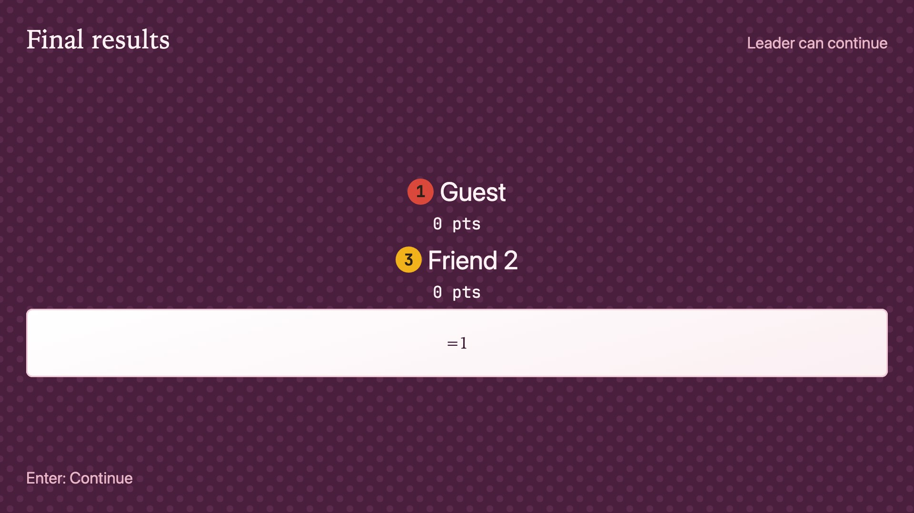 | | |

| Acceptance statement | Pass / fail | Evidence |
|---|---|---|
| | | |
