# R-06-solo-best UAT evidence

Superseded by round6 and perf-r5; not used as closing evidence.

Automated execution only. Visual review and acceptance decisions are pending.

Command: `node tools/uat/run.mjs -- R-06-solo-best --phones 2 --out round5`
Commit: `98cc343512ac1ee938a7ceda9fa4b69c89595e0f`
Viewports: 1920×1080, 844×390

| Timing | ms | Status |
|---|---:|---|
| Create room through host page | 1383.3 | completed |
| Solo match 1 with seed 42 | 35926.8 | completed |
| Solo match 2 with seed 42 | 34747.9 | completed |
| Solo match 3 with seed 42 | 33798.5 | completed |
| Solo match 4 with seed 42 | 33913.4 | completed |
| Create room through host page | 845.7 | completed |

Expected errors (count):
None

## Real server

| Screenshot | What it shows | Looked at by |
|---|---|---|
| 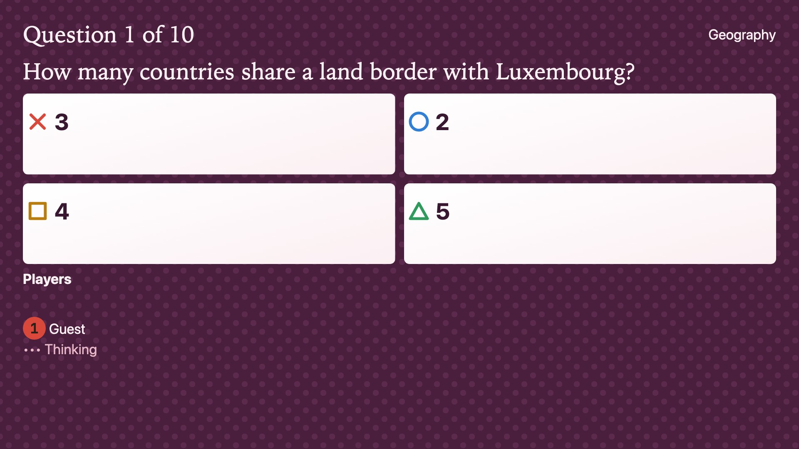 | | |
|  | | |
| 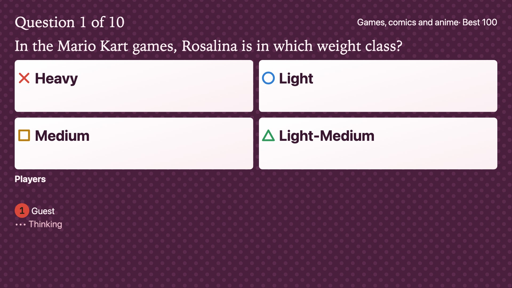 | | |
| 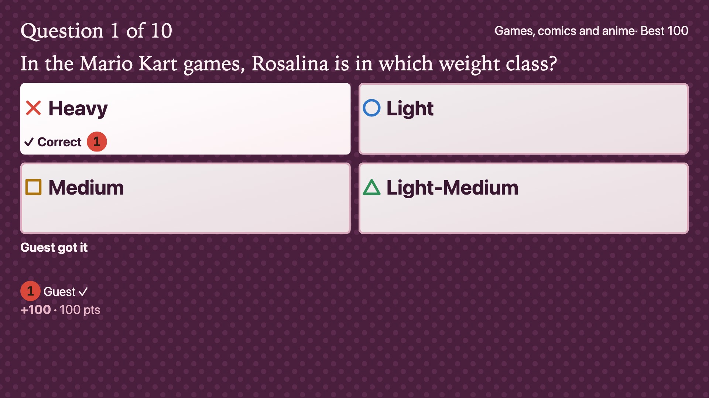 | | |
| 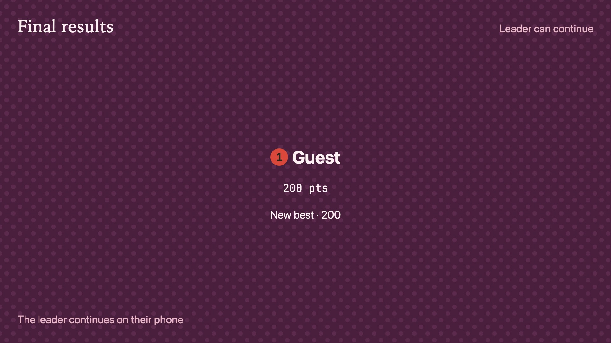 | | |
| 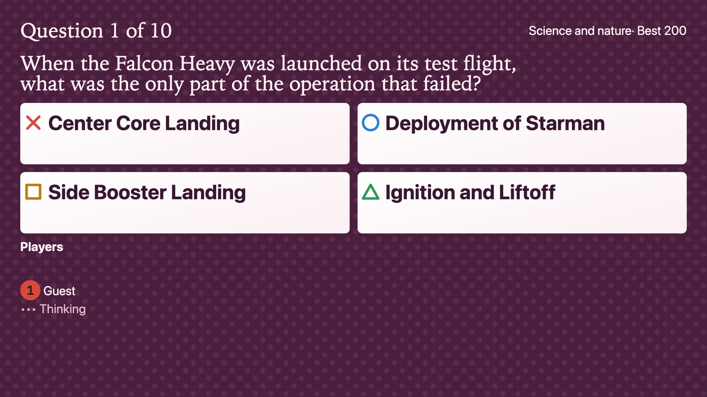 | | |
| 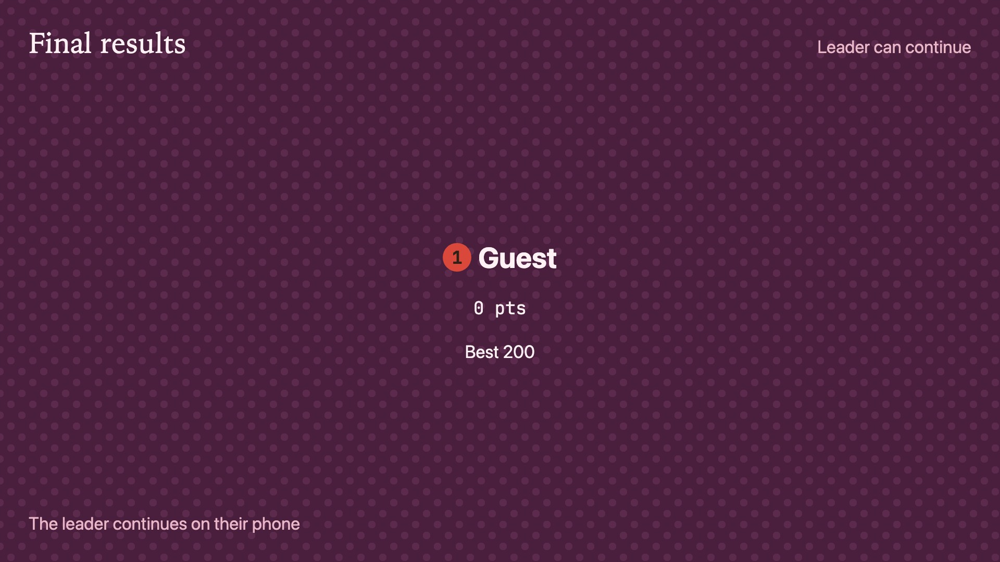 | | |
| 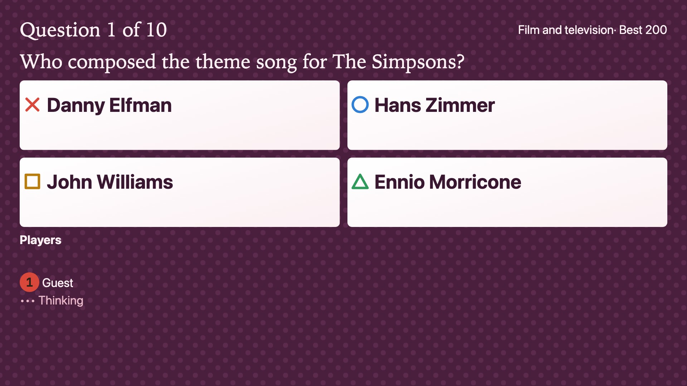 | | |
| 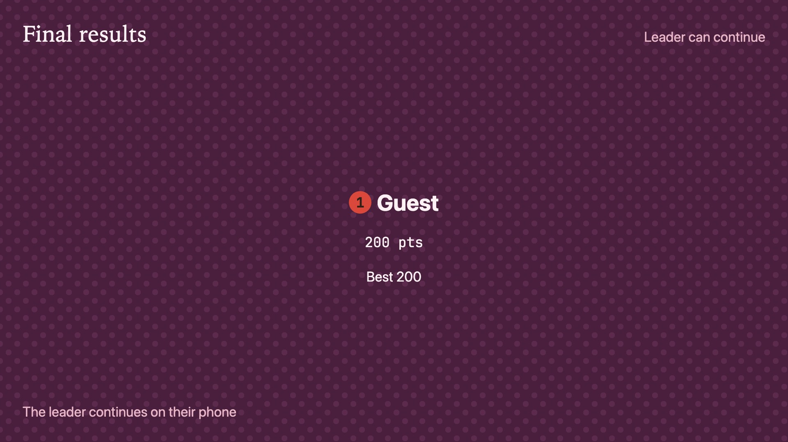 | | |
| 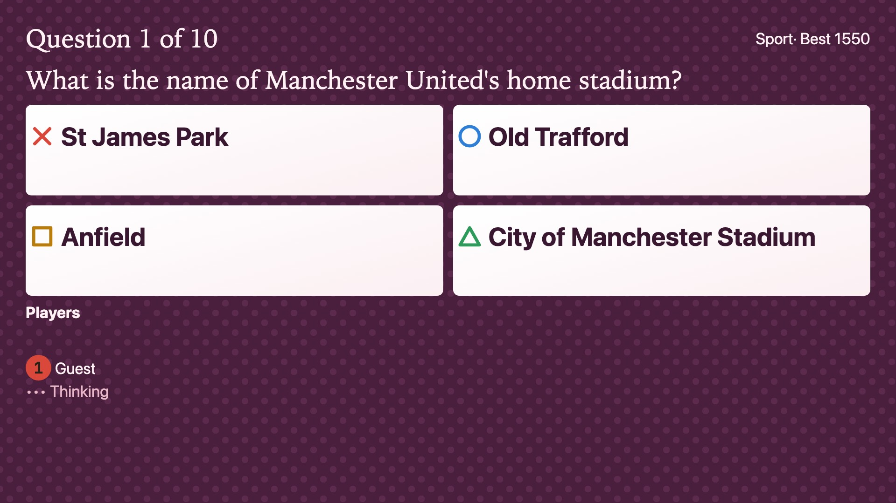 | | |
| 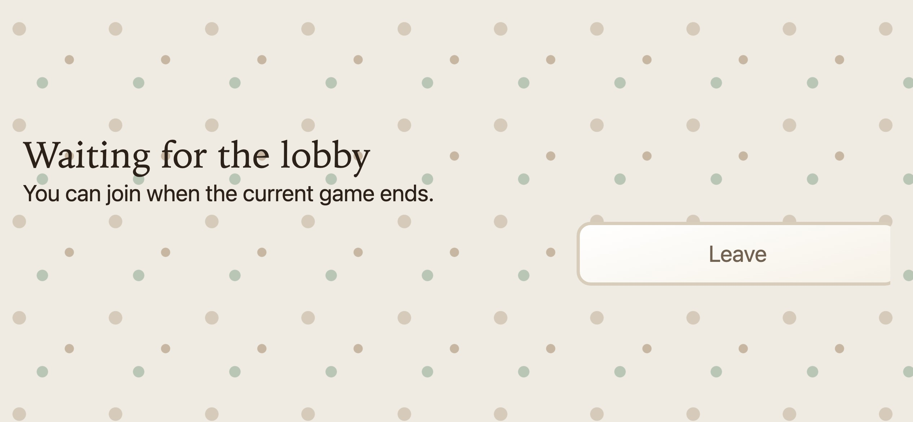 | | |
| 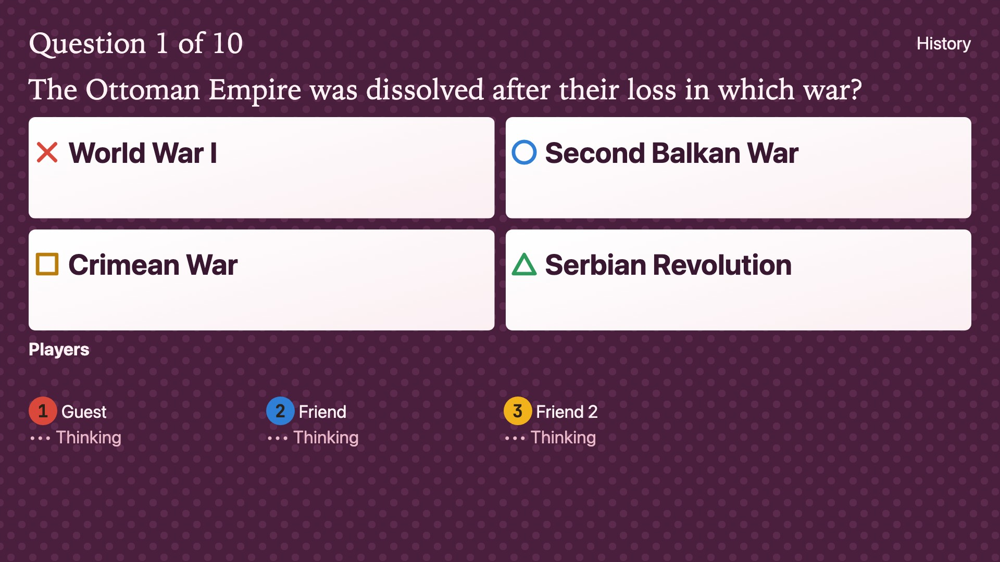 | | |
| 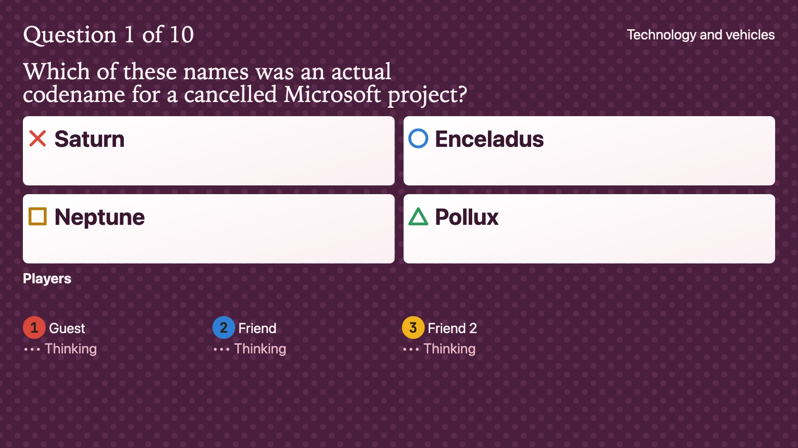 | | |
| 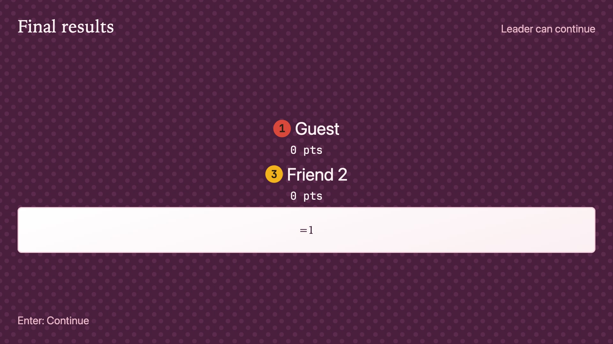 | | |

## Strips

| Screenshot | What it shows | Looked at by |
|---|---|---|
|  | | |
|  | | |

| Acceptance statement | Pass / fail | Evidence |
|---|---|---|
| | | |
