# R-06-solo-best UAT evidence

Looked at by the integrator and review 6, 2026-11-18. This is the closing evidence for R-06.

Command: `node tools/uat/run.mjs -- R-06-solo-best --phones 2 --out round6`
Commit: `ac4f2bfd6f998cfca7d5d7cd9d803783e670dd08`
Viewports: 1920×1080, 844×390

| Timing | ms | Status |
|---|---:|---|
| Create room through host page | 1324.5 | completed |
| Solo match 1 with seed 42 | 34357.3 | completed |
| Solo match 2 with seed 42 | 33862.7 | completed |
| Solo match 3 with seed 42 | 33449.8 | completed |
| Solo match 4 with seed 42 | 32980.9 | completed |
| Create room through host page | 834.6 | completed |

Expected errors (count):
None

## Real server

| Screenshot | What it shows | Looked at by |
|---|---|---|
| 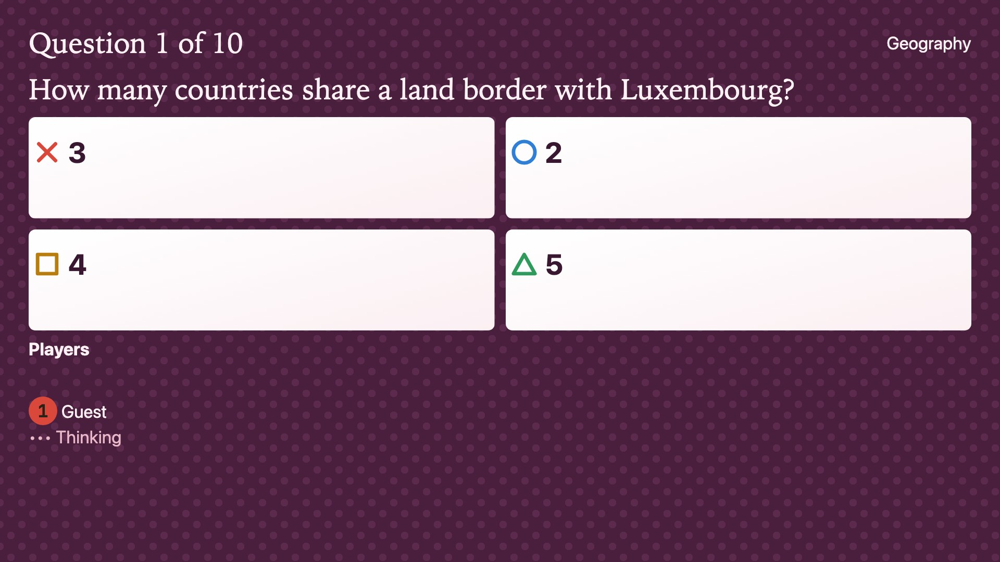 | Match 1, Question 1 of 10, solo; header shows only "Geography", no Best (first match, no "Best 0"); status Thinking. | Integrator, review 6 |
|  | Solo final, Guest, 100 pts, "New best · 100" at 34 px. | Integrator, review 6 |
| 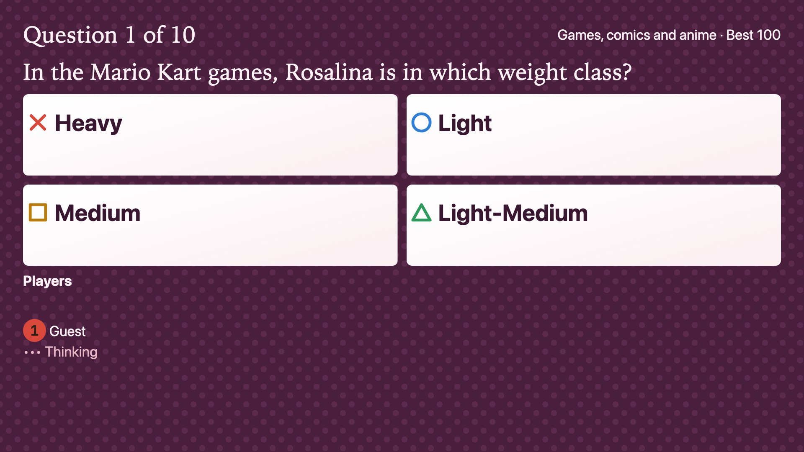 | Match 2, Question 1; header "Games, comics and anime · Best 100" on one line; a different first question. | Integrator, review 6 |
| 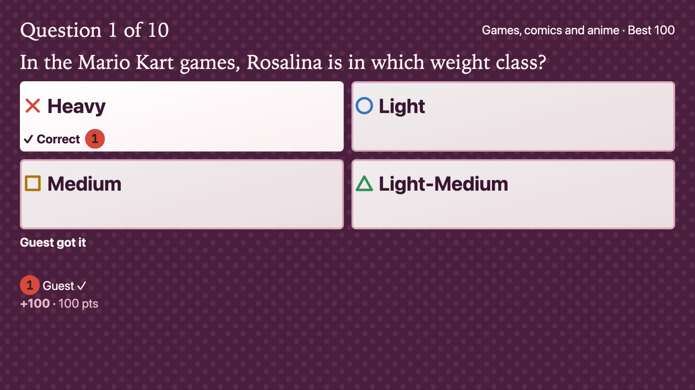 | Match 2 reveal: "+100 · 100 pts" in the seat status; header "· Best 100". | Integrator, review 6 |
| 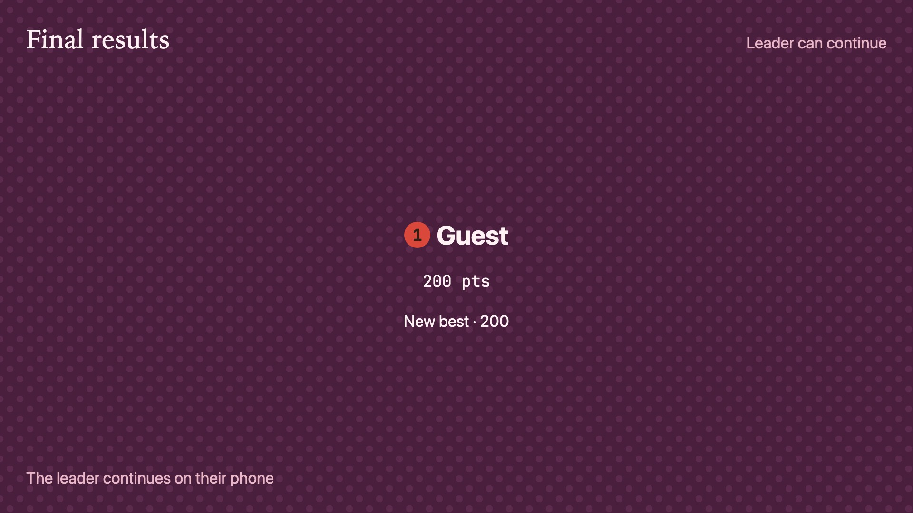 | Solo final, 200 pts, "New best · 200". | Integrator, review 6 |
| 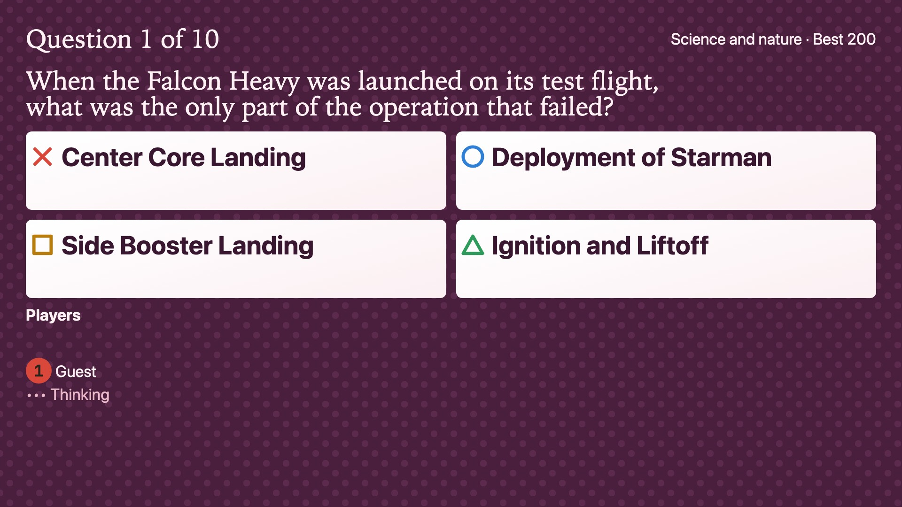 | Match 3, Question 1: "Science and nature · Best 200"; the question runs to two lines. | Integrator, review 6 |
| 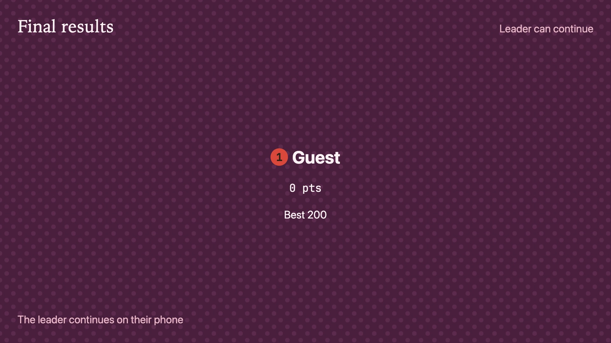 | Match 3 final, 0 pts, "Best 200" (unbeaten, no pulse). | Integrator, review 6 |
| 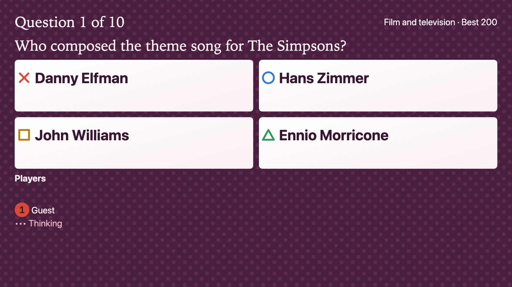 | Match 4, Question 1: "Film and television · Best 200". | Integrator, review 6 |
| 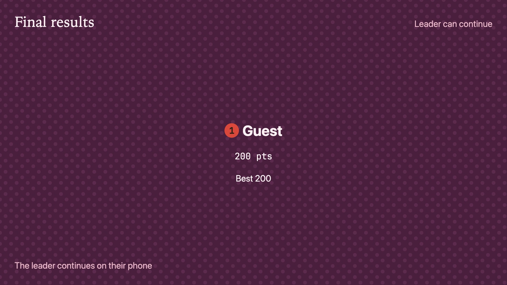 | Match 4 final, 200 pts, "Best 200" (a tie keeps the best; no "New best"). | Integrator, review 6 |
| 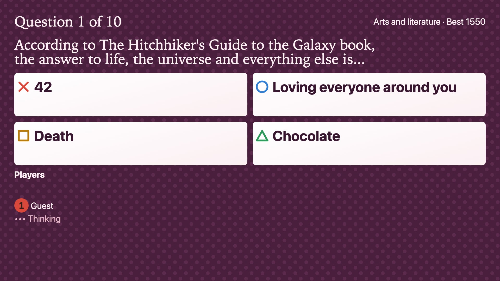 | Seeded four-digit best: "Arts and literature · Best 1550" on one line at 34 px or more, no overflow (asserted). | Integrator, review 6 |
| 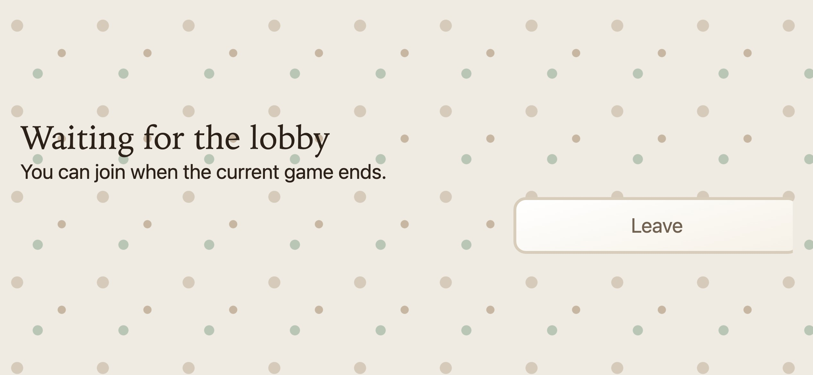 | Second phone at 844 × 390, "Waiting for the lobby"; the Leave button is clipped on the right (shell code, fixed in C-17). | Integrator, review 6 |
| 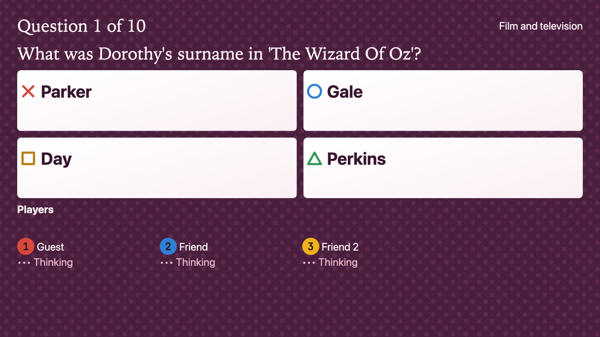 | Multi-player match (three seats: pre-C-17 double seat); header shows only the category, no Best. | Integrator, review 6 |
| 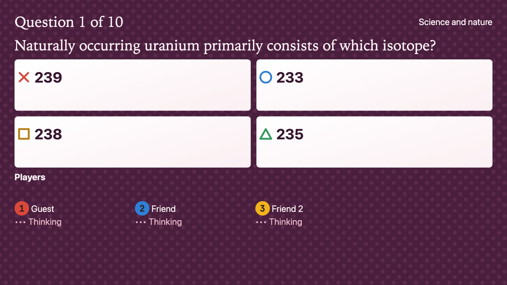 | Multi-player match start; no Best in the header. | Integrator, review 6 |
| 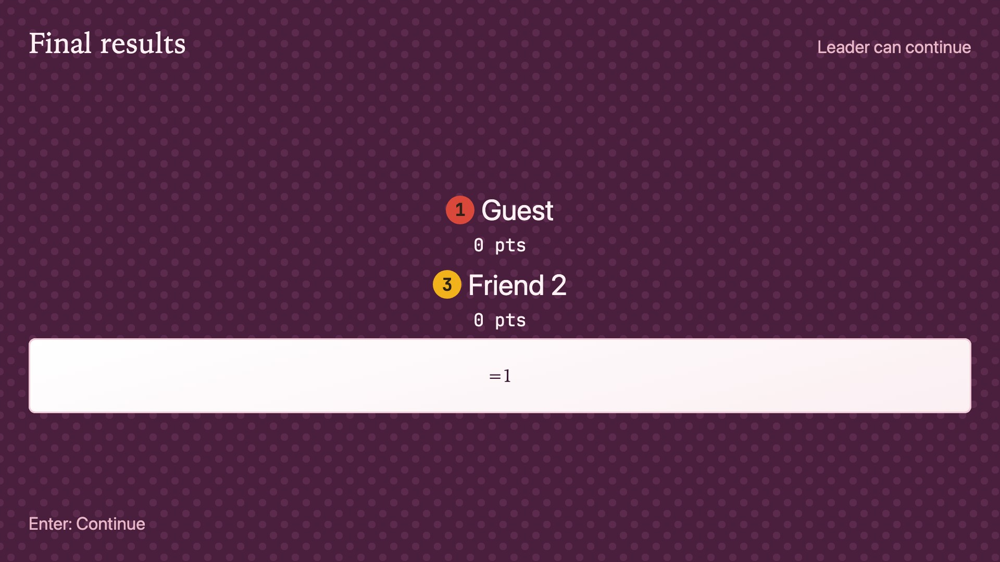 | Multi-player final, Guest and Friend 2 tied at 0, no Best; full-width "=1" step (OQ-047). | Integrator, review 6 |

## Strips

| Screenshot | What it shows | Looked at by |
|---|---|---|
|  | Strip: Question 10 reveal into the solo final; "New best · 100" fades in from 112 ms; settled and opaque from 410 ms; the pulse runs after the entrance, 213 → 219 px wide at 595 ms (about ×1.03) and back by 752 ms. | Integrator, review 6 |
|  | Strip: match 2 final; settled by 403 ms; pulse 217 → 227 px at 564 ms (about ×1.05, peak) and back by 724 ms, all on opaque frames. | Integrator, review 6 |

| Acceptance statement | Pass / fail | Evidence |
|---|---|---|
| RZ-013: a solo best is kept per length and shown in the header once positive | Pass | 01, 16, 32, 34, 36 |
| RZ-013: New best only after a stored improvement, with one pulse on the settled screen | Pass | 14, 15, 30, 31 |
| RZ-013: unbeaten and tied scores show "Best N" with no pulse | Pass | 33, 35 |
| RZ-013: anyone joining ends best eligibility | Pass | 38, 39, 40 |
| RZ-015: no repeated first question across four matches | Pass | 01, 16, 32, 34 (plus tests) |
| Four-digit Best fits on one line at 34 px or more | Pass | 36 |
