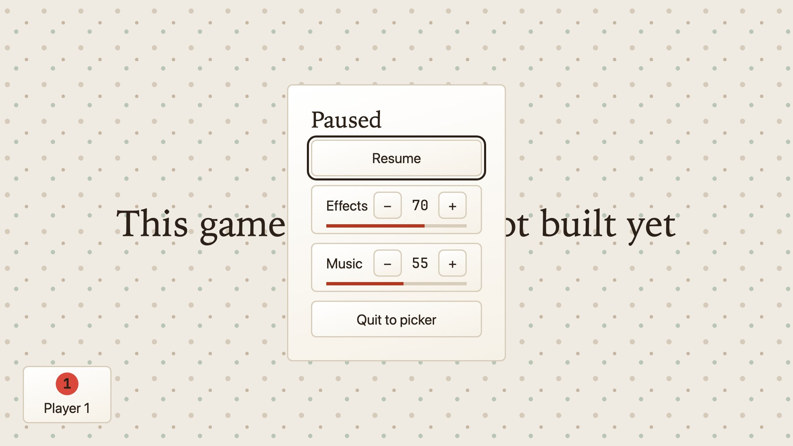
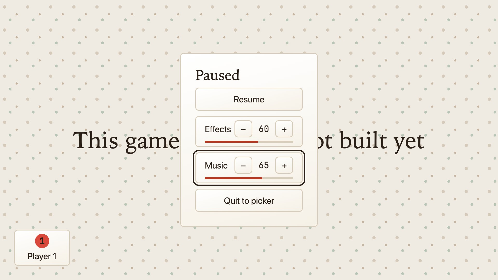
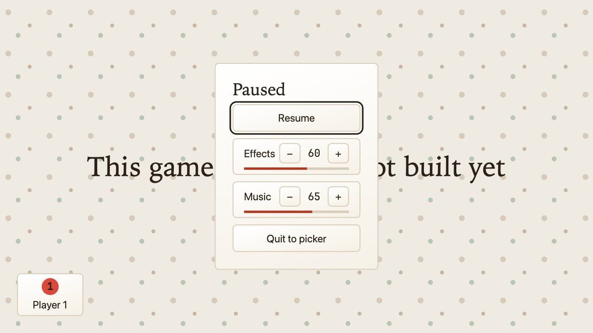
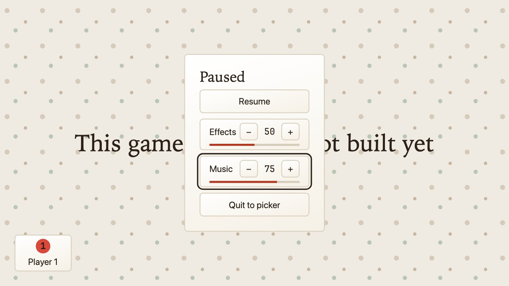

# R-07-pause-levels UAT evidence

Visual review done 2026-11-18 by the integrator and the Claude reviewer.

Command: `node tools/uat/run.mjs -- R-07-pause-levels --phones 1 --out round2`
Commit: `a64f7e64a8c45a871ce1940a3fb7c4e7ec3d7e64`
Viewports: 1920×1080, 1280×720

| Timing | ms | Status |
|---|---:|---|
| Create room through host page | 1181.4 | completed |

Expected errors (count):
None

## Real server

| Screenshot | What it shows | Looked at by |
|---|---|---|
|  | Pause panel at 1920×1080 opened with Esc; focus ring on Resume; Effects 70 and Music 55 with bars; − and + styled as panels. | Integrator and Claude reviewer, 2026-11-18 |
|  | After Down, Left, Down, Right: Effects 60, Music 65, focus ring on Music, bars follow the values. | Integrator and Claude reviewer, 2026-11-18 |
|  | Reopened at 1280×720: levels kept at 60/65; focus on Resume; panel inside the safe area. | Integrator and Claude reviewer, 2026-11-18 |
|  | After the same keys: Effects 50, Music 75, focus on Music. | Integrator and Claude reviewer, 2026-11-18 |

| Acceptance statement | Pass / fail | Evidence |
|---|---|---|
| Up/Down reach Resume, Effects, Music, Quit; Left/Right step by 10, clamped | pass | 01–04; pause-level.test.ts, pause-panel.dom.test.ts |
| Game-pad d-pad uses the same route | pass | pause-panel.dom.test.ts |
| One cue per Effects change, none for Music, at a bound or on reaching 0 | pass | pause-panel.dom.test.ts, sound.test.ts |
| Levels saved and applied live | pass | host-sound.test.ts, 03 |
| Token styling, bar motion, reduced motion | pass | 01–04 |
| Fits the TV safe area at both sizes | pass | 01–04, DOM test |
