# R-08-full-match UAT evidence

Host browser: chromium 156.0.8078.4
Phone browser: chromium (legacy iPhone emulation) 156.0.8078.4

Automated execution only. Visual review and acceptance decisions are pending.

Command: `node tools/uat/run.mjs -- R-08-full-match --phones 1 --out r16-solo4`
Commit: `0cc1508fe22dd514050fb3a8e59c69ad12d21008`
Viewports: 1920×1080, 844×390, 1280×720, 1440×900

| Timing | ms | Status |
|---|---:|---|
| Create room through host page | 1733.2 | completed |
| Question 1: privacy, inputs, reveal and scores | 2253.0 | completed |
| Question 2: privacy, inputs, reveal and scores | 1181.7 | completed |
| Question 3: privacy, inputs, reveal and scores | 1887.9 | completed |
| Question 4: privacy, inputs, reveal and scores | 11450.0 | completed |
| Question 5: privacy, inputs, reveal and scores | 4131.7 | completed |
| Question 6: privacy, inputs, reveal and scores | 1069.9 | completed |
| Question 7: privacy, inputs, reveal and scores | 1257.6 | completed |
| Question 8: privacy, inputs, reveal and scores | 2032.7 | completed |
| RZ-009 final-round card and double-points header | 3594.8 | completed |
| Question 9: privacy, inputs, reveal and scores | 6182.1 | completed |
| Question 10: privacy, inputs, reveal and scores | 265.2 | completed |

Expected errors (count):
None

## Real server

| Screenshot | What it shows | Looked at by |
|---|---|---|
| 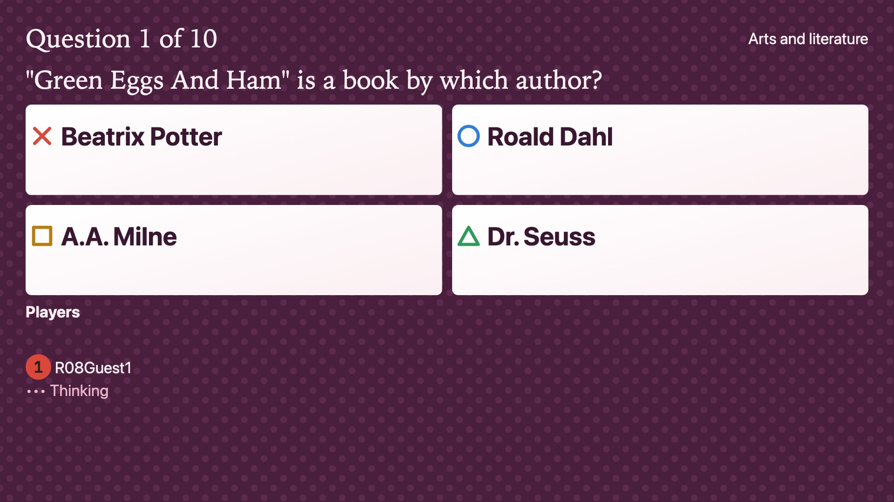 | | |
| 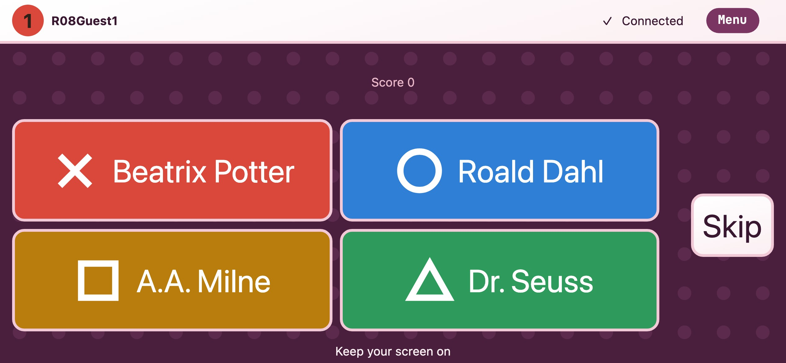 | | |
| 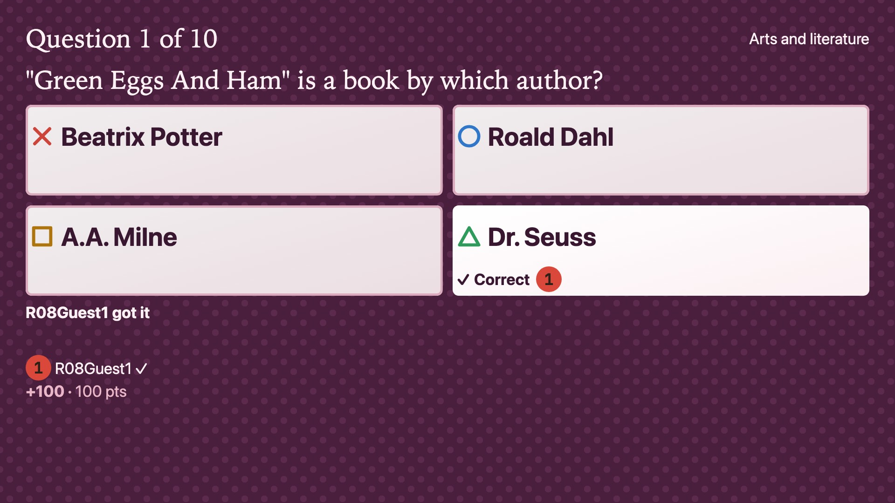 | | |
| 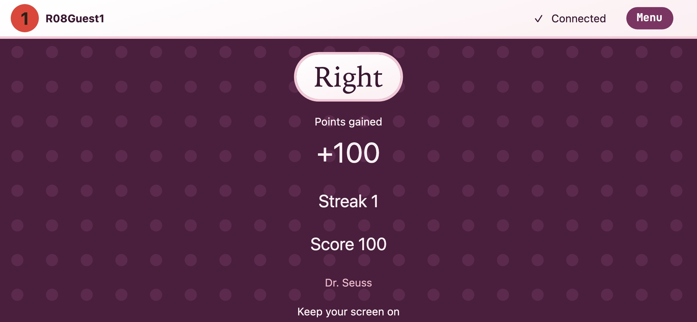 | | |
| 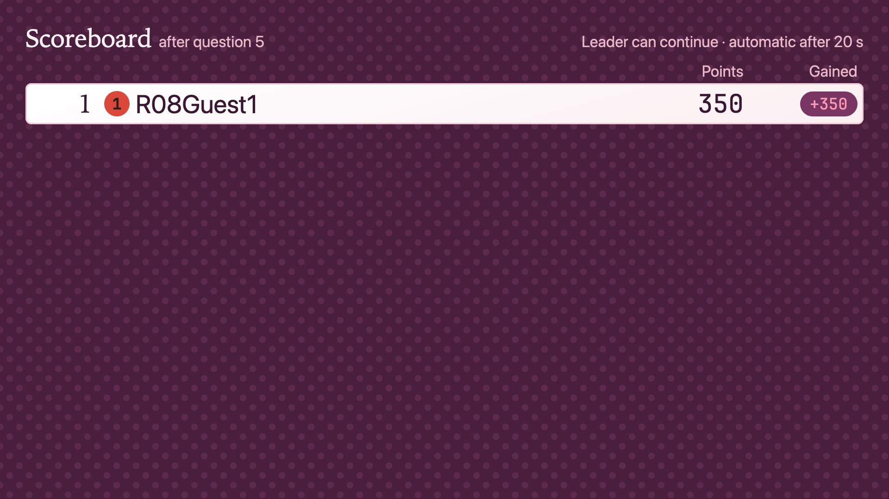 | | |
| 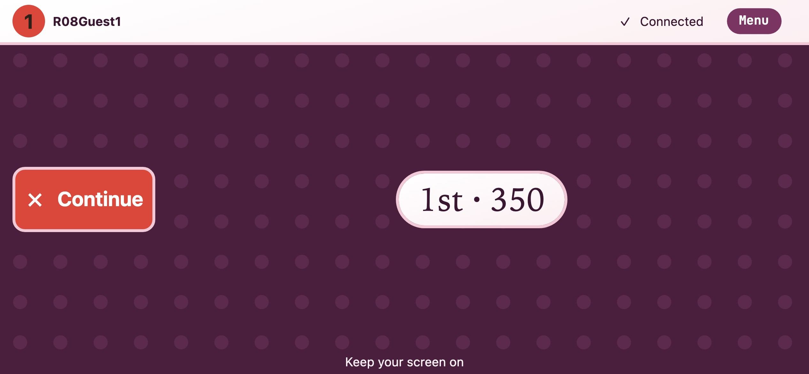 | | |
| 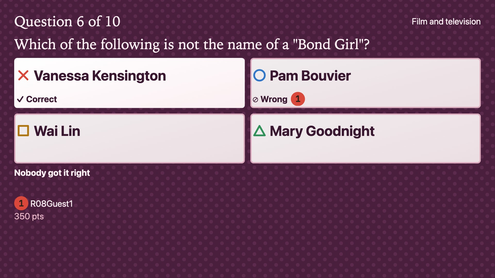 | | |
| 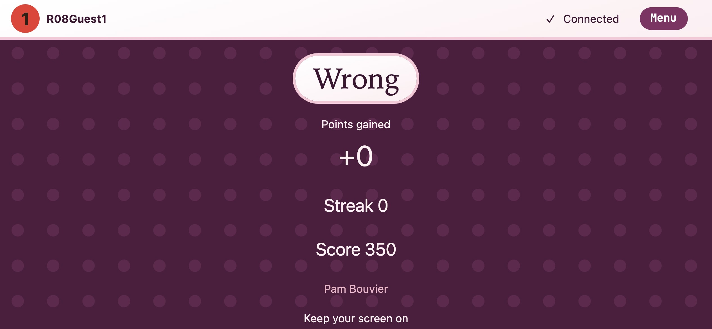 | | |
| 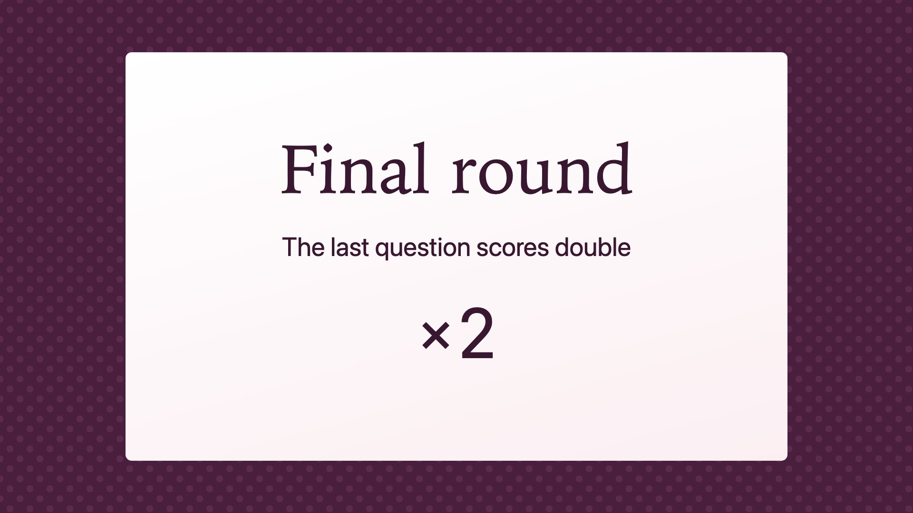 | | |
| 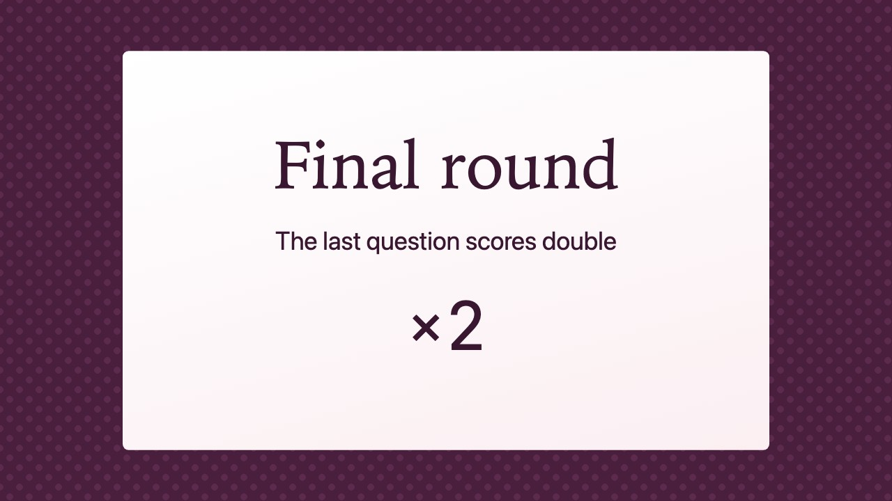 | | |
| 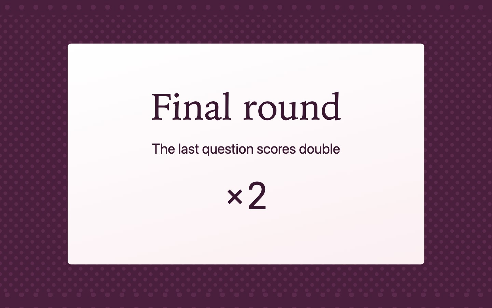 | | |
| 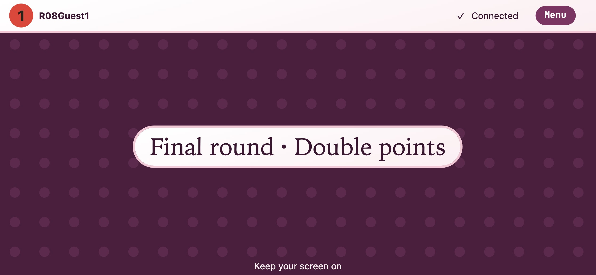 | | |
| 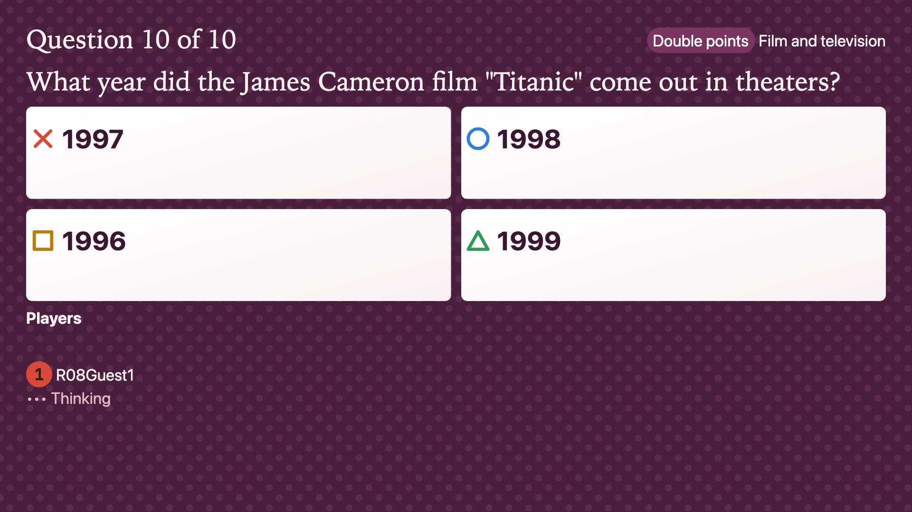 | | |
|  | | |
| 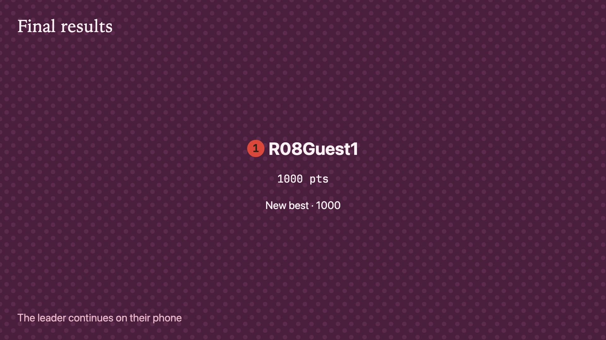 | | |
|  | | |

## Strips

| Screenshot | What it shows | Looked at by |
|---|---|---|
| 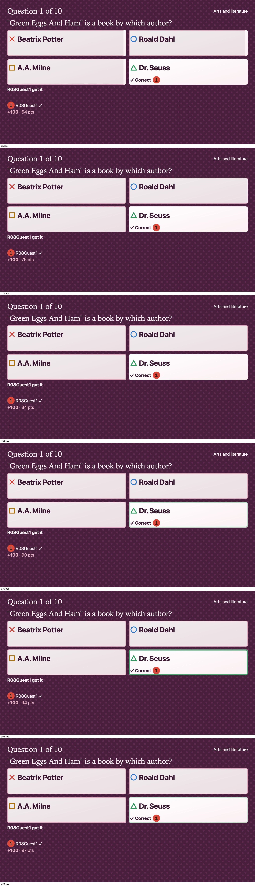 | | |
| 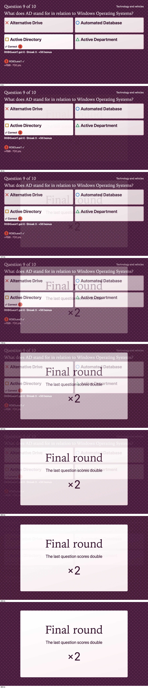 | | |
| 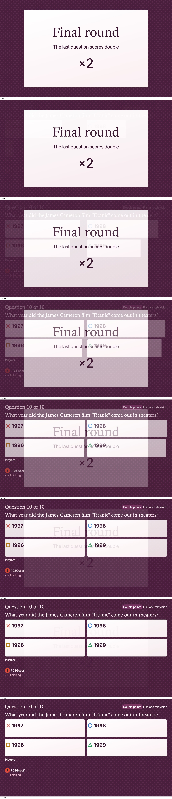 | | |
| 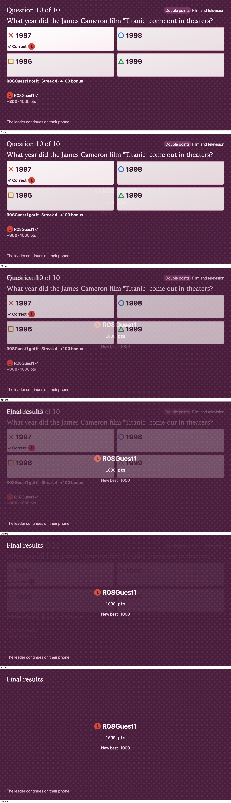 | | |

| Acceptance statement | Pass / fail | Evidence |
|---|---|---|
| | | |

## Visual review (Claude reviewer, 2026-11-19, commit 0cc1508f; 9.0 MB of 12 MiB)

| Screenshot | What it shows | Looked at by |
|---|---|---|
| 01-host-question-tv | Question 1 of 10, four shape-marked options, one player Thinking; no Double points chip | Claude reviewer, 2026-11-19 (contact sheet) |
| 10-host-reveal-tv | Question 1 reveal: Dr. Seuss Correct with seat 1; "R08Guest1 got it"; +100 · 100 pts | Claude reviewer, 2026-11-19 (contact sheet) |
| 12-host-scoreboard-5-tv | Scoreboard after question 5: one row, 350, +350 chip | Claude reviewer, 2026-11-19 (contact sheet) |
| 14-host-lock-out-solo-first-wrong-tv | Question 6: Pam Bouvier Wrong, Vanessa Kensington Correct, "Nobody got it right", 350 pts | Claude reviewer, 2026-11-19 (contact sheet) |
| 25-host-final-round-card-1920-tv | Final-round card at 1920 × 1080: "Final round" 144 px, "The last question scores double" 55 px, mono ×2, 1.618 : 1 panel on the dotted plum ground | Claude reviewer, 2026-11-19 |
| 26-host-final-round-card-1280-tv | Same card at 1280 × 720, panel inside the frame, nothing clipped | Claude reviewer, 2026-11-19 |
| 27-host-final-round-card-1440-letterbox-tv | Same card at 1440 × 900, letterboxed with the artboard centred | Claude reviewer, 2026-11-19 |
| 28-phone1-final-round-double-points-phone1 | Phone: "Final round · Double points" pill, no answer buttons | Claude reviewer, 2026-11-19 (contact sheet) |
| 38-host-final-question-double-points-1920-tv | Question 10 of 10 with the Double points chip left of "Film and television"; no solo Best yet | Claude reviewer, 2026-11-19 |
| 39-host-final-question-double-points-1280-tv | Same at 1280 × 720, chip inside the header, no overlap | Claude reviewer, 2026-11-19 (contact sheet) |
| 47-host-podium-tv | Final results, solo: 1000 pts settled, "New best · 1000", hand-off line at the foot | Claude reviewer, 2026-11-19 |
| 48-phone1-podium-phone1 | Phone Results, "Watch the TV.", Teams off and Continue | Claude reviewer, 2026-11-19 (contact sheet) |
| 02, 11, 13, 15 (phone) | R-08 regression stills, unchanged by R-16 | (not opened) |

| Strip | What it shows | Looked at by |
|---|---|---|
| 09-strip-reveal | Question 1 reveal; the total counts up 64 → 97 across frames | Claude reviewer, 2026-11-19 (contact sheet) |
| 24-strip-final-round-card-in | Question 9 reveal held fully drawn while the card fades in above it; no frame shows the bare ground | Claude reviewer, 2026-11-19 (contact sheet) |
| 37-strip-final-round-card-out | Card held while question 10, chip included, fades in above it; last frame is question 10 alone | Claude reviewer, 2026-11-19 (contact sheet) |
| 46-strip-podium | Question 10 reveal ("Streak 4 · +100 bonus") under the incoming Final results; the hand-off line shows over the reveal in early frames (C-28) | Claude reviewer, 2026-11-19 (contact sheet) |

| Acceptance statement | Pass / fail | Evidence |
|---|---|---|
| The TV shows the final-round card before question 10, with the count-specific line and ×2 | Pass | 25, 26, 27, 24 |
| The card fades in and out with the old screen fully drawn underneath (paired crossfade, D-290) | Pass | 24, 37 |
| The phone shows "Final round · Double points" during the card and drops it when question 10 opens | Pass | 28; UAT assertion |
| The Double points chip is in question 10's header at both TV sizes | Pass | 38, 39 |
| The podium shows settled totals matching the public view | Pass | 47; UAT assertion |
| The chip sits clear of solo Best | Not shown here (no Best yet); DOM test only | — |
