# R-08-full-match UAT evidence

Automated round-2 run passed its hard assertions, with the known gaps below. Claude’s recorded inspections are attributed only to the files listed in review 1. Codex opened all table images on 2026-11-18 (stills in labelled contact sheets; strips separately). Final merge acceptance remains with the integrator.

Command: `node tools/uat/run.mjs -- R-08-full-match --phones 8 --max-mb 24 --timeout-min 20 --out round2-ffa`
Commit: `b485254e2bb771ebc1870b4e7688895a689e94c8`
Viewports: 1920×1080, 844×390

| Timing | ms | Status |
|---|---:|---|
| Create room through host page | 1373.1 | completed |
| Question 1: privacy, inputs, reveal and scores | 5199.5 | completed |
| Question 2: privacy, inputs, reveal and scores | 2469.0 | completed |
| Question 3: privacy, inputs, reveal and scores | 4951.4 | completed |
| Question 4: privacy, inputs, reveal and scores | 16047.4 | completed |
| Question 5: privacy, inputs, reveal and scores | 12090.2 | completed |
| Question 6: privacy, inputs, reveal and scores | 2373.5 | completed |
| Question 7: privacy, inputs, reveal and scores | 4465.2 | completed |
| Question 8: privacy, inputs, reveal and scores | 4437.6 | completed |
| KNOWN GAP RZ-009: no final-round announcement on the TV | 1.0 | completed |
| Question 9: privacy, inputs, reveal and scores | 8222.6 | completed |
| Question 10: privacy, inputs, reveal and scores | 2240.2 | completed |

Expected errors (count):
None

## Real server

| Screenshot | What it shows | Looked at by |
|---|---|---|
| 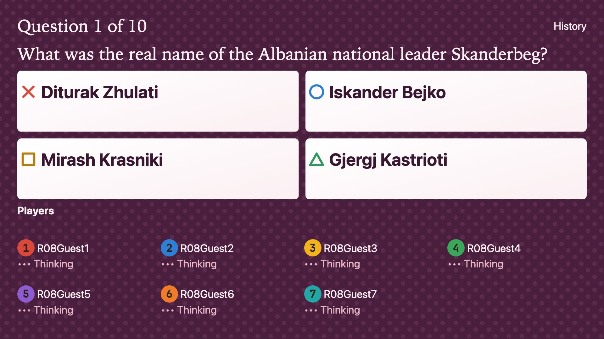 | Question 1 of 10: prompt, four shape-labelled options and player list marked Thinking. | Claude reviewer, 2026-11-18; Codex, 2026-11-18 |
| 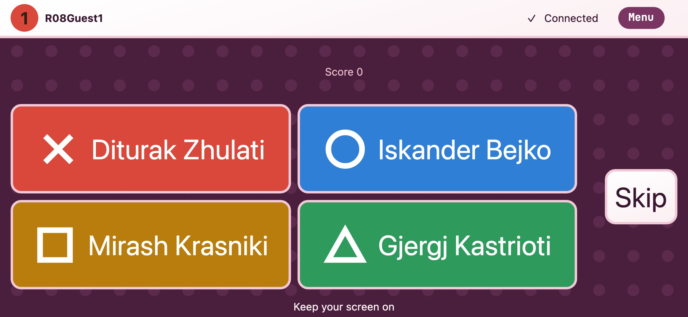 | Own seat and nickname, Score 0, red cross / blue circle / yellow square / green triangle answer buttons; leader Skip. | Codex, 2026-11-18; Claude review pending |
| 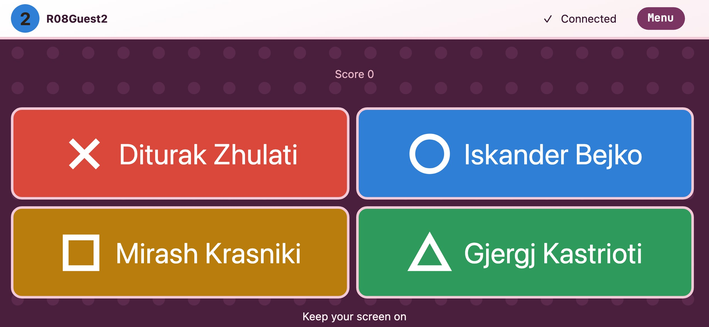 | Own seat and nickname, Score 0, red cross / blue circle / yellow square / green triangle answer buttons. | Claude reviewer, 2026-11-18; Codex, 2026-11-18 |
| 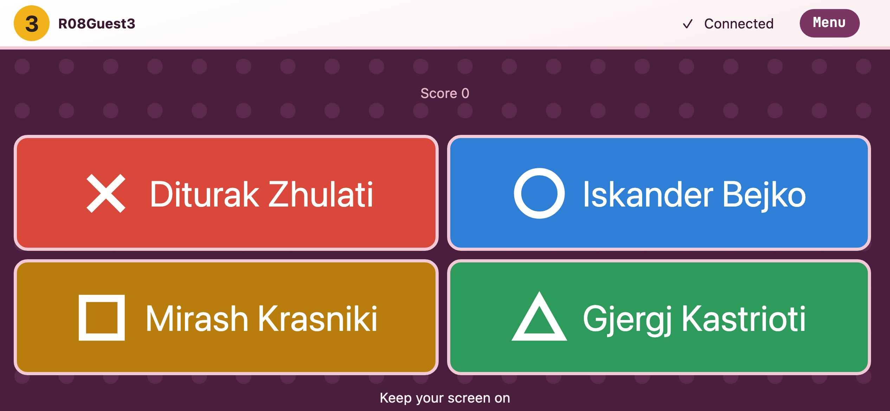 | Own seat and nickname, Score 0, red cross / blue circle / yellow square / green triangle answer buttons. | Codex, 2026-11-18; Claude review pending |
|  | Own seat and nickname, Score 0, red cross / blue circle / yellow square / green triangle answer buttons. | Codex, 2026-11-18; Claude review pending |
|  | Own seat and nickname, Score 0, red cross / blue circle / yellow square / green triangle answer buttons. | Codex, 2026-11-18; Claude review pending |
|  | Own seat and nickname, Score 0, red cross / blue circle / yellow square / green triangle answer buttons. | Codex, 2026-11-18; Claude review pending |
|  | Own seat and nickname, Score 0, red cross / blue circle / yellow square / green triangle answer buttons. | Codex, 2026-11-18; Claude review pending |
| 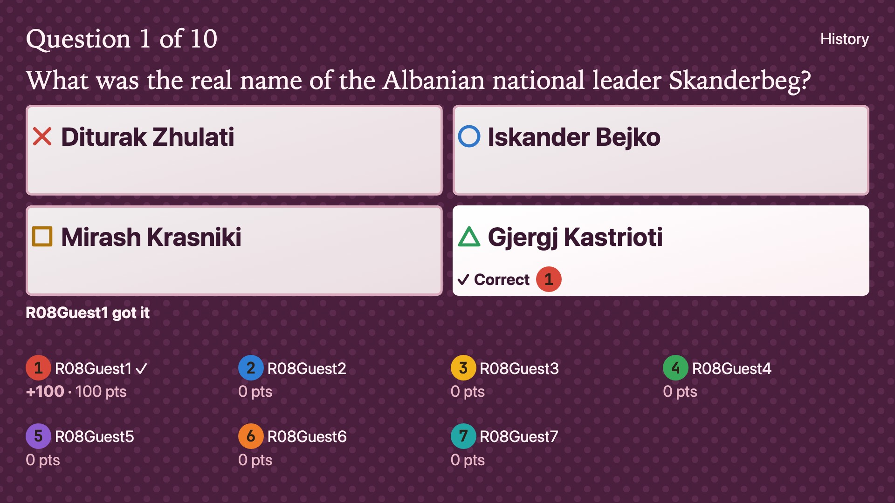 | Question 1 reveal: correct option marked, R08Guest1 got it; +100 · 100 pts; no TV streak. | Claude reviewer, 2026-11-18; Codex, 2026-11-18 |
| 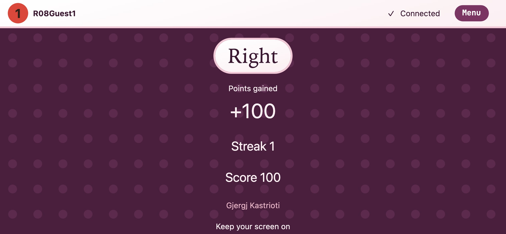 | Right, +100, Streak 1, Score 100 and own answer text. | Codex, 2026-11-18; Claude review pending |
| 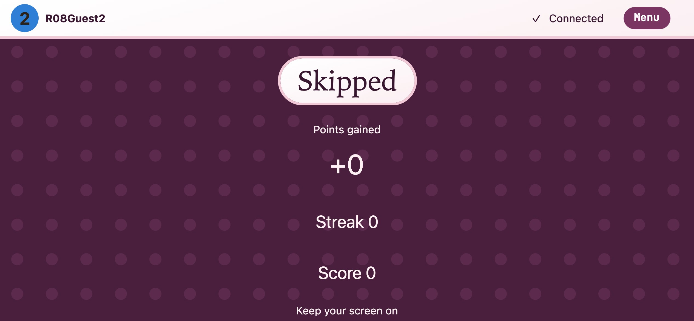 | Skipped, +0, Streak 0, Score 0. | Codex, 2026-11-18; Claude review pending |
| 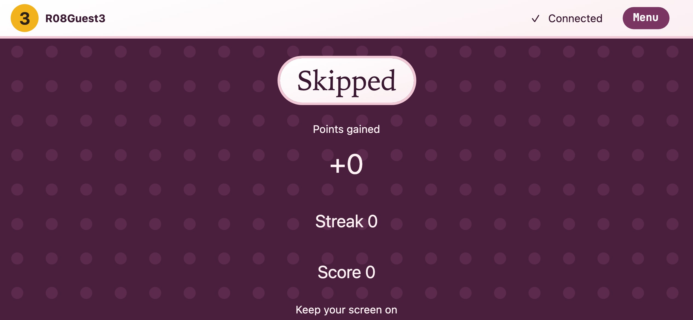 | Skipped, +0, Streak 0, Score 0. | Codex, 2026-11-18; Claude review pending |
|  | Skipped, +0, Streak 0, Score 0. | Codex, 2026-11-18; Claude review pending |
| 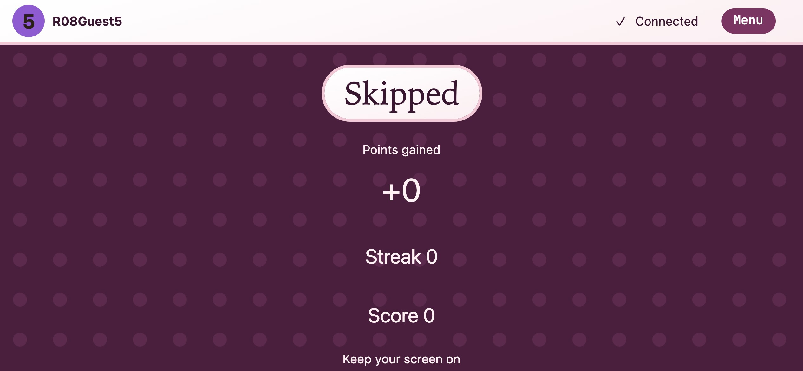 | Skipped, +0, Streak 0, Score 0. | Codex, 2026-11-18; Claude review pending |
|  | Skipped, +0, Streak 0, Score 0. | Codex, 2026-11-18; Claude review pending |
|  | Skipped, +0, Streak 0, Score 0. | Codex, 2026-11-18; Claude review pending |
| 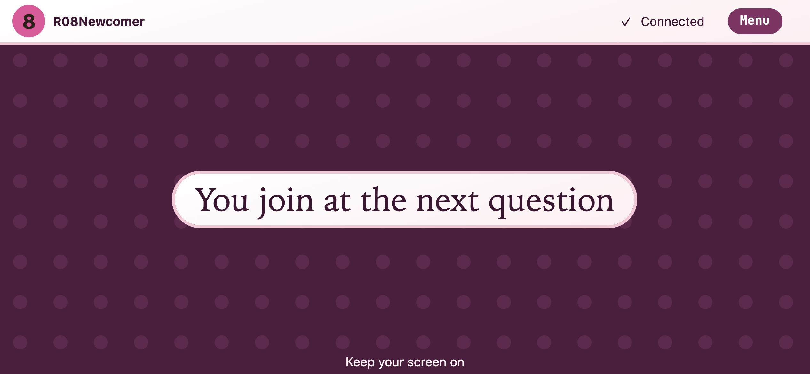 | R08Newcomer, seat 8: You join at the next question. | Claude reviewer, 2026-11-18; Codex, 2026-11-18 |
| 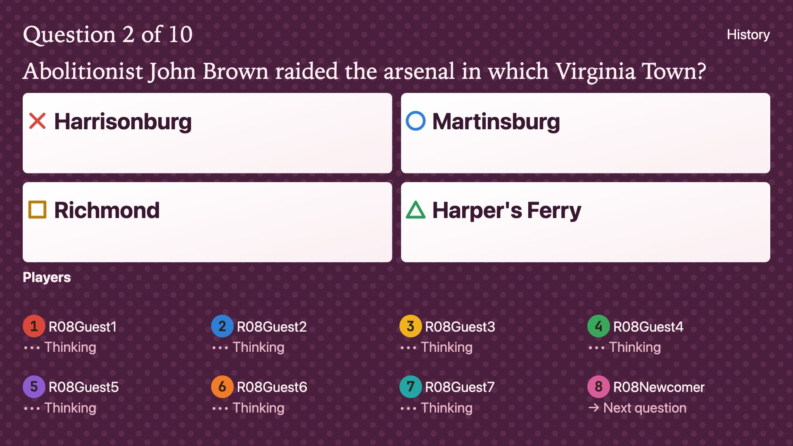 | Question 2: seven players Thinking; R08Newcomer marked Next question. | Claude reviewer, 2026-11-18; Codex, 2026-11-18 |
| 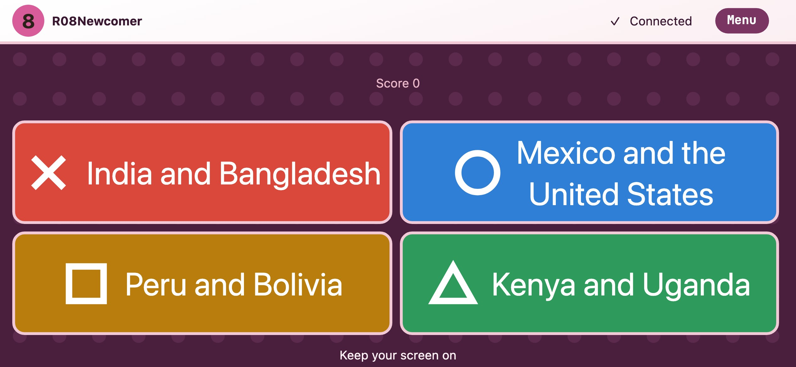 | R08Newcomer seat 8, Score 0 and four coloured shape answer buttons. | Claude reviewer, 2026-11-18; Codex, 2026-11-18 |
| 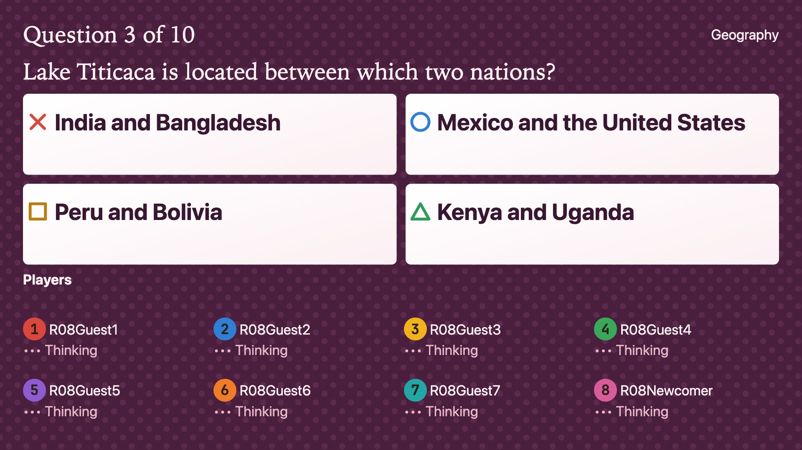 | Question 3 with eight players, including R08Newcomer, Thinking. | Claude reviewer, 2026-11-18; Codex, 2026-11-18 |
|  | R08Guest1 seat 1, Score 350, four answer buttons and Skip; same visible seat and score before and after reload. | Claude reviewer, 2026-11-18; Codex, 2026-11-18 |
| 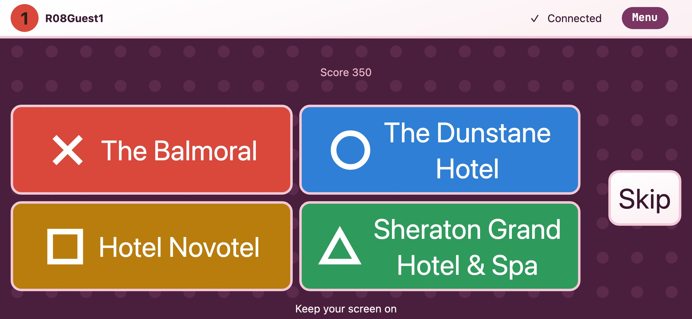 | R08Guest1 seat 1, Score 350, four answer buttons and Skip; same visible seat and score before and after reload. | Claude reviewer, 2026-11-18; Codex, 2026-11-18 |
| 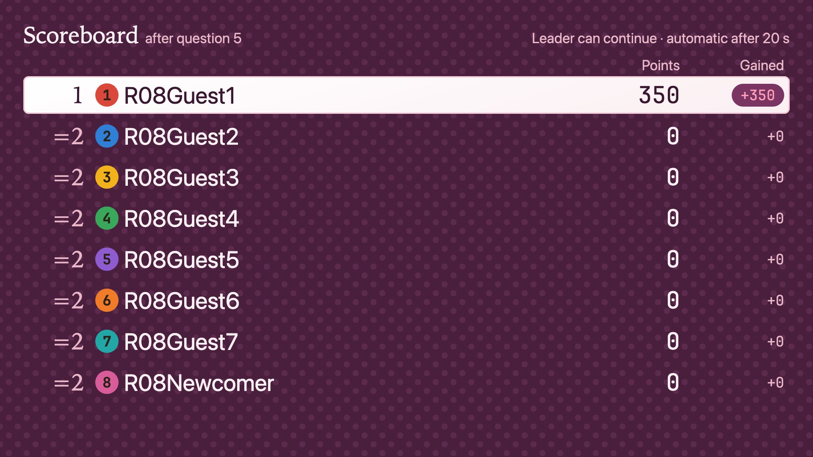 | Scoreboard after question 5: R08Guest1 350, seven zero scorers share =2. | Claude reviewer, 2026-11-18; Codex, 2026-11-18 |
|  | 1st · 350 and Continue with a cross glyph. | Codex, 2026-11-18; Claude review pending |
|  | 2nd · 0; no shared-place equals sign. | Codex, 2026-11-18; Claude review pending |
|  | 2nd · 0; no shared-place equals sign. | Codex, 2026-11-18; Claude review pending |
|  | 2nd · 0; no shared-place equals sign. | Codex, 2026-11-18; Claude review pending |
| 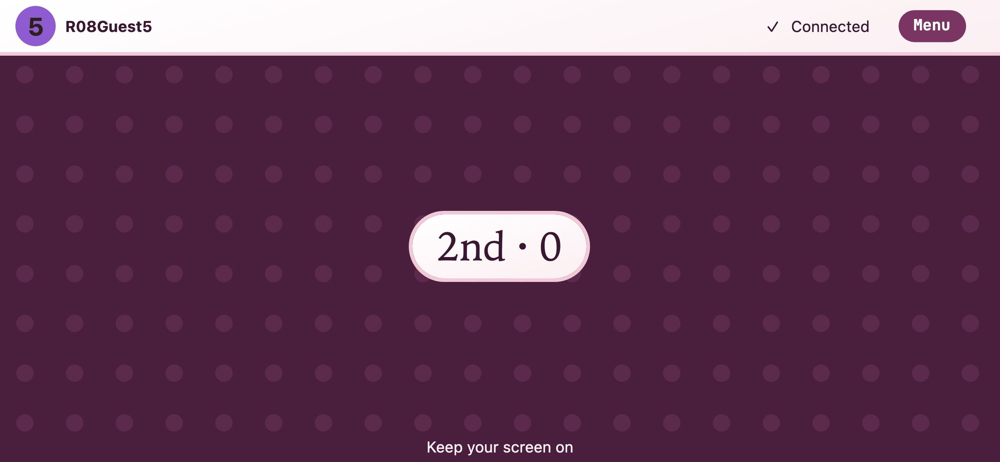 | 2nd · 0; no shared-place equals sign. | Codex, 2026-11-18; Claude review pending |
| 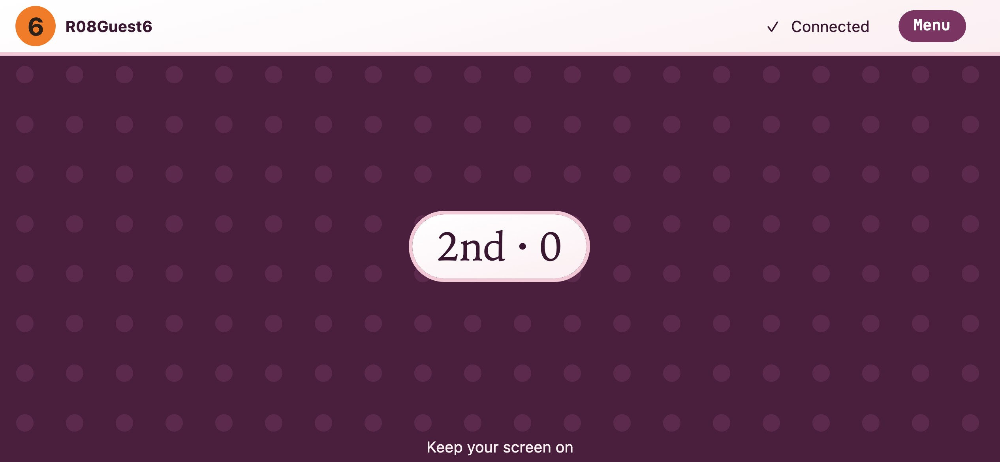 | 2nd · 0; no shared-place equals sign. | Codex, 2026-11-18; Claude review pending |
| 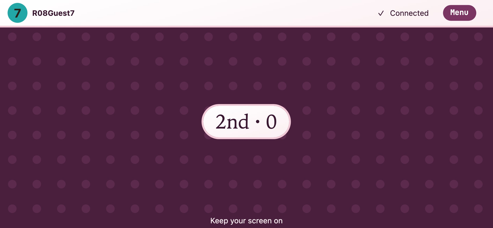 | 2nd · 0; no shared-place equals sign. | Codex, 2026-11-18; Claude review pending |
|  | 2nd · 0; no shared-place equals sign. | Codex, 2026-11-18; Claude review pending |
| 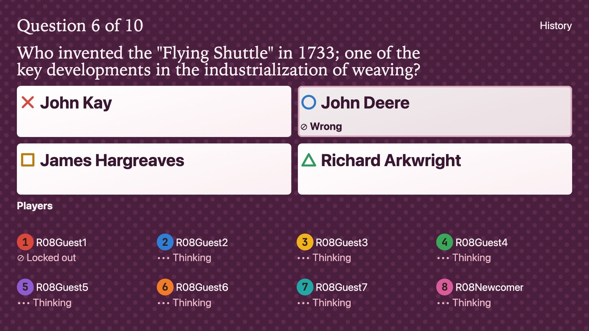 | Question 6: wrong option marked Wrong; R08Guest1 marked Locked out while other players are Thinking. | Claude reviewer, 2026-11-18; Codex, 2026-11-18 |
| 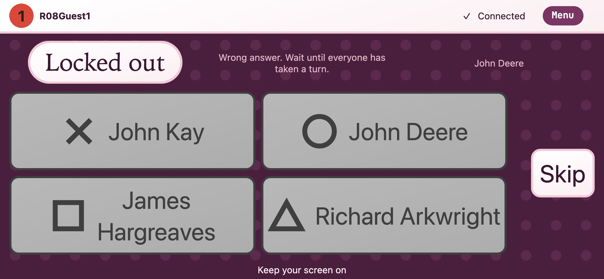 | Locked out, wrong-answer explanation and grey answer grid; own selected answer text remains visible. | Codex, 2026-11-18; Claude review pending |
|  | Score 0; wrong option grey, three other coloured shape answer buttons; own seat and nickname in header. | Codex, 2026-11-18; Claude review pending |
|  | Score 0; wrong option grey, three other coloured shape answer buttons; own seat and nickname in header. | Codex, 2026-11-18; Claude review pending |
|  | Score 0; wrong option grey, three other coloured shape answer buttons; own seat and nickname in header. | Codex, 2026-11-18; Claude review pending |
| 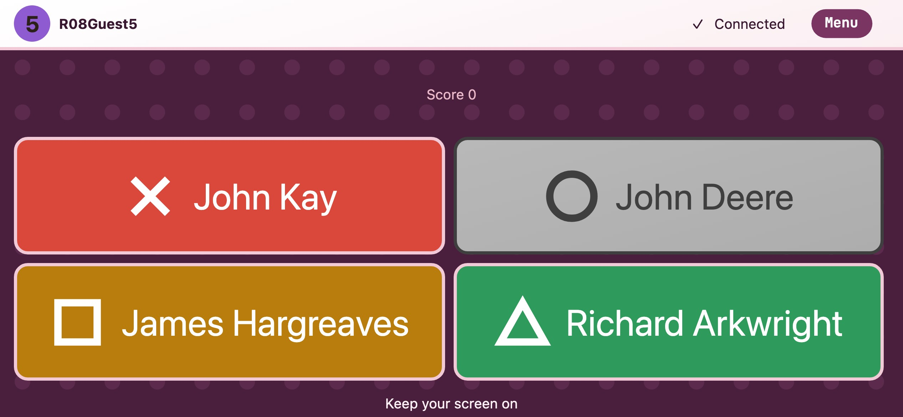 | Score 0; wrong option grey, three other coloured shape answer buttons; own seat and nickname in header. | Codex, 2026-11-18; Claude review pending |
|  | Score 0; wrong option grey, three other coloured shape answer buttons; own seat and nickname in header. | Codex, 2026-11-18; Claude review pending |
|  | Score 0; wrong option grey, three other coloured shape answer buttons; own seat and nickname in header. | Codex, 2026-11-18; Claude review pending |
| 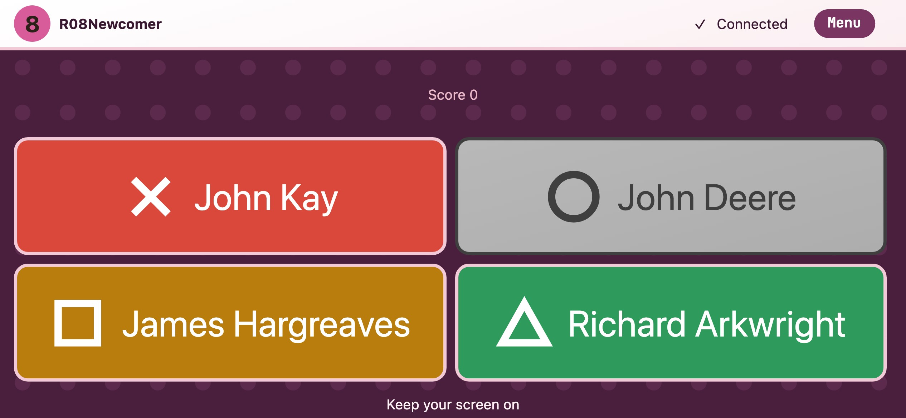 | Score 0; wrong option grey, three other coloured shape answer buttons; own seat and nickname in header. | Claude reviewer, 2026-11-18; Codex, 2026-11-18 |
| 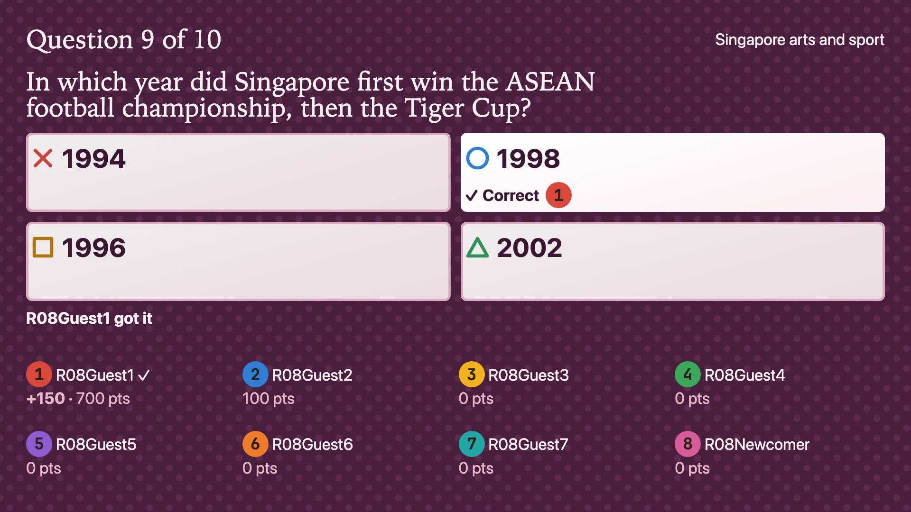 | Question 9 reveal remains visible: correct option marked, R08Guest1 +150 · 700 pts; no final-round announcement or TV streak. | Codex, 2026-11-18; Claude review pending |
| 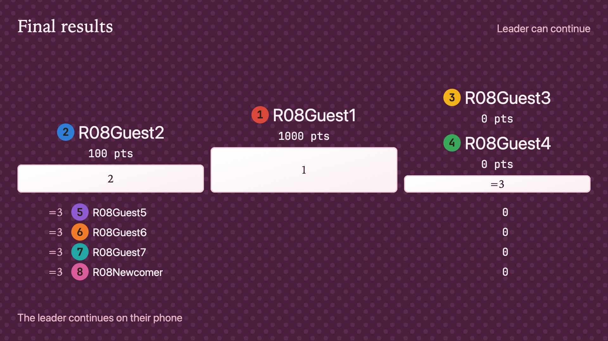 | Final results: R08Guest1 1000, R08Guest2 100; zero scorers share =3. | Claude reviewer, 2026-11-18; Codex, 2026-11-18 |
|  | Results, Watch the TV, Leave; Teams off and Continue with a cross glyph. | Codex, 2026-11-18; Claude review pending |
|  | Own seat and nickname, Leave, Results and Watch the TV. | Codex, 2026-11-18; Claude review pending |
|  | Own seat and nickname, Leave, Results and Watch the TV. | Claude reviewer, 2026-11-18; Codex, 2026-11-18 |
|  | Own seat and nickname, Leave, Results and Watch the TV. | Codex, 2026-11-18; Claude review pending |
|  | Own seat and nickname, Leave, Results and Watch the TV. | Codex, 2026-11-18; Claude review pending |
|  | Own seat and nickname, Leave, Results and Watch the TV. | Codex, 2026-11-18; Claude review pending |
|  | Own seat and nickname, Leave, Results and Watch the TV. | Codex, 2026-11-18; Claude review pending |
| 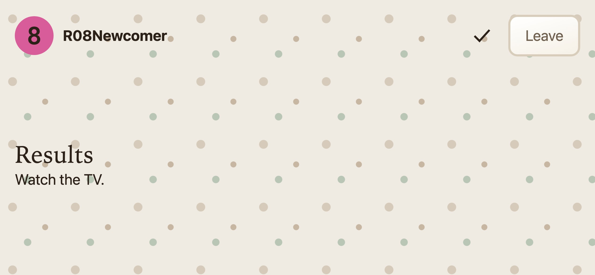 | Own seat and nickname, Leave, Results and Watch the TV. | Codex, 2026-11-18; Claude review pending |

## Strips

| Screenshot | What it shows | Looked at by |
|---|---|---|
| 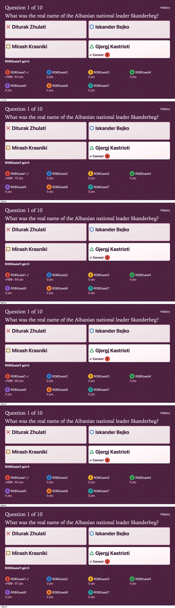 | Six reveal frames: the winner’s displayed total rises from 64 to 97; the correct option remains marked. The settled still shows 100. | Claude reviewer, 2026-11-18; Codex, 2026-11-18 |
| 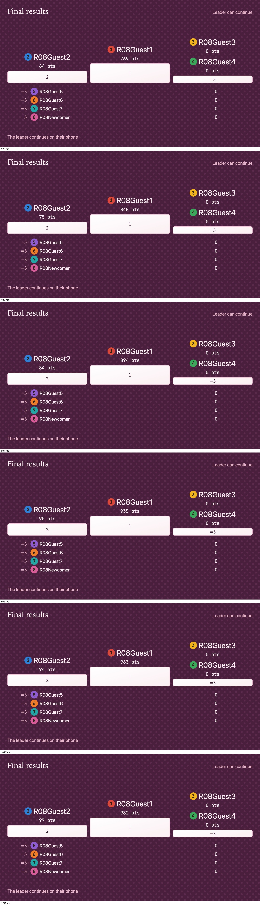 | Six podium frames: displayed totals increase towards the settled results; these samples alone do not show the completed count-up. | Codex, 2026-11-18; Claude review pending |

| Acceptance statement | Pass / fail | Evidence |
|---|---|---|
| Default ten-question match, unique prompts, correct reveal indices and independent score oracle (RZ-001, RZ-007, RZ-015) | Pass: automated | run.json completed question steps; settled reveal and final-results stills above |
| Matching TV options and phone shapes/colours (RZ-003) | Pass: visual | Question 1 TV and phone stills above |
| Scoring and phone streak (RZ-008) | Pass for phone/scoring only | Phone reveal: Streak 1; run score oracle |
| TV streak (RZ-008) | Fail: known product gap → R-18 | TV reveal and final-phase stills show points, no streak |
| Doubled final award (RZ-009) | Pass: automated | run.json question 10 score oracle |
| TV announces final double round (RZ-009) | Fail: known gap → R-16 | known-gap-RZ-009.json; final-phase-no-announcement still shows question 9 reveal |
| Late join waits, then enters with zero (RZ-014) | Pass: automated and visual | 24–27 joiner stills; run.json |
| Reload retains seat and score (RZ-004) | Pass for unanswered state only | 28/29 before/after stills; run.json |
| Lock-out and shared TV placings (RZ-004–005, RZ-016) | Pass within sampled scope | 39–47 lock-out stills; 30 scoreboard (=2), 56 podium (=3) |
| Rabakz end to end through the registry (PLAT-033) | Pass for Rabakz’s share only | run.json and the console stills above |
| Picture questions, network loading during play, RZ-021–025, sound and 3 m reading | Not evidenced | Outside these runs; see slice coverage table |
