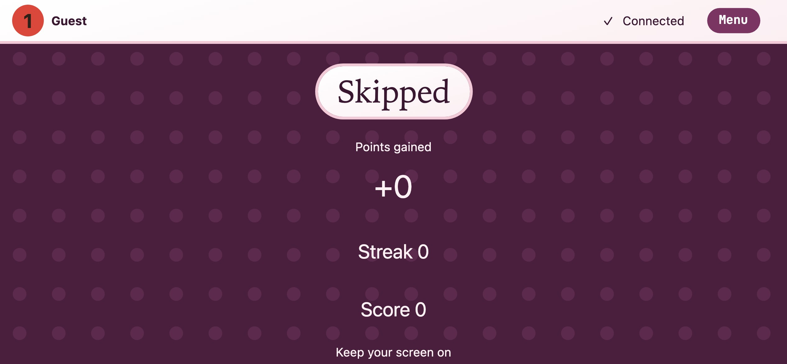
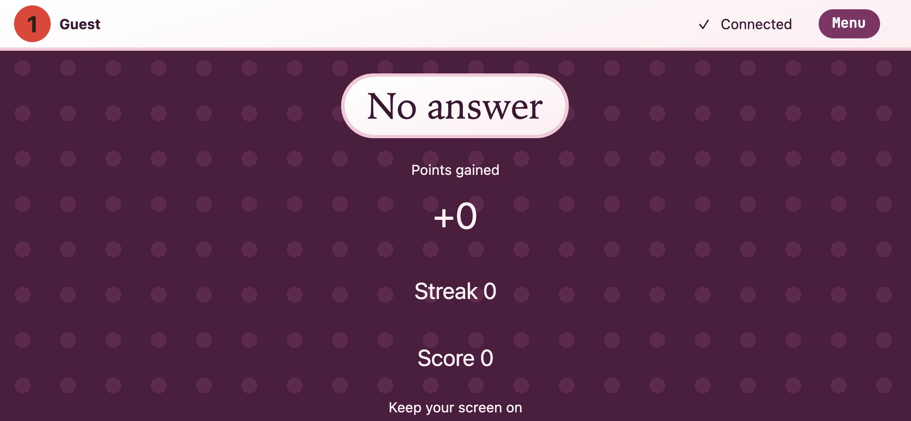

# R-17-no-answer UAT evidence

UAT ran and passed. Both settled phone stills were visually reviewed.

Command: `node tools/uat/run.mjs -- R-17-no-answer --phones 1 --out round1`
Commit: `ab29b5f52263cc1caef22b282fa948d41ca4de6a`
Viewports: 844×390

| Timing | ms | Status |
|---|---:|---|
| Create room through host page | 1115.4 | completed |
| Solo skip shows Skipped | 1214.4 | completed |
| Next question times out and shows No answer | 12931.0 | completed |

Expected errors (count):
None

## Real server

| Screenshot | What it shows | Looked at by |
|---|---|---|
|  | Solo leader reveal: Skipped, +0, Streak 0, Score 0; settled text, no clipping or ghosts | Claude reviewer, 2026-11-18 |
|  | Next question timeout: No answer, +0, Streak 0, Score 0; wider pill fits, no clipping or ghosts | Claude reviewer, 2026-11-18 |

| Acceptance statement | Pass / fail | Evidence |
|---|---|---|
| Solo skip shows “Skipped” and zero points | Pass | 01-phone1-01-skipped-phone.jpg |
| Next solo question times out with “No answer” and zero points | Pass | 02-phone1-02-no-answer-phone.jpg |
| Idle opponent and guest on leader skip see “No answer” | Pass (unit coverage only) | games/rabakz/src/rules/views.test.ts; no multiplayer picture in this run |
| Right/Wrong and awards remain unchanged | Pass (unit coverage only) | games/rabakz/src/rules/views.test.ts; no Right/Wrong picture in this run |
