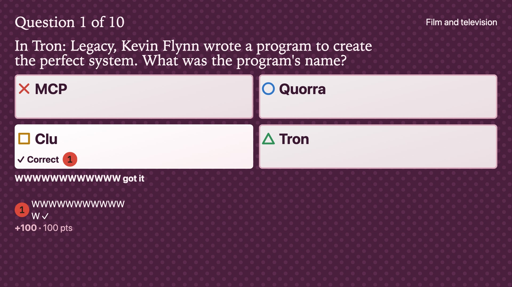
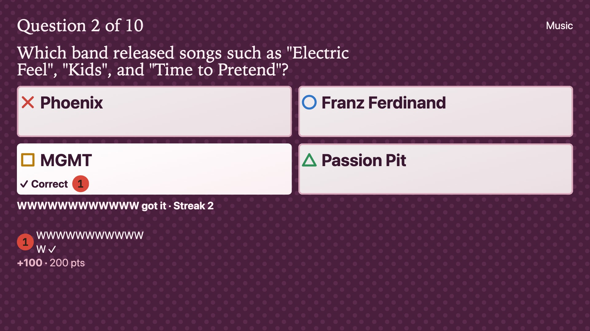
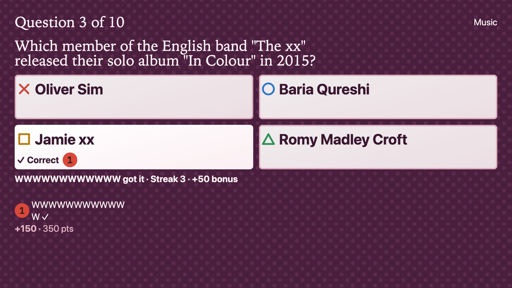
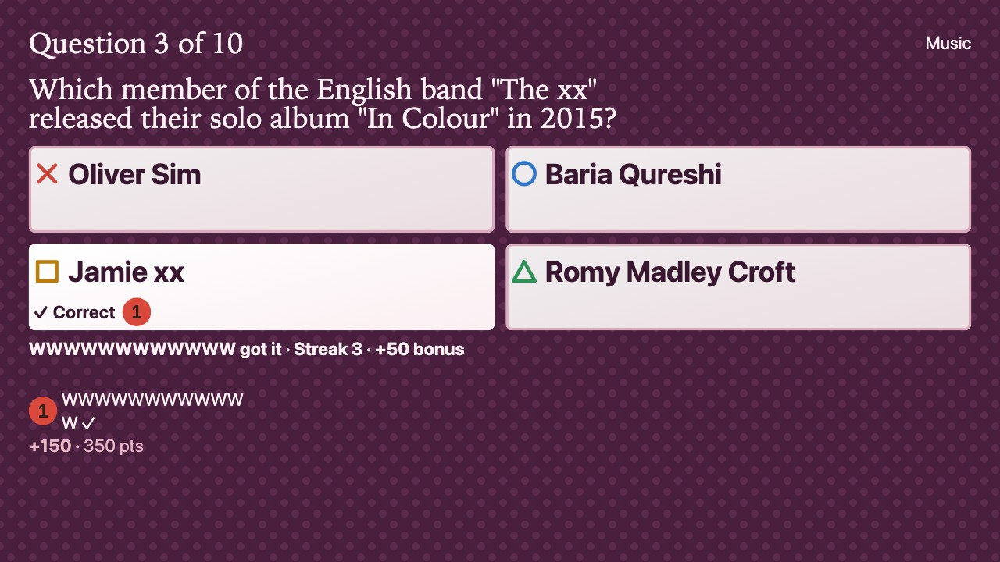

# R-18-tv-streak UAT evidence

Host browser: chromium 156.0.8078.4
Phone browser: chromium (legacy iPhone emulation) 156.0.8078.4

Automated execution passed. Visual review: Claude integrator and reviewer, 2026-11-18 (R-18 review 1).

Command: `node tools/uat/run.mjs -- R-18-tv-streak --phones 1 --out round1`
Commit: `541430e96c4b61a6ffcdbf18d21034e3fb24ab57`
Viewports: 1920×1080, 1280×720

| Timing | ms | Status |
|---|---:|---|
| Create room through host page | 1575.8 | completed |
| Win 1: TV streak | 1108.4 | completed |
| Win 2: TV streak | 1092.1 | completed |
| Win 3: TV streak | 992.3 | completed |

Expected errors (count):
None

## Real server

| Screenshot | What it shows | Looked at by |
|---|---|---|
|  | Win 1 at 1920: "WWWWWWWWWWWW got it"; seat "+100 · 100 pts". | Claude integrator and reviewer, 2026-11-18 |
|  | Win 2 at 1920: "… got it · Streak 2"; "+100 · 200 pts". | Claude integrator and reviewer, 2026-11-18 |
|  | Win 3 at 1920: "… got it · Streak 3 · +50 bonus"; "+150 · 350 pts"; one line, ink x 56–890. | Claude integrator and reviewer, 2026-11-18 |
|  | Win 3 at 1280: same line at 720p, one line, nothing clipped. | Claude integrator and reviewer, 2026-11-18 |

| Acceptance statement | Pass / fail | Evidence |
|---|---|---|
| A single winner's streak from 2 shows on the TV outcome line | Pass | 02 |
| From 3 the bonus shows with the streak | Pass | 03, 04 |
| One line, not clipped, at 1080p and 720p | Pass | 03, 04 |
