# R-19-rabakz-phone-polish UAT evidence

Host browser: chromium 156.0.8078.4
Phone browser: chromium (legacy iPhone emulation) 156.0.8078.4

Automated execution only. Visual review and acceptance decisions are pending.

Command: `node tools/uat/run.mjs -- R-19-rabakz-phone-polish --phones 3 --max-mb 24 --timeout-min 10 --out round7`
Commit: `b8c2ff1c8914a9ef488e52abdf325772302082b7`
Viewports: 844×390

| Timing | ms | Status |
|---|---:|---|
| Create room through host page | 1204.3 | completed |
| ffa question 1 | 4031.8 | completed |
| ffa question 2 | 2344.6 | completed |
| ffa question 3 | 2354.0 | completed |
| ffa question 4 | 2344.4 | completed |
| ffa question 5 | 3145.4 | completed |
| ffa question 6 | 2384.5 | completed |
| ffa question 7 | 2351.4 | completed |
| ffa question 8 | 2346.7 | completed |
| ffa question 9 | 2336.9 | completed |
| ffa question 10 | 3798.4 | completed |
| teams question 1 | 4012.9 | completed |
| teams question 2 | 2433.7 | completed |
| teams question 3 | 2357.0 | completed |
| teams question 4 | 2349.8 | completed |
| teams question 5 | 3139.6 | completed |
| teams question 6 | 2387.7 | completed |
| teams question 7 | 2425.2 | completed |
| teams question 8 | 2660.7 | completed |
| teams question 9 | 2665.7 | completed |
| teams question 10 | 4225.0 | completed |

Expected errors (count):
None

## Real server

| Screenshot | What it shows | Looked at by |
|---|---|---|
| 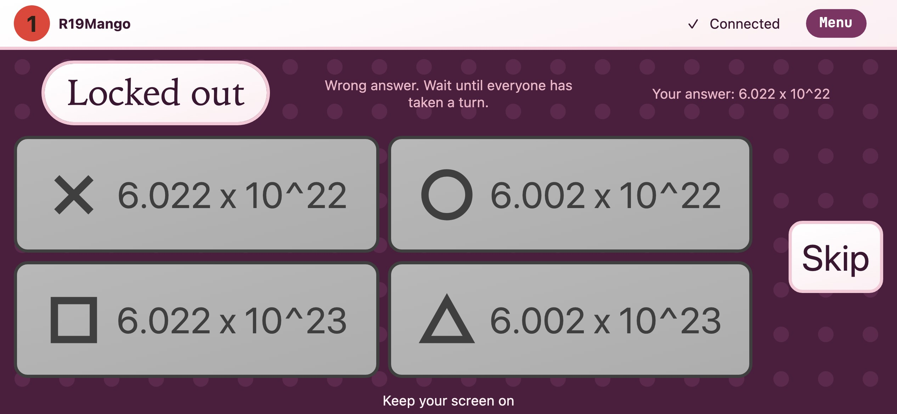 | | |
| 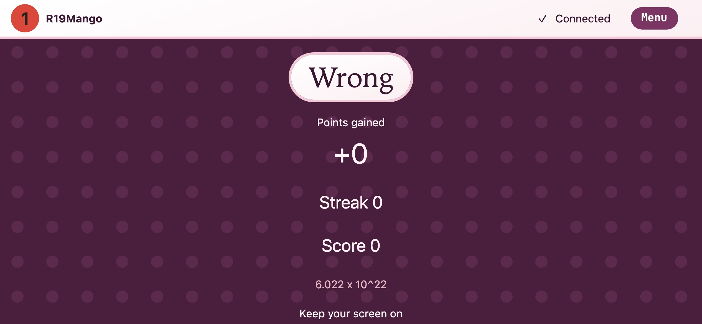 | | |
| 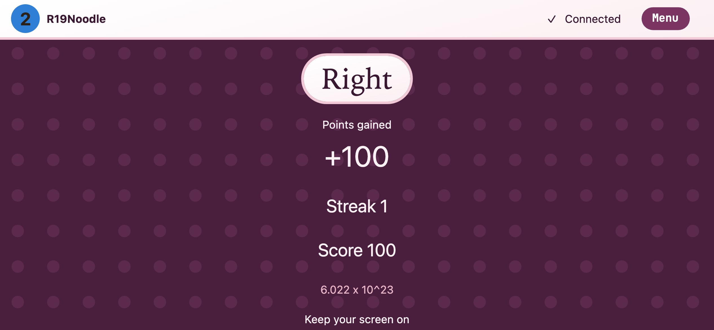 | | |
| 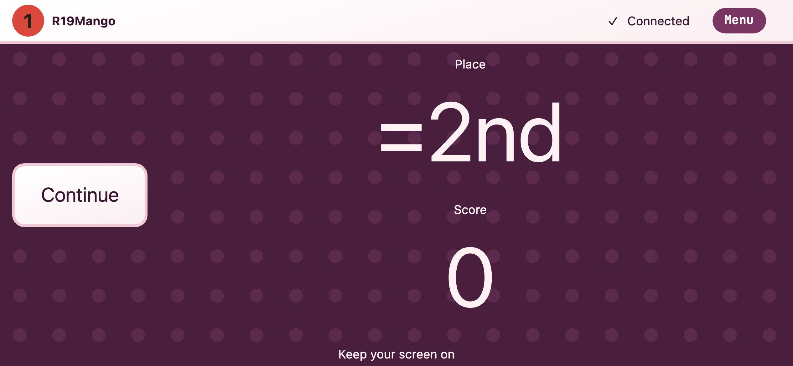 | | |
|  | | |
| 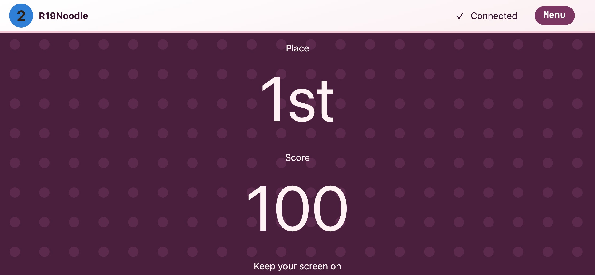 | | |
| 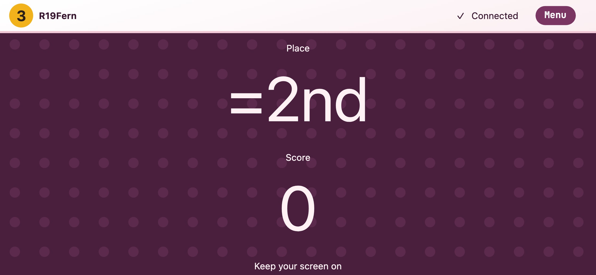 | | |
| 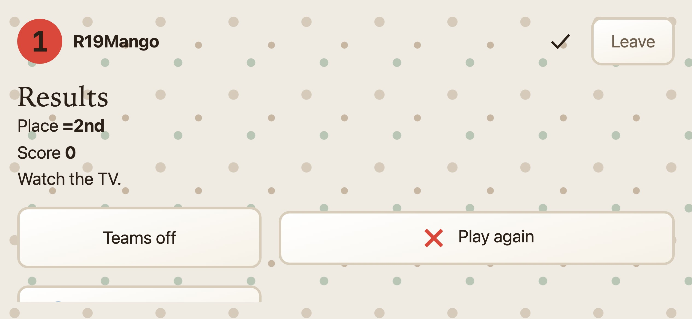 | | |
| 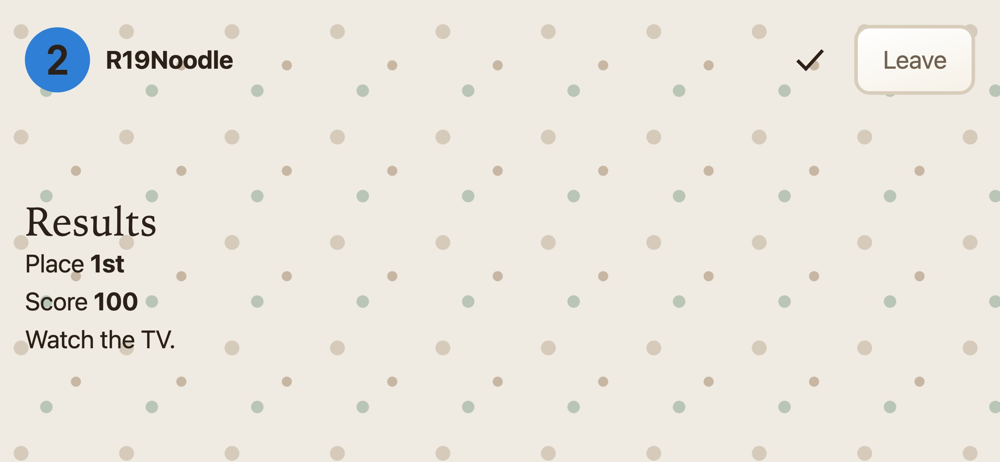 | | |
| 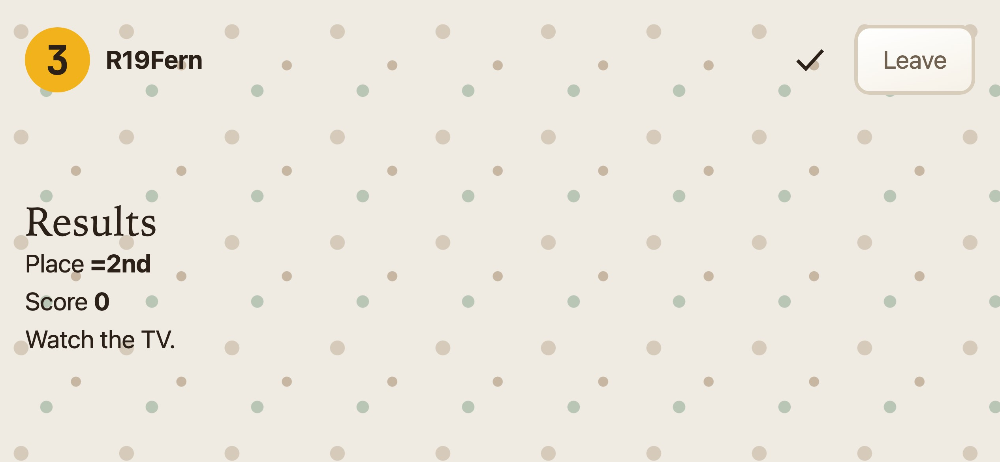 | | |
| 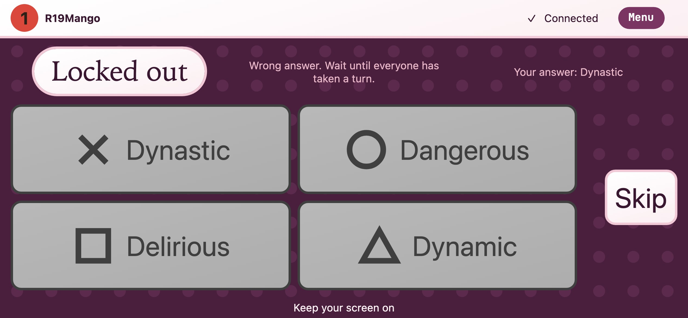 | | |
|  | | |
|  | | |
|  | | |
| 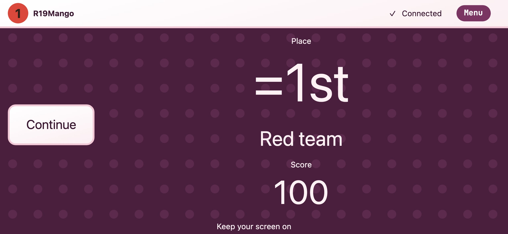 | | |
| 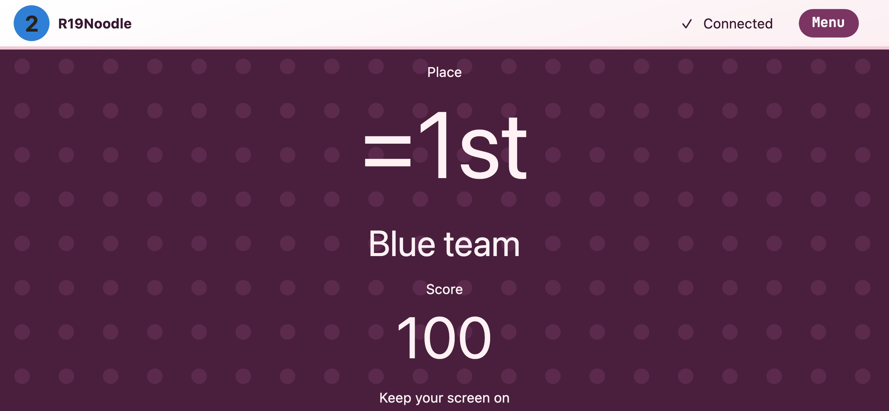 | | |
| 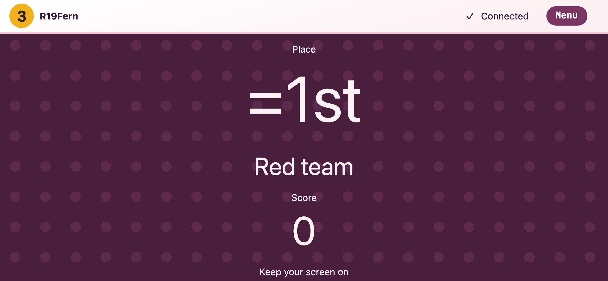 | | |
| 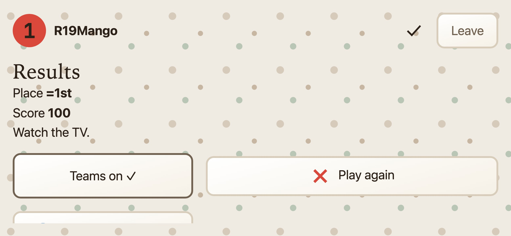 | | |
| 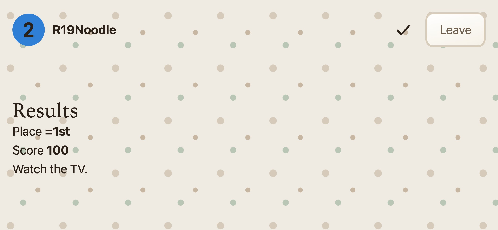 | | |
|  | | |

## Strips

| Screenshot | What it shows | Looked at by |
|---|---|---|
| 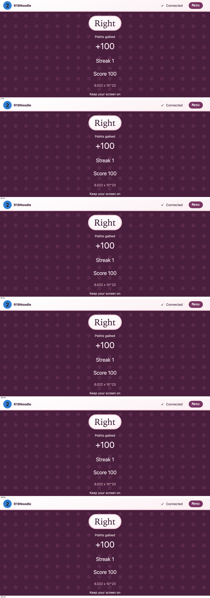 | | |
|  | | |

| Acceptance statement | Pass / fail | Evidence |
|---|---|---|
| | | |

### REPORT.md visual-review table (round7)

| Screenshot | What it shows | Looked at by |
|---|---|---|
| 01-phone1-ffa-locked-out | "Locked out" pill, explanation note, "Your answer: 6.022 x 10^22"; answer grid greyed; Skip. | Claude reviewer |
| 02-phone1-ffa-wrong | "Wrong" pill, +0, Streak 0, Score 0, bare note "6.022 x 10^22" (should-fix 6, integrator). | Claude reviewer |
| 03-phone2-ffa-right | "Right" pill, +100, Streak 1, Score 100, note "6.022 x 10^23". | Claude reviewer |
| 10-strip-ffa-right-pulse | Six scrubbed frames: one pulse, glyph 245→252→244 px, peak at 0.4, back to 1, no overshoot; other blocks still. | Claude reviewer |
| 11-phone1-ffa-continue | Leader scoreboard: Continue as words only, no shape; Place =2nd, Score 0. | Claude reviewer |
| 12-phone1-ffa-place-phone1 | Same as 11: Place =2nd, Score 0. | Claude reviewer |
| 13-phone2-ffa-place-phone2 | Place 1st, Score 100; no Continue (not leader). | Claude reviewer |
| 14-phone3-ffa-place-phone3 | Place =2nd, Score 0. | Claude reviewer |
| 15-phone1-ffa-final-place-phone1 | Results: Place =2nd, Score 0; Teams off; Play again with red cross; third button clipped at the bottom (platform). | Claude reviewer |
| 16-phone2-ffa-final-place-phone2 | Results: Place 1st, Score 100. | Claude reviewer |
| 17-phone3-ffa-final-place-phone3 | Results: Place =2nd, Score 0. | Claude reviewer |
| 18-phone1-teams-locked-out | Locked out pill, note, "Your answer: Dynastic". | Claude reviewer |
| 19-phone1-teams-wrong | Wrong, +0, Streak 0, Score 0, bare note "Dynastic". | Claude reviewer |
| 20-phone2-teams-right | Right, +100, Streak 1, Score 100, note "Dynamic". | Claude reviewer |
| 27-strip-teams-right-pulse | Same pulse shape as 10: one pulse, no overshoot. | Claude reviewer |
| 28-phone1-teams-continue | Continue words only; Place =1st, "Red team", Score 100 (teams level 100–100). | Claude reviewer |
| 29-phone1-teams-place-phone1 | Same as 28. | Claude reviewer |
| 30-phone2-teams-place-phone2 | Place =1st, "Blue team", Score 100. | Claude reviewer |
| 31-phone3-teams-place-phone3 | Place =1st, "Red team", Score 0. | Claude reviewer |
| 32-phone1-teams-final-place-phone1 | Results: Place =1st, Score 100; Teams on ✓; Play again with red cross; third button clipped (platform). | Claude reviewer |
| 33-phone2-teams-final-place-phone2 | Results: Place =1st, Score 100. | Claude reviewer |
| 34-phone3-teams-final-place-phone3 | Results: Place =1st, Score 0. | Claude reviewer |

| Acceptance statement | Pass / fail | Evidence |
|---|---|---|
| Only success ("Right") pulses, once, no overshoot | Pass | 10, 27; UAT :133-134; DOM test |
| Wrong and Locked out have no motion | Pass | 01, 02, 18, 19; UAT :101, :133; DOM test |
| Reduced motion drops the pulse, keeps the state | Pass (DOM/unit only) | `status-title.test.ts`, `rabakz-phone-polish.dom.test.ts` |
| Titles in one strip share one size | Pass (DOM only) | DOM test at 667/844/932 |
| Continue is words only | Pass | 11, 28; UAT :127 |
| Free-for-all "=" places on scoreboard and Results | Pass | 11–17 |
| Team places by team total, tied "=1st", team named | Pass | 28–31 |
| Team place on final Results | Pass | 32–34; UAT :177-185 |
| Locked-out answer labelled | Pass | 01, 18 |
| Teamless player: No team, no place | Pass (unit only) | `views.test.ts` |
| Controller start-up (PERF-020, D-148) | Pass | `perf-controller/startup.json`: production, median 174.4 ms ≤ 2000 |
