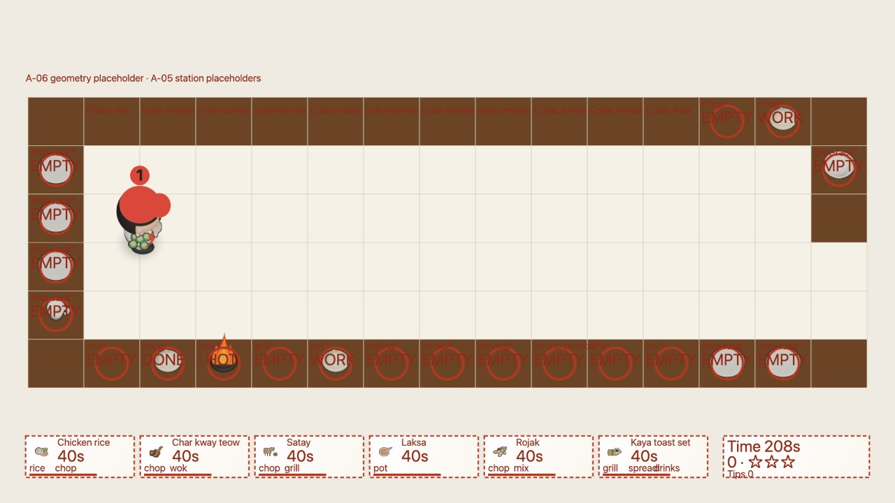
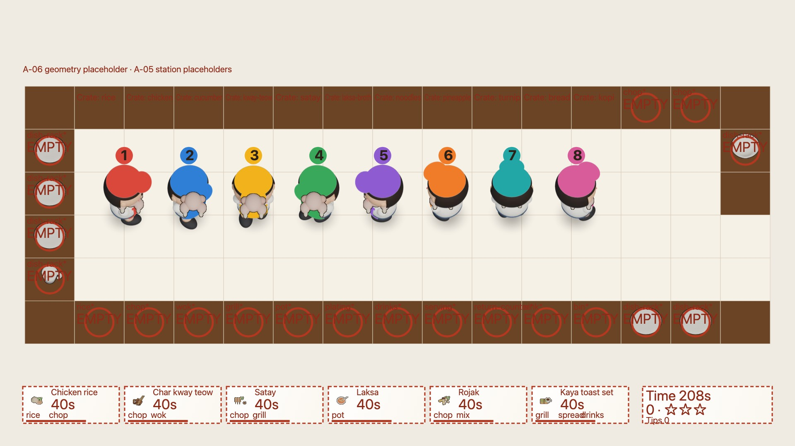
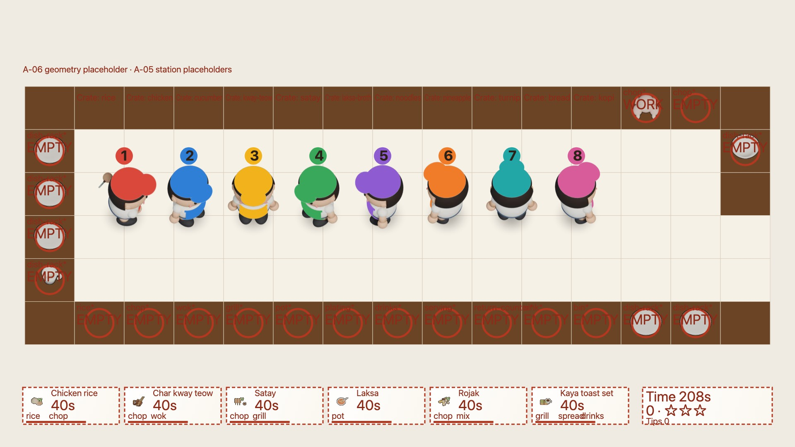
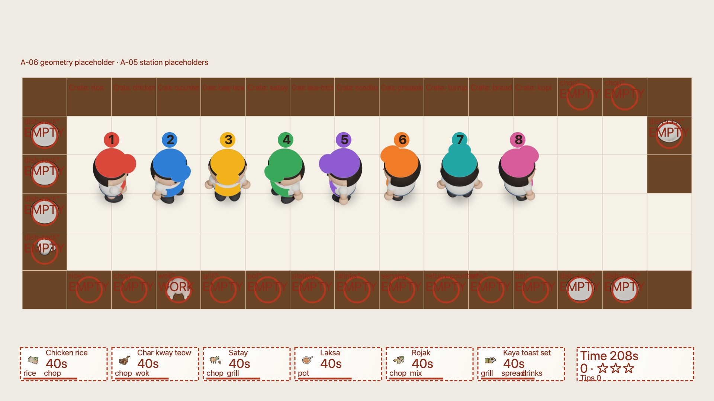
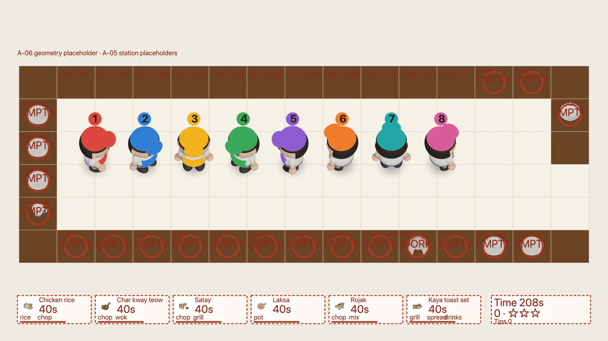
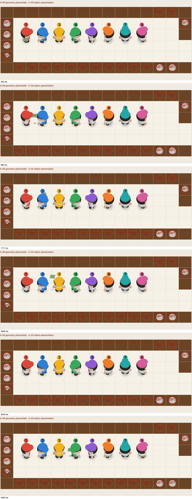
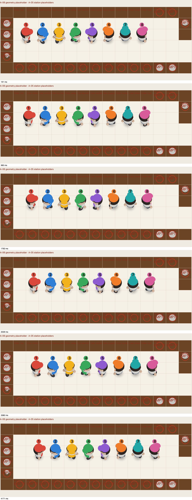

# T-07-tv-renderer UAT evidence

Automated execution only. Visual review and acceptance decisions are pending.

Command: `node tools/uat/run.mjs -- T-07-tv-renderer --phones 1 --max-mb 32 --out round1`
Commit: `9d9980fb0f337f735c20f39efa507237956c02b6`
Viewports: 1920×1080, 1280×720

| Timing | ms | Status |
|---|---:|---|

Expected errors (count):
None

## Real server

| Screenshot | What it shows | Looked at by |
|---|---|---|
|  | | |
|  | | |
|  | | |
|  | | |
|  | | |
|  | | |
|  | | |
|  | | |
|  | | |
|  | | |
|  | | |
|  | | |
|  | | |
|  | | |

## Strips

| Screenshot | What it shows | Looked at by |
|---|---|---|
|  | | |
|  | | |

| Acceptance statement | Pass / fail | Evidence |
|---|---|---|
| | | |
