# T-07-tv-renderer UAT evidence

Automated execution only. Visual review and acceptance decisions are pending.

Command: `node tools/uat/run.mjs -- T-07-tv-renderer --phones 1 --max-mb 30 --out round4`
Commit: `4c447d1c9218c9ee8854b276f36a64f0ff15669f`
Viewports: 1920×1080, 1280×720, 1080×1080

| Timing | ms | Status |
|---|---:|---|
| 1 cooks at 1920 | 4869.7 | completed |
| 1 cooks at 1280 | 3242.1 | completed |
| 8 cooks at 1920 | 3255.6 | completed |
| 8 cooks at 1280 | 3265.8 | completed |
| Burning station label | 870.5 | completed |
| Mid-clip actions at their stations | 9135.3 | completed |
| entrance through completion | 4703.1 | completed |
| serve through completion | 5335.9 | completed |
| done through completion | 5390.7 | completed |
| throw through completion | 4434.1 | completed |
| walk through completion | 4604.2 | completed |
| Reduced motion entrance and confirmation pulses | 6705.5 | completed |
| Registry to production MountedScreen readiness without a phone | 3053.9 | completed |
| Letterbox portrait window | 1118.0 | completed |

Expected errors (count):
None

## Real server

| Screenshot | What it shows | Looked at by |
|---|---|---|
| 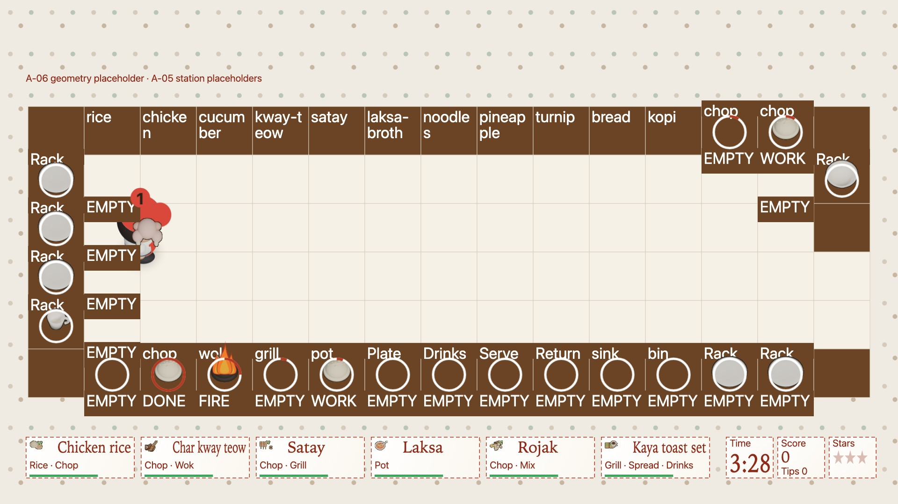 | | |
| 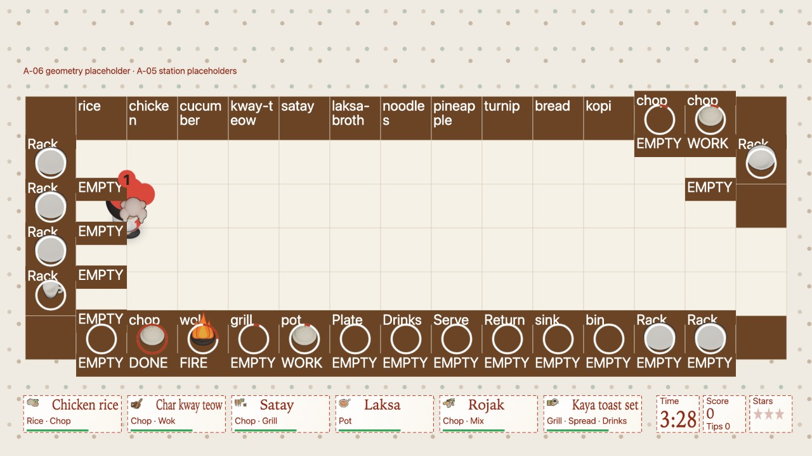 | | |
| 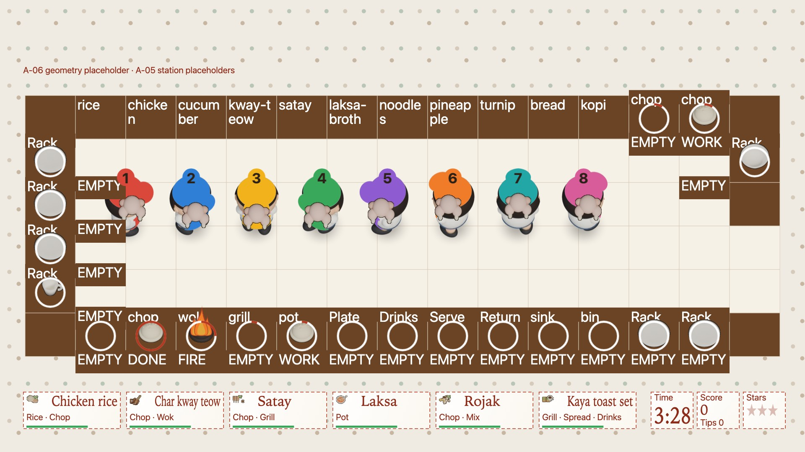 | | |
| 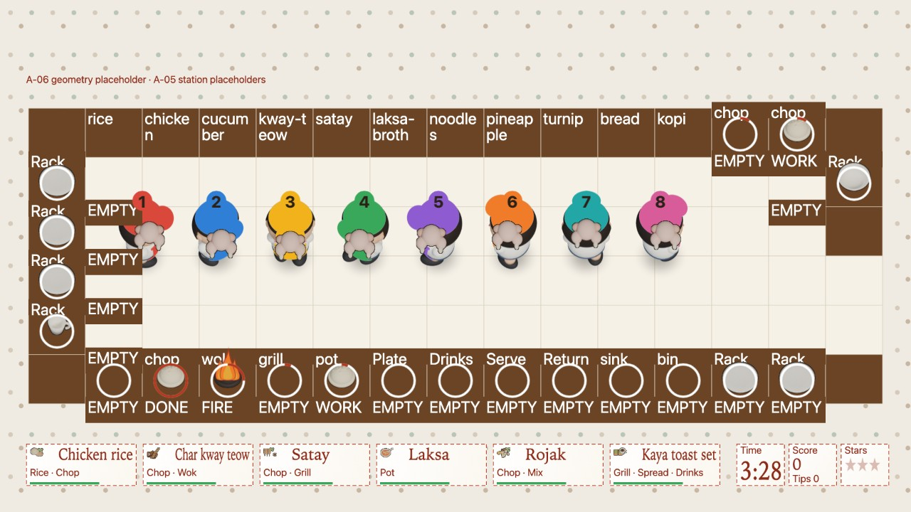 | | |
|  | | |
| 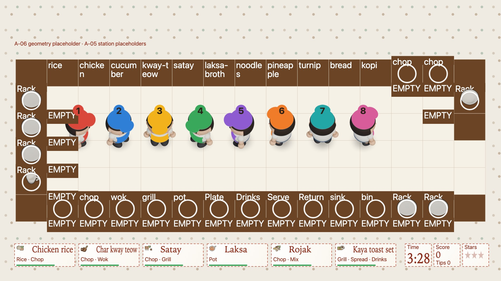 | | |
|  | | |
|  | | |
| 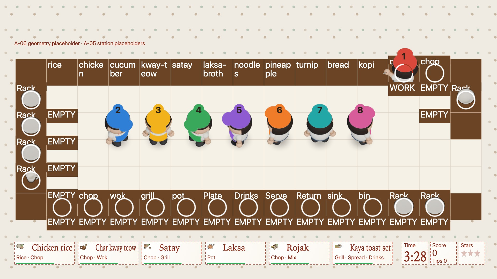 | | |
| 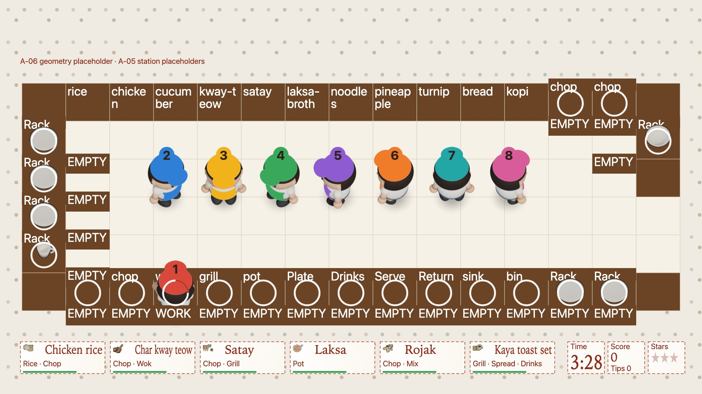 | | |
| 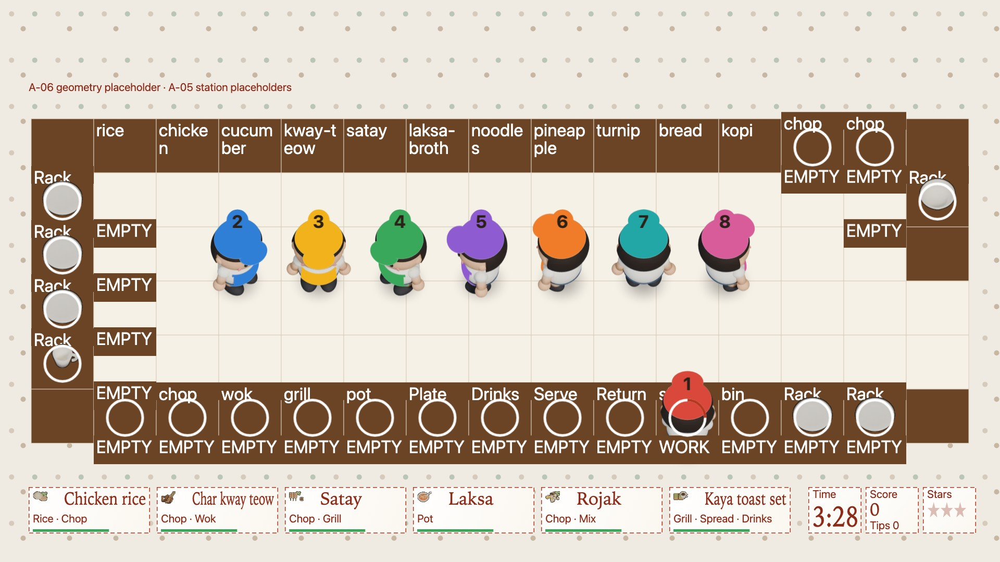 | | |
| 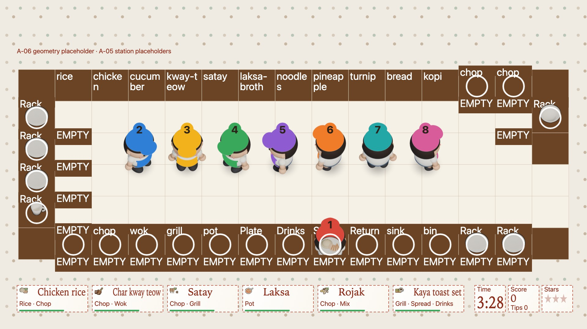 | | |
|  | | |
| 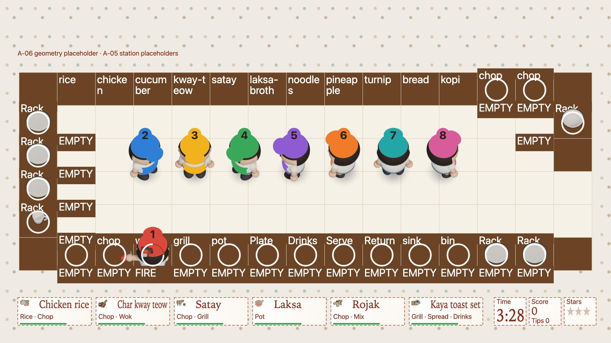 | | |
| 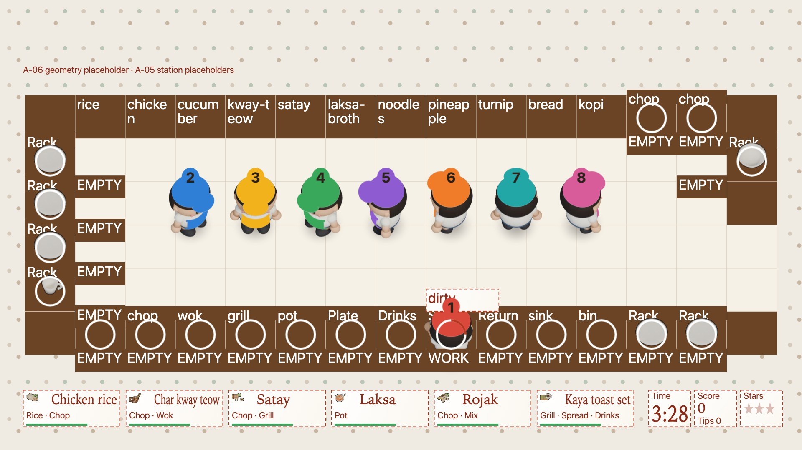 | | |
|  | | |
| 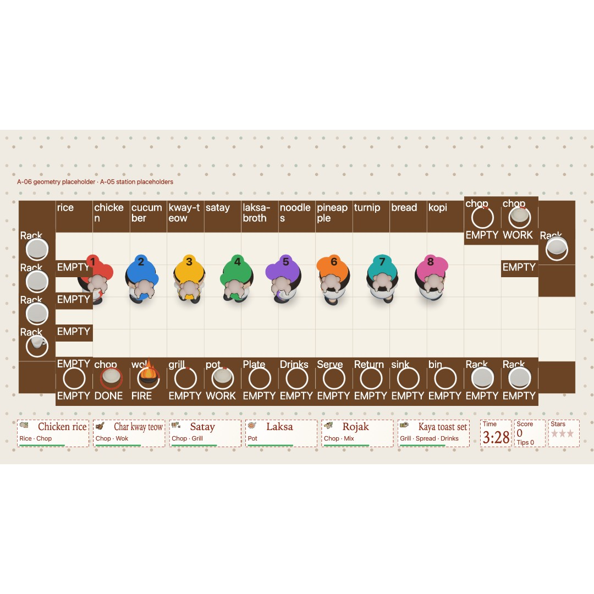 | | |

## Strips

| Screenshot | What it shows | Looked at by |
|---|---|---|
| 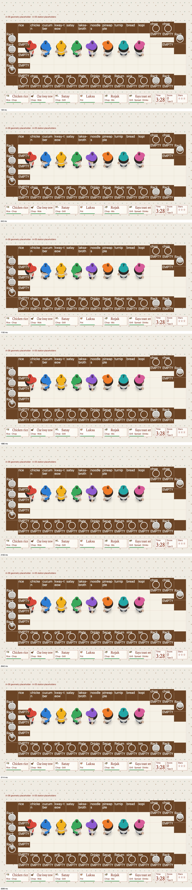 | | |
| 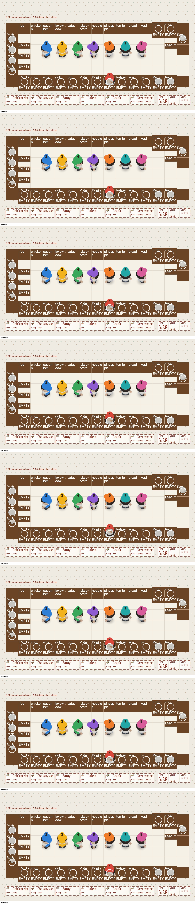 | | |
| 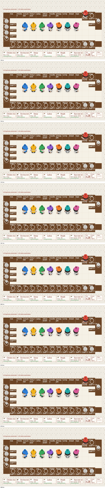 | | |
| 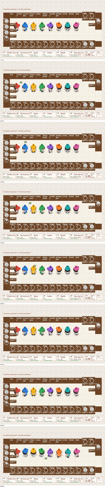 | | |
| 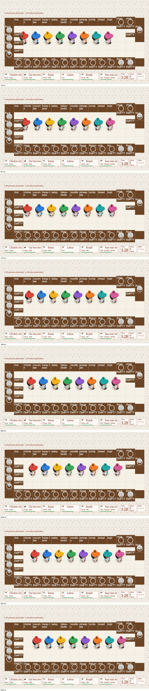 | | |
| 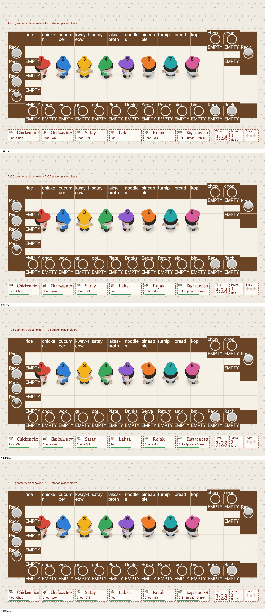 | | |
| 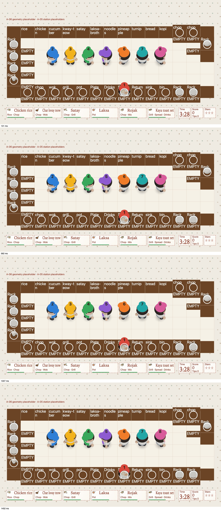 | | |
| 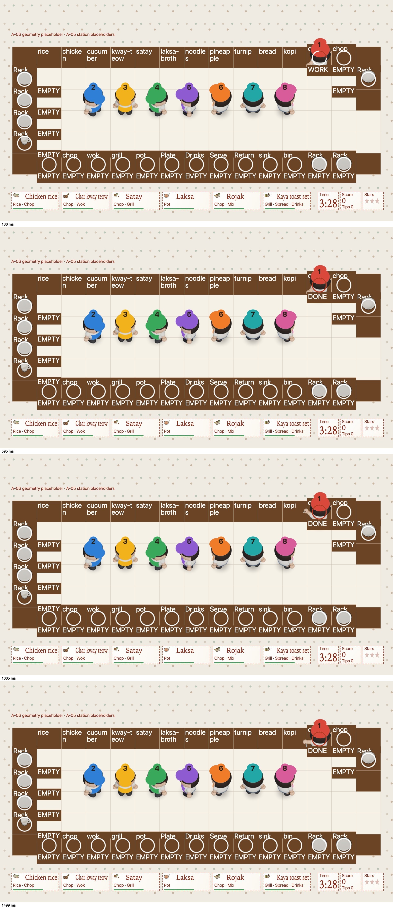 | | |

| Acceptance statement | Pass / fail | Evidence |
|---|---|---|
| | | |
