# T-07-tv-renderer UAT evidence

Host browser: chromium 156.0.8078.4
Phone browser: chromium (legacy iPhone emulation) 156.0.8078.4

Automated execution only. Visual review and acceptance decisions are pending.

Command: `node tools/uat/run.mjs -- T-07-tv-renderer --out round9b-uat --max-mb 40 --timeout-min 20`
Commit: `1cfa65565865574ab9e5e9dad111a1315e149cf0`
Viewports: 1920×1080, 1280×720, 1080×1080

| Timing | ms | Status |
|---|---:|---|
| 1 cooks at 1920 | 3116.9 | completed |
| 1 cooks at 1280 | 1885.9 | completed |
| 8 cooks at 1920 | 2050.0 | completed |
| 8 cooks at 1280 | 2051.2 | completed |
| HUD drawn width and Rack column | 2026.4 | completed |
| Burning station label | 584.5 | completed |
| Mid-clip actions at their stations | 6448.6 | completed |
| Normal entrance at pinned render times | 2513.9 | completed |
| Normal serve at pinned render times | 3042.0 | completed |
| Normal done at pinned render times | 2468.1 | completed |
| Normal exit at pinned render times | 2513.9 | completed |
| Reduced entrance at pinned render times | 2405.9 | completed |
| Reduced serve at pinned render times | 2863.0 | completed |
| Reduced done at pinned render times | 2344.3 | completed |
| Reduced exit at pinned render times | 2443.8 | completed |
| Throw landing and cook walk | 7201.3 | completed |
| Registry to production MountedScreen readiness without a phone | 1484.0 | completed |
| Letterbox portrait window | 882.6 | completed |

Expected errors (count):
None

## Real server

| Screenshot | What it shows | Looked at by |
|---|---|---|
| 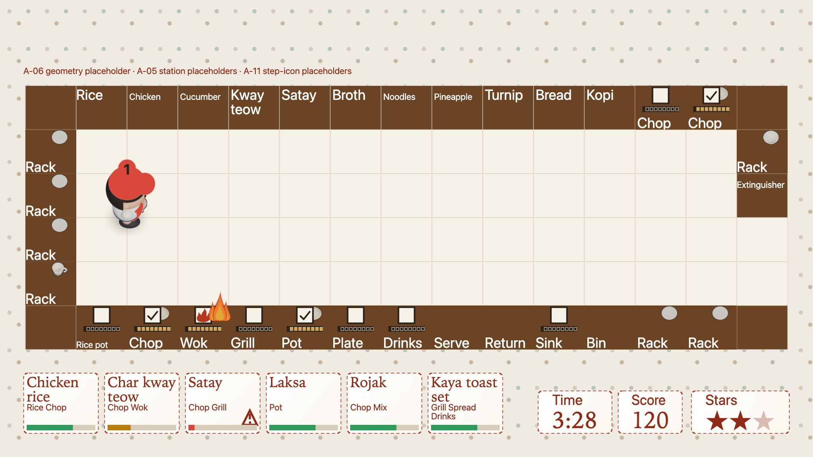 | | |
| 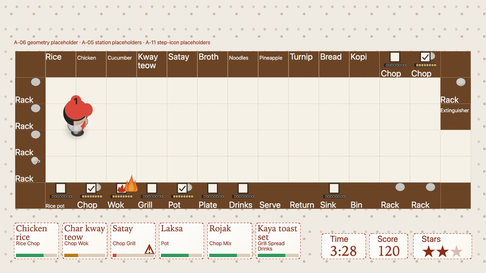 | | |
| 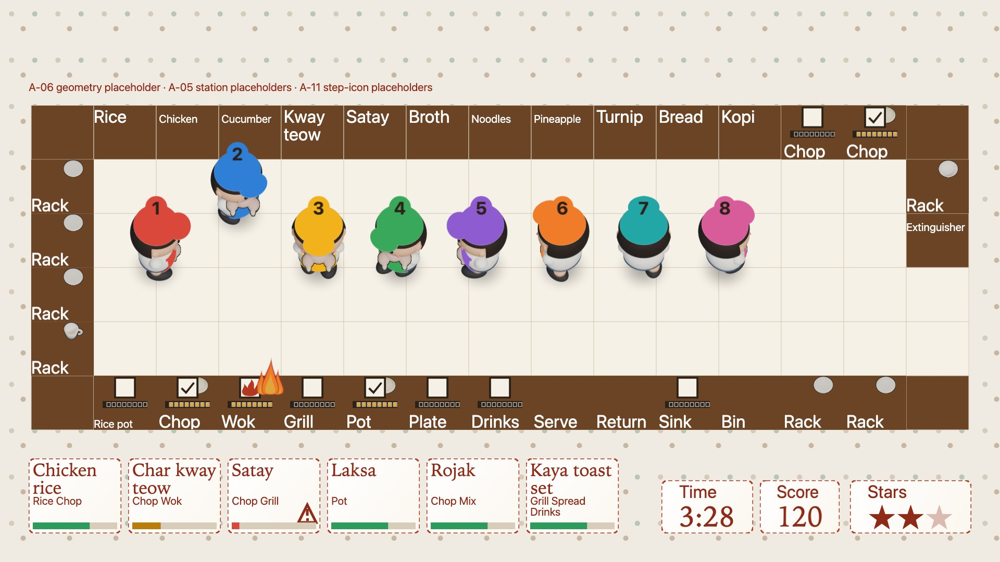 | | |
|  | | |
| 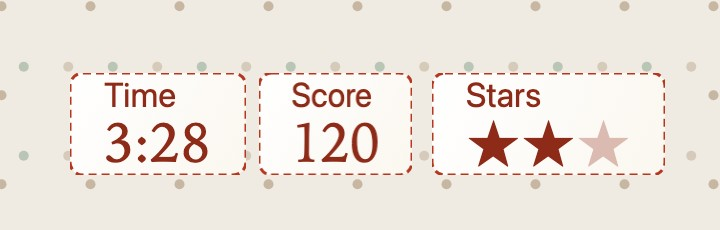 | | |
| 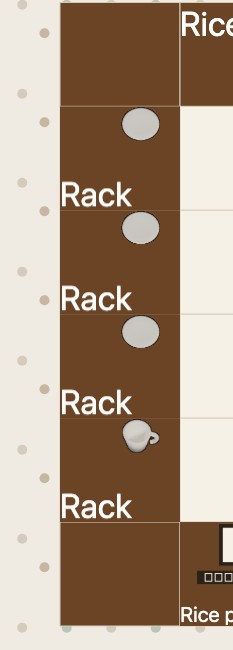 | | |
| 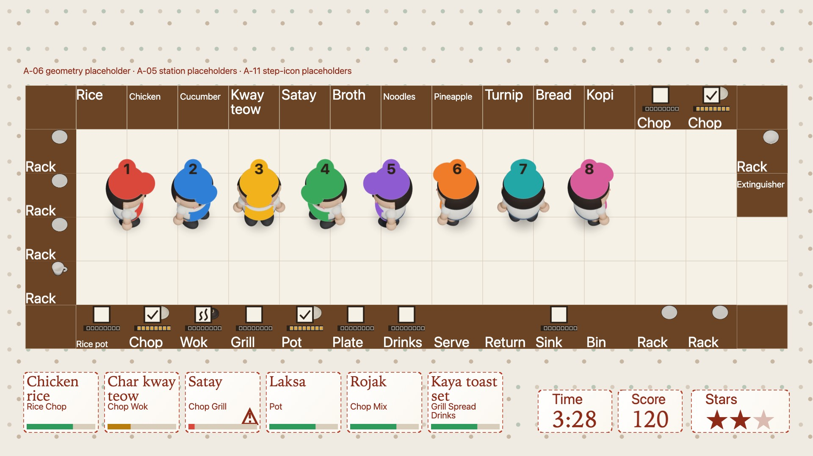 | | |
|  | | |
|  | | |
| 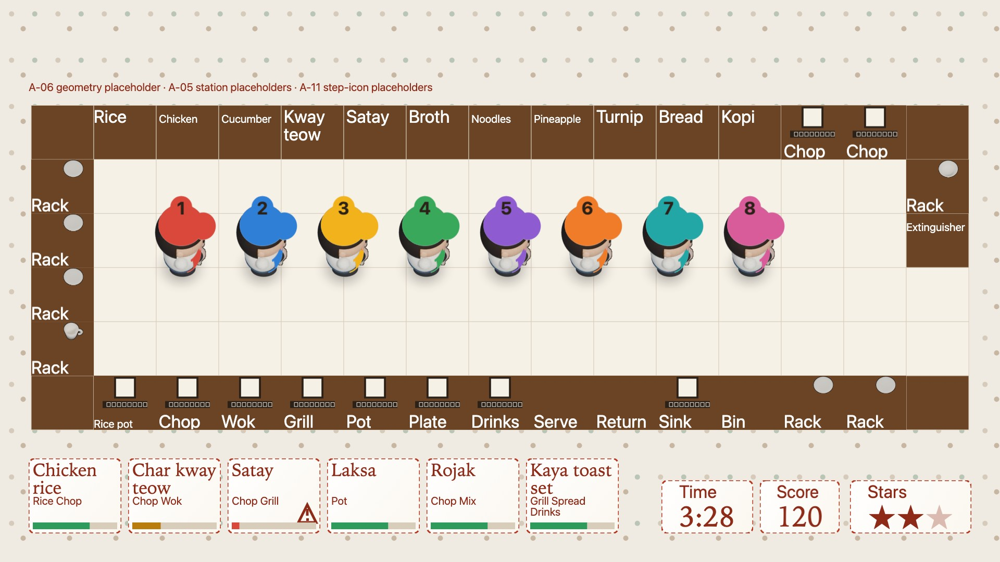 | | |
| 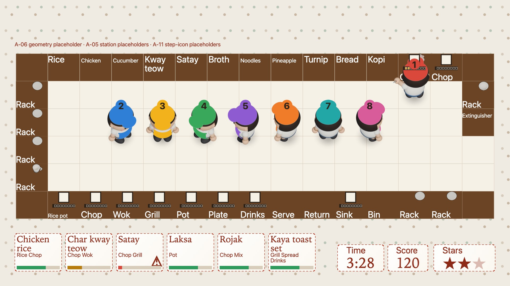 | | |
| 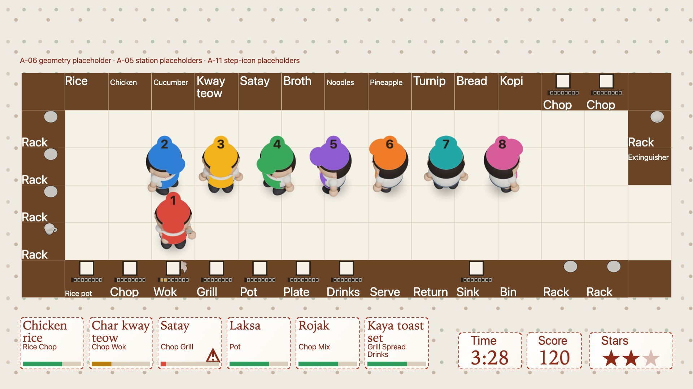 | | |
| 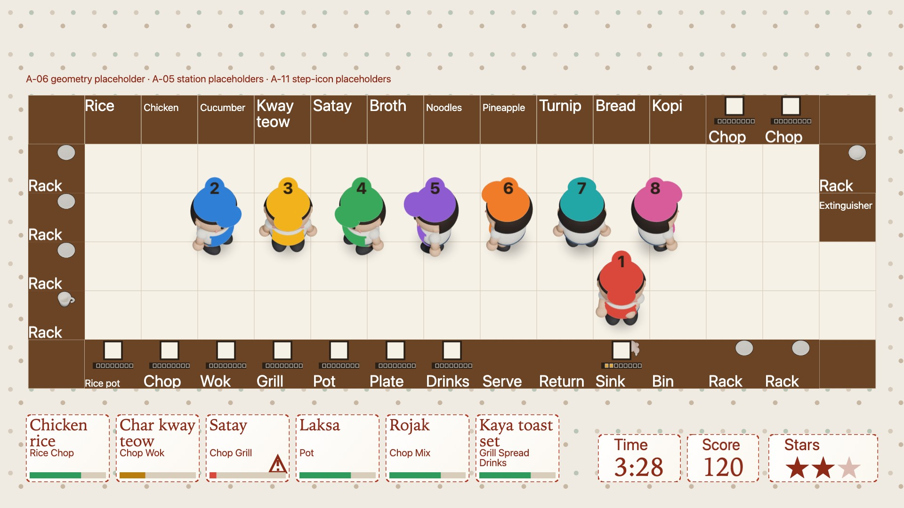 | | |
| 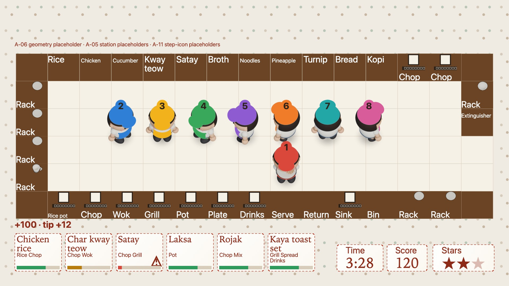 | | |
|  | | |
| 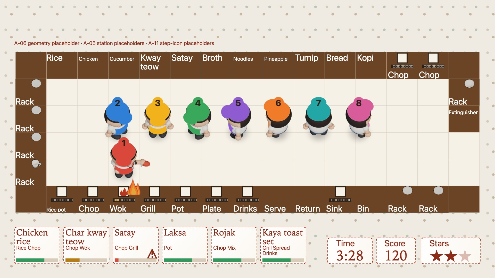 | | |
|  | | |
| 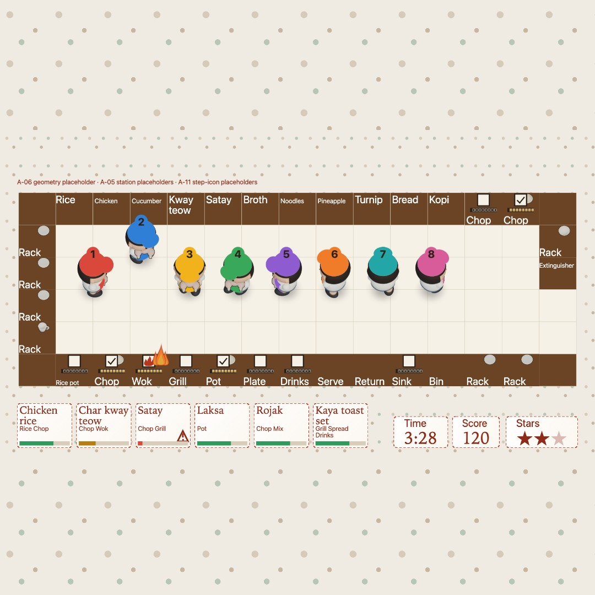 | | |

## Strips

| Screenshot | What it shows | Looked at by |
|---|---|---|
| 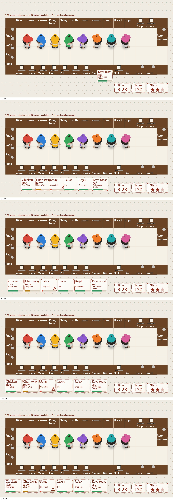 | | |
| 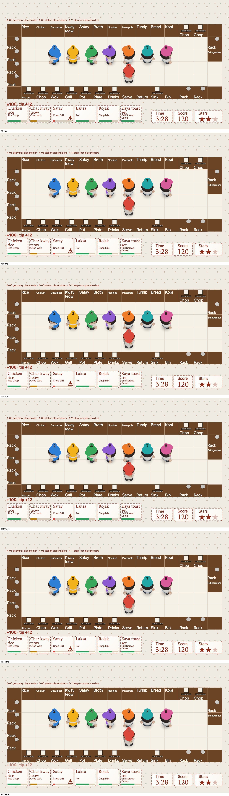 | | |
|  | | |
| 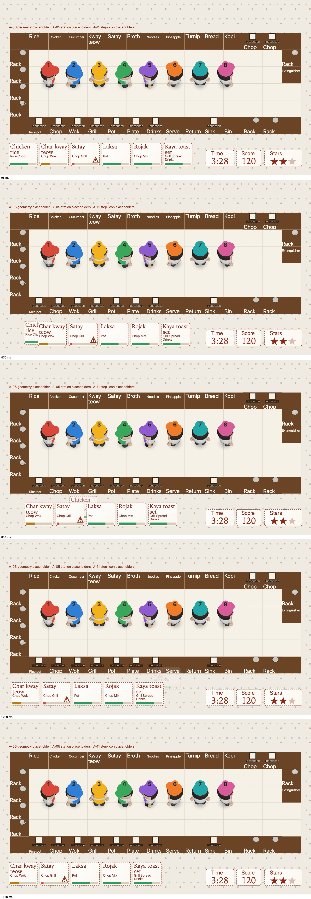 | | |
| 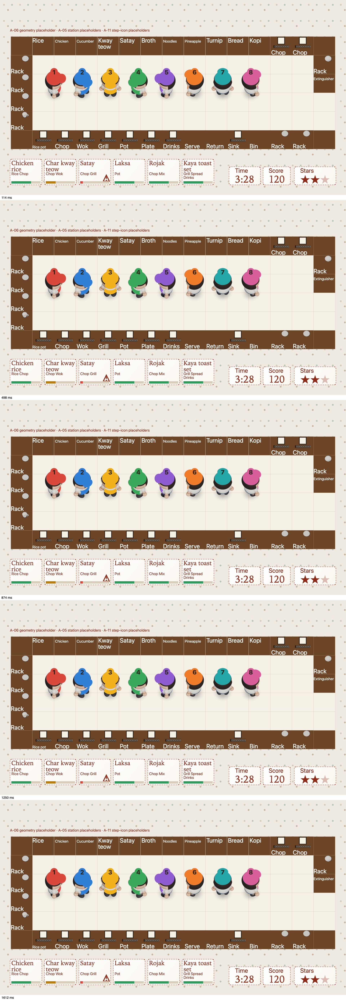 | | |
| 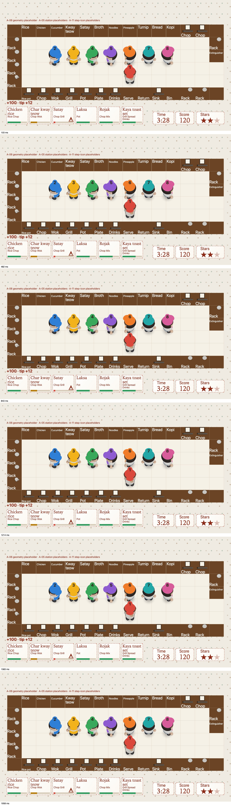 | | |
| 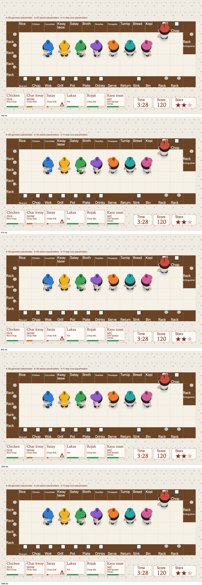 | | |
| 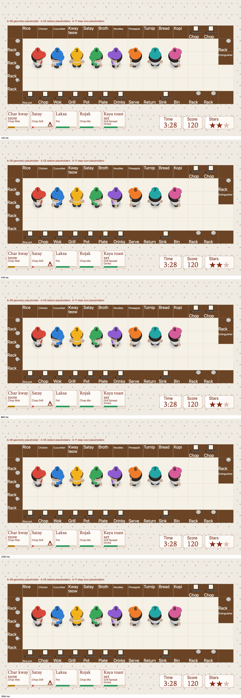 | | |
| 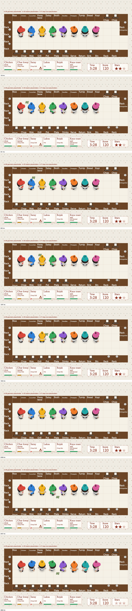 | | |
| 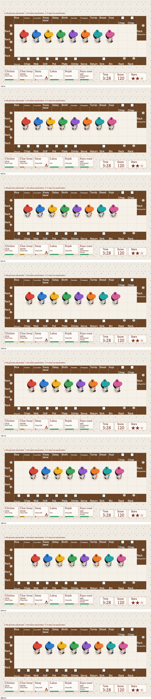 | | |

| Acceptance statement | Pass / fail | Evidence |
|---|---|---|
| | | |
