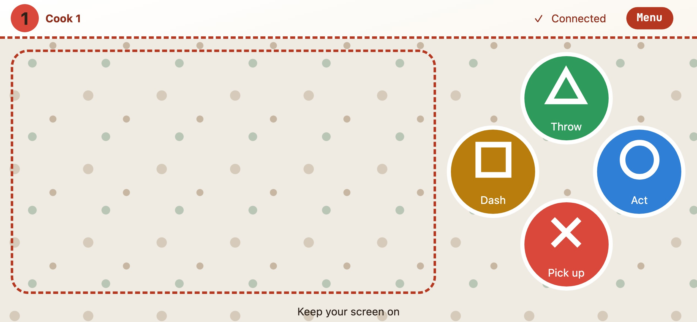
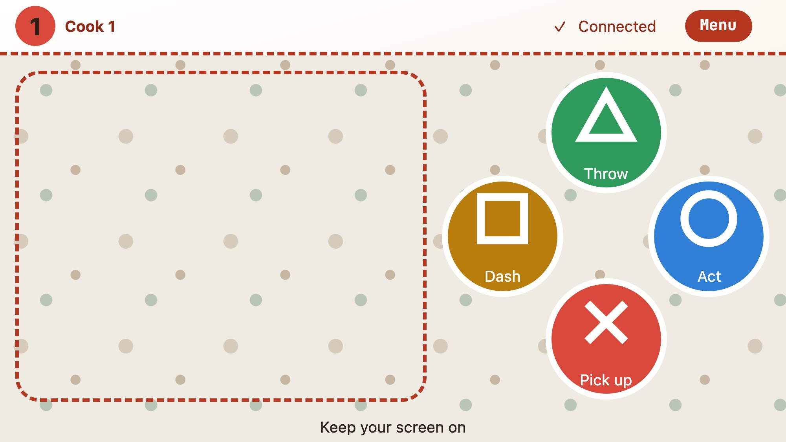
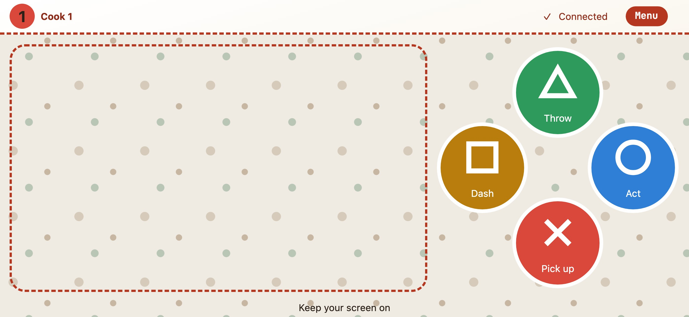
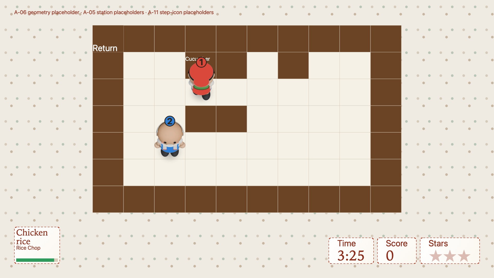
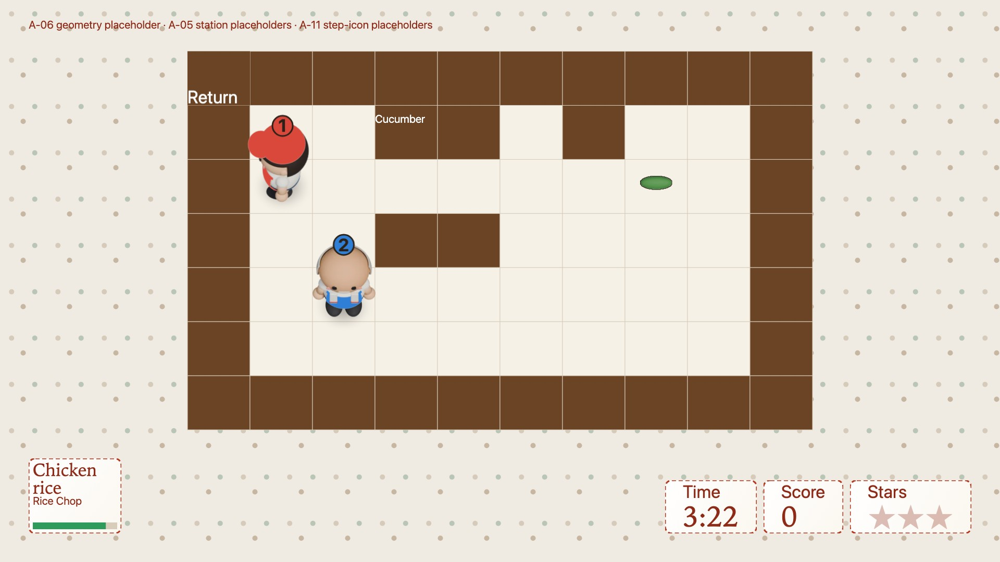
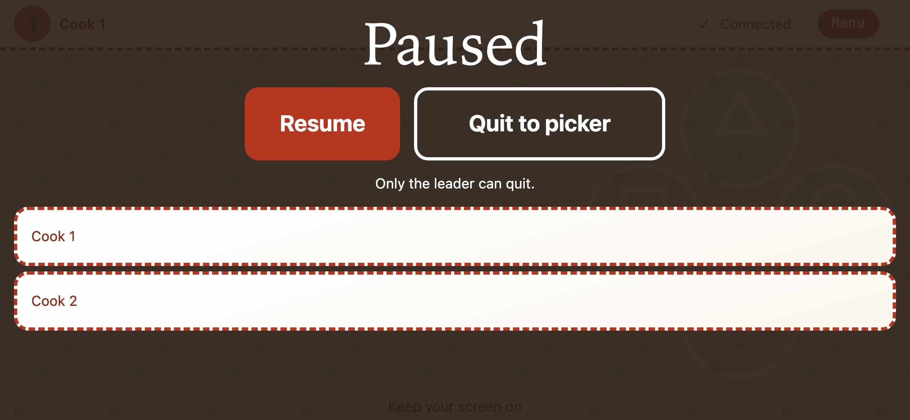
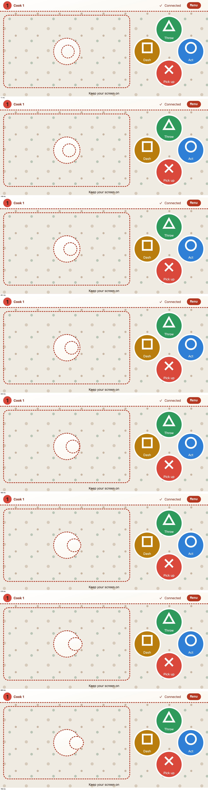

# T-08-controller UAT evidence

Host browser: chromium 156.0.8078.4
Phone browser: chromium (legacy iPhone emulation) 156.0.8078.4

Automated execution only. Visual review and acceptance decisions are pending.

Command: `node tools/uat/run.mjs -- T-08-controller --phones 2 --out round6`
Commit: `ab347813418df685def0d4898e18ba894e3112e3`
Viewports: 844×390, 667×375, 932×430, 1920×1080

| Timing | ms | Status |
|---|---:|---|
| Create room through host page | 1371.8 | completed |

Expected errors (count):
None

## Real server

| Screenshot | What it shows | Looked at by |
|---|---|---|
|  | | |
|  | | |
|  | | |
|  | | |
|  | | |
|  | | |
|  | | |
|  | | |
|  | | |

## Strips

| Screenshot | What it shows | Looked at by |
|---|---|---|
|  | | |

| Acceptance statement | Pass / fail | Evidence |
|---|---|---|
| | | |

## Visual review (2026-11-20)

| Screenshot | What it shows | Looked at by |
|
