# T-09-cook-picker UAT evidence

Host browser: chromium 156.0.8078.4
Phone browser: chromium (legacy iPhone emulation) 156.0.8078.4

Automated execution only. Visual review and acceptance decisions are pending.

Command: `node tools/uat/run.mjs -- T-09-cook-picker --phones 4 --out round11`
Commit: `cd6e13fb2134347fb77a1fa7854b975213959e28`
Viewports: 844×390, 667×375, 932×430, 1920×1080, 1280×720

| Timing | ms | Status |
|---|---:|---|
| Create room through host page | 1118.5 | completed |
| Create room through host page | 834.8 | completed |

Expected errors (count):
None

## Real server

| Screenshot | What it shows | Looked at by |
|---|---|---|
| 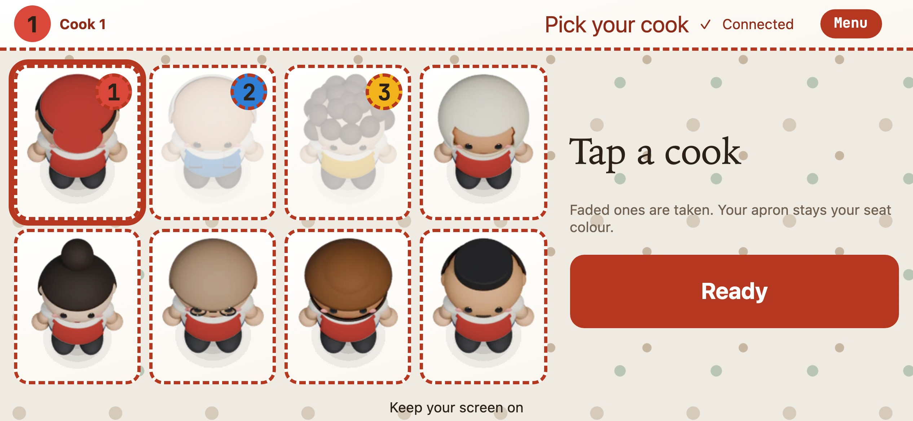 | | |
| 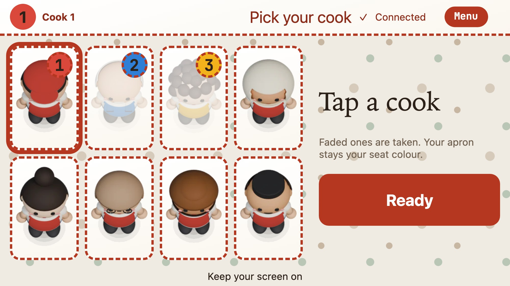 | | |
| 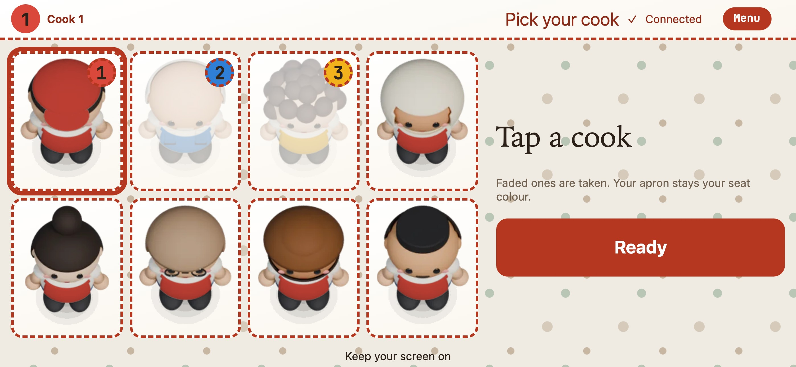 | | |
| 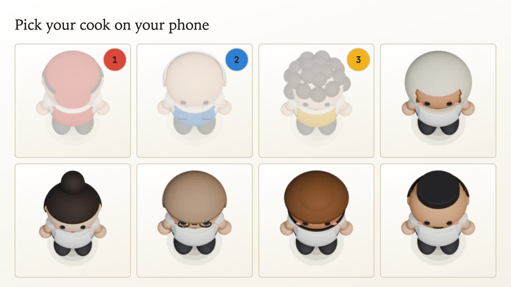 | | |
|  | | |
| 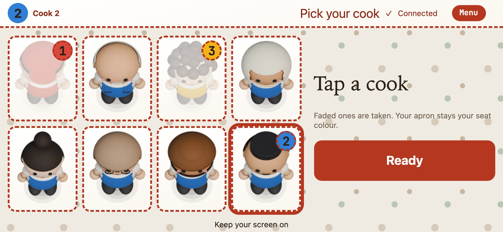 | | |
| 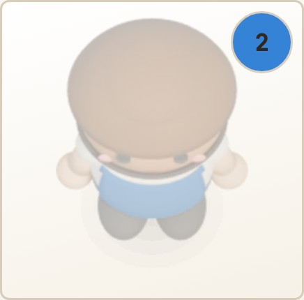 | | |
| 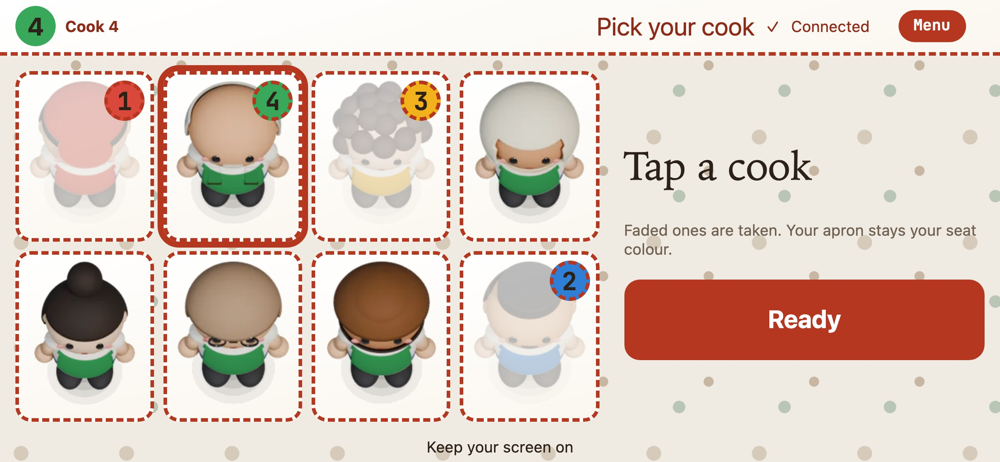 | | |
|  | | |
| 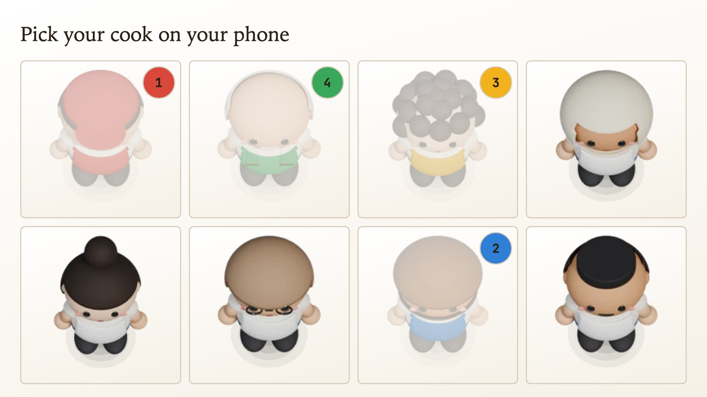 | | |
| 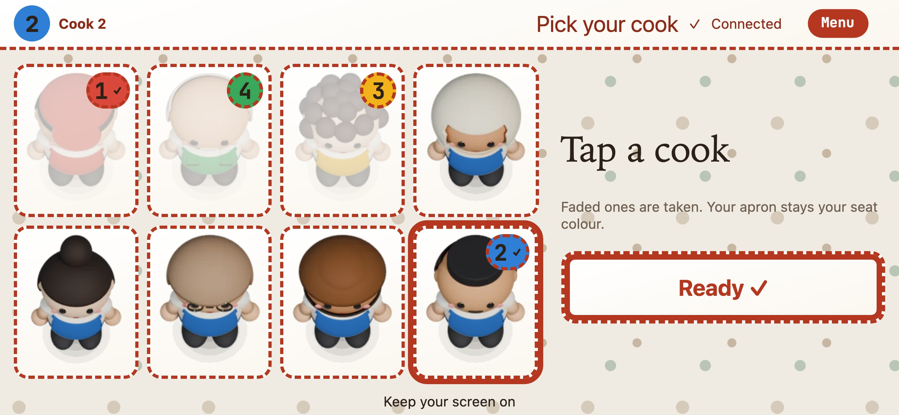 | | |
| 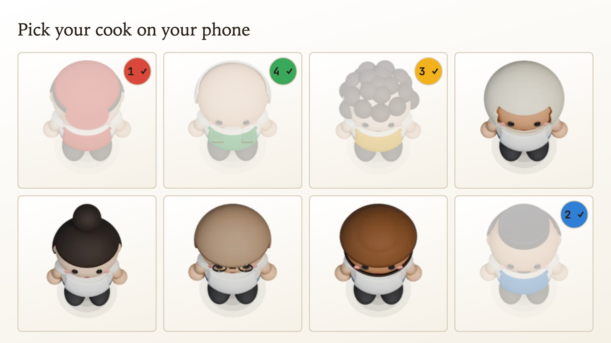 | | |
| 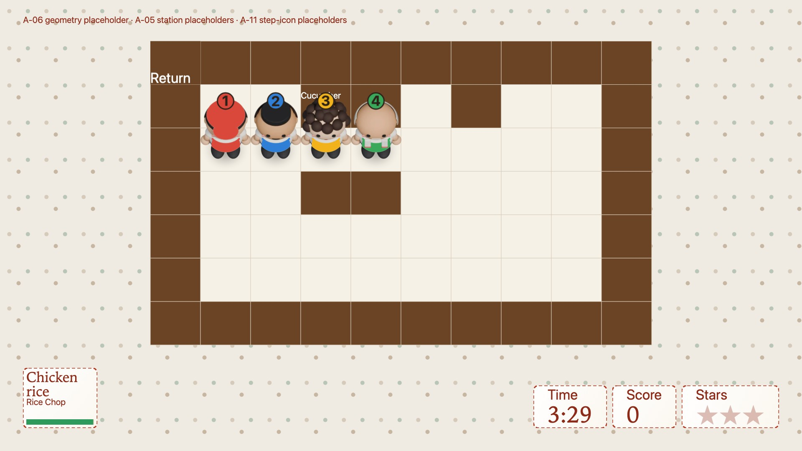 | | |
| 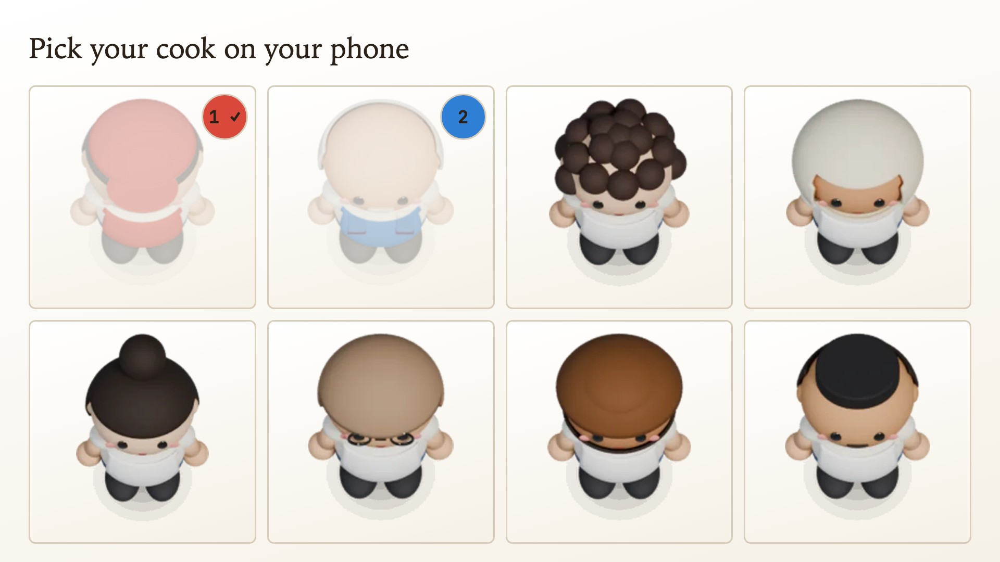 | | |
| 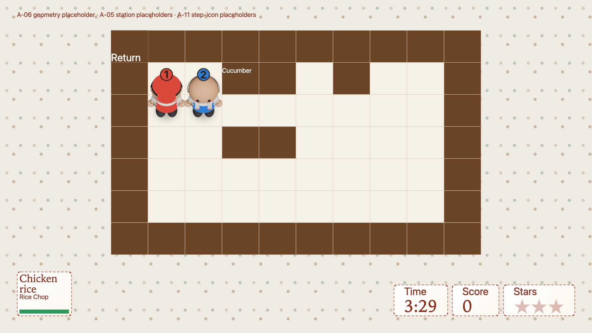 | | |

## Strips

| Screenshot | What it shows | Looked at by |
|---|---|---|
| 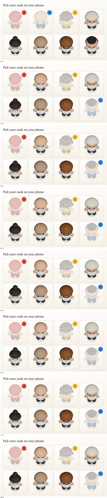 | | |
| 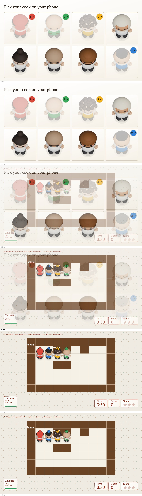 | | |

| Acceptance statement | Pass / fail | Evidence |
|---|---|---|
| | | |

## Visual review (merged tree cd6e13fb; also looked at by Claude, integrator)

| Screenshot | What it shows | Looked at by |
|---|---|---|
| 01-phone1-phone-default-844 | Phone 1 at 844: cap selected with a 5 px outline; seat badges 1–3 on cap, uncle and auntie; uncle and auntie faded; free cooks in red seat aprons, cap untinted; "Tap a cook", co-op note, Ready; "Pick your cook" beside "✓ Connected" in the header | Claude reviewer, 2026-11-19 |
| 02-phone1-phone-default-667 | Same at 667 × 375; the note wraps to two lines and nothing is clipped | Claude reviewer, 2026-11-19 |
| 03-phone1-phone-default-932 | Same at 932 × 430 | Claude reviewer, 2026-11-19 |
| 04-host-tv-picker-1920 | TV at 1920: "Pick your cook on your phone", 4 × 2 grid, badges 1–3 on faded cap, uncle and auntie, taken aprons tinted in seat colours | Claude reviewer, 2026-11-19 |
| 05-host-tv-picker-1280 | Same at 1280 × 720 | Claude reviewer, 2026-11-19 |
| 14-strip-tv-cook-selection | Re-pick on TV: at 28 ms badge 2 is on uncle; by 157 ms uncle is unfaded and badge 2 is on songkok; no intermediate frame was caught | Claude reviewer, 2026-11-19 |
| 15-phone2-phone-free-cook-selected | Phone 2 moved to songkok: outline and badge 2 on songkok, uncle freed, free cooks in blue aprons | Claude reviewer, 2026-11-19 |
| 16-host-badge-fade | Crop of the TV Turban cell, faded and taken, with badge 2. The script asserted mid-fade opacity, but the badge looks settled (pixel within a few levels of still 04), so the fade is not visible | Claude reviewer, 2026-11-19 (asserted, not visible: S-b) |
| 17-phone4-phone-join-lowest-free | The joiner (seat 4, green) takes uncle, the lowest free cook; badge 2 is back on songkok | Claude reviewer, 2026-11-19 |
| 18-host-tv-join-during-pick | TV shows badge 4 on uncle in a green apron, badge 2 on songkok | Claude reviewer, 2026-11-19 |
| 19-host-tv-picker-reduced-motion | Under reduced motion phone 2 re-picks the Turban: badge 2 on the Turban, songkok freed; the state change is shown | Claude reviewer, 2026-11-19 |
| 20-phone2-phone-after-ready | Phone 2 after Ready: "Ready ✓" outlined panel, songkok kept; "1 ✓" and "2 ✓" pills with numeral and tick side by side | Claude reviewer, 2026-11-19 |
| 21-host-tv-all-ready | TV: "1 ✓", "4 ✓", "3 ✓", "2 ✓", numeral and tick side by side | Claude reviewer, 2026-11-19 |
| 28-strip-tv-picker-exit | The picker crossfades to the kitchen (overlap frames at 230 and 362 ms), kitchen alone by 415 ms; no blank frame | Claude reviewer, 2026-11-19 |
| 29-host-tv-round-picked-heads | Kitchen (placeholder floor, T-17): cap/red 1, songkok/blue 2, auntie/yellow 3, uncle/green 4, seat markers above the heads | Claude reviewer, 2026-11-19 |
| 30-host-tv-seat-ready | Keyboard seat 1 readied by one instant Space press ("1 ✓"); phone seat 2 not ready | Claude reviewer, 2026-11-19 |
| 31-host-tv-seat-round | Round started with the TV seat (cap, red, 1) and the phone (uncle, blue, 2) | Claude reviewer, 2026-11-19 |

Acceptance rows for the same REPORT:
- Defaults, refusal and switching: pass (01, 15).
- Joiner takes the lowest free cook: pass (17, 18).
- Ready locks: pass (20, 21).
- Reduced motion keeps the state change: pass (19).
- Chosen heads in the kitchen: pass (29, 31).
- TV seat readies with one press: pass (30).
- Badge entrance visible in a still: not shown (16; covered by the motion DOM test).
