# T-10-tutorial UAT evidence

Host browser: chromium 156.0.8078.4
Phone browser: chromium (legacy iPhone emulation) 156.0.8078.4

Automated execution only. Visual review and acceptance decisions are pending.

Command: `node tools/uat/run.mjs -- T-10-tutorial --phones 3 --out round14`
Commit: `3f4d086d7e8ea4c2afd02689336dd83e0c4e6536`
Viewports: 1920×1080, 844×390, 1280×720

| Timing | ms | Status |
|---|---:|---|
| Create room through host page | 1231.7 | completed |
| Start and capture the first lesson | 10796.3 | completed |
| All three cooks move through real phone sticks | 12775.7 | completed |
| All three cooks pick up from the real crate | 12203.6 | completed |
| Every cook places and chops their ingredient with cross and held circle | 19521.0 | completed |
| Every cook places on Serve and the first real round starts | 9522.7 | completed |
| After a completed real round the same room has no tutorial | 221944.4 | completed |
| Create room through host page | 915.1 | completed |
| New room with reduced motion and leader skip at step two | 28151.7 | completed |

Expected errors (count):
None

## Real server

| Screenshot | What it shows | Looked at by |
|---|---|---|
| 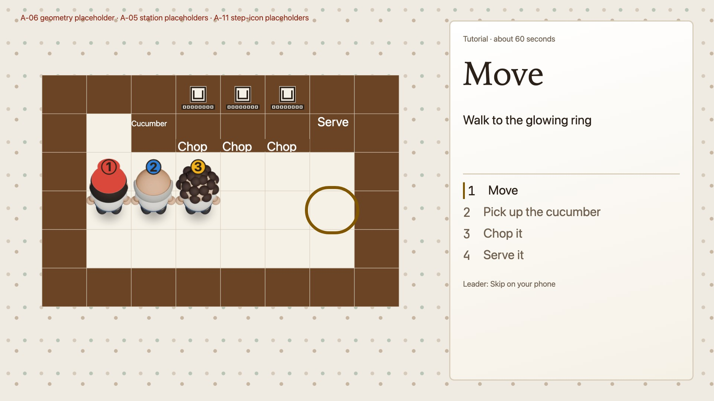 | | |
| 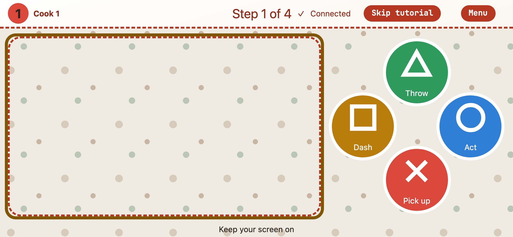 | | |
| 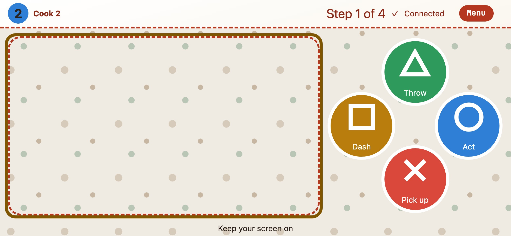 | | |
| 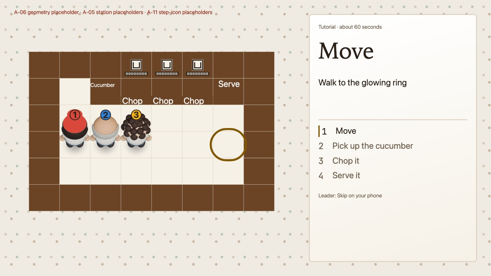 | | |
|  | | |
|  | | |
| 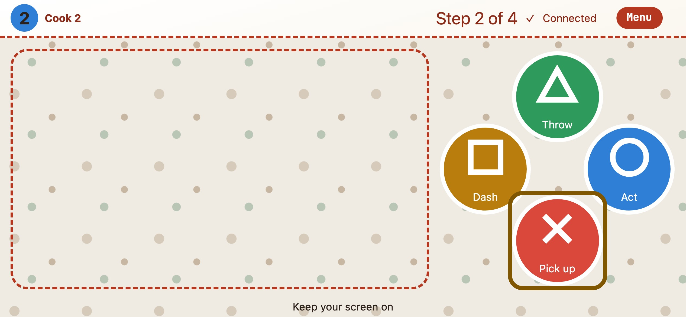 | | |
| 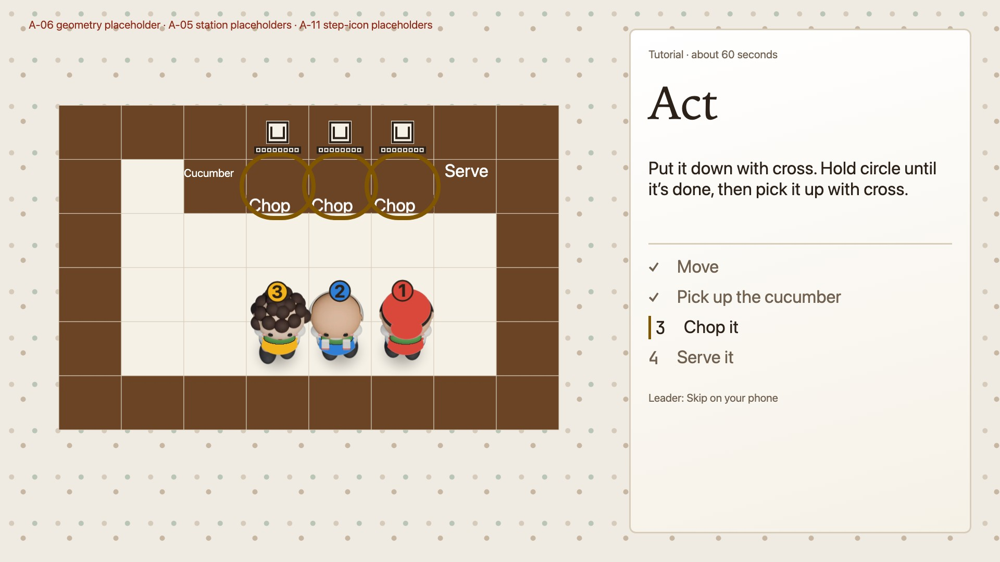 | | |
| 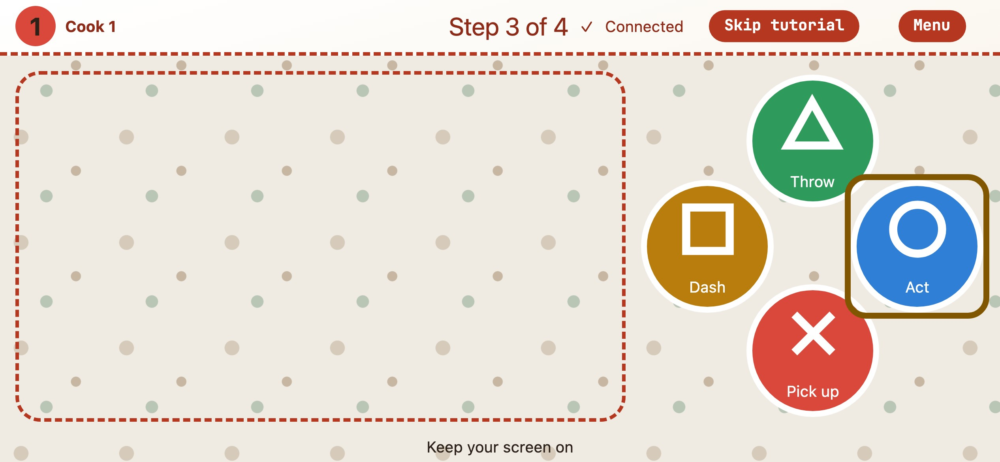 | | |
| 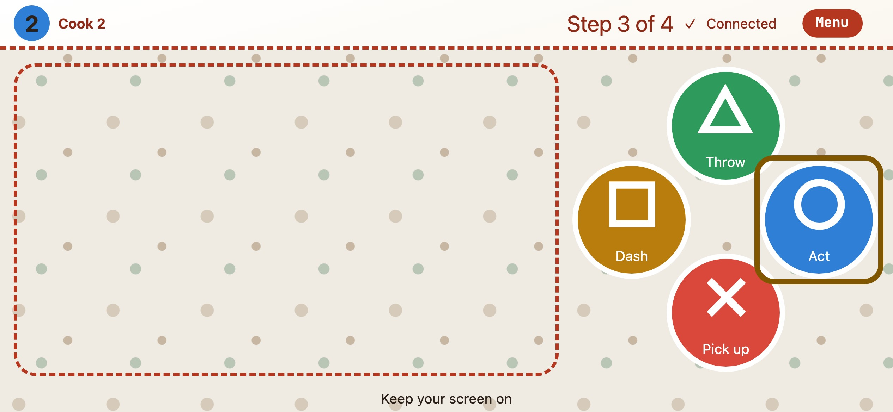 | | |
| 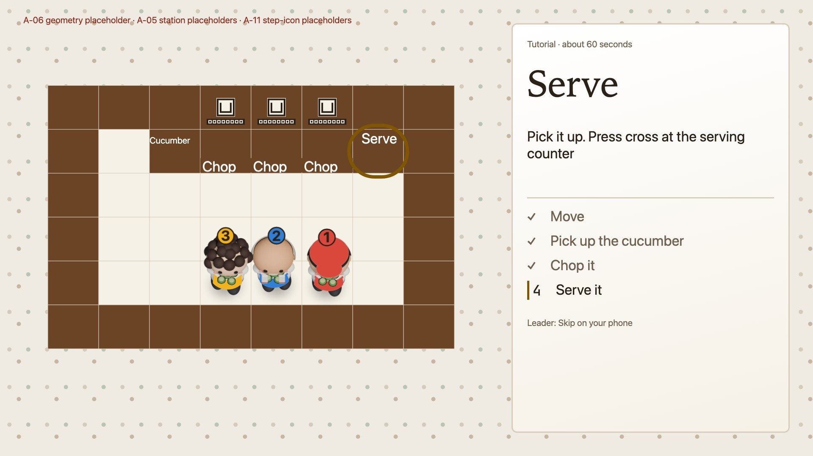 | | |
| 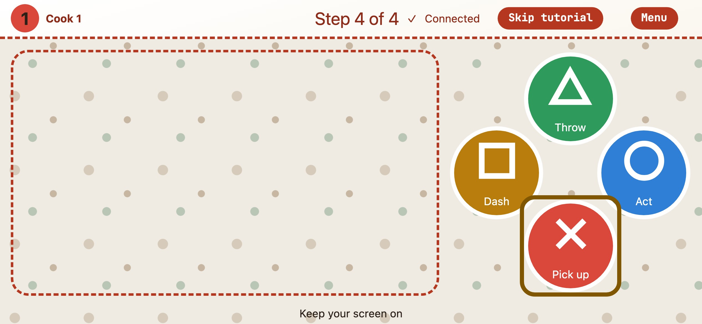 | | |
|  | | |
|  | | |
|  | | |
| 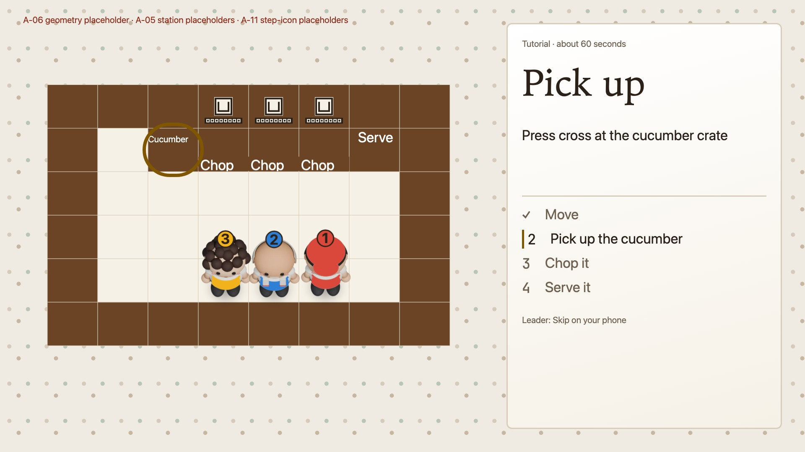 | | |
| 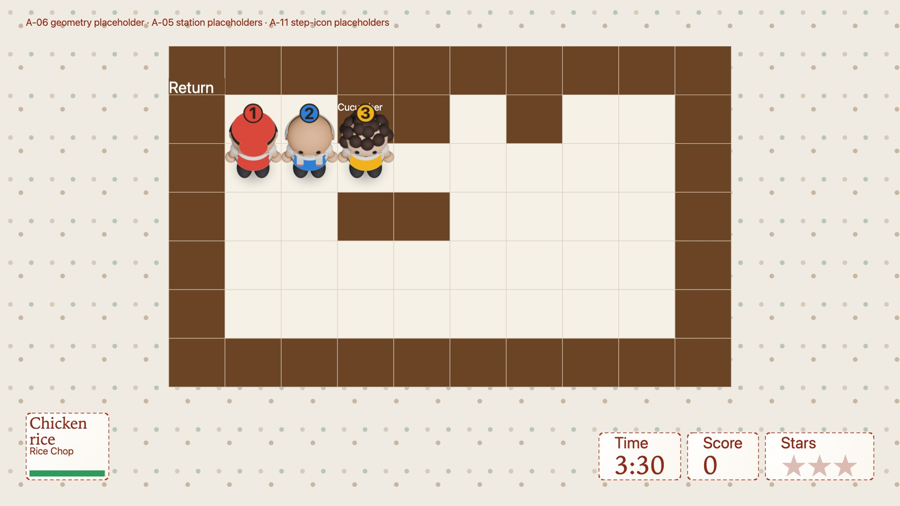 | | |

## Strips

| Screenshot | What it shows | Looked at by |
|---|---|---|
| 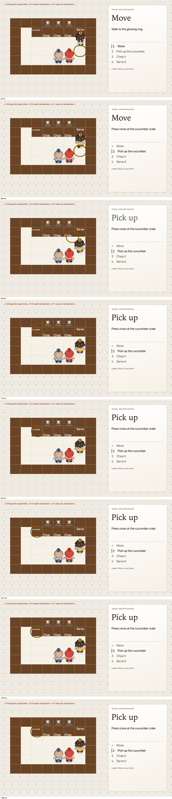 | | |
| 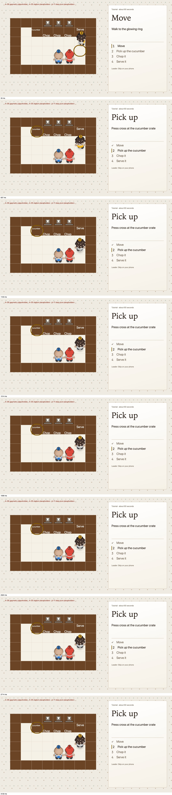 | | |

| Acceptance statement | Pass / fail | Evidence |
|---|---|---|
| | | |

## REPORT.md visual-review table (round14)
| Screenshot | What it shows | Looked at by |
|---|---|---|
| 01-host-tv-step-1.jpg | TV 1920: dotted backdrop to the right edge, caption complete from x≈55; kitchen centred at the left with one crate, three Chop boards and Serve; rail 55 px from the edge, step 1 current in dark ink with a highlight bar; dark ring on floor tile 30 | Claude (reviewer) |
| 02-phone1-phone-leader-step-1.jpg | Leader phone: "Step 1 of 4", Connected, Skip tutorial and Menu; stick area outlined in the highlight colour | Claude (reviewer) |
| 03-phone2-phone-cook-step-1.jpg | Non-leader: same, with no Skip; stick outlined | Claude (reviewer) |
| 04-host-tv-step-1-1280.jpg | TV 1280×720: same layout scaled, backdrop full width, caption complete | Claude (reviewer) |
| 13-strip-ring-move.jpg | Eight frames, 35–1186 ms: cook 3 reaches the ring, Move gets a tick, the ring arcs to the crate and pulses once; the title fades "Move" out under "Pick up" by about 700 ms; no black band | Claude (reviewer) |
| 14-host-tv-step-2.jpg | Pick up: Move ticked; outset ring around the crate, crossing the "C" of "Cucumber" | Claude (reviewer) |
| 15-phone1-phone-leader-step-2.jpg | Leader: Step 2 of 4; Pick up outlined, outline drawn over neighbouring buttons; Skip shown | Claude (reviewer) |
| 16-phone2-phone-cook-step-2.jpg | Non-leader: Step 2 of 4, Pick up outlined, no Skip | Claude (reviewer) |
| 17-host-tv-step-3.jpg | Act: copy ends "…then pick it up with cross."; three rings on three Chop boards, overlapping each other and the labels; cooks holding cucumbers | Claude (reviewer) |
| 18-phone1-phone-leader-step-3.jpg | Leader: Step 3 of 4, Act outlined, Skip shown | Claude (reviewer) |
| 19-phone2-phone-cook-step-3.jpg | Non-leader: Step 3 of 4, Act outlined | Claude (reviewer) |
| 20-host-tv-step-4.jpg | Serve: three ticks; ring around the Serve counter, label clear; cooks holding chopped cucumber | Claude (reviewer) |
| 21-phone1-phone-leader-step-4.jpg | Leader: Step 4 of 4, Pick up outlined, Skip shown | Claude (reviewer) |
| 22-phone2-phone-cook-step-4.jpg | Non-leader: Step 4 of 4, Pick up outlined, no Skip | Claude (reviewer) |
| 23-host-tv-first-real-round.jpg | Real round after lesson 4: full-width kitchen, Time 3:30, Score 0, empty stars, chosen heads, no rail | Claude (reviewer) |
| 24-host-tv-second-round-no-tutorial.jpg | Same room after Play again: no tutorial, round at 3:26 | Claude (reviewer) |
| 33-strip-ring-move-reduced.jpg | Reduced motion, eight frames, 55–3133 ms: ring and title change in one frame with no motion; state kept | Claude (reviewer) |
| 34-host-tv-skip-step-2.jpg | New room, reduced motion: step 2 just before the leader skips; backdrop complete | Claude (reviewer) |
| 35-host-tv-skipped-real-round.jpg | After Skip: real round at 3:30, full width, no rail | Claude (reviewer) |

| Acceptance statement | Pass / fail | Evidence |
|---|---|---|
| Move, pick up, act and serve lessons, each waiting for every cook | pass (Serve as recorded in D-311) | 01, 14, 17, 20, 23 |
| Only the leader can skip, from the phone | pass | 02/03, 34, 35 |
| A TV-seat leader can skip with K or Back, and Pick up never skips | pass (unit test) | `apps/web/src/local-player.test.ts` |
| No tutorial after a completed round | pass | 24 |
| Reduced motion keeps the state change | pass | 33 |
| TV backdrop fills the screen and the caption is complete | pass | 01, 04 + script pixel checks |
| No hitch at the tutorial-to-round hand-off | pass (slice gate; development build, Chromium) | `uat/evidence/T-10-tutorial/perf-tutorial/` |
