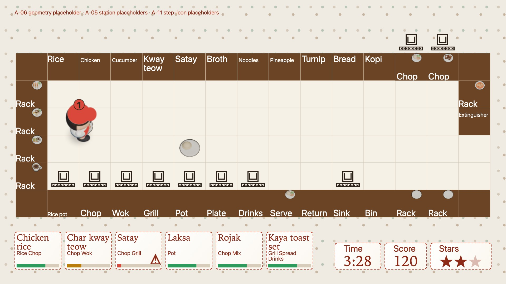

# T-18-served-dishes UAT evidence

Host browser: chromium 156.0.8078.4
Phone browser: chromium (legacy iPhone emulation) 156.0.8078.4

Automated execution only. Visual review and acceptance decisions are pending.

Command: `node tools/uat/run.mjs -- T-18-served-dishes --out round2-uat`
Commit: `a7b833c32263f55f4f411a5cdfd999781d007e3a`
Viewports: 1920×1080, 1280×720

| Timing | ms | Status |
|---|---:|---|
| full kopi servings at 1920 | 2343.5 | completed |
| full teh servings at 1920 | 1566.5 | completed |
| full kopi servings at 1280 | 1590.4 | completed |
| full teh servings at 1280 | 1519.0 | completed |
| half kopi servings at 1920 | 1461.6 | completed |
| half teh servings at 1920 | 1558.7 | completed |
| half kopi servings at 1280 | 1634.3 | completed |
| half teh servings at 1280 | 1651.8 | completed |

Expected errors (count):
None

## Real server

| Screenshot | What it shows | Looked at by |
|---|---|---|
|  | | |
|  | | |
|  | | |
|  | | |
|  | | |
|  | | |
|  | | |
|  | | |

| Acceptance statement | Pass / fail | Evidence |
|---|---|---|
| | | |
