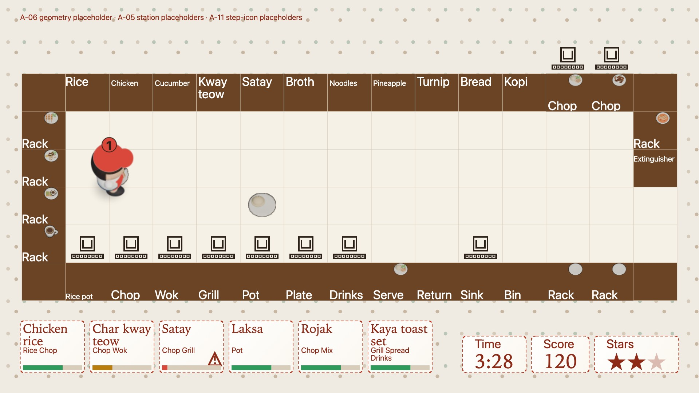

# T-18-served-dishes UAT evidence

Host browser: chromium 156.0.8078.4
Phone browser: chromium (legacy iPhone emulation) 156.0.8078.4

Looked at by Claude (integrator) and the T-18 reviewer, 2026-11-19. Full and half detail match pixel for pixel apart from resampling noise. Perf: `uat/evidence/T-18-served-dishes/perf-8b/` (quiet machine, median 16.7 ms, p99 17.6 ms, max 17.7 ms; PERF-001 itself is assessed in T-17).

Command: `node tools/uat/run.mjs -- T-18-served-dishes --phones 1 --out round3`
Commit: `e4d33dda4e366e95d6bc3df0233027a1328e728a`
Viewports: 1920×1080, 1280×720

| Timing | ms | Status |
|---|---:|---|
| full kopi servings at 1920 | 3236.2 | completed |
| full teh servings at 1920 | 1782.1 | completed |
| full kopi servings at 1280 | 2357.3 | completed |
| full teh servings at 1280 | 1724.2 | completed |
| half kopi servings at 1920 | 2216.5 | completed |
| half teh servings at 1920 | 1656.4 | completed |
| half kopi servings at 1280 | 2163.4 | completed |
| half teh servings at 1280 | 1527.4 | completed |

Expected errors (count):
None

## Real server

| Screenshot | What it shows | Looked at by |
|---|---|---|
|  | Seven dishes on racks and Chop counters built from container plus portion layers; a rice-only partial plate on the floor; chicken rice on Serve (kopi: dark drink) | Claude (integrator), 2026-11-19 |
|  | Cook 1 faces east holding a plated dish; only the plate rim shows past the cap and hand (held-dish legibility owed to T-17 and the 3 m TV check) | Claude (integrator), 2026-11-19 |
|  | Seven dishes on racks and Chop counters built from container plus portion layers; a rice-only partial plate on the floor; chicken rice on Serve (teh: light drink in cup and side cup) | Claude (integrator), 2026-11-19 |
|  | Seven dishes on racks and Chop counters built from container plus portion layers; a rice-only partial plate on the floor; chicken rice on Serve (kopi: dark drink) | Claude (integrator), 2026-11-19 |
|  | Cook 1 faces east holding a plated dish; only the plate rim shows past the cap and hand (held-dish legibility owed to T-17 and the 3 m TV check) | Claude (integrator), 2026-11-19 |
|  | Seven dishes on racks and Chop counters built from container plus portion layers; a rice-only partial plate on the floor; chicken rice on Serve (teh: light drink in cup and side cup) | Claude (integrator), 2026-11-19 |
|  | Seven dishes on racks and Chop counters built from container plus portion layers; a rice-only partial plate on the floor; chicken rice on Serve (kopi: dark drink) | Claude (integrator), 2026-11-19 |
|  | Cook 1 faces east holding a plated dish; only the plate rim shows past the cap and hand (held-dish legibility owed to T-17 and the 3 m TV check) | Claude (integrator), 2026-11-19 |
|  | Seven dishes on racks and Chop counters built from container plus portion layers; a rice-only partial plate on the floor; chicken rice on Serve (teh: light drink in cup and side cup) | Claude (integrator), 2026-11-19 |
|  | Seven dishes on racks and Chop counters built from container plus portion layers; a rice-only partial plate on the floor; chicken rice on Serve (kopi: dark drink) | Claude (integrator), 2026-11-19 |
|  | Cook 1 faces east holding a plated dish; only the plate rim shows past the cap and hand (held-dish legibility owed to T-17 and the 3 m TV check) | Claude (integrator), 2026-11-19 |
|  | Seven dishes on racks and Chop counters built from container plus portion layers; a rice-only partial plate on the floor; chicken rice on Serve (teh: light drink in cup and side cup) | Claude (integrator), 2026-11-19 |

| Acceptance statement | Pass / fail | Evidence |
|---|---|---|
| | | |
