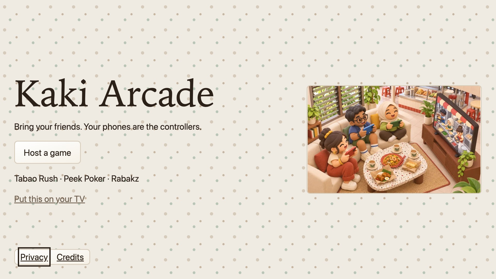
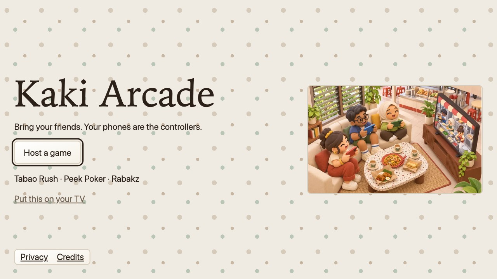
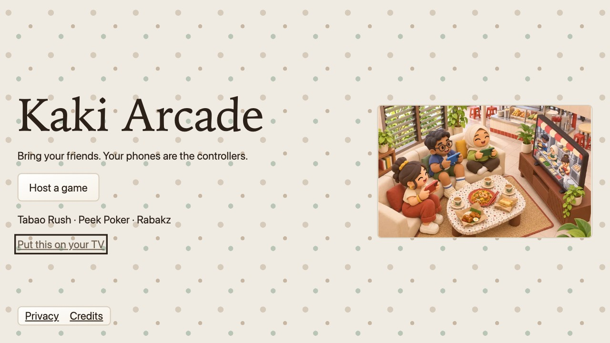
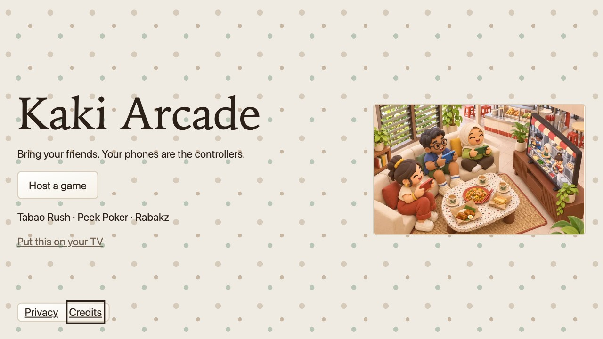
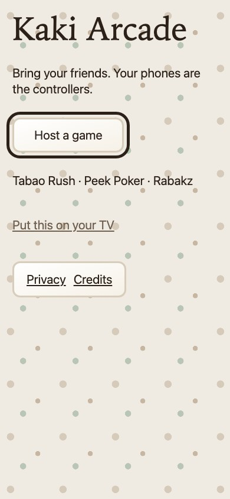
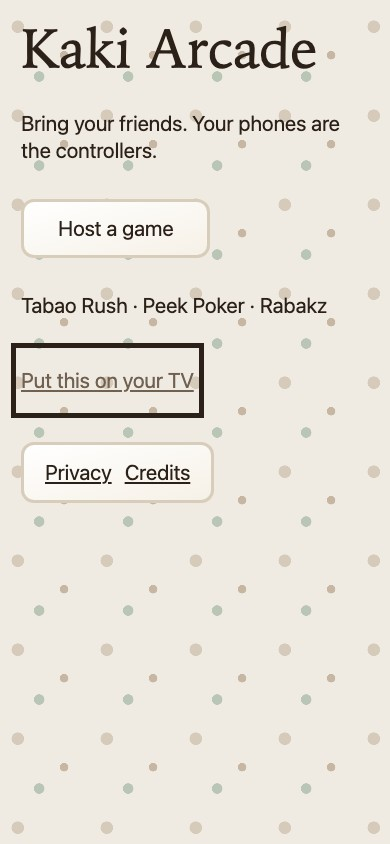
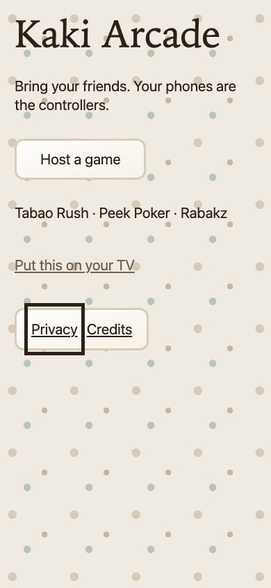
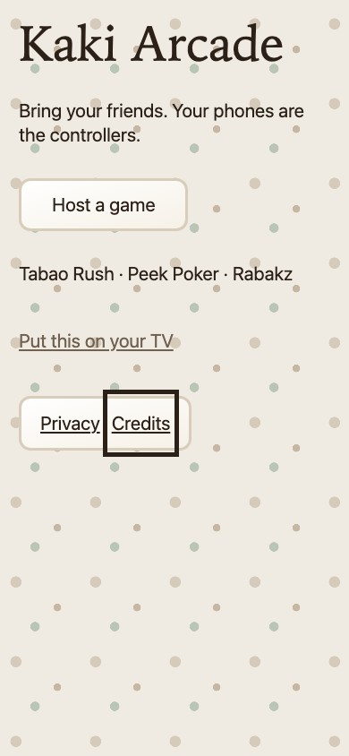
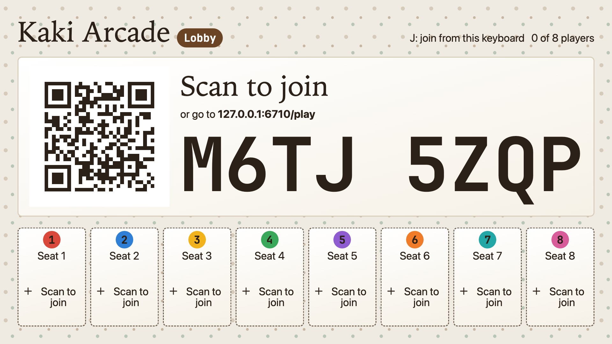

# X-01-landing UAT evidence

Round 1 automated execution passed. Visual review: Claude reviewer, 2026-11-18 (X-01 review 1). Superseded by round2/.

Command: `node tools/uat/run.mjs -- X-01-landing --out round1`
Commit: `9fd54a6260fa11d47cdfdc4ceeb5ec18422715a0`
Viewports: 1920×1080, 1280×720, 390×844

| Timing | ms | Status |
|---|---:|---|
| Landing and keyboard at 1920 × 1080 | 1177.6 | completed |
| Landing and keyboard at 1280 × 720 | 719.5 | completed |
| Landing and keyboard at 390 × 844 | 652.6 | completed |
| Enter on Host a game opens the room screen | 1291.9 | completed |

Expected errors (count):
None

## Real server

| Screenshot | What it shows | Looked at by |
|---|---|---|
|  | Landing on load. Ring on Host a game; one primary panel button; Put this on your TV is a secondary text link; no horizontal scroll. | Claude reviewer, 2026-11-18 |
|  | Ring on Put this on your TV after ArrowDown. Down and Right sets are identical. | Claude reviewer, 2026-11-18 |
|  | Ring on Privacy after ArrowDown. Down and Right sets are identical. | Claude reviewer, 2026-11-18 |
|  | Ring on Credits after ArrowDown. Down and Right sets are identical. | Claude reviewer, 2026-11-18 |
|  | Ring on Put this on your TV after ArrowRight. Down and Right sets are identical. | Claude reviewer, 2026-11-18 |
|  | Ring on Privacy after ArrowRight. Down and Right sets are identical. | Claude reviewer, 2026-11-18 |
|  | Ring on Credits after ArrowRight. Down and Right sets are identical. | Claude reviewer, 2026-11-18 |
|  | Landing on load. Ring on Host a game; one primary panel button; Put this on your TV is a secondary text link; no horizontal scroll. | Claude reviewer, 2026-11-18 |
|  | Ring on Put this on your TV after ArrowDown. Down and Right sets are identical. | Claude reviewer, 2026-11-18 |
|  | Ring on Privacy after ArrowDown. Down and Right sets are identical. | Claude reviewer, 2026-11-18 |
|  | Ring on Credits after ArrowDown. Down and Right sets are identical. | Claude reviewer, 2026-11-18 |
|  | Ring on Put this on your TV after ArrowRight. Down and Right sets are identical. | Claude reviewer, 2026-11-18 |
|  | Ring on Privacy after ArrowRight. Down and Right sets are identical. | Claude reviewer, 2026-11-18 |
|  | Ring on Credits after ArrowRight. Down and Right sets are identical. | Claude reviewer, 2026-11-18 |
|  | Landing on load. Ring on Host a game; one primary panel button; Put this on your TV is a secondary text link; no horizontal scroll. | Claude reviewer, 2026-11-18 |
|  | Ring on Put this on your TV after ArrowDown. Down and Right sets are identical. | Claude reviewer, 2026-11-18 |
|  | Ring on Privacy after ArrowDown. Down and Right sets are identical. | Claude reviewer, 2026-11-18 |
|  | Ring on Credits after ArrowDown. Down and Right sets are identical. | Claude reviewer, 2026-11-18 |
|  | Ring on Put this on your TV after ArrowRight. Down and Right sets are identical. | Claude reviewer, 2026-11-18 |
|  | Ring on Privacy after ArrowRight. Down and Right sets are identical. | Claude reviewer, 2026-11-18 |
|  | Ring on Credits after ArrowRight. Down and Right sets are identical. | Claude reviewer, 2026-11-18 |
|  | Lobby (room code M6TJ 5ZQP) after Enter on the focused Host a game. | Claude reviewer, 2026-11-18 |

| Acceptance statement | Pass / fail | Evidence |
|---|---|---|
| Landing has one primary action, secondary TV link and no horizontal scroll at all three widths | Pass | 01, 08, 15 |
| Down and Right reach the links in reading order with visible focus | Pass | 02–07, 09–14, 16–21 |
| Enter on Host a game opens the lobby | Pass | 22 |
