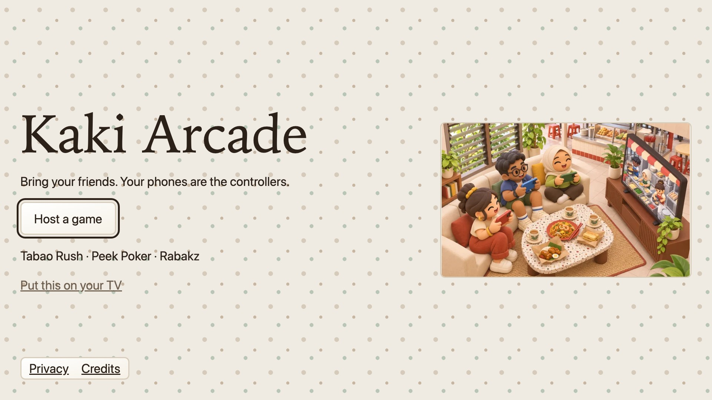
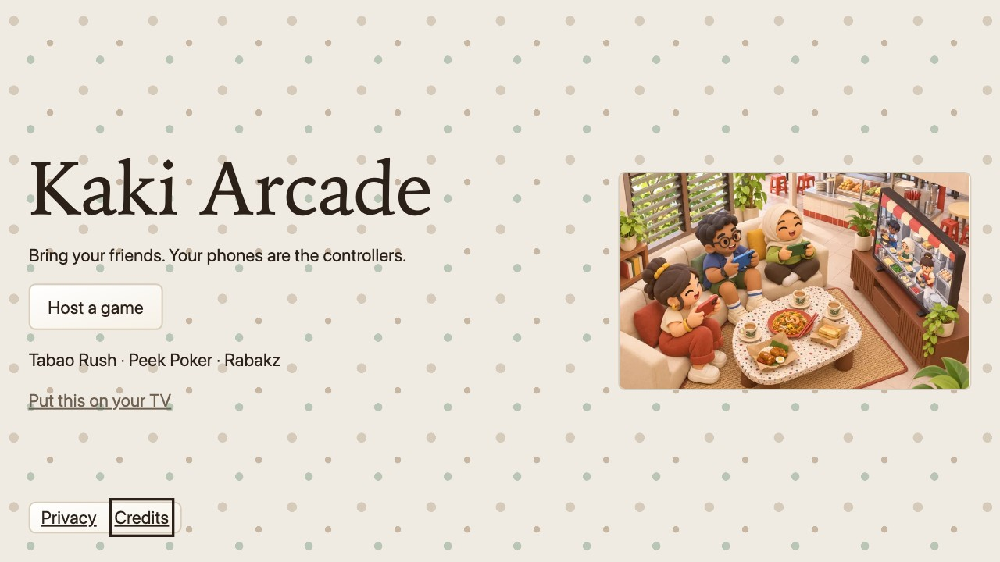
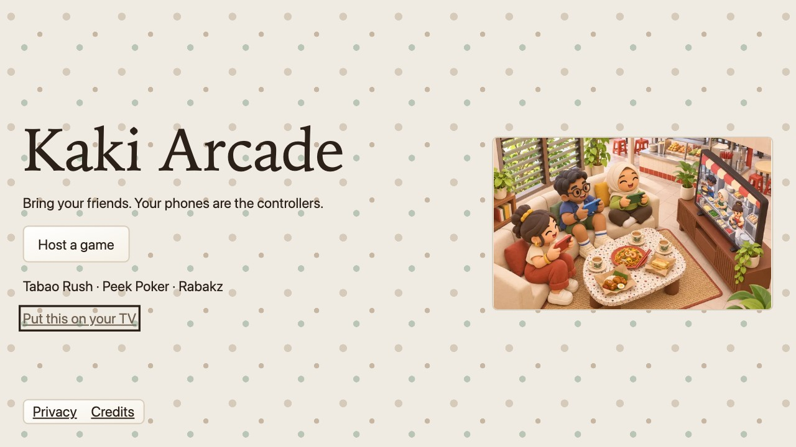
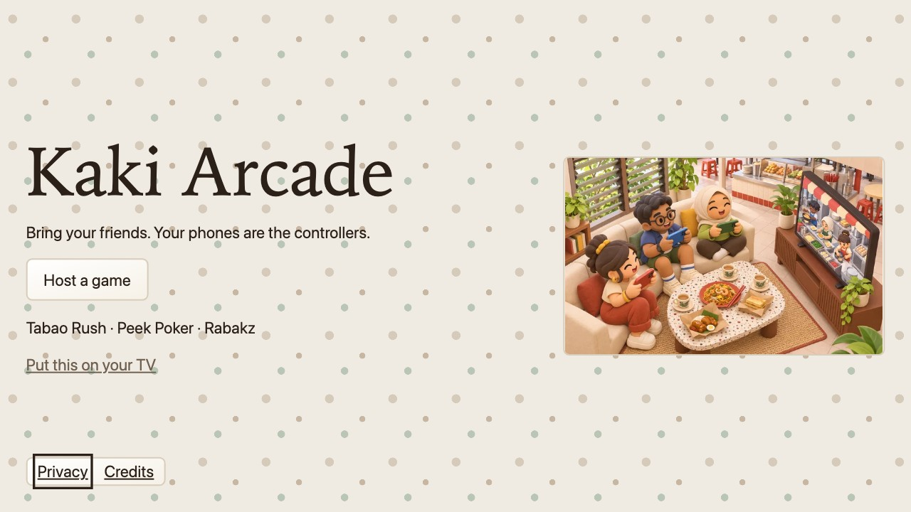
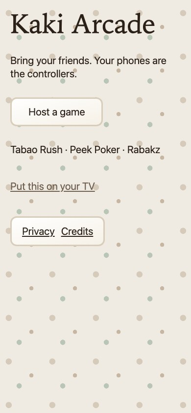
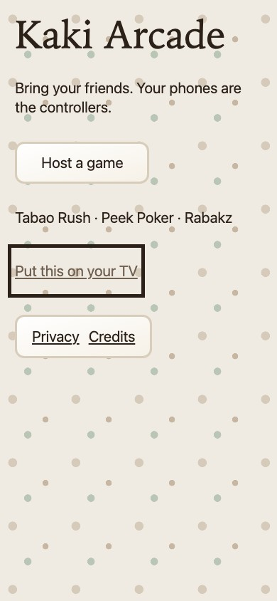
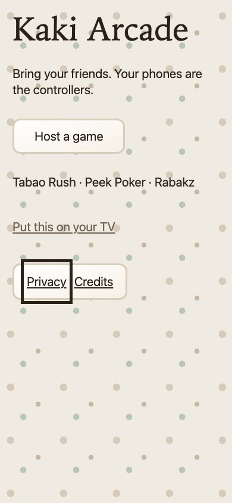
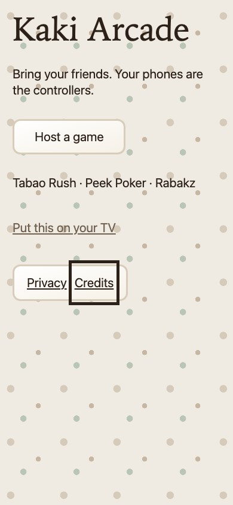
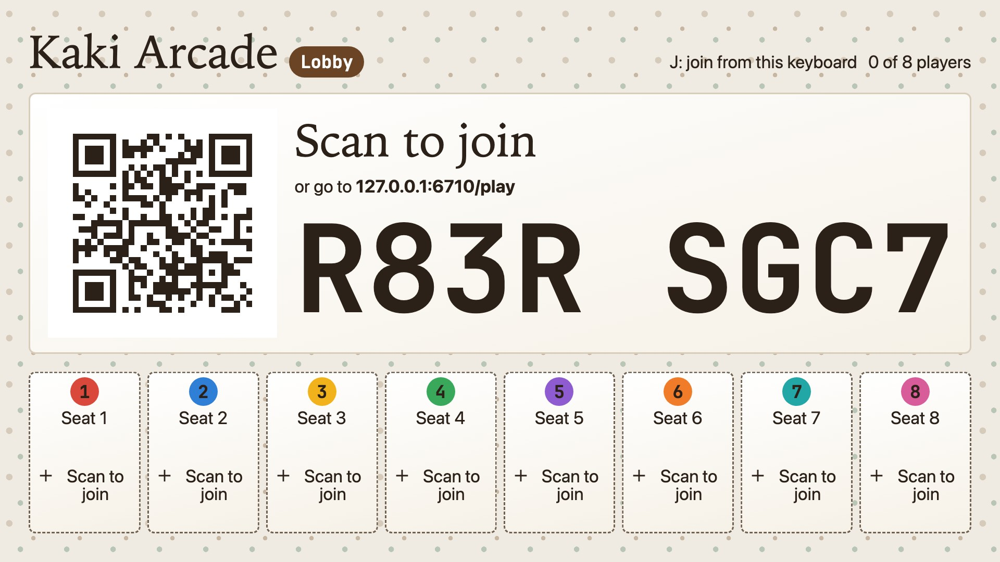

# X-01-landing UAT evidence

Automated execution passed. Visual review: Claude reviewer, 2026-11-18 (X-01 review 2).

Command: `node tools/uat/run.mjs -- X-01-landing --out round2`
Commit: `a6252d0230a52f0d364073375d8464b9b0018fd5`
Viewports: 1920×1080, 1280×720, 390×844

| Timing | ms | Status |
|---|---:|---|
| Landing and keyboard at 1920 × 1080 | 1504.6 | completed |
| Landing and keyboard at 1280 × 720 | 670.5 | completed |
| Landing and keyboard at 390 × 844 | 667.4 | completed |
| Enter on Host a game opens the room screen | 1286.7 | completed |

Expected errors (count):
None

## Real server

| Screenshot | What it shows | Looked at by |
|---|---|---|
|  | The landing on load at 1920. The ring is on Host a game; one primary panel button; Put this on your TV is a secondary text link; no horizontal scroll. | Claude reviewer, 2026-11-18 |
|  | At 1920, after a click on the picture left the page body focused, ArrowDown brought the ring back to Host a game. | Claude reviewer, 2026-11-18 |
|  | At 1920, after ArrowDown 1: the ring is on Put this on your TV. | Claude reviewer, 2026-11-18 |
|  | At 1920, after ArrowDown 2: the ring is on Privacy. | Claude reviewer, 2026-11-18 |
|  | At 1920, after ArrowDown 3: the ring is on Credits. | Claude reviewer, 2026-11-18 |
|  | At 1920, after ArrowRight 1: the ring is on Put this on your TV. | Claude reviewer, 2026-11-18 |
|  | At 1920, after ArrowRight 2: the ring is on Privacy. | Claude reviewer, 2026-11-18 |
|  | At 1920, after ArrowRight 3: the ring is on Credits. | Claude reviewer, 2026-11-18 |
|  | The landing on load at 1280. The ring is on Host a game; one primary panel button; Put this on your TV is a secondary text link; no horizontal scroll. | Claude reviewer, 2026-11-18 |
|  | At 1280, after ArrowDown 1: the ring is on Put this on your TV. | Claude reviewer, 2026-11-18 |
|  | At 1280, after ArrowDown 2: the ring is on Privacy. | Claude reviewer, 2026-11-18 |
|  | At 1280, after ArrowDown 3: the ring is on Credits. | Claude reviewer, 2026-11-18 |
|  | At 1280, after ArrowRight 1: the ring is on Put this on your TV. | Claude reviewer, 2026-11-18 |
|  | At 1280, after ArrowRight 2: the ring is on Privacy. | Claude reviewer, 2026-11-18 |
|  | At 1280, after ArrowRight 3: the ring is on Credits. | Claude reviewer, 2026-11-18 |
|  | The landing on load at 390. No ring (no mount focus on the phone layout); ArrowDown then focuses Host a game. | Claude reviewer, 2026-11-18 |
|  | At 390, after ArrowDown 1: the ring is on Put this on your TV. | Claude reviewer, 2026-11-18 |
|  | At 390, after ArrowDown 2: the ring is on Privacy. | Claude reviewer, 2026-11-18 |
|  | At 390, after ArrowDown 3: the ring is on Credits. | Claude reviewer, 2026-11-18 |
|  | At 390, after ArrowRight 1: the ring is on Put this on your TV. | Claude reviewer, 2026-11-18 |
|  | At 390, after ArrowRight 2: the ring is on Privacy. | Claude reviewer, 2026-11-18 |
|  | At 390, after ArrowRight 3: the ring is on Credits. | Claude reviewer, 2026-11-18 |
|  | The lobby (room code R83R SGC7) after Enter on the focused Host a game. | Claude reviewer, 2026-11-18 |

| Acceptance statement | Pass / fail | Evidence |
|---|---|---|
| One primary action, a secondary TV link, no horizontal scroll at all three widths | Pass | 01, 09, 16 |
| Focus lost at 1920: an arrow returns it to Host a game | Pass | 02 |
| Down and Right reach the links in reading order with visible focus | Pass | 03–08, 10–15, 17–22 |
| No focus on load at phone width | Pass | 16 |
| Enter on Host a game opens the lobby | Pass | 23 |
